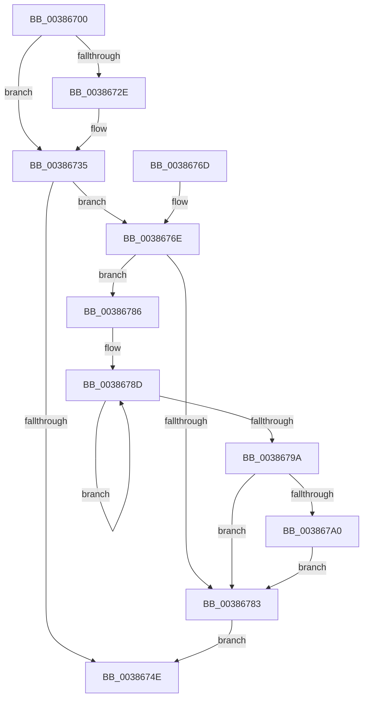

# ExInterlockedInsertTailList

- RVA: `0x00386700`–`0x003867A7` (길이 `167` bytes)
- VA: `0x0000000140386700`
- 실행 섹션: `.text`
- PDB 이름 있음: `예`; PDB Function 태그: `아니요`
- unwind 정보 RVA: `0x0005CBA8`
- 디코드: `49`개 명령, `167/167` bytes 표시
- 미해석 바이트: `0` (있으면 어셈블리에 `.byte`로 보존)

> 이 문서는 커널 이미지의 기계어와 PDB 기호를 분석해 생성했습니다. 4번과 5번은 함수 원형과 자료형을 바이너리 사용 방식에서 추정한 C 해석이며 원본 소스 복구 결과는 아닙니다.

## 1. Dependencies

- 직접 호출 지점: **2**; 고유 호출 대상: **2**
- 직접 호출자로 확인된 함수: **11**
- RIP 상대 이미지 참조: **0**

### Outgoing calls
- `0x00386720` → [ExpAcquireSpinLockDisabled](ExpAcquireSpinLockDisabled_function_00386858.md) (function, `0x00386858`)
- `0x003867A0` → [KiRemoveSystemWorkPriorityKick](../26/KiRemoveSystemWorkPriorityKick_function_002631D0.md) (function, `0x002631D0`)

### Direct callers
- [PopFxHandleReportDevicePoweredOn](../26/PopFxHandleReportDevicePoweredOn_function_0026D980.md) at `0x0026D9EE`
- [PopHandleDevicePowerIrpCompletion](../26/PopHandleDevicePowerIrpCompletion_function_0026F030.md) at `0x0026F100`
- [PopFxQueueWorkItem](../2B/PopFxQueueWorkItem_function_002BFE08.md) at `0x002BFE4F`
- [IoWMIWriteEvent](IoWMIWriteEvent_function_00386480.md) at `0x00386575`
- [WheapWorkQueueAddItem](WheapWorkQueueAddItem_function_0038662C.md) at `0x00386639`
- [CcCanIWrite](CcCanIWrite_function_00388250.md) at `0x00388681`
- [CcDeferWrite](../57/CcDeferWrite_function_0057C860.md) at `0x0057C963`
- [KiAltContextWorkQueueAddItem](../5C/KiAltContextWorkQueueAddItem_function_005CB028.md) at `0x005CB050`
- [IoInitializeTimer](../../page/71/IoInitializeTimer_function_0071D5B0.md) at `0x0071D615`
- [VfAllocateAdapterChannel](../../pagevrfy/B9/VfAllocateAdapterChannel_function_00B95180.md) at `0x00B9526D`
- [VfAllocateAdapterChannelEx](../../pagevrfy/B9/VfAllocateAdapterChannelEx_function_00B95360.md) at `0x00B95446`

### Static image references
- 디코드된 RIP-relative 메모리 참조가 없습니다.

## 2. Other-region calls and transfers

- 다른 실행 섹션으로 향하는 call: **0**
- 별도 외부 분기/꼬리 이동을 확인하지 못했습니다.

## 3. Assembly (complete function range)

```asm
00386700  48 89 5C 24 08                  mov qword ptr [rsp + 8], rbx
00386705  48 89 6C 24 10                  mov qword ptr [rsp + 0x10], rbp
0038670A  48 89 74 24 18                  mov qword ptr [rsp + 0x18], rsi
0038670F  57                              push rdi
00386710  48 83 EC 20                     sub rsp, 0x20
00386714  48 8B F1                        mov rsi, rcx
00386717  49 8B E8                        mov rbp, r8
0038671A  49 8B C8                        mov rcx, r8
0038671D  48 8B FA                        mov rdi, rdx
00386720  E8 33 01 00 00                  call 0x140386858
00386725  48 8B 5E 08                     mov rbx, qword ptr [rsi + 8]
00386729  48 39 33                        cmp qword ptr [rbx], rsi
0038672C  74 07                           je 0x140386735
0038672E  B9 03 00 00 00                  mov ecx, 3
00386733  CD 29                           int 0x29
00386735  48 89 37                        mov qword ptr [rdi], rsi
00386738  48 89 5F 08                     mov qword ptr [rdi + 8], rbx
0038673C  48 89 3B                        mov qword ptr [rbx], rdi
0038673F  48 89 7E 08                     mov qword ptr [rsi + 8], rdi
00386743  33 FF                           xor edi, edi
00386745  F0 48 21 7D 00                  lock and qword ptr [rbp], rdi
0038674A  84 C0                           test al, al
0038674C  75 20                           jne 0x14038676e
0038674E  48 8B 6C 24 38                  mov rbp, qword ptr [rsp + 0x38]
00386753  48 3B DE                        cmp rbx, rsi
00386756  48 8B 74 24 40                  mov rsi, qword ptr [rsp + 0x40]
0038675B  48 0F 44 DF                     cmove rbx, rdi
0038675F  48 8B C3                        mov rax, rbx
00386762  48 8B 5C 24 30                  mov rbx, qword ptr [rsp + 0x30]
00386767  48 83 C4 20                     add rsp, 0x20
0038676B  5F                              pop rdi
0038676C  C3                              ret
0038676D  CC                              int3
0038676E  65 48 8B 0C 25 20 00 00 00      mov rcx, qword ptr gs:[0x20]
00386777  4C 8B 81 B8 8E 00 00            mov r8, qword ptr [rcx + 0x8eb8]
0038677E  4D 85 C0                        test r8, r8
00386781  75 03                           jne 0x140386786
00386783  FB                              sti
00386784  EB C8                           jmp 0x14038674e
00386786  41 0F 0D 08                     prefetchw byte ptr [r8]
0038678A  41 8B 00                        mov eax, dword ptr [r8]
0038678D  8B D0                           mov edx, eax
0038678F  0F BA F2 15                     btr edx, 0x15
00386793  F0 41 0F B1 10                  lock cmpxchg dword ptr [r8], edx
00386798  75 F3                           jne 0x14038678d
0038679A  0F BA E0 15                     bt eax, 0x15
0038679E  73 E3                           jae 0x140386783
003867A0  E8 2B CA ED FF                  call 0x1402631d0
003867A5  EB DC                           jmp 0x140386783
```

## 4. C-style interpretation (structured pseudocode)

```c
__int64 __fastcall ExInterlockedInsertTailList(__int64 a1, __int64 a2, __int64 a3)
{
    __int64 result;
    __int64 v_rbx;
    __int64 v_rdi;
    __int64 v_rsp;
    unsigned __int64 v_stack_p10;
    unsigned __int64 v_stack_p18;
    unsigned __int64 v_stack_p8;

    v_stack_p8 = v_rbx;
    v_stack_p10 = v_rbp;
    v_stack_p18 = v_rsi;
    v_rsp = (v_rsp) - (32);
    result = ExpAcquireSpinLockDisabled(a3, a2, a3, a4);
    if ((*(unsigned __int64 *)(*(unsigned __int64 *)(a1 + 8))) != a1) {
        a1 = 3;
    }
    *(unsigned __int64 *)(a2) = a1;
    *(unsigned __int64 *)(a2 + 8) = *(unsigned __int64 *)(a1 + 8);
    *(unsigned __int64 *)(*(unsigned __int64 *)(a1 + 8)) = a2;
    *(unsigned __int64 *)(a1 + 8) = a2;
    v_rdi = 0;
    if ((unsigned __int8)(result) != 0) goto loc_0038676E;
loc_0038674E:
    v_rbx = *(unsigned __int64 *)(a1 + 8);
    if ((*(unsigned __int64 *)(a1 + 8)) == a1) { v_rbx = 0; }
    v_rsp = (v_rsp) + (32);
    return v_rbx;
loc_0038676E:
    if (*(unsigned __int64 *)(*(unsigned __int64 *)(gs_base + (0 + 32)) + 36536) != 0) goto loc_00386786;
loc_00386783:
    goto loc_0038674E;
loc_00386786:
loc_0038678D:
    if (*(unsigned __int64 *)(*(unsigned __int64 *)(gs_base + (0 + 32)) + 36536) != 0) goto loc_0038678D;
    if (condition_is_above_or_equal) goto loc_00386783;
    result = KiRemoveSystemWorkPriorityKick(*(unsigned __int64 *)(gs_base + (0 + 32)), (unsigned int)((unsigned int)((unsigned int)(*(unsigned int *)(*(unsigned __int64 *)(*(unsigned __int64 *)(gs_base + (0 + 32)) + 36536))))), *(unsigned __int64 *)(*(unsigned __int64 *)(gs_base + (0 + 32)) + 36536), a4);
    goto loc_00386783;
}
```

## 5. (Beta) C Style

```c
int64_t ExInterlockedInsertTailList(void *Arg1, void *Arg2, void *Arg3)
{
    uint8_t *arg1 = (uint8_t *)Arg1;
    uint8_t *arg2 = (uint8_t *)Arg2;
    uint8_t *arg3 = (uint8_t *)Arg3;

    int64_t result;
    int64_t local_rbx;
    int64_t local_rdi;
    int64_t local_rsp;
    uint64_t v_stack_p10;
    uint64_t v_stack_p18;
    uint64_t v_stack_p8;

    v_stack_p8 = local_rbx;
    v_stack_p10 = local_rbp;
    v_stack_p18 = local_rsi;
    local_rsp = (local_rsp) - (32);
    result = ExpAcquireSpinLockDisabled(Arg3, Arg2, Arg3, a4);
    if ((*(uint64_t *)(*(uint64_t *)(arg1 + 0x8))) != Arg1) {
        Arg1 = 3;
    }
    *(void **)(arg2) = Arg1;
    *(uint64_t *)(arg2 + 0x8) = *(uint64_t *)(arg1 + 0x8);
    *(void **)(*(uint64_t *)(arg1 + 0x8)) = Arg2;
    *(void **)(arg1 + 0x8) = Arg2;
    local_rdi = 0;
    if ((uint8_t)(result) != 0) goto loc_0038676E;
loc_0038674E:
    local_rbx = *(uint64_t *)(arg1 + 0x8);
    if ((*(uint64_t *)(arg1 + 0x8)) == Arg1) { local_rbx = 0; }
    local_rsp = (local_rsp) + (32);
    return local_rbx;
loc_0038676E:
    if (*(uint64_t *)(*(uint64_t *)(gs_base + (0 + 0x20)) + 0x8EB8) != 0) goto loc_00386786;
loc_00386783:
    goto loc_0038674E;
loc_00386786:
loc_0038678D:
    if (*(uint64_t *)(*(uint64_t *)(gs_base + (0 + 0x20)) + 0x8EB8) != 0) goto loc_0038678D;
    if (condition_is_above_or_equal) goto loc_00386783;
    result = KiRemoveSystemWorkPriorityKick(*(uint64_t *)(gs_base + (0 + 0x20)), (uint32_t)((uint32_t)((uint32_t)(*(uint32_t *)(*(uint64_t *)(*(uint64_t *)(gs_base + (0 + 0x20)) + 0x8EB8))))), *(uint64_t *)(*(uint64_t *)(gs_base + (0 + 0x20)) + 0x8EB8), a4);
    goto loc_00386783;
}
```

### 관측된 메모리 오프셋

구조체 형식이 확인되지 않은 접근은 인자 기준의 오프셋으로만 기록했습니다.

| 기준 인자 | 오프셋 표현 | 폭 (bit) | 접근 |
|---|---:|---:|---|
| `Arg1` | `+ 0x8` | `64` | `R` |
| `Arg1` | `+ 0x8` | `64` | `W` |
| `Arg2` | `+ 0x0` | `64` | `W` |
| `Arg2` | `+ 0x8` | `64` | `W` |
| `Arg3` | `+ 0x0` | `64` | `R/W` |

## 6. Execution-region graph

[열기: 2D/3D 그래프와 함수 탐색 컨트롤 패널](../../../control-panel.html?section=text&rva=0x00386700&view=graph)

- 2D 그래프는 위에서 아래로 흐르고, 3D 그래프는 빈 공간을 드래그해 회전합니다. Shift+드래그는 이동, 휠은 확대·축소, 함수 노드 선택은 대상 보고서 이동입니다.

### Static fallback


