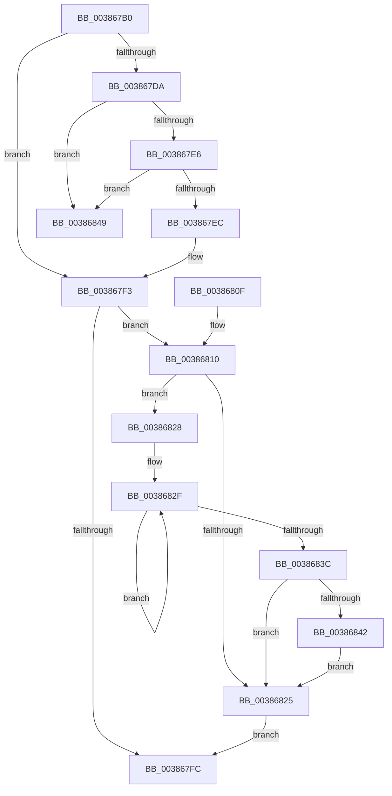

# ExInterlockedRemoveHeadList

- RVA: `0x003867B0`–`0x00386850` (길이 `160` bytes)
- VA: `0x00000001403867B0`
- 실행 섹션: `.text`
- PDB 이름 있음: `예`; PDB Function 태그: `아니요`
- unwind 정보 RVA: `0x00067AB8`
- 디코드: `49`개 명령, `160/160` bytes 표시
- 미해석 바이트: `0` (있으면 어셈블리에 `.byte`로 보존)

> 이 문서는 커널 이미지의 기계어와 PDB 기호를 분석해 생성했습니다. 4번과 5번은 함수 원형과 자료형을 바이너리 사용 방식에서 추정한 C 해석이며 원본 소스 복구 결과는 아닙니다.

## 1. Dependencies

- 직접 호출 지점: **2**; 고유 호출 대상: **2**
- 직접 호출자로 확인된 함수: **4**
- RIP 상대 이미지 참조: **0**

### Outgoing calls
- `0x003867CA` → [ExpAcquireSpinLockDisabled](ExpAcquireSpinLockDisabled_function_00386858.md) (function, `0x00386858`)
- `0x00386842` → [KiRemoveSystemWorkPriorityKick](../26/KiRemoveSystemWorkPriorityKick_function_002631D0.md) (function, `0x002631D0`)

### Direct callers
- [WheapWorkQueueWorkerRoutine](WheapWorkQueueWorkerRoutine_function_003865E0.md) at `0x003865F4`
- [PopFxProcessWorkPool](../49/PopFxProcessWorkPool_function_0049E8A0.md) at `0x0049EA47`
- [KiAltReturnWorkerRoutine](../5C/KiAltReturnWorkerRoutine_function_005CB130.md) at `0x005CB159`
- [WmipEventNotification](../../page/9D/WmipEventNotification_function_009DF9D0.md) at `0x009DF9E4`

### Static image references
- 디코드된 RIP-relative 메모리 참조가 없습니다.

## 2. Other-region calls and transfers

- 다른 실행 섹션으로 향하는 call: **0**
- 별도 외부 분기/꼬리 이동을 확인하지 못했습니다.

## 3. Assembly (complete function range)

```asm
003867B0  48 89 5C 24 08                  mov qword ptr [rsp + 8], rbx
003867B5  48 89 74 24 10                  mov qword ptr [rsp + 0x10], rsi
003867BA  57                              push rdi
003867BB  48 83 EC 20                     sub rsp, 0x20
003867BF  48 8B F9                        mov rdi, rcx
003867C2  48 8B F2                        mov rsi, rdx
003867C5  48 8B CA                        mov rcx, rdx
003867C8  33 DB                           xor ebx, ebx
003867CA  E8 89 00 00 00                  call 0x140386858
003867CF  0F B6 C8                        movzx ecx, al
003867D2  48 8B 07                        mov rax, qword ptr [rdi]
003867D5  48 3B C7                        cmp rax, rdi
003867D8  74 19                           je 0x1403867f3
003867DA  48 8B D8                        mov rbx, rax
003867DD  48 8B 00                        mov rax, qword ptr [rax]
003867E0  48 39 7B 08                     cmp qword ptr [rbx + 8], rdi
003867E4  75 63                           jne 0x140386849
003867E6  48 39 58 08                     cmp qword ptr [rax + 8], rbx
003867EA  75 5D                           jne 0x140386849
003867EC  48 89 07                        mov qword ptr [rdi], rax
003867EF  48 89 78 08                     mov qword ptr [rax + 8], rdi
003867F3  F0 48 83 26 00                  lock and qword ptr [rsi], 0
003867F8  84 C9                           test cl, cl
003867FA  75 14                           jne 0x140386810
003867FC  48 8B 74 24 38                  mov rsi, qword ptr [rsp + 0x38]
00386801  48 8B C3                        mov rax, rbx
00386804  48 8B 5C 24 30                  mov rbx, qword ptr [rsp + 0x30]
00386809  48 83 C4 20                     add rsp, 0x20
0038680D  5F                              pop rdi
0038680E  C3                              ret
0038680F  CC                              int3
00386810  65 48 8B 0C 25 20 00 00 00      mov rcx, qword ptr gs:[0x20]
00386819  4C 8B 81 B8 8E 00 00            mov r8, qword ptr [rcx + 0x8eb8]
00386820  4D 85 C0                        test r8, r8
00386823  75 03                           jne 0x140386828
00386825  FB                              sti
00386826  EB D4                           jmp 0x1403867fc
00386828  41 0F 0D 08                     prefetchw byte ptr [r8]
0038682C  41 8B 00                        mov eax, dword ptr [r8]
0038682F  8B D0                           mov edx, eax
00386831  0F BA F2 15                     btr edx, 0x15
00386835  F0 41 0F B1 10                  lock cmpxchg dword ptr [r8], edx
0038683A  75 F3                           jne 0x14038682f
0038683C  0F BA E0 15                     bt eax, 0x15
00386840  73 E3                           jae 0x140386825
00386842  E8 89 C9 ED FF                  call 0x1402631d0
00386847  EB DC                           jmp 0x140386825
00386849  B9 03 00 00 00                  mov ecx, 3
0038684E  CD 29                           int 0x29
```

## 4. C-style interpretation (structured pseudocode)

```c
__int64 __fastcall ExInterlockedRemoveHeadList(__int64 a1, __int64 a2)
{
    __int64 result;
    __int64 v_rbx;
    __int64 v_rsp;
    unsigned __int64 v_stack_p10;
    unsigned __int64 v_stack_p8;

    v_stack_p8 = v_rbx;
    v_stack_p10 = v_rsi;
    v_rsp = (v_rsp) - (32);
    v_rbx = 0;
    result = ExpAcquireSpinLockDisabled(a2, a2, a3, a4);
    if ((*(unsigned __int64 *)(a1)) == a1) goto loc_003867F3;
    if ((*(unsigned __int64 *)(*(unsigned __int64 *)(a1) + 8)) != a1) goto loc_00386849;
    if ((*(unsigned __int64 *)(*(unsigned __int64 *)(*(unsigned __int64 *)(a1)) + 8)) != (*(unsigned __int64 *)(a1))) goto loc_00386849;
    *(unsigned __int64 *)(a1) = *(unsigned __int64 *)(*(unsigned __int64 *)(a1));
    *(unsigned __int64 *)(*(unsigned __int64 *)(*(unsigned __int64 *)(a1)) + 8) = a1;
loc_003867F3:
    if ((unsigned __int8)((unsigned __int8)(result)) != 0) goto loc_00386810;
loc_003867FC:
    v_rsp = (v_rsp) + (32);
    return *(unsigned __int64 *)(a1);
loc_00386810:
    if (*(unsigned __int64 *)(*(unsigned __int64 *)(gs_base + (0 + 32)) + 36536) != 0) goto loc_00386828;
loc_00386825:
    goto loc_003867FC;
loc_00386828:
loc_0038682F:
    if (*(unsigned __int64 *)(*(unsigned __int64 *)(gs_base + (0 + 32)) + 36536) != 0) goto loc_0038682F;
    if (condition_is_above_or_equal) goto loc_00386825;
    result = KiRemoveSystemWorkPriorityKick(*(unsigned __int64 *)(gs_base + (0 + 32)), (unsigned int)((unsigned int)((unsigned int)(*(unsigned int *)(*(unsigned __int64 *)(*(unsigned __int64 *)(gs_base + (0 + 32)) + 36536))))), *(unsigned __int64 *)(*(unsigned __int64 *)(gs_base + (0 + 32)) + 36536), a4);
    goto loc_00386825;
loc_00386849:
    return result;
}
```

## 5. (Beta) C Style

```c
int64_t ExInterlockedRemoveHeadList(void *Arg1, void *Arg2)
{
    uint8_t *arg1 = (uint8_t *)Arg1;
    uint8_t *arg2 = (uint8_t *)Arg2;

    int64_t result;
    int64_t local_rbx;
    int64_t local_rsp;
    uint64_t v_stack_p10;
    uint64_t v_stack_p8;

    v_stack_p8 = local_rbx;
    v_stack_p10 = local_rsi;
    local_rsp = (local_rsp) - (32);
    local_rbx = 0;
    result = ExpAcquireSpinLockDisabled(Arg2, Arg2, a3, a4);
    if ((*(uint64_t *)(arg1)) == Arg1) goto loc_003867F3;
    if ((*(uint64_t *)(*(uint64_t *)(arg1) + 0x8)) != Arg1) goto loc_00386849;
    if ((*(uint64_t *)(*(uint64_t *)(*(uint64_t *)(arg1)) + 0x8)) != (*(uint64_t *)(arg1))) goto loc_00386849;
    *(uint64_t *)(arg1) = *(uint64_t *)(*(uint64_t *)(arg1));
    *(void **)(*(uint64_t *)(*(uint64_t *)(arg1)) + 0x8) = Arg1;
loc_003867F3:
    if ((uint8_t)((uint8_t)(result)) != 0) goto loc_00386810;
loc_003867FC:
    local_rsp = (local_rsp) + (32);
    return *(uint64_t *)(arg1);
loc_00386810:
    if (*(uint64_t *)(*(uint64_t *)(gs_base + (0 + 0x20)) + 0x8EB8) != 0) goto loc_00386828;
loc_00386825:
    goto loc_003867FC;
loc_00386828:
loc_0038682F:
    if (*(uint64_t *)(*(uint64_t *)(gs_base + (0 + 0x20)) + 0x8EB8) != 0) goto loc_0038682F;
    if (condition_is_above_or_equal) goto loc_00386825;
    result = KiRemoveSystemWorkPriorityKick(*(uint64_t *)(gs_base + (0 + 0x20)), (uint32_t)((uint32_t)((uint32_t)(*(uint32_t *)(*(uint64_t *)(*(uint64_t *)(gs_base + (0 + 0x20)) + 0x8EB8))))), *(uint64_t *)(*(uint64_t *)(gs_base + (0 + 0x20)) + 0x8EB8), a4);
    goto loc_00386825;
loc_00386849:
    return result;
}
```

### 관측된 메모리 오프셋

구조체 형식이 확인되지 않은 접근은 인자 기준의 오프셋으로만 기록했습니다.

| 기준 인자 | 오프셋 표현 | 폭 (bit) | 접근 |
|---|---:|---:|---|
| `Arg1` | `+ 0x0` | `64` | `R` |
| `Arg1` | `+ 0x0` | `64` | `W` |
| `Arg2` | `+ 0x0` | `64` | `R/W` |

## 6. Execution-region graph

[열기: 2D/3D 그래프와 함수 탐색 컨트롤 패널](../../../control-panel.html?section=text&rva=0x003867B0&view=graph)

- 2D 그래프는 위에서 아래로 흐르고, 3D 그래프는 빈 공간을 드래그해 회전합니다. Shift+드래그는 이동, 휠은 확대·축소, 함수 노드 선택은 대상 보고서 이동입니다.

### Static fallback


