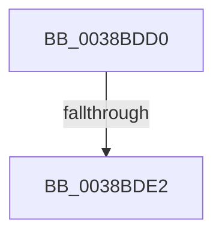

# ExReinitializeResourceLite

- RVA: `0x0038BDD0`–`0x0038BDFB` (길이 `43` bytes)
- VA: `0x000000014038BDD0`
- 실행 섹션: `.text`
- PDB 이름 있음: `예`; PDB Function 태그: `예`
- unwind 정보 RVA: `0x000801C0`
- 디코드: `14`개 명령, `43/43` bytes 표시
- 미해석 바이트: `0` (있으면 어셈블리에 `.byte`로 보존)

> 이 문서는 커널 이미지의 기계어와 PDB 기호를 분석해 생성했습니다. 4번과 5번은 함수 원형과 자료형을 바이너리 사용 방식에서 추정한 C 해석이며 원본 소스 복구 결과는 아닙니다.

## 1. Dependencies

- 직접 호출 지점: **1**; 고유 호출 대상: **1**
- 직접 호출자로 확인된 함수: **0**
- RIP 상대 이미지 참조: **0**

### Outgoing calls
- `0x0038BDF5` → [KeBugCheckEx](../4F/KeBugCheckEx_function_004FD660.md) (function, `0x004FD660`)

### Direct callers
- 이 함수 시작 RVA로 연결되는 직접 call은 확인되지 않았습니다. 간접 호출은 완전히 역산할 수 없습니다.

### Static image references
- 디코드된 RIP-relative 메모리 참조가 없습니다.

## 2. Other-region calls and transfers

- 다른 실행 섹션으로 향하는 call: **0**
- call이 아닌 외부 분기/꼬리 이동: **1**
  - `0x0038BDE0` → [sub_0038BDFB](Unknown_function_0038BDFB.md) (`tail-transfer`)

## 3. Assembly (complete function range)

```asm
0038BDD0  40 53                           push rbx
0038BDD2  57                              push rdi
0038BDD3  48 83 EC 48                     sub rsp, 0x48
0038BDD7  33 FF                           xor edi, edi
0038BDD9  48 8B D9                        mov rbx, rcx
0038BDDC  F6 41 1A 01                     test byte ptr [rcx + 0x1a], 1
0038BDE0  74 19                           je 0x14038bdfb
0038BDE2  4C 8B C1                        mov r8, rcx
0038BDE5  48 89 7C 24 20                  mov qword ptr [rsp + 0x20], rdi
0038BDEA  B9 C6 01 00 00                  mov ecx, 0x1c6
0038BDEF  8D 57 0E                        lea edx, [rdi + 0xe]
0038BDF2  45 33 C9                        xor r9d, r9d
0038BDF5  E8 66 18 17 00                  call 0x1404fd660
0038BDFA  CC                              int3
```

## 4. C-style interpretation (structured pseudocode)

```c
__int64 __fastcall ExReinitializeResourceLite(__int64 a1, __int64 a2, __int64 a3, int a4)
{
    __int64 result;
    __int64 v_rdi;
    __int64 v_rsp;
    unsigned __int64 v_stack_m38;

    v_rsp = (v_rsp) - (72);
    v_rdi = 0;
    v_stack_m38 = 0;
    a4 = 0;
    result = KeBugCheckEx(454, v_rdi + 14, a1, a4);
    return result;
}
```

## 5. (Beta) C Style

```c
int64_t ExReinitializeResourceLite(void *Arg1, int64_t Arg2, int64_t Arg3, int32_t Arg4)
{
    uint8_t *arg1 = (uint8_t *)Arg1;

    int64_t result;
    int64_t local_rdi;
    int64_t local_rsp;
    uint64_t v_stack_m38;

    local_rsp = (local_rsp) - (72);
    local_rdi = 0;
    v_stack_m38 = 0;
    Arg4 = 0;
    result = KeBugCheckEx(454, local_rdi + 14, Arg1, Arg4);
    return result;
}
```

### 관측된 메모리 오프셋

구조체 형식이 확인되지 않은 접근은 인자 기준의 오프셋으로만 기록했습니다.

| 기준 인자 | 오프셋 표현 | 폭 (bit) | 접근 |
|---|---:|---:|---|
| `Arg1` | `+ 0x1A` | `8` | `R` |

## 6. Execution-region graph

[열기: 2D/3D 그래프와 함수 탐색 컨트롤 패널](../../../control-panel.html?section=text&rva=0x0038BDD0&view=graph)

- 2D 그래프는 위에서 아래로 흐르고, 3D 그래프는 빈 공간을 드래그해 회전합니다. Shift+드래그는 이동, 휠은 확대·축소, 함수 노드 선택은 대상 보고서 이동입니다.

### Static fallback


