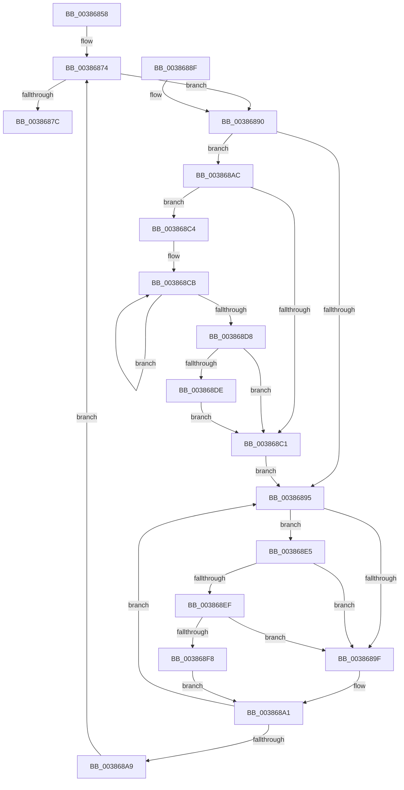

# ExpAcquireSpinLockDisabled

- RVA: `0x00386858`–`0x00386901` (길이 `169` bytes)
- VA: `0x0000000140386858`
- 실행 섹션: `.text`
- PDB 이름 있음: `예`; PDB Function 태그: `아니요`
- unwind 정보 RVA: `0x0007BD38`
- 디코드: `53`개 명령, `169/169` bytes 표시
- 미해석 바이트: `0` (있으면 어셈블리에 `.byte`로 보존)

> 이 문서는 커널 이미지의 기계어와 PDB 기호를 분석해 생성했습니다. 4번과 5번은 함수 원형과 자료형을 바이너리 사용 방식에서 추정한 C 해석이며 원본 소스 복구 결과는 아닙니다.

## 1. Dependencies

- 직접 호출 지점: **4**; 고유 호출 대상: **4**
- 직접 호출자로 확인된 함수: **7**
- RIP 상대 이미지 참조: **2**

### Outgoing calls
- `0x0038686C` → [KeDisableInterrupts](../21/KeDisableInterrupts_function_00217BE0.md) (function, `0x00217BE0`)
- `0x003868DE` → [KiRemoveSystemWorkPriorityKick](../26/KiRemoveSystemWorkPriorityKick_function_002631D0.md) (function, `0x002631D0`)
- `0x003868EF` → [KiCheckVpBackingLongSpinWaitHypercall](../30/KiCheckVpBackingLongSpinWaitHypercall_function_0030F490.md) (function, `0x0030F490`)
- `0x003868FA` → [HvlNotifyLongSpinWait](../30/HvlNotifyLongSpinWait_function_0030F460.md) (function, `0x0030F460`)

### Direct callers
- [ExInterlockedAddLargeInteger](ExInterlockedAddLargeInteger_function_003863C0.md) at `0x003863E0`
- [ExInterlockedAddUlong](ExInterlockedAddUlong_function_00386420.md) at `0x0038643F`
- [ExInterlockedInsertHeadList](ExInterlockedInsertHeadList_function_00386680.md) at `0x003866A0`
- [ExInterlockedInsertTailList](ExInterlockedInsertTailList_function_00386700.md) at `0x00386720`
- [ExInterlockedRemoveHeadList](ExInterlockedRemoveHeadList_function_003867B0.md) at `0x003867CA`
- [ExInterlockedPopEntryList](../65/ExInterlockedPopEntryList_function_0065A2B0.md) at `0x0065A2C8`
- [ExInterlockedPushEntryList](../65/ExInterlockedPushEntryList_function_0065A300.md) at `0x0065A320`

### Static image references
- `0x00386897` → RVA `0x00FC52AC` (`ALMOSTRO`; reference)
- `0x003868E5` → RVA `0x00FC6AB8` (`ALMOSTRO`; read)

## 2. Other-region calls and transfers

- 다른 실행 섹션으로 향하는 call: **0**
- 별도 외부 분기/꼬리 이동을 확인하지 못했습니다.

## 3. Assembly (complete function range)

```asm
00386858  48 89 5C 24 08                  mov qword ptr [rsp + 8], rbx
0038685D  48 89 74 24 10                  mov qword ptr [rsp + 0x10], rsi
00386862  57                              push rdi
00386863  48 83 EC 20                     sub rsp, 0x20
00386867  33 DB                           xor ebx, ebx
00386869  48 8B F9                        mov rdi, rcx
0038686C  E8 6F 13 E9 FF                  call 0x140217be0
00386871  40 8A F0                        mov sil, al
00386874  F0 48 0F BA 2F 00               lock bts qword ptr [rdi], 0
0038687A  72 14                           jb 0x140386890
0038687C  48 8B 5C 24 30                  mov rbx, qword ptr [rsp + 0x30]
00386881  40 8A C6                        mov al, sil
00386884  48 8B 74 24 38                  mov rsi, qword ptr [rsp + 0x38]
00386889  48 83 C4 20                     add rsp, 0x20
0038688D  5F                              pop rdi
0038688E  C3                              ret
0038688F  CC                              int3
00386890  40 84 F6                        test sil, sil
00386893  75 17                           jne 0x1403868ac
00386895  FF C3                           inc ebx
00386897  85 1D 0F EA C3 00               test dword ptr [rip + 0xc3ea0f], ebx
0038689D  74 46                           je 0x1403868e5
0038689F  F3 90                           pause
003868A1  48 8B 07                        mov rax, qword ptr [rdi]
003868A4  48 85 C0                        test rax, rax
003868A7  75 EC                           jne 0x140386895
003868A9  FA                              cli
003868AA  EB C8                           jmp 0x140386874
003868AC  65 48 8B 0C 25 20 00 00 00      mov rcx, qword ptr gs:[0x20]
003868B5  4C 8B 81 B8 8E 00 00            mov r8, qword ptr [rcx + 0x8eb8]
003868BC  4D 85 C0                        test r8, r8
003868BF  75 03                           jne 0x1403868c4
003868C1  FB                              sti
003868C2  EB D1                           jmp 0x140386895
003868C4  41 0F 0D 08                     prefetchw byte ptr [r8]
003868C8  41 8B 00                        mov eax, dword ptr [r8]
003868CB  8B D0                           mov edx, eax
003868CD  0F BA F2 15                     btr edx, 0x15
003868D1  F0 41 0F B1 10                  lock cmpxchg dword ptr [r8], edx
003868D6  75 F3                           jne 0x1403868cb
003868D8  0F BA E0 15                     bt eax, 0x15
003868DC  73 E3                           jae 0x1403868c1
003868DE  E8 ED C8 ED FF                  call 0x1402631d0
003868E3  EB DC                           jmp 0x1403868c1
003868E5  8B 05 CD 01 C4 00               mov eax, dword ptr [rip + 0xc401cd]
003868EB  A8 40                           test al, 0x40
003868ED  74 B0                           je 0x14038689f
003868EF  E8 9C 8B F8 FF                  call 0x14030f490
003868F4  84 C0                           test al, al
003868F6  74 A7                           je 0x14038689f
003868F8  8B CB                           mov ecx, ebx
003868FA  E8 61 8B F8 FF                  call 0x14030f460
003868FF  EB A0                           jmp 0x1403868a1
```

## 4. C-style interpretation (structured pseudocode)

```c
__int64 __fastcall ExpAcquireSpinLockDisabled(__int64 a1)
{
    __int64 result;
    __int64 v_rbx;
    __int64 v_rsp;
    unsigned __int64 v_stack_p10;
    unsigned __int64 v_stack_p8;

    v_stack_p8 = v_rbx;
    v_stack_p10 = v_rsi;
    v_rsp = (v_rsp) - (32);
    v_rbx = 0;
    result = KeDisableInterrupts(a1, a2, a3, a4);
loc_00386874:
    if (condition_is_below) goto loc_00386890;
    v_rsp = (v_rsp) + (32);
    return (unsigned __int8)((unsigned __int8)(result));
loc_00386890:
    if ((unsigned __int8)(v_stack_p10) != 0) goto loc_003868AC;
loc_00386895:
    v_rbx = (unsigned int)((v_stack_p8) + 1);
    if (((*(unsigned int *)(v_rip + 12839439)) & ((unsigned int)(v_rbx))) == 0) goto loc_003868E5;
loc_0038689F:
loc_003868A1:
    if (*(unsigned __int64 *)(a1) != 0) goto loc_00386895;
    goto loc_00386874;
loc_003868AC:
    if (*(unsigned __int64 *)(*(unsigned __int64 *)(gs_base + (0 + 32)) + 36536) != 0) goto loc_003868C4;
loc_003868C1:
    goto loc_00386895;
loc_003868C4:
loc_003868CB:
    if (*(unsigned __int64 *)(*(unsigned __int64 *)(gs_base + (0 + 32)) + 36536) != 0) goto loc_003868CB;
    if (condition_is_above_or_equal) goto loc_003868C1;
    result = KiRemoveSystemWorkPriorityKick(*(unsigned __int64 *)(gs_base + (0 + 32)), (unsigned int)((unsigned int)((unsigned int)(*(unsigned int *)(*(unsigned __int64 *)(*(unsigned __int64 *)(gs_base + (0 + 32)) + 36536))))), *(unsigned __int64 *)(*(unsigned __int64 *)(gs_base + (0 + 32)) + 36536), a4);
    goto loc_003868C1;
loc_003868E5:
    if ((((unsigned __int8)((unsigned int)(*(unsigned int *)(v_rip + 12845517)))) & (64)) == 0) goto loc_0038689F;
    result = KiCheckVpBackingLongSpinWaitHypercall(*(unsigned __int64 *)(gs_base + (0 + 32)), (unsigned int)((unsigned int)((unsigned int)(*(unsigned int *)(*(unsigned __int64 *)(*(unsigned __int64 *)(gs_base + (0 + 32)) + 36536))))), *(unsigned __int64 *)(*(unsigned __int64 *)(gs_base + (0 + 32)) + 36536), a4);
    if ((unsigned __int8)(result) == 0) goto loc_0038689F;
    result = HvlNotifyLongSpinWait((unsigned int)((unsigned int)(v_rbx)), (unsigned int)((unsigned int)((unsigned int)(*(unsigned int *)(*(unsigned __int64 *)(*(unsigned __int64 *)(gs_base + (0 + 32)) + 36536))))), *(unsigned __int64 *)(*(unsigned __int64 *)(gs_base + (0 + 32)) + 36536), a4);
    goto loc_003868A1;
}
```

## 5. (Beta) C Style

```c
int64_t ExpAcquireSpinLockDisabled(void *Arg1)
{
    uint8_t *arg1 = (uint8_t *)Arg1;

    int64_t result;
    int64_t local_rbx;
    int64_t local_rsp;
    uint64_t v_stack_p10;
    uint64_t v_stack_p8;

    v_stack_p8 = local_rbx;
    v_stack_p10 = local_rsi;
    local_rsp = (local_rsp) - (32);
    local_rbx = 0;
    result = KeDisableInterrupts(Arg1, a2, a3, a4);
loc_00386874:
    if (condition_is_below) goto loc_00386890;
    local_rsp = (local_rsp) + (32);
    return (uint8_t)((uint8_t)(result));
loc_00386890:
    if ((uint8_t)(v_stack_p10) != 0) goto loc_003868AC;
loc_00386895:
    local_rbx = (uint32_t)((v_stack_p8) + 1);
    if (((*(uint32_t *)(v_rip + 0xC3EA0F)) & ((uint32_t)(local_rbx))) == 0) goto loc_003868E5;
loc_0038689F:
loc_003868A1:
    if (*(uint64_t *)(arg1) != 0) goto loc_00386895;
    goto loc_00386874;
loc_003868AC:
    if (*(uint64_t *)(*(uint64_t *)(gs_base + (0 + 0x20)) + 0x8EB8) != 0) goto loc_003868C4;
loc_003868C1:
    goto loc_00386895;
loc_003868C4:
loc_003868CB:
    if (*(uint64_t *)(*(uint64_t *)(gs_base + (0 + 0x20)) + 0x8EB8) != 0) goto loc_003868CB;
    if (condition_is_above_or_equal) goto loc_003868C1;
    result = KiRemoveSystemWorkPriorityKick(*(uint64_t *)(gs_base + (0 + 0x20)), (uint32_t)((uint32_t)((uint32_t)(*(uint32_t *)(*(uint64_t *)(*(uint64_t *)(gs_base + (0 + 0x20)) + 0x8EB8))))), *(uint64_t *)(*(uint64_t *)(gs_base + (0 + 0x20)) + 0x8EB8), a4);
    goto loc_003868C1;
loc_003868E5:
    if ((((uint8_t)((uint32_t)(*(uint32_t *)(v_rip + 0xC401CD)))) & (64)) == 0) goto loc_0038689F;
    result = KiCheckVpBackingLongSpinWaitHypercall(*(uint64_t *)(gs_base + (0 + 0x20)), (uint32_t)((uint32_t)((uint32_t)(*(uint32_t *)(*(uint64_t *)(*(uint64_t *)(gs_base + (0 + 0x20)) + 0x8EB8))))), *(uint64_t *)(*(uint64_t *)(gs_base + (0 + 0x20)) + 0x8EB8), a4);
    if ((uint8_t)(result) == 0) goto loc_0038689F;
    result = HvlNotifyLongSpinWait((uint32_t)((uint32_t)(local_rbx)), (uint32_t)((uint32_t)((uint32_t)(*(uint32_t *)(*(uint64_t *)(*(uint64_t *)(gs_base + (0 + 0x20)) + 0x8EB8))))), *(uint64_t *)(*(uint64_t *)(gs_base + (0 + 0x20)) + 0x8EB8), a4);
    goto loc_003868A1;
}
```

### 관측된 메모리 오프셋

구조체 형식이 확인되지 않은 접근은 인자 기준의 오프셋으로만 기록했습니다.

| 기준 인자 | 오프셋 표현 | 폭 (bit) | 접근 |
|---|---:|---:|---|
| `Arg1` | `+ 0x0` | `64` | `R` |
| `Arg1` | `+ 0x0` | `64` | `R/W` |

## 6. Execution-region graph

[열기: 2D/3D 그래프와 함수 탐색 컨트롤 패널](../../../control-panel.html?section=text&rva=0x00386858&view=graph)

- 2D 그래프는 위에서 아래로 흐르고, 3D 그래프는 빈 공간을 드래그해 회전합니다. Shift+드래그는 이동, 휠은 확대·축소, 함수 노드 선택은 대상 보고서 이동입니다.

### Static fallback


