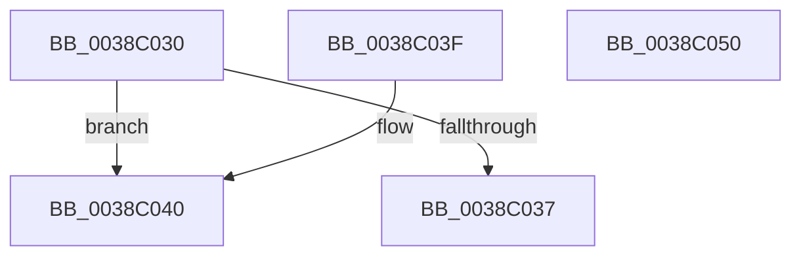

# ExpOwnerEntryToThread

- RVA: `0x0038C030`–`0x0038C051` (길이 `33` bytes)
- VA: `0x000000014038C030`
- 실행 섹션: `.text`
- PDB 이름 있음: `예`; PDB Function 태그: `아니요`
- unwind 정보 RVA: `0x000DB714`
- 디코드: `13`개 명령, `33/33` bytes 표시
- 미해석 바이트: `0` (있으면 어셈블리에 `.byte`로 보존)

> 이 문서는 커널 이미지의 기계어와 PDB 기호를 분석해 생성했습니다. 4번과 5번은 함수 원형과 자료형을 바이너리 사용 방식에서 추정한 C 해석이며 원본 소스 복구 결과는 아닙니다.

## 1. Dependencies

- 직접 호출 지점: **0**; 고유 호출 대상: **0**
- 직접 호출자로 확인된 함수: **3**
- RIP 상대 이미지 참조: **0**

### Outgoing calls
- 직접 디코드된 call 명령이 없습니다.

### Direct callers
- [sub_0038BBFB](Unknown_function_0038BBFB.md) at `0x0038BC4D`
- [sub_0038BEEF](Unknown_function_0038BEEF.md) at `0x0038BF14`
- [ExQuerySystemLockInformation](../../pagelk/B7/ExQuerySystemLockInformation_function_00B793DC.md) at `0x00B794CA`

### Static image references
- 디코드된 RIP-relative 메모리 참조가 없습니다.

## 2. Other-region calls and transfers

- 다른 실행 섹션으로 향하는 call: **0**
- 별도 외부 분기/꼬리 이동을 확인하지 못했습니다.

## 3. Assembly (complete function range)

```asm
0038C030  8B 41 08                        mov eax, dword ptr [rcx + 8]
0038C033  A8 02                           test al, 2
0038C035  74 09                           je 0x14038c040
0038C037  48 8B 01                        mov rax, qword ptr [rcx]
0038C03A  48 83 E0 FC                     and rax, 0xfffffffffffffffc
0038C03E  C3                              ret
0038C03F  CC                              int3
0038C040  48 8B 11                        mov rdx, qword ptr [rcx]
0038C043  B8 00 00 00 00                  mov eax, 0
0038C048  F6 C2 03                        test dl, 3
0038C04B  48 0F 44 C2                     cmove rax, rdx
0038C04F  C3                              ret
0038C050  CC                              int3
```

## 4. C-style interpretation (structured pseudocode)

```c
__int64 __fastcall ExpOwnerEntryToThread(__int64 a1)
{
    __int64 result;

    if ((((unsigned __int8)((unsigned int)(*(unsigned int *)(a1 + 8)))) & (2)) == 0) goto loc_0038C040;
    result = (*(unsigned __int64 *)(a1)) & (-4);
    return result;
loc_0038C040:
    result = 0;
    if ((((unsigned __int8)(*(unsigned __int64 *)(a1))) & (3)) == 0) { result = *(unsigned __int64 *)(a1); }
    return result;
}
```

## 5. (Beta) C Style

```c
int64_t ExpOwnerEntryToThread(void *Arg1)
{
    uint8_t *arg1 = (uint8_t *)Arg1;

    int64_t result;

    if ((((uint8_t)((uint32_t)(*(uint32_t *)(arg1 + 0x8)))) & (2)) == 0) goto loc_0038C040;
    result = (*(uint64_t *)(arg1)) & (-4);
    return result;
loc_0038C040:
    result = 0;
    if ((((uint8_t)(*(uint64_t *)(arg1))) & (3)) == 0) { result = *(uint64_t *)(arg1); }
    return result;
}
```

### 관측된 메모리 오프셋

구조체 형식이 확인되지 않은 접근은 인자 기준의 오프셋으로만 기록했습니다.

| 기준 인자 | 오프셋 표현 | 폭 (bit) | 접근 |
|---|---:|---:|---|
| `Arg1` | `+ 0x0` | `64` | `R` |
| `Arg1` | `+ 0x8` | `32` | `R` |

## 6. Execution-region graph

[열기: 2D/3D 그래프와 함수 탐색 컨트롤 패널](../../../control-panel.html?section=text&rva=0x0038C030&view=graph)

- 2D 그래프는 위에서 아래로 흐르고, 3D 그래프는 빈 공간을 드래그해 회전합니다. Shift+드래그는 이동, 휠은 확대·축소, 함수 노드 선택은 대상 보고서 이동입니다.

### Static fallback


