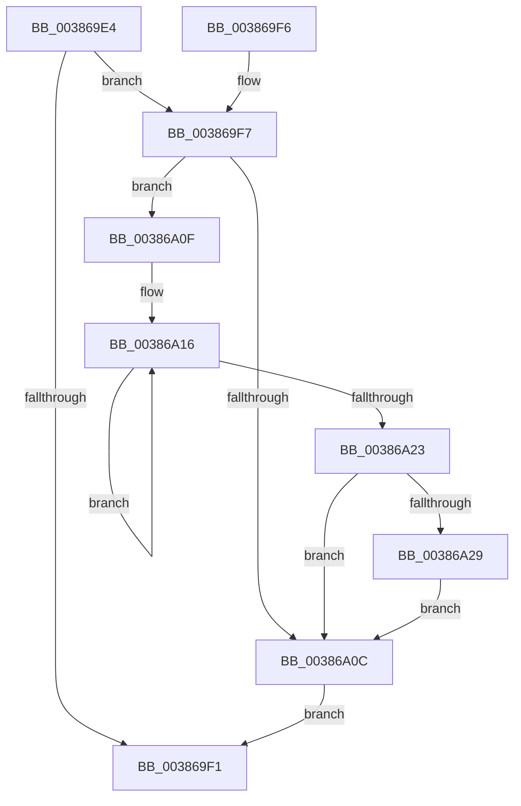

# ExpReleaseSpinLockDisabled

- RVA: `0x003869E4`–`0x00386A30` (길이 `76` bytes)
- VA: `0x00000001403869E4`
- 실행 섹션: `.text`
- PDB 이름 있음: `예`; PDB Function 태그: `아니요`
- unwind 정보 RVA: `0x0007FBE8`
- 디코드: `23`개 명령, `76/76` bytes 표시
- 미해석 바이트: `0` (있으면 어셈블리에 `.byte`로 보존)

> 이 문서는 커널 이미지의 기계어와 PDB 기호를 분석해 생성했습니다. 4번과 5번은 함수 원형과 자료형을 바이너리 사용 방식에서 추정한 C 해석이며 원본 소스 복구 결과는 아닙니다.

## 1. Dependencies

- 직접 호출 지점: **1**; 고유 호출 대상: **1**
- 직접 호출자로 확인된 함수: **5**
- RIP 상대 이미지 참조: **0**

### Outgoing calls
- `0x00386A29` → [KiRemoveSystemWorkPriorityKick](../26/KiRemoveSystemWorkPriorityKick_function_002631D0.md) (function, `0x002631D0`)

### Direct callers
- [ExInterlockedAddLargeInteger](ExInterlockedAddLargeInteger_function_003863C0.md) at `0x003863F4`
- [ExInterlockedAddUlong](ExInterlockedAddUlong_function_00386420.md) at `0x00386450`
- [ExInterlockedInsertHeadList](ExInterlockedInsertHeadList_function_00386680.md) at `0x003866C8`
- [ExInterlockedPopEntryList](../65/ExInterlockedPopEntryList_function_0065A2B0.md) at `0x0065A2E0`
- [ExInterlockedPushEntryList](../65/ExInterlockedPushEntryList_function_0065A300.md) at `0x0065A333`

### Static image references
- 디코드된 RIP-relative 메모리 참조가 없습니다.

## 2. Other-region calls and transfers

- 다른 실행 섹션으로 향하는 call: **0**
- 별도 외부 분기/꼬리 이동을 확인하지 못했습니다.

## 3. Assembly (complete function range)

```asm
003869E4  48 83 EC 28                     sub rsp, 0x28
003869E8  F0 48 83 21 00                  lock and qword ptr [rcx], 0
003869ED  84 D2                           test dl, dl
003869EF  75 06                           jne 0x1403869f7
003869F1  48 83 C4 28                     add rsp, 0x28
003869F5  C3                              ret
003869F6  CC                              int3
003869F7  65 48 8B 0C 25 20 00 00 00      mov rcx, qword ptr gs:[0x20]
00386A00  4C 8B 81 B8 8E 00 00            mov r8, qword ptr [rcx + 0x8eb8]
00386A07  4D 85 C0                        test r8, r8
00386A0A  75 03                           jne 0x140386a0f
00386A0C  FB                              sti
00386A0D  EB E2                           jmp 0x1403869f1
00386A0F  41 0F 0D 08                     prefetchw byte ptr [r8]
00386A13  41 8B 00                        mov eax, dword ptr [r8]
00386A16  8B D0                           mov edx, eax
00386A18  0F BA F2 15                     btr edx, 0x15
00386A1C  F0 41 0F B1 10                  lock cmpxchg dword ptr [r8], edx
00386A21  75 F3                           jne 0x140386a16
00386A23  0F BA E0 15                     bt eax, 0x15
00386A27  73 E3                           jae 0x140386a0c
00386A29  E8 A2 C7 ED FF                  call 0x1402631d0
00386A2E  EB DC                           jmp 0x140386a0c
```

## 4. C-style interpretation (structured pseudocode)

```c
__int64 __fastcall ExpReleaseSpinLockDisabled(__int64 a1, unsigned __int8 a2)
{
    __int64 result;
    __int64 v_rsp;

    v_rsp = (v_rsp) - (40);
    if (a2 != 0) goto loc_003869F7;
loc_003869F1:
    v_rsp = (v_rsp) + (40);
    return result;
loc_003869F7:
    if (*(unsigned __int64 *)(*(unsigned __int64 *)(gs_base + (0 + 32)) + 36536) != 0) goto loc_00386A0F;
loc_00386A0C:
    goto loc_003869F1;
loc_00386A0F:
loc_00386A16:
    if (*(unsigned __int64 *)(*(unsigned __int64 *)(gs_base + (0 + 32)) + 36536) != 0) goto loc_00386A16;
    if (condition_is_above_or_equal) goto loc_00386A0C;
    result = KiRemoveSystemWorkPriorityKick(*(unsigned __int64 *)(gs_base + (0 + 32)), (unsigned int)((unsigned int)((unsigned int)(*(unsigned int *)(*(unsigned __int64 *)(*(unsigned __int64 *)(gs_base + (0 + 32)) + 36536))))), *(unsigned __int64 *)(*(unsigned __int64 *)(gs_base + (0 + 32)) + 36536), a4);
    goto loc_00386A0C;
}
```

## 5. (Beta) C Style

```c
int64_t ExpReleaseSpinLockDisabled(void *Arg1, uint8_t Arg2)
{
    uint8_t *arg1 = (uint8_t *)Arg1;

    int64_t result;
    int64_t local_rsp;

    local_rsp = (local_rsp) - (40);
    if (Arg2 != 0) goto loc_003869F7;
loc_003869F1:
    local_rsp = (local_rsp) + (40);
    return result;
loc_003869F7:
    if (*(uint64_t *)(*(uint64_t *)(gs_base + (0 + 0x20)) + 0x8EB8) != 0) goto loc_00386A0F;
loc_00386A0C:
    goto loc_003869F1;
loc_00386A0F:
loc_00386A16:
    if (*(uint64_t *)(*(uint64_t *)(gs_base + (0 + 0x20)) + 0x8EB8) != 0) goto loc_00386A16;
    if (condition_is_above_or_equal) goto loc_00386A0C;
    result = KiRemoveSystemWorkPriorityKick(*(uint64_t *)(gs_base + (0 + 0x20)), (uint32_t)((uint32_t)((uint32_t)(*(uint32_t *)(*(uint64_t *)(*(uint64_t *)(gs_base + (0 + 0x20)) + 0x8EB8))))), *(uint64_t *)(*(uint64_t *)(gs_base + (0 + 0x20)) + 0x8EB8), a4);
    goto loc_00386A0C;
}
```

### 관측된 메모리 오프셋

구조체 형식이 확인되지 않은 접근은 인자 기준의 오프셋으로만 기록했습니다.

| 기준 인자 | 오프셋 표현 | 폭 (bit) | 접근 |
|---|---:|---:|---|
| `Arg1` | `+ 0x0` | `64` | `R/W` |

## 6. Execution-region graph

[열기: 2D/3D 그래프와 함수 탐색 컨트롤 패널](../../../control-panel.html?section=text&rva=0x003869E4&view=graph)

- 2D 그래프는 위에서 아래로 흐르고, 3D 그래프는 빈 공간을 드래그해 회전합니다. Shift+드래그는 이동, 휠은 확대·축소, 함수 노드 선택은 대상 보고서 이동입니다.

### Static fallback


