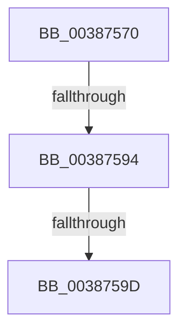

# FsRtlAddBaseMcbEntryEx

- RVA: `0x00387570`–`0x003875A6` (길이 `54` bytes)
- VA: `0x0000000140387570`
- 실행 섹션: `.text`
- PDB 이름 있음: `예`; PDB Function 태그: `예`
- unwind 정보 RVA: `0x0007FD4C`
- 디코드: `16`개 명령, `54/54` bytes 표시
- 미해석 바이트: `0` (있으면 어셈블리에 `.byte`로 보존)

> 이 문서는 커널 이미지의 기계어와 PDB 기호를 분석해 생성했습니다. 4번과 5번은 함수 원형과 자료형을 바이너리 사용 방식에서 추정한 C 해석이며 원본 소스 복구 결과는 아닙니다.

## 1. Dependencies

- 직접 호출 지점: **0**; 고유 호출 대상: **0**
- 직접 호출자로 확인된 함수: **1**
- RIP 상대 이미지 참조: **0**

### Outgoing calls
- 직접 디코드된 call 명령이 없습니다.

### Direct callers
- [FsRtlAddBaseMcbEntry](FsRtlAddBaseMcbEntry_function_00387550.md) at `0x00387554`

### Static image references
- 디코드된 RIP-relative 메모리 참조가 없습니다.

## 2. Other-region calls and transfers

- 다른 실행 섹션으로 향하는 call: **0**
- call이 아닌 외부 분기/꼬리 이동: **3**
  - `0x0038758E` → [sub_00387BC2](Unknown_function_00387BC2.md) (`tail-transfer`)
  - `0x00387597` → [sub_00387BC2](Unknown_function_00387BC2.md) (`tail-transfer`)
  - `0x003875A0` → [sub_00387BC2](Unknown_function_00387BC2.md) (`tail-transfer`)

## 3. Assembly (complete function range)

```asm
00387570  4C 89 44 24 18                  mov qword ptr [rsp + 0x18], r8
00387575  53                              push rbx
00387576  57                              push rdi
00387577  41 55                           push r13
00387579  41 56                           push r14
0038757B  48 83 EC 38                     sub rsp, 0x38
0038757F  4D 8B E9                        mov r13, r9
00387582  4D 8B F0                        mov r14, r8
00387585  48 8B DA                        mov rbx, rdx
00387588  48 8B F9                        mov rdi, rcx
0038758B  48 85 D2                        test rdx, rdx
0038758E  0F 88 2E 06 00 00               js 0x140387bc2
00387594  4D 85 C0                        test r8, r8
00387597  0F 88 25 06 00 00               js 0x140387bc2
0038759D  4D 85 C9                        test r9, r9
003875A0  0F 8E 1C 06 00 00               jle 0x140387bc2
```

## 4. C-style interpretation (structured pseudocode)

```c
void __fastcall FsRtlAddBaseMcbEntryEx(__int64 a1, __int64 a2, __int64 a3, __int64 a4)
{
    __int64 v_rsp;
    unsigned __int64 v_stack_p18;

    v_stack_p18 = a3;
    v_rsp = (v_rsp) - (56);
}
```

## 5. (Beta) C Style

```c
void FsRtlAddBaseMcbEntryEx(int64_t Arg1, int64_t Arg2, int64_t Arg3, int64_t Arg4)
{
    int64_t local_rsp;
    uint64_t v_stack_p18;

    v_stack_p18 = Arg3;
    local_rsp = (local_rsp) - (56);
}
```

## 6. Execution-region graph

[열기: 2D/3D 그래프와 함수 탐색 컨트롤 패널](../../../control-panel.html?section=text&rva=0x00387570&view=graph)

- 2D 그래프는 위에서 아래로 흐르고, 3D 그래프는 빈 공간을 드래그해 회전합니다. Shift+드래그는 이동, 휠은 확대·축소, 함수 노드 선택은 대상 보고서 이동입니다.

### Static fallback


