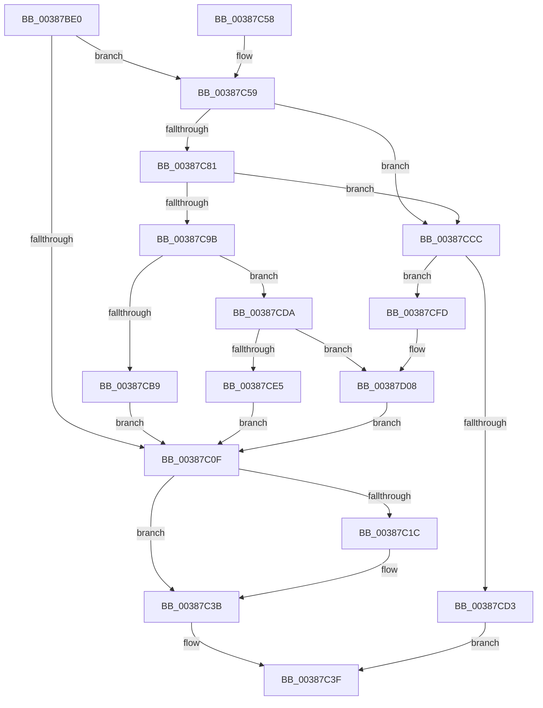

# FsRtlAddEntry

- RVA: `0x00387BE0`–`0x00387D20` (길이 `320` bytes)
- VA: `0x0000000140387BE0`
- 실행 섹션: `.text`
- PDB 이름 있음: `예`; PDB Function 태그: `아니요`
- unwind 정보 RVA: `0x0007FDE0`
- 디코드: `88`개 명령, `320/320` bytes 표시
- 미해석 바이트: `0` (있으면 어셈블리에 `.byte`로 보존)

> 이 문서는 커널 이미지의 기계어와 PDB 기호를 분석해 생성했습니다. 4번과 5번은 함수 원형과 자료형을 바이너리 사용 방식에서 추정한 C 해석이며 원본 소스 복구 결과는 아닙니다.

## 1. Dependencies

- 직접 호출 지점: **7**; 고유 호출 대상: **6**
- 직접 호출자로 확인된 함수: **3**
- RIP 상대 이미지 참조: **2**

### Outgoing calls
- `0x00387C36` → [memcpy](../6C/memcpy_function_006C6840.md) (function, `0x006C6840`)
- `0x00387C8E` → [ExAllocatePoolWithTag](../../poolcode/B8/ExAllocatePoolWithTag_function_00B82010.md) (function, `0x00B82010`)
- `0x00387CAA` → [memcpy](../6C/memcpy_function_006C6840.md) (function, `0x006C6840`)
- `0x00387CBB` → [ExFreePoolWithTag](../../poolcode/B8/ExFreePoolWithTag_function_00B82870.md) (function, `0x00B82870`)
- `0x00387CEC` → [ExFreeToPagedLookasideList](ExFreeToPagedLookasideList_function_00387D30.md) (function, `0x00387D30`)
- `0x00387D02` → [RtlRaiseStatus](../2F/RtlRaiseStatus_function_002F6A50.md) (function, `0x002F6A50`)
- `0x00387D0F` → [ExFreeToNPagedLookasideList](ExFreeToNPagedLookasideList_function_0038D9D0.md) (function, `0x0038D9D0`)

### Direct callers
- [FsRtlRemoveBaseMcbEntry](FsRtlRemoveBaseMcbEntry_function_00387070.md) at `0x00387254`
- [FsRtlRemoveBaseMcbEntry](FsRtlRemoveBaseMcbEntry_function_00387070.md) at `0x0038732D`
- [FsRtlRemoveBaseMcbEntry](FsRtlRemoveBaseMcbEntry_function_00387070.md) at `0x00387471`
- [sub_00387740](Unknown_function_00387740.md) at `0x003877ED`
- [sub_00387740](Unknown_function_00387740.md) at `0x003878DC`
- [sub_00387740](Unknown_function_00387740.md) at `0x00387ADB`
- [sub_00387740](Unknown_function_00387740.md) at `0x00387B4F`
- [sub_00387740](Unknown_function_00387740.md) at `0x00387B85`
- [FsRtlSplitBaseMcb](../58/FsRtlSplitBaseMcb_function_005813E0.md) at `0x00581490`
- [FsRtlSplitBaseMcb](../58/FsRtlSplitBaseMcb_function_005813E0.md) at `0x005814B5`

### Static image references
- `0x00387CE5` → RVA `0x00E11E00` (`.data`; read)
- `0x00387D08` → RVA `0x00E11D80` (`.data`; read)

## 2. Other-region calls and transfers

- 다른 실행 섹션으로 향하는 call: **2**
  - `0x00387C8E` → [ExAllocatePoolWithTag](../../poolcode/B8/ExAllocatePoolWithTag_function_00B82010.md) (`.text` → `POOLCODE`)
  - `0x00387CBB` → [ExFreePoolWithTag](../../poolcode/B8/ExFreePoolWithTag_function_00B82870.md) (`.text` → `POOLCODE`)
- 별도 외부 분기/꼬리 이동을 확인하지 못했습니다.

## 3. Assembly (complete function range)

```asm
00387BE0  48 89 5C 24 08                  mov qword ptr [rsp + 8], rbx
00387BE5  48 89 6C 24 10                  mov qword ptr [rsp + 0x10], rbp
00387BEA  48 89 74 24 18                  mov qword ptr [rsp + 0x18], rsi
00387BEF  57                              push rdi
00387BF0  41 56                           push r14
00387BF2  41 57                           push r15
00387BF4  48 83 EC 20                     sub rsp, 0x20
00387BF8  4C 8B F9                        mov r15, rcx
00387BFB  44 8B F2                        mov r14d, edx
00387BFE  8B 09                           mov ecx, dword ptr [rcx]
00387C00  41 8B F0                        mov esi, r8d
00387C03  45 8B 4F 04                     mov r9d, dword ptr [r15 + 4]
00387C07  45 03 C8                        add r9d, r8d
00387C0A  44 3B C9                        cmp r9d, ecx
00387C0D  77 4A                           ja 0x140387c59
00387C0F  41 8B 47 04                     mov eax, dword ptr [r15 + 4]
00387C13  49 8D 5F 04                     lea rbx, [r15 + 4]
00387C17  44 3B F0                        cmp r14d, eax
00387C1A  73 1F                           jae 0x140387c3b
00387C1C  4D 8B 4F 10                     mov r9, qword ptr [r15 + 0x10]
00387C20  41 2B C6                        sub eax, r14d
00387C23  44 8B C0                        mov r8d, eax
00387C26  41 8D 04 36                     lea eax, [r14 + rsi]
00387C2A  49 C1 E0 03                     shl r8, 3
00387C2E  4B 8D 14 F1                     lea rdx, [r9 + r14*8]
00387C32  49 8D 0C C1                     lea rcx, [r9 + rax*8]
00387C36  E8 05 EC 33 00                  call 0x1406c6840
00387C3B  01 33                           add dword ptr [rbx], esi
00387C3D  B0 01                           mov al, 1
00387C3F  48 8B 5C 24 40                  mov rbx, qword ptr [rsp + 0x40]
00387C44  48 8B 6C 24 48                  mov rbp, qword ptr [rsp + 0x48]
00387C49  48 8B 74 24 50                  mov rsi, qword ptr [rsp + 0x50]
00387C4E  48 83 C4 20                     add rsp, 0x20
00387C52  41 5F                           pop r15
00387C54  41 5E                           pop r14
00387C56  5F                              pop rdi
00387C57  C3                              ret
00387C58  CC                              int3
00387C59  81 F9 00 08 00 00               cmp ecx, 0x800
00387C5F  8D 81 00 08 00 00               lea eax, [rcx + 0x800]
00387C65  44 8D 04 09                     lea r8d, [rcx + rcx]
00387C69  B9 FF FF FF FF                  mov ecx, 0xffffffff
00387C6E  44 0F 43 C0                     cmovae r8d, eax
00387C72  41 8B C0                        mov eax, r8d
00387C75  48 C1 E0 03                     shl rax, 3
00387C79  41 8B D8                        mov ebx, r8d
00387C7C  48 3B C1                        cmp rax, rcx
00387C7F  77 4B                           ja 0x140387ccc
00387C81  41 0F B7 4F 08                  movzx ecx, word ptr [r15 + 8]
00387C86  41 B8 46 53 69 6D               mov r8d, 0x6d695346
00387C8C  8B D0                           mov edx, eax
00387C8E  E8 7D A3 7F 00                  call 0x140b82010
00387C93  48 8B E8                        mov rbp, rax
00387C96  48 85 C0                        test rax, rax
00387C99  74 31                           je 0x140387ccc
00387C9B  45 8B 47 04                     mov r8d, dword ptr [r15 + 4]
00387C9F  48 8B C8                        mov rcx, rax
00387CA2  49 8B 57 10                     mov rdx, qword ptr [r15 + 0x10]
00387CA6  49 C1 E0 03                     shl r8, 3
00387CAA  E8 91 EB 33 00                  call 0x1406c6840
00387CAF  41 83 3F 0F                     cmp dword ptr [r15], 0xf
00387CB3  49 8B 4F 10                     mov rcx, qword ptr [r15 + 0x10]
00387CB7  74 21                           je 0x140387cda
00387CB9  33 D2                           xor edx, edx
00387CBB  E8 B0 AB 7F 00                  call 0x140b82870
00387CC0  49 89 6F 10                     mov qword ptr [r15 + 0x10], rbp
00387CC4  41 89 1F                        mov dword ptr [r15], ebx
00387CC7  E9 43 FF FF FF                  jmp 0x140387c0f
00387CCC  41 F6 47 0A 01                  test byte ptr [r15 + 0xa], 1
00387CD1  75 2A                           jne 0x140387cfd
00387CD3  32 C0                           xor al, al
00387CD5  E9 65 FF FF FF                  jmp 0x140387c3f
00387CDA  66 41 83 7F 08 01               cmp word ptr [r15 + 8], 1
00387CE0  48 8B D1                        mov rdx, rcx
00387CE3  75 23                           jne 0x140387d08
00387CE5  48 8D 0D 14 A1 A8 00            lea rcx, [rip + 0xa8a114]
00387CEC  E8 3F 00 00 00                  call 0x140387d30
00387CF1  49 89 6F 10                     mov qword ptr [r15 + 0x10], rbp
00387CF5  41 89 1F                        mov dword ptr [r15], ebx
00387CF8  E9 12 FF FF FF                  jmp 0x140387c0f
00387CFD  B9 9A 00 00 C0                  mov ecx, 0xc000009a
00387D02  E8 49 ED F6 FF                  call 0x1402f6a50
00387D07  CC                              int3
00387D08  48 8D 0D 71 A0 A8 00            lea rcx, [rip + 0xa8a071]
00387D0F  E8 BC 5C 00 00                  call 0x14038d9d0
00387D14  49 89 6F 10                     mov qword ptr [r15 + 0x10], rbp
00387D18  41 89 1F                        mov dword ptr [r15], ebx
00387D1B  E9 EF FE FF FF                  jmp 0x140387c0f
```

## 4. C-style interpretation (structured pseudocode)

```c
__int64 __fastcall FsRtlAddEntry(__int64 a1, int a2, int a3)
{
    __int64 result;
    __int64 v_rsp;
    unsigned __int64 v_stack_p10;
    unsigned __int64 v_stack_p18;
    unsigned __int64 v_stack_p8;

    v_stack_p8 = v_rbx;
    v_stack_p10 = v_rbp;
    v_stack_p18 = v_rsi;
    v_rsp = (v_rsp) - (32);
    a4 = (unsigned int)(((unsigned int)(*(unsigned int *)(a1 + 4))) + (a3));
    if (((unsigned int)(a4)) > ((unsigned int)((unsigned int)(*(unsigned int *)(a1))))) goto loc_00387C59;
loc_00387C0F:
    result = (unsigned int)(*(unsigned int *)(a1 + 4));
    if (((unsigned int)((unsigned int)(a2))) < ((unsigned int)((unsigned int)(*(unsigned int *)(a1 + 4))))) {
        a4 = *(unsigned __int64 *)(a1 + 16);
        result = (unsigned int)(((unsigned int)(*(unsigned int *)(a1 + 4))) - ((unsigned int)((unsigned int)(a2))));
        a3 = (unsigned int)(result);
        result = (unsigned int)(a2) + (unsigned int)(a3) * 1;
        a3 = (a3) << (3);
        a2 = a4 + (unsigned int)(a2) * 8;
        a1 = a4 + result * 8;
        result = memcpy(a1, a2, a3, a4);
    }
loc_00387C3F:
    v_rsp = (v_rsp) + (32);
    return 1;
loc_00387C59:
    a3 = a1 + a1 * 1;
    if (((unsigned int)(a1)) >= 0x800ULL) { a3 = (unsigned int)(a1 + 2048); }
    result = ((unsigned int)(a3)) << (3);
    if (result > ((unsigned int)(0xFFFFFFFFULL))) goto loc_00387CCC;
    result = ExAllocatePoolWithTag(*(unsigned __int16 *)(a1 + 8), (unsigned int)((unsigned int)(result)), (unsigned int)(0x6D695346ULL), a4);
    if (result == 0) goto loc_00387CCC;
    a3 = ((unsigned int)(*(unsigned int *)(a1 + 4))) << (3);
    result = memcpy(result, *(unsigned __int64 *)(a1 + 16), a3, a4);
    if ((*(unsigned int *)(a1)) == 15) goto loc_00387CDA;
    a2 = 0;
    result = ExFreePoolWithTag(*(unsigned __int64 *)(a1 + 16), a2, a3, a4);
    *(unsigned __int64 *)(a1 + 16) = result;
    *(unsigned int *)(a1) = (unsigned int)((unsigned int)(a3));
    goto loc_00387C0F;
loc_00387CCC:
    if (((*(unsigned __int8 *)(a1 + 10)) & (1)) != 0) goto loc_00387CFD;
    result = 0;
    goto loc_00387C3F;
loc_00387CDA:
    if ((*(unsigned __int16 *)(a1 + 8)) != 1) goto loc_00387D08;
    result = ExFreeToPagedLookasideList(v_rip + 11051284, *(unsigned __int64 *)(a1 + 16), a3, a4);
    *(unsigned __int64 *)(a1 + 16) = result;
    *(unsigned int *)(a1) = (unsigned int)((unsigned int)(a3));
    goto loc_00387C0F;
loc_00387CFD:
    result = RtlRaiseStatus((unsigned int)(0xC000009AULL), *(unsigned __int64 *)(a1 + 16), a3, a4);
loc_00387D08:
    result = ExFreeToNPagedLookasideList(v_rip + 11051121, *(unsigned __int64 *)(a1 + 16), a3, a4);
    *(unsigned __int64 *)(a1 + 16) = result;
    *(unsigned int *)(a1) = (unsigned int)((unsigned int)(a3));
    goto loc_00387C0F;
}
```

## 5. (Beta) C Style

```c
int64_t FsRtlAddEntry(void *Arg1, int32_t Arg2, int32_t Arg3)
{
    uint8_t *arg1 = (uint8_t *)Arg1;

    int64_t result;
    int64_t local_rsp;
    uint64_t v_stack_p10;
    uint64_t v_stack_p18;
    uint64_t v_stack_p8;

    v_stack_p8 = local_rbx;
    v_stack_p10 = local_rbp;
    v_stack_p18 = local_rsi;
    local_rsp = (local_rsp) - (32);
    a4 = (uint32_t)(((uint32_t)(*(uint32_t *)(arg1 + 0x4))) + (Arg3));
    if (((uint32_t)(a4)) > ((uint32_t)((uint32_t)(*(uint32_t *)(arg1))))) goto loc_00387C59;
loc_00387C0F:
    result = (uint32_t)(*(uint32_t *)(arg1 + 0x4));
    if (((uint32_t)((uint32_t)(Arg2))) < ((uint32_t)((uint32_t)(*(uint32_t *)(arg1 + 0x4))))) {
        a4 = *(uint64_t *)(arg1 + 0x10);
        result = (uint32_t)(((uint32_t)(*(uint32_t *)(arg1 + 0x4))) - ((uint32_t)((uint32_t)(Arg2))));
        Arg3 = (uint32_t)(result);
        result = (uint32_t)(Arg2) + (uint32_t)(Arg3) * 1;
        Arg3 = (Arg3) << (3);
        Arg2 = a4 + (uint32_t)(Arg2) * 8;
        Arg1 = a4 + result * 8;
        result = memcpy(Arg1, Arg2, Arg3, a4);
    }
loc_00387C3F:
    local_rsp = (local_rsp) + (32);
    return 1;
loc_00387C59:
    Arg3 = Arg1 + Arg1 * 1;
    if (((uint32_t)(Arg1)) >= 0x800ULL) { Arg3 = (uint32_t)(Arg1 + 2048); }
    result = ((uint32_t)(Arg3)) << (3);
    if (result > ((uint32_t)(0xFFFFFFFFULL))) goto loc_00387CCC;
    result = ExAllocatePoolWithTag(*(uint16_t *)(arg1 + 0x8), (uint32_t)((uint32_t)(result)), (uint32_t)(0x6D695346ULL), a4);
    if (result == 0) goto loc_00387CCC;
    Arg3 = ((uint32_t)(*(uint32_t *)(arg1 + 0x4))) << (3);
    result = memcpy(result, *(uint64_t *)(arg1 + 0x10), Arg3, a4);
    if ((*(uint32_t *)(arg1)) == 15) goto loc_00387CDA;
    Arg2 = 0;
    result = ExFreePoolWithTag(*(uint64_t *)(arg1 + 0x10), Arg2, Arg3, a4);
    *(uint64_t *)(arg1 + 0x10) = result;
    *(uint32_t *)(arg1) = (uint32_t)((uint32_t)(Arg3));
    goto loc_00387C0F;
loc_00387CCC:
    if (((*(uint8_t *)(arg1 + 0xA)) & (1)) != 0) goto loc_00387CFD;
    result = 0;
    goto loc_00387C3F;
loc_00387CDA:
    if ((*(uint16_t *)(arg1 + 0x8)) != 1) goto loc_00387D08;
    result = ExFreeToPagedLookasideList(v_rip + 11051284, *(uint64_t *)(arg1 + 0x10), Arg3, a4);
    *(uint64_t *)(arg1 + 0x10) = result;
    *(uint32_t *)(arg1) = (uint32_t)((uint32_t)(Arg3));
    goto loc_00387C0F;
loc_00387CFD:
    result = RtlRaiseStatus((uint32_t)(0xC000009AULL), *(uint64_t *)(arg1 + 0x10), Arg3, a4);
loc_00387D08:
    result = ExFreeToNPagedLookasideList(v_rip + 11051121, *(uint64_t *)(arg1 + 0x10), Arg3, a4);
    *(uint64_t *)(arg1 + 0x10) = result;
    *(uint32_t *)(arg1) = (uint32_t)((uint32_t)(Arg3));
    goto loc_00387C0F;
}
```

### 관측된 메모리 오프셋

구조체 형식이 확인되지 않은 접근은 인자 기준의 오프셋으로만 기록했습니다.

| 기준 인자 | 오프셋 표현 | 폭 (bit) | 접근 |
|---|---:|---:|---|
| `Arg1` | `+ 0x0` | `32` | `R` |
| `Arg1` | `+ 0x0` | `32` | `R/W` |
| `Arg1` | `+ 0x0` | `32` | `W` |
| `Arg1` | `+ 0x4` | `32` | `R` |
| `Arg1` | `+ 0x4` | `64` | `R` |
| `Arg1` | `+ 0x8` | `16` | `R` |
| `Arg1` | `+ 0xA` | `8` | `R` |
| `Arg1` | `+ 0x10` | `64` | `R` |
| `Arg1` | `+ 0x10` | `64` | `W` |

## 6. Execution-region graph

[열기: 2D/3D 그래프와 함수 탐색 컨트롤 패널](../../../control-panel.html?section=text&rva=0x00387BE0&view=graph)

- 2D 그래프는 위에서 아래로 흐르고, 3D 그래프는 빈 공간을 드래그해 회전합니다. Shift+드래그는 이동, 휠은 확대·축소, 함수 노드 선택은 대상 보고서 이동입니다.

### Static fallback


