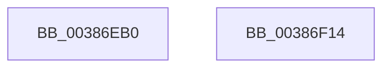

# FsRtlAddLargeMcbEntry

- RVA: `0x00386EB0`–`0x00386F15` (길이 `101` bytes)
- VA: `0x0000000140386EB0`
- 실행 섹션: `.text`
- PDB 이름 있음: `예`; PDB Function 태그: `아니요`
- unwind 정보 RVA: `0x0007FCB4`
- 디코드: `30`개 명령, `101/101` bytes 표시
- 미해석 바이트: `0` (있으면 어셈블리에 `.byte`로 보존)

> 이 문서는 커널 이미지의 기계어와 PDB 기호를 분석해 생성했습니다. 4번과 5번은 함수 원형과 자료형을 바이너리 사용 방식에서 추정한 C 해석이며 원본 소스 복구 결과는 아닙니다.

## 1. Dependencies

- 직접 호출 지점: **3**; 고유 호출 대상: **3**
- 직접 호출자로 확인된 함수: **1**
- RIP 상대 이미지 참조: **0**

### Outgoing calls
- `0x00386ED8` → [ExAcquireFastMutex](../20/ExAcquireFastMutex_function_0020E5A0.md) (function, `0x0020E5A0`)
- `0x00386EEB` → [FsRtlAddBaseMcbEntry](FsRtlAddBaseMcbEntry_function_00387550.md) (function, `0x00387550`)
- `0x00386EF6` → [ExReleaseFastMutex](../25/ExReleaseFastMutex_function_002519C0.md) (function, `0x002519C0`)

### Direct callers
- [FsRtlAddMcbEntry](../58/FsRtlAddMcbEntry_function_00581190.md) at `0x0058119C`

### Static image references
- 디코드된 RIP-relative 메모리 참조가 없습니다.

## 2. Other-region calls and transfers

- 다른 실행 섹션으로 향하는 call: **0**
- 별도 외부 분기/꼬리 이동을 확인하지 못했습니다.

## 3. Assembly (complete function range)

```asm
00386EB0  48 8B C4                        mov rax, rsp
00386EB3  48 89 58 10                     mov qword ptr [rax + 0x10], rbx
00386EB7  48 89 70 18                     mov qword ptr [rax + 0x18], rsi
00386EBB  48 89 78 20                     mov qword ptr [rax + 0x20], rdi
00386EBF  48 89 48 08                     mov qword ptr [rax + 8], rcx
00386EC3  41 56                           push r14
00386EC5  48 83 EC 20                     sub rsp, 0x20
00386EC9  49 8B F9                        mov rdi, r9
00386ECC  49 8B F0                        mov rsi, r8
00386ECF  4C 8B F2                        mov r14, rdx
00386ED2  48 8B D9                        mov rbx, rcx
00386ED5  48 8B 09                        mov rcx, qword ptr [rcx]
00386ED8  E8 C3 76 E8 FF                  call 0x14020e5a0
00386EDD  90                              nop
00386EDE  48 8D 4B 08                     lea rcx, [rbx + 8]
00386EE2  4C 8B CF                        mov r9, rdi
00386EE5  4C 8B C6                        mov r8, rsi
00386EE8  49 8B D6                        mov rdx, r14
00386EEB  E8 60 06 00 00                  call 0x140387550
00386EF0  40 8A F8                        mov dil, al
00386EF3  48 8B 0B                        mov rcx, qword ptr [rbx]
00386EF6  E8 C5 AA EC FF                  call 0x1402519c0
00386EFB  40 8A C7                        mov al, dil
00386EFE  48 8B 5C 24 38                  mov rbx, qword ptr [rsp + 0x38]
00386F03  48 8B 74 24 40                  mov rsi, qword ptr [rsp + 0x40]
00386F08  48 8B 7C 24 48                  mov rdi, qword ptr [rsp + 0x48]
00386F0D  48 83 C4 20                     add rsp, 0x20
00386F11  41 5E                           pop r14
00386F13  C3                              ret
00386F14  CC                              int3
```

## 4. C-style interpretation (structured pseudocode)

```c
__int64 __fastcall FsRtlAddLargeMcbEntry(__int64 a1, __int64 a2, __int64 a3, __int64 a4)
{
    __int64 result;
    __int64 v_rsp;
    unsigned __int64 v_stack_p10;
    unsigned __int64 v_stack_p18;
    unsigned __int64 v_stack_p20;

    *(unsigned __int64 *)(v_rsp + 16) = v_rbx;
    *(unsigned __int64 *)(v_rsp + 24) = v_rsi;
    *(unsigned __int64 *)(v_rsp + 32) = v_rdi;
    *(unsigned __int64 *)(v_rsp + 8) = a1;
    v_rsp = (v_rsp) - (32);
    result = ExAcquireFastMutex(*(unsigned __int64 *)(a1), a2, a3, a4);
    result = FsRtlAddBaseMcbEntry(a1 + 8, a2, a3, a4);
    result = ExReleaseFastMutex(*(unsigned __int64 *)(a1), a2, a3, a4);
    v_rsp = (v_rsp) + (32);
    return (unsigned __int8)((unsigned __int8)(result));
}
```

## 5. (Beta) C Style

```c
int64_t FsRtlAddLargeMcbEntry(void *Arg1, int64_t Arg2, int64_t Arg3, int64_t Arg4)
{
    uint8_t *arg1 = (uint8_t *)Arg1;

    int64_t result;
    int64_t local_rsp;
    uint64_t v_stack_p10;
    uint64_t v_stack_p18;
    uint64_t v_stack_p20;

    *(uint64_t *)(local_rsp + 0x10) = local_rbx;
    *(uint64_t *)(local_rsp + 0x18) = local_rsi;
    *(uint64_t *)(local_rsp + 0x20) = local_rdi;
    *(void **)(local_rsp + 0x8) = Arg1;
    local_rsp = (local_rsp) - (32);
    result = ExAcquireFastMutex(*(uint64_t *)(arg1), Arg2, Arg3, Arg4);
    result = FsRtlAddBaseMcbEntry(Arg1 + 8, Arg2, Arg3, Arg4);
    result = ExReleaseFastMutex(*(uint64_t *)(arg1), Arg2, Arg3, Arg4);
    local_rsp = (local_rsp) + (32);
    return (uint8_t)((uint8_t)(result));
}
```

### 관측된 메모리 오프셋

구조체 형식이 확인되지 않은 접근은 인자 기준의 오프셋으로만 기록했습니다.

| 기준 인자 | 오프셋 표현 | 폭 (bit) | 접근 |
|---|---:|---:|---|
| `Arg1` | `+ 0x0` | `64` | `R` |
| `Arg1` | `+ 0x8` | `64` | `R` |

## 6. Execution-region graph

[열기: 2D/3D 그래프와 함수 탐색 컨트롤 패널](../../../control-panel.html?section=text&rva=0x00386EB0&view=graph)

- 2D 그래프는 위에서 아래로 흐르고, 3D 그래프는 빈 공간을 드래그해 회전합니다. Shift+드래그는 이동, 휠은 확대·축소, 함수 노드 선택은 대상 보고서 이동입니다.

### Static fallback


