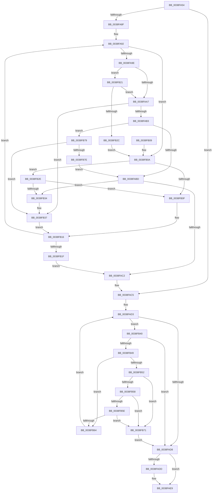

# FsRtlCheckNoExclusiveConflict

- RVA: `0x0038FA54`–`0x0038FB83` (길이 `303` bytes)
- VA: `0x000000014038FA54`
- 실행 섹션: `.text`
- PDB 이름 있음: `예`; PDB Function 태그: `아니요`
- unwind 정보 RVA: `0x00080834`
- 디코드: `94`개 명령, `303/303` bytes 표시
- 미해석 바이트: `0` (있으면 어셈블리에 `.byte`로 보존)

> 이 문서는 커널 이미지의 기계어와 PDB 기호를 분석해 생성했습니다. 4번과 5번은 함수 원형과 자료형을 바이너리 사용 방식에서 추정한 C 해석이며 원본 소스 복구 결과는 아닙니다.

## 1. Dependencies

- 직접 호출 지점: **2**; 고유 호출 대상: **2**
- 직접 호출자로 확인된 함수: **2**
- RIP 상대 이미지 참조: **0**

### Outgoing calls
- `0x0038FAE0` → [RtlSplay](RtlSplay_function_0038F1E0.md) (function, `0x0038F1E0`)
- `0x0038FB64` → [RtlRealSuccessor](RtlRealSuccessor_function_0038DF40.md) (function, `0x0038DF40`)

### Direct callers
- [FsRtlFastCheckLockForWrite](../39/FsRtlFastCheckLockForWrite_function_003910D0.md) at `0x003911FC`
- [sub_003FD43F](../3F/Unknown_function_003FD43F.md) at `0x003FD49A`

### Static image references
- 디코드된 RIP-relative 메모리 참조가 없습니다.

## 2. Other-region calls and transfers

- 다른 실행 섹션으로 향하는 call: **0**
- 별도 외부 분기/꼬리 이동을 확인하지 못했습니다.

## 3. Assembly (complete function range)

```asm
0038FA54  48 89 5C 24 08                  mov qword ptr [rsp + 8], rbx
0038FA59  48 89 6C 24 10                  mov qword ptr [rsp + 0x10], rbp
0038FA5E  48 89 74 24 18                  mov qword ptr [rsp + 0x18], rsi
0038FA63  57                              push rdi
0038FA64  41 54                           push r12
0038FA66  41 55                           push r13
0038FA68  41 56                           push r14
0038FA6A  41 57                           push r15
0038FA6C  48 83 EC 20                     sub rsp, 0x20
0038FA70  48 8B 41 10                     mov rax, qword ptr [rcx + 0x10]
0038FA74  4C 8B E9                        mov r13, rcx
0038FA77  33 C9                           xor ecx, ecx
0038FA79  45 33 DB                        xor r11d, r11d
0038FA7C  33 DB                           xor ebx, ebx
0038FA7E  45 8B E1                        mov r12d, r9d
0038FA81  4D 8B F0                        mov r14, r8
0038FA84  4C 8B FA                        mov r15, rdx
0038FA87  40 B5 01                        mov bpl, 1
0038FA8A  48 85 C0                        test rax, rax
0038FA8D  74 36                           je 0x14038fac5
0038FA8F  4C 8B 0A                        mov r9, qword ptr [rdx]
0038FA92  4C 8B 50 40                     mov r10, qword ptr [rax + 0x40]
0038FA96  4C 8B D8                        mov r11, rax
0038FA99  4D 3B D1                        cmp r10, r9
0038FA9C  72 6C                           jb 0x14038fb0a
0038FA9E  4C 8B 40 18                     mov r8, qword ptr [rax + 0x18]
0038FAA2  4D 85 C0                        test r8, r8
0038FAA5  74 7A                           je 0x14038fb21
0038FAA7  49 8B 16                        mov rdx, qword ptr [r14]
0038FAAA  4C 3B C2                        cmp r8, rdx
0038FAAD  0F 87 84 00 00 00               ja 0x14038fb37
0038FAB3  48 83 FA FF                     cmp rdx, -1
0038FAB7  0F 84 BC 00 00 00               je 0x14038fb79
0038FABD  4D 3B C1                        cmp r8, r9
0038FAC0  77 72                           ja 0x14038fb34
0038FAC2  48 85 C0                        test rax, rax
0038FAC5  48 8B 7C 24 78                  mov rdi, qword ptr [rsp + 0x78]
0038FACA  49 0F 45 CB                     cmovne rcx, r11
0038FACE  48 8B 74 24 70                  mov rsi, qword ptr [rsp + 0x70]
0038FAD3  48 85 C9                        test rcx, rcx
0038FAD6  75 68                           jne 0x14038fb40
0038FAD8  48 85 DB                        test rbx, rbx
0038FADB  74 0C                           je 0x14038fae9
0038FADD  48 8B CB                        mov rcx, rbx
0038FAE0  E8 FB F6 FF FF                  call 0x14038f1e0
0038FAE5  49 89 45 10                     mov qword ptr [r13 + 0x10], rax
0038FAE9  48 8B 5C 24 50                  mov rbx, qword ptr [rsp + 0x50]
0038FAEE  40 8A C5                        mov al, bpl
0038FAF1  48 8B 6C 24 58                  mov rbp, qword ptr [rsp + 0x58]
0038FAF6  48 8B 74 24 60                  mov rsi, qword ptr [rsp + 0x60]
0038FAFB  48 83 C4 20                     add rsp, 0x20
0038FAFF  41 5F                           pop r15
0038FB01  41 5E                           pop r14
0038FB03  41 5D                           pop r13
0038FB05  41 5C                           pop r12
0038FB07  5F                              pop rdi
0038FB08  C3                              ret
0038FB09  CC                              int3
0038FB0A  4D 3B 16                        cmp r10, qword ptr [r14]
0038FB0D  74 1F                           je 0x14038fb2e
0038FB0F  48 8B D8                        mov rbx, rax
0038FB12  48 8B 40 10                     mov rax, qword ptr [rax + 0x10]
0038FB16  48 85 C0                        test rax, rax
0038FB19  0F 85 73 FF FF FF               jne 0x14038fa92
0038FB1F  EB A1                           jmp 0x14038fac2
0038FB21  48 83 78 20 00                  cmp qword ptr [rax + 0x20], 0
0038FB26  0F 85 7B FF FF FF               jne 0x14038faa7
0038FB2C  EB DC                           jmp 0x14038fb0a
0038FB2E  4C 39 48 18                     cmp qword ptr [rax + 0x18], r9
0038FB32  75 DB                           jne 0x14038fb0f
0038FB34  48 8B C8                        mov rcx, rax
0038FB37  48 8B D8                        mov rbx, rax
0038FB3A  48 8B 40 08                     mov rax, qword ptr [rax + 8]
0038FB3E  EB D6                           jmp 0x14038fb16
0038FB40  48 8B 41 18                     mov rax, qword ptr [rcx + 0x18]
0038FB44  49 39 06                        cmp qword ptr [r14], rax
0038FB47  72 8F                           jb 0x14038fad8
0038FB49  48 8B 41 40                     mov rax, qword ptr [rcx + 0x40]
0038FB4D  49 39 07                        cmp qword ptr [r15], rax
0038FB50  77 12                           ja 0x14038fb64
0038FB52  48 39 71 30                     cmp qword ptr [rcx + 0x30], rsi
0038FB56  75 19                           jne 0x14038fb71
0038FB58  48 39 79 38                     cmp qword ptr [rcx + 0x38], rdi
0038FB5C  75 13                           jne 0x14038fb71
0038FB5E  44 39 61 2C                     cmp dword ptr [rcx + 0x2c], r12d
0038FB62  75 0D                           jne 0x14038fb71
0038FB64  E8 D7 E3 FF FF                  call 0x14038df40
0038FB69  48 8B C8                        mov rcx, rax
0038FB6C  E9 62 FF FF FF                  jmp 0x14038fad3
0038FB71  40 32 ED                        xor bpl, bpl
0038FB74  E9 5F FF FF FF                  jmp 0x14038fad8
0038FB79  4D 85 C9                        test r9, r9
0038FB7C  74 B9                           je 0x14038fb37
0038FB7E  E9 3A FF FF FF                  jmp 0x14038fabd
```

## 4. C-style interpretation (structured pseudocode)

```c
__int64 __fastcall FsRtlCheckNoExclusiveConflict(__int64 a1, __int64 a2, __int64 a3, int a4, __int64 a5, __int64 a6)
{
    __int64 result;
    __int64 v_r11;
    __int64 v_rbp;
    __int64 v_rbx;
    __int64 v_rsp;
    unsigned __int64 v_stack_p10;
    unsigned __int64 v_stack_p18;
    unsigned __int64 v_stack_p8;

    v_stack_p8 = v_rbx;
    v_stack_p10 = v_rbp;
    v_stack_p18 = v_rsi;
    v_rsp = (v_rsp) - (32);
    a1 = 0;
    v_r11 = 0;
    v_rbx = 0;
    if (*(unsigned __int64 *)(a1 + 16) == 0) goto loc_0038FAC5;
loc_0038FA92:
    if ((*(unsigned __int64 *)(*(unsigned __int64 *)(a1 + 16) + 64)) < (*(unsigned __int64 *)(a2))) goto loc_0038FB0A;
    if (*(unsigned __int64 *)(*(unsigned __int64 *)(a1 + 16) + 24) == 0) goto loc_0038FB21;
loc_0038FAA7:
    if ((*(unsigned __int64 *)(*(unsigned __int64 *)(a1 + 16) + 24)) > (*(unsigned __int64 *)(a3))) goto loc_0038FB37;
    if ((*(unsigned __int64 *)(a3)) == -1) goto loc_0038FB79;
loc_0038FABD:
    if ((*(unsigned __int64 *)(*(unsigned __int64 *)(a1 + 16) + 24)) > (*(unsigned __int64 *)(a2))) goto loc_0038FB34;
loc_0038FAC2:
loc_0038FAC5:
    if (*(unsigned __int64 *)(a1 + 16) != 0) { a1 = *(unsigned __int64 *)(a1 + 16); }
loc_0038FAD3:
    if (a1 != 0) goto loc_0038FB40;
loc_0038FAD8:
    result = *(unsigned __int64 *)(a1 + 16);
    if (0 != 0) {
        a1 = 0;
        result = RtlSplay(a1, *(unsigned __int64 *)(a3), *(unsigned __int64 *)(*(unsigned __int64 *)(a1 + 16) + 24), *(unsigned __int64 *)(a2));
        *(unsigned __int64 *)(a1 + 16) = result;
    }
    v_rsp = (v_rsp) + (32);
    return 1;
loc_0038FB0A:
    if ((*(unsigned __int64 *)(*(unsigned __int64 *)(a1 + 16) + 64)) == (*(unsigned __int64 *)(a3))) goto loc_0038FB2E;
loc_0038FB0F:
loc_0038FB16:
    if (*(unsigned __int64 *)(1 + 16) != 0) goto loc_0038FA92;
    goto loc_0038FAC2;
loc_0038FB21:
    if ((*(unsigned __int64 *)(*(unsigned __int64 *)(1 + 16) + 32)) != 0) goto loc_0038FAA7;
    goto loc_0038FB0A;
loc_0038FB2E:
    if ((*(unsigned __int64 *)(*(unsigned __int64 *)(1 + 16) + 24)) != (*(unsigned __int64 *)(a2))) goto loc_0038FB0F;
loc_0038FB34:
loc_0038FB37:
    goto loc_0038FB16;
loc_0038FB40:
    if ((*(unsigned __int64 *)(a3)) < (*(unsigned __int64 *)(*(unsigned __int64 *)(1 + 16) + 24))) goto loc_0038FAD8;
    if ((*(unsigned __int64 *)(a2)) > (*(unsigned __int64 *)(*(unsigned __int64 *)(1 + 16) + 64))) goto loc_0038FB64;
    if ((*(unsigned __int64 *)(*(unsigned __int64 *)(1 + 16) + 48)) != v_stack_p18) goto loc_0038FB71;
    if ((*(unsigned __int64 *)(*(unsigned __int64 *)(1 + 16) + 56)) != a6) goto loc_0038FB71;
    if ((*(unsigned int *)(*(unsigned __int64 *)(1 + 16) + 44)) != ((unsigned int)((unsigned int)(a4)))) goto loc_0038FB71;
loc_0038FB64:
    result = RtlRealSuccessor(*(unsigned __int64 *)(1 + 16), *(unsigned __int64 *)(a3), *(unsigned __int64 *)(*(unsigned __int64 *)(a1 + 16) + 24), *(unsigned __int64 *)(a2));
    goto loc_0038FAD3;
loc_0038FB71:
    v_rbp = 0;
    goto loc_0038FAD8;
loc_0038FB79:
    if (*(unsigned __int64 *)(a2) == 0) goto loc_0038FB37;
    goto loc_0038FABD;
}
```

## 5. (Beta) C Style

```c
int64_t FsRtlCheckNoExclusiveConflict(void *Arg1, void *Arg2, void *Arg3, int32_t Arg4, int64_t Arg5, int64_t Arg6)
{
    uint8_t *arg1 = (uint8_t *)Arg1;
    uint8_t *arg2 = (uint8_t *)Arg2;
    uint8_t *arg3 = (uint8_t *)Arg3;

    int64_t result;
    int64_t local_r11;
    int64_t local_rbp;
    int64_t local_rbx;
    int64_t local_rsp;
    uint64_t v_stack_p10;
    uint64_t v_stack_p18;
    uint64_t v_stack_p8;

    v_stack_p8 = local_rbx;
    v_stack_p10 = local_rbp;
    v_stack_p18 = local_rsi;
    local_rsp = (local_rsp) - (32);
    Arg1 = 0;
    local_r11 = 0;
    local_rbx = 0;
    if (*(uint64_t *)(arg1 + 0x10) == 0) goto loc_0038FAC5;
loc_0038FA92:
    if ((*(uint64_t *)(*(uint64_t *)(arg1 + 0x10) + 0x40)) < (*(uint64_t *)(arg2))) goto loc_0038FB0A;
    if (*(uint64_t *)(*(uint64_t *)(arg1 + 0x10) + 0x18) == 0) goto loc_0038FB21;
loc_0038FAA7:
    if ((*(uint64_t *)(*(uint64_t *)(arg1 + 0x10) + 0x18)) > (*(uint64_t *)(arg3))) goto loc_0038FB37;
    if ((*(uint64_t *)(arg3)) == -1) goto loc_0038FB79;
loc_0038FABD:
    if ((*(uint64_t *)(*(uint64_t *)(arg1 + 0x10) + 0x18)) > (*(uint64_t *)(arg2))) goto loc_0038FB34;
loc_0038FAC2:
loc_0038FAC5:
    if (*(uint64_t *)(arg1 + 0x10) != 0) { Arg1 = *(uint64_t *)(arg1 + 0x10); }
loc_0038FAD3:
    if (Arg1 != NULL) goto loc_0038FB40;
loc_0038FAD8:
    result = *(uint64_t *)(arg1 + 0x10);
    if (0 != 0) {
        Arg1 = 0;
        result = RtlSplay(Arg1, *(uint64_t *)(arg3), *(uint64_t *)(*(uint64_t *)(arg1 + 0x10) + 0x18), *(uint64_t *)(arg2));
        *(uint64_t *)(arg1 + 0x10) = result;
    }
    local_rsp = (local_rsp) + (32);
    return 1;
loc_0038FB0A:
    if ((*(uint64_t *)(*(uint64_t *)(arg1 + 0x10) + 0x40)) == (*(uint64_t *)(arg3))) goto loc_0038FB2E;
loc_0038FB0F:
loc_0038FB16:
    if (*(uint64_t *)(1 + 0x10) != 0) goto loc_0038FA92;
    goto loc_0038FAC2;
loc_0038FB21:
    if ((*(uint64_t *)(*(uint64_t *)(1 + 0x10) + 0x20)) != 0) goto loc_0038FAA7;
    goto loc_0038FB0A;
loc_0038FB2E:
    if ((*(uint64_t *)(*(uint64_t *)(1 + 0x10) + 0x18)) != (*(uint64_t *)(arg2))) goto loc_0038FB0F;
loc_0038FB34:
loc_0038FB37:
    goto loc_0038FB16;
loc_0038FB40:
    if ((*(uint64_t *)(arg3)) < (*(uint64_t *)(*(uint64_t *)(1 + 0x10) + 0x18))) goto loc_0038FAD8;
    if ((*(uint64_t *)(arg2)) > (*(uint64_t *)(*(uint64_t *)(1 + 0x10) + 0x40))) goto loc_0038FB64;
    if ((*(uint64_t *)(*(uint64_t *)(1 + 0x10) + 0x30)) != v_stack_p18) goto loc_0038FB71;
    if ((*(uint64_t *)(*(uint64_t *)(1 + 0x10) + 0x38)) != Arg6) goto loc_0038FB71;
    if ((*(uint32_t *)(*(uint64_t *)(1 + 0x10) + 0x2C)) != ((uint32_t)((uint32_t)(Arg4)))) goto loc_0038FB71;
loc_0038FB64:
    result = RtlRealSuccessor(*(uint64_t *)(1 + 0x10), *(uint64_t *)(arg3), *(uint64_t *)(*(uint64_t *)(arg1 + 0x10) + 0x18), *(uint64_t *)(arg2));
    goto loc_0038FAD3;
loc_0038FB71:
    local_rbp = 0;
    goto loc_0038FAD8;
loc_0038FB79:
    if (*(uint64_t *)(arg2) == 0) goto loc_0038FB37;
    goto loc_0038FABD;
}
```

### 관측된 메모리 오프셋

구조체 형식이 확인되지 않은 접근은 인자 기준의 오프셋으로만 기록했습니다.

| 기준 인자 | 오프셋 표현 | 폭 (bit) | 접근 |
|---|---:|---:|---|
| `Arg1` | `+ 0x10` | `64` | `R` |
| `Arg1` | `+ 0x10` | `64` | `W` |
| `Arg2` | `+ 0x0` | `64` | `R` |
| `Arg3` | `+ 0x0` | `64` | `R` |

## 6. Execution-region graph

[열기: 2D/3D 그래프와 함수 탐색 컨트롤 패널](../../../control-panel.html?section=text&rva=0x0038FA54&view=graph)

- 2D 그래프는 위에서 아래로 흐르고, 3D 그래프는 빈 공간을 드래그해 회전합니다. Shift+드래그는 이동, 휠은 확대·축소, 함수 노드 선택은 대상 보고서 이동입니다.

### Static fallback


