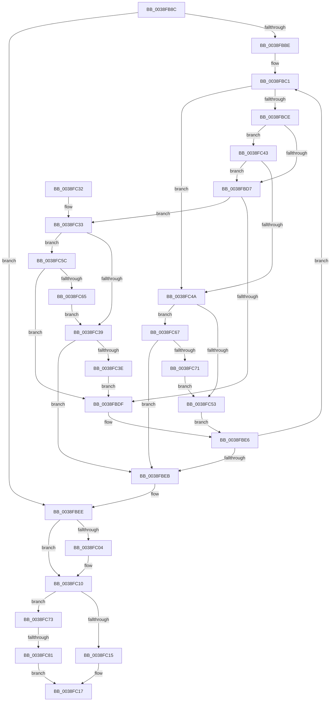

# FsRtlCheckNoSharedConflict

- RVA: `0x0038FB8C`–`0x0038FC94` (길이 `264` bytes)
- VA: `0x000000014038FB8C`
- 실행 섹션: `.text`
- PDB 이름 있음: `예`; PDB Function 태그: `예`
- unwind 정보 RVA: `0x00080854`
- 디코드: `82`개 명령, `264/264` bytes 표시
- 미해석 바이트: `0` (있으면 어셈블리에 `.byte`로 보존)

> 이 문서는 커널 이미지의 기계어와 PDB 기호를 분석해 생성했습니다. 4번과 5번은 함수 원형과 자료형을 바이너리 사용 방식에서 추정한 C 해석이며 원본 소스 복구 결과는 아닙니다.

## 1. Dependencies

- 직접 호출 지점: **2**; 고유 호출 대상: **2**
- 직접 호출자로 확인된 함수: **1**
- RIP 상대 이미지 참조: **0**

### Outgoing calls
- `0x0038FC07` → [RtlSplay](RtlSplay_function_0038F1E0.md) (function, `0x0038F1E0`)
- `0x0038FC87` → [FsRtlFindFirstOverlapInNode](../4F/FsRtlFindFirstOverlapInNode_function_004FC38C.md) (function, `0x004FC38C`)

### Direct callers
- [FsRtlFastCheckLockForWrite](../39/FsRtlFastCheckLockForWrite_function_003910D0.md) at `0x003911D7`

### Static image references
- 디코드된 RIP-relative 메모리 참조가 없습니다.

## 2. Other-region calls and transfers

- 다른 실행 섹션으로 향하는 call: **0**
- call이 아닌 외부 분기/꼬리 이동: **1**
  - `0x0038FC7B` → [sub_006E5778](../6E/Unknown_function_006E5778.md) (`tail-transfer`)

## 3. Assembly (complete function range)

```asm
0038FB8C  48 8B C4                        mov rax, rsp
0038FB8F  48 89 58 08                     mov qword ptr [rax + 8], rbx
0038FB93  48 89 68 10                     mov qword ptr [rax + 0x10], rbp
0038FB97  48 89 70 18                     mov qword ptr [rax + 0x18], rsi
0038FB9B  48 89 78 20                     mov qword ptr [rax + 0x20], rdi
0038FB9F  41 56                           push r14
0038FBA1  48 83 EC 20                     sub rsp, 0x20
0038FBA5  4C 8B 49 08                     mov r9, qword ptr [rcx + 8]
0038FBA9  45 33 DB                        xor r11d, r11d
0038FBAC  33 FF                           xor edi, edi
0038FBAE  33 DB                           xor ebx, ebx
0038FBB0  49 8B F0                        mov rsi, r8
0038FBB3  4C 8B F2                        mov r14, rdx
0038FBB6  48 8B E9                        mov rbp, rcx
0038FBB9  4D 85 C9                        test r9, r9
0038FBBC  74 30                           je 0x14038fbee
0038FBBE  4C 8B 12                        mov r10, qword ptr [rdx]
0038FBC1  4D 8D 59 E8                     lea r11, [r9 - 0x18]
0038FBC5  49 8B 13                        mov rdx, qword ptr [r11]
0038FBC8  4D 39 53 10                     cmp qword ptr [r11 + 0x10], r10
0038FBCC  72 7C                           jb 0x14038fc4a
0038FBCE  4C 8B 42 08                     mov r8, qword ptr [rdx + 8]
0038FBD2  4D 85 C0                        test r8, r8
0038FBD5  74 6C                           je 0x14038fc43
0038FBD7  48 8B 06                        mov rax, qword ptr [rsi]
0038FBDA  4C 3B C0                        cmp r8, rax
0038FBDD  76 54                           jbe 0x14038fc33
0038FBDF  49 8B F9                        mov rdi, r9
0038FBE2  4D 8B 49 08                     mov r9, qword ptr [r9 + 8]
0038FBE6  4D 85 C9                        test r9, r9
0038FBE9  75 D6                           jne 0x14038fbc1
0038FBEB  4D 85 C9                        test r9, r9
0038FBEE  49 0F 45 DB                     cmovne rbx, r11
0038FBF2  48 8D 43 18                     lea rax, [rbx + 0x18]
0038FBF6  48 F7 DB                        neg rbx
0038FBF9  48 1B DB                        sbb rbx, rbx
0038FBFC  48 23 D8                        and rbx, rax
0038FBFF  48 85 FF                        test rdi, rdi
0038FC02  74 0C                           je 0x14038fc10
0038FC04  48 8B CF                        mov rcx, rdi
0038FC07  E8 D4 F5 FF FF                  call 0x14038f1e0
0038FC0C  48 89 45 08                     mov qword ptr [rbp + 8], rax
0038FC10  48 85 DB                        test rbx, rbx
0038FC13  75 5E                           jne 0x14038fc73
0038FC15  B0 01                           mov al, 1
0038FC17  48 8B 5C 24 30                  mov rbx, qword ptr [rsp + 0x30]
0038FC1C  48 8B 6C 24 38                  mov rbp, qword ptr [rsp + 0x38]
0038FC21  48 8B 74 24 40                  mov rsi, qword ptr [rsp + 0x40]
0038FC26  48 8B 7C 24 48                  mov rdi, qword ptr [rsp + 0x48]
0038FC2B  48 83 C4 20                     add rsp, 0x20
0038FC2F  41 5E                           pop r14
0038FC31  C3                              ret
0038FC32  CC                              int3
0038FC33  48 83 F8 FF                     cmp rax, -1
0038FC37  74 23                           je 0x14038fc5c
0038FC39  4D 3B C2                        cmp r8, r10
0038FC3C  76 AD                           jbe 0x14038fbeb
0038FC3E  49 8B DB                        mov rbx, r11
0038FC41  EB 9C                           jmp 0x14038fbdf
0038FC43  48 83 7A 10 00                  cmp qword ptr [rdx + 0x10], 0
0038FC48  75 8D                           jne 0x14038fbd7
0038FC4A  48 8B 06                        mov rax, qword ptr [rsi]
0038FC4D  48 39 42 30                     cmp qword ptr [rdx + 0x30], rax
0038FC51  74 14                           je 0x14038fc67
0038FC53  49 8B F9                        mov rdi, r9
0038FC56  4D 8B 49 10                     mov r9, qword ptr [r9 + 0x10]
0038FC5A  EB 8A                           jmp 0x14038fbe6
0038FC5C  4D 85 D2                        test r10, r10
0038FC5F  0F 84 7A FF FF FF               je 0x14038fbdf
0038FC65  EB D2                           jmp 0x14038fc39
0038FC67  4C 39 52 08                     cmp qword ptr [rdx + 8], r10
0038FC6B  0F 84 7A FF FF FF               je 0x14038fbeb
0038FC71  EB E0                           jmp 0x14038fc53
0038FC73  48 8D 4B E8                     lea rcx, [rbx - 0x18]
0038FC77  80 79 08 00                     cmp byte ptr [rcx + 8], 0
0038FC7B  0F 84 F7 5A 35 00               je 0x1406e5778
0038FC81  4C 8B C6                        mov r8, rsi
0038FC84  49 8B D6                        mov rdx, r14
0038FC87  E8 00 C7 16 00                  call 0x1404fc38c
0038FC8C  48 85 C0                        test rax, rax
0038FC8F  0F 94 C0                        sete al
0038FC92  EB 83                           jmp 0x14038fc17
```

## 4. C-style interpretation (structured pseudocode)

```c
__int64 __fastcall FsRtlCheckNoSharedConflict(__int64 a1, __int64 a2, __int64 a3)
{
    __int64 result;
    __int64 v_r11;
    __int64 v_rbx;
    __int64 v_rdi;
    __int64 v_rsp;
    unsigned __int64 v_stack_p10;
    unsigned __int64 v_stack_p18;
    unsigned __int64 v_stack_p20;
    unsigned __int64 v_stack_p8;

    *(unsigned __int64 *)(v_rsp + 8) = v_rbx;
    *(unsigned __int64 *)(v_rsp + 16) = v_rbp;
    *(unsigned __int64 *)(v_rsp + 24) = v_rsi;
    *(unsigned __int64 *)(v_rsp + 32) = v_rdi;
    v_rsp = (v_rsp) - (32);
    v_r11 = 0;
    v_rdi = 0;
    v_rbx = 0;
    if (*(unsigned __int64 *)(a1 + 8) == 0) goto loc_0038FBEE;
loc_0038FBC1:
    if ((*(unsigned __int64 *)(*(unsigned __int64 *)(a1 + 8) - 24 + 16)) < (*(unsigned __int64 *)(a2))) goto loc_0038FC4A;
    if (*(unsigned __int64 *)(*(unsigned __int64 *)(*(unsigned __int64 *)(a1 + 8) - 24) + 8) == 0) goto loc_0038FC43;
loc_0038FBD7:
    if ((*(unsigned __int64 *)(*(unsigned __int64 *)(*(unsigned __int64 *)(a1 + 8) - 24) + 8)) <= (*(unsigned __int64 *)(a3))) goto loc_0038FC33;
loc_0038FBDF:
loc_0038FBE6:
    if (*(unsigned __int64 *)(*(unsigned __int64 *)(a1 + 8) + 8) != 0) goto loc_0038FBC1;
loc_0038FBEB:
loc_0038FBEE:
    if (*(unsigned __int64 *)(*(unsigned __int64 *)(a1 + 8) + 8) != 0) { v_rbx = *(unsigned __int64 *)(a1 + 8) - 24; }
    v_rbx = -(v_rbx);
    v_rbx = (v_rbx) & (v_rbx + 24);
    result = v_rbx + 24;
    if (*(unsigned __int64 *)(a1 + 8) != 0) {
        a1 = *(unsigned __int64 *)(a1 + 8);
        result = RtlSplay(a1, *(unsigned __int64 *)(*(unsigned __int64 *)(a1 + 8) - 24), *(unsigned __int64 *)(*(unsigned __int64 *)(*(unsigned __int64 *)(a1 + 8) - 24) + 8), *(unsigned __int64 *)(*(unsigned __int64 *)(a1 + 8) + 8));
        *(unsigned __int64 *)(a1 + 8) = result;
    }
    if (v_rbx != 0) goto loc_0038FC73;
loc_0038FC17:
    v_rsp = (v_rsp) + (32);
    return 1;
loc_0038FC33:
    if (1 == -1) goto loc_0038FC5C;
loc_0038FC39:
    if ((*(unsigned __int64 *)(*(unsigned __int64 *)(*(unsigned __int64 *)(a1 + 8) - 24) + 8)) <= (*(unsigned __int64 *)(a2))) goto loc_0038FBEB;
    goto loc_0038FBDF;
loc_0038FC43:
    if ((*(unsigned __int64 *)(*(unsigned __int64 *)(*(unsigned __int64 *)(a1 + 8) - 24) + 16)) != 0) goto loc_0038FBD7;
loc_0038FC4A:
    if ((*(unsigned __int64 *)(*(unsigned __int64 *)(*(unsigned __int64 *)(a1 + 8) - 24) + 48)) == (*(unsigned __int64 *)(v_stack_p18))) goto loc_0038FC67;
loc_0038FC53:
    goto loc_0038FBE6;
loc_0038FC5C:
    if (*(unsigned __int64 *)(a2) == 0) goto loc_0038FBDF;
    goto loc_0038FC39;
loc_0038FC67:
    if ((*(unsigned __int64 *)(*(unsigned __int64 *)(*(unsigned __int64 *)(a1 + 8) - 24) + 8)) == (*(unsigned __int64 *)(a2))) goto loc_0038FBEB;
    goto loc_0038FC53;
loc_0038FC73:
    result = FsRtlFindFirstOverlapInNode(*(unsigned __int64 *)(a1 + 8) - 24 - 24, a2, v_stack_p18, *(unsigned __int64 *)(*(unsigned __int64 *)(*(unsigned __int64 *)(a1 + 8) + 8) + 16));
    result = (result == 0) ? 1 : 0;
    goto loc_0038FC17;
}
```

## 5. (Beta) C Style

```c
int64_t FsRtlCheckNoSharedConflict(void *Arg1, void *Arg2, void *Arg3)
{
    uint8_t *arg1 = (uint8_t *)Arg1;
    uint8_t *arg2 = (uint8_t *)Arg2;
    uint8_t *arg3 = (uint8_t *)Arg3;

    int64_t result;
    int64_t local_r11;
    int64_t local_rbx;
    int64_t local_rdi;
    int64_t local_rsp;
    uint64_t v_stack_p10;
    uint64_t v_stack_p18;
    uint64_t v_stack_p20;
    uint64_t v_stack_p8;

    *(uint64_t *)(local_rsp + 0x8) = local_rbx;
    *(uint64_t *)(local_rsp + 0x10) = local_rbp;
    *(uint64_t *)(local_rsp + 0x18) = local_rsi;
    *(uint64_t *)(local_rsp + 0x20) = local_rdi;
    local_rsp = (local_rsp) - (32);
    local_r11 = 0;
    local_rdi = 0;
    local_rbx = 0;
    if (*(uint64_t *)(arg1 + 0x8) == 0) goto loc_0038FBEE;
loc_0038FBC1:
    if ((*(uint64_t *)(*(uint64_t *)(arg1 + 0x8) - 0x18 + 0x10)) < (*(uint64_t *)(arg2))) goto loc_0038FC4A;
    if (*(uint64_t *)(*(uint64_t *)(*(uint64_t *)(arg1 + 0x8) - 0x18) + 0x8) == 0) goto loc_0038FC43;
loc_0038FBD7:
    if ((*(uint64_t *)(*(uint64_t *)(*(uint64_t *)(arg1 + 0x8) - 0x18) + 0x8)) <= (*(uint64_t *)(arg3))) goto loc_0038FC33;
loc_0038FBDF:
loc_0038FBE6:
    if (*(uint64_t *)(*(uint64_t *)(arg1 + 0x8) + 0x8) != 0) goto loc_0038FBC1;
loc_0038FBEB:
loc_0038FBEE:
    if (*(uint64_t *)(*(uint64_t *)(arg1 + 0x8) + 0x8) != 0) { local_rbx = *(uint64_t *)(arg1 + 0x8) - 24; }
    local_rbx = -(local_rbx);
    local_rbx = (local_rbx) & (local_rbx + 24);
    result = local_rbx + 24;
    if (*(uint64_t *)(arg1 + 0x8) != 0) {
        Arg1 = *(uint64_t *)(arg1 + 0x8);
        result = RtlSplay(Arg1, *(uint64_t *)(*(uint64_t *)(arg1 + 0x8) - 0x18), *(uint64_t *)(*(uint64_t *)(*(uint64_t *)(arg1 + 0x8) - 0x18) + 0x8), *(uint64_t *)(*(uint64_t *)(arg1 + 0x8) + 0x8));
        *(uint64_t *)(arg1 + 0x8) = result;
    }
    if (local_rbx != 0) goto loc_0038FC73;
loc_0038FC17:
    local_rsp = (local_rsp) + (32);
    return 1;
loc_0038FC33:
    if (1 == -1) goto loc_0038FC5C;
loc_0038FC39:
    if ((*(uint64_t *)(*(uint64_t *)(*(uint64_t *)(arg1 + 0x8) - 0x18) + 0x8)) <= (*(uint64_t *)(arg2))) goto loc_0038FBEB;
    goto loc_0038FBDF;
loc_0038FC43:
    if ((*(uint64_t *)(*(uint64_t *)(*(uint64_t *)(arg1 + 0x8) - 0x18) + 0x10)) != 0) goto loc_0038FBD7;
loc_0038FC4A:
    if ((*(uint64_t *)(*(uint64_t *)(*(uint64_t *)(arg1 + 0x8) - 0x18) + 0x30)) == (*(uint64_t *)(v_stack_p18))) goto loc_0038FC67;
loc_0038FC53:
    goto loc_0038FBE6;
loc_0038FC5C:
    if (*(uint64_t *)(arg2) == 0) goto loc_0038FBDF;
    goto loc_0038FC39;
loc_0038FC67:
    if ((*(uint64_t *)(*(uint64_t *)(*(uint64_t *)(arg1 + 0x8) - 0x18) + 0x8)) == (*(uint64_t *)(arg2))) goto loc_0038FBEB;
    goto loc_0038FC53;
loc_0038FC73:
    result = FsRtlFindFirstOverlapInNode(*(uint64_t *)(arg1 + 0x8) - 24 - 24, Arg2, v_stack_p18, *(uint64_t *)(*(uint64_t *)(*(uint64_t *)(arg1 + 0x8) + 0x8) + 0x10));
    result = (result == 0) ? 1 : 0;
    goto loc_0038FC17;
}
```

### 관측된 메모리 오프셋

구조체 형식이 확인되지 않은 접근은 인자 기준의 오프셋으로만 기록했습니다.

| 기준 인자 | 오프셋 표현 | 폭 (bit) | 접근 |
|---|---:|---:|---|
| `Arg1` | `+ 0x8` | `64` | `R` |
| `Arg1` | `+ 0x8` | `64` | `W` |
| `Arg2` | `+ 0x0` | `64` | `R` |
| `Arg3` | `+ 0x0` | `64` | `R` |

## 6. Execution-region graph

[열기: 2D/3D 그래프와 함수 탐색 컨트롤 패널](../../../control-panel.html?section=text&rva=0x0038FB8C&view=graph)

- 2D 그래프는 위에서 아래로 흐르고, 3D 그래프는 빈 공간을 드래그해 회전합니다. Shift+드래그는 이동, 휠은 확대·축소, 함수 노드 선택은 대상 보고서 이동입니다.

### Static fallback


