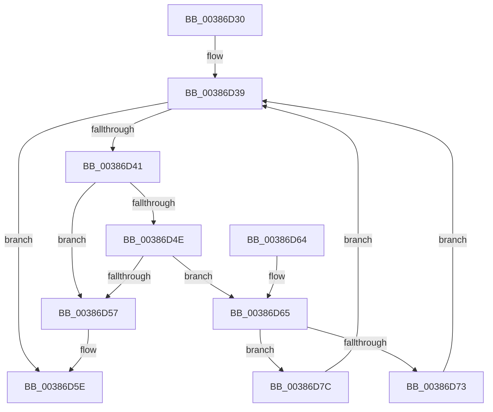

# FsRtlEmptyFreePoolList

- RVA: `0x00386D30`–`0x00386D8D` (길이 `93` bytes)
- VA: `0x0000000140386D30`
- 실행 섹션: `.text`
- PDB 이름 있음: `예`; PDB Function 태그: `아니요`
- unwind 정보 RVA: `0x0007FC80`
- 디코드: `31`개 명령, `93/93` bytes 표시
- 미해석 바이트: `0` (있으면 어셈블리에 `.byte`로 보존)

> 이 문서는 커널 이미지의 기계어와 PDB 기호를 분석해 생성했습니다. 4번과 5번은 함수 원형과 자료형을 바이너리 사용 방식에서 추정한 C 해석이며 원본 소스 복구 결과는 아닙니다.

## 1. Dependencies

- 직접 호출 지점: **2**; 고유 호출 대상: **2**
- 직접 호출자로 확인된 함수: **4**
- RIP 상대 이미지 참조: **1**

### Outgoing calls
- `0x00386D75` → [ExFreePoolWithTag](../../poolcode/B8/ExFreePoolWithTag_function_00B82870.md) (function, `0x00B82870`)
- `0x00386D86` → [ExFreeToPagedLookasideList](ExFreeToPagedLookasideList_function_00387D30.md) (function, `0x00387D30`)

### Direct callers
- [FsRtlFindInTunnelCacheEx](../../page/93/FsRtlFindInTunnelCacheEx_function_00937A50.md) at `0x00937B6C`
- [FsRtlAddToTunnelCacheEx](../../page/93/FsRtlAddToTunnelCacheEx_function_00937C00.md) at `0x00937F3B`
- [FsRtlDeleteKeyFromTunnelCache](../../page/A5/FsRtlDeleteKeyFromTunnelCache_function_00A51E30.md) at `0x00A51E9F`
- [FsRtlFindInTunnelCacheEx$fin$0](../../page/B0/FsRtlFindInTunnelCacheEx_fin_0_function_00B0FB2C.md) at `0x00B0FB42`

### Static image references
- `0x00386D7F` → RVA `0x00E11F00` (`.data`; read)

## 2. Other-region calls and transfers

- 다른 실행 섹션으로 향하는 call: **1**
  - `0x00386D75` → [ExFreePoolWithTag](../../poolcode/B8/ExFreePoolWithTag_function_00B82870.md) (`.text` → `POOLCODE`)
- 별도 외부 분기/꼬리 이동을 확인하지 못했습니다.

## 3. Assembly (complete function range)

```asm
00386D30  40 53                           push rbx
00386D32  48 83 EC 20                     sub rsp, 0x20
00386D36  48 8B D9                        mov rbx, rcx
00386D39  48 8B 03                        mov rax, qword ptr [rbx]
00386D3C  48 3B C3                        cmp rax, rbx
00386D3F  74 1D                           je 0x140386d5e
00386D41  4C 8B 00                        mov r8, qword ptr [rax]
00386D44  48 8D 48 E8                     lea rcx, [rax - 0x18]
00386D48  49 39 40 08                     cmp qword ptr [r8 + 8], rax
00386D4C  75 09                           jne 0x140386d57
00386D4E  48 8B 50 08                     mov rdx, qword ptr [rax + 8]
00386D52  48 39 02                        cmp qword ptr [rdx], rax
00386D55  74 0E                           je 0x140386d65
00386D57  B9 03 00 00 00                  mov ecx, 3
00386D5C  CD 29                           int 0x29
00386D5E  48 83 C4 20                     add rsp, 0x20
00386D62  5B                              pop rbx
00386D63  C3                              ret
00386D64  CC                              int3
00386D65  4C 89 02                        mov qword ptr [rdx], r8
00386D68  49 89 50 08                     mov qword ptr [r8 + 8], rdx
00386D6C  8B 41 38                        mov eax, dword ptr [rcx + 0x38]
00386D6F  A8 01                           test al, 1
00386D71  74 09                           je 0x140386d7c
00386D73  33 D2                           xor edx, edx
00386D75  E8 F6 BA 7F 00                  call 0x140b82870
00386D7A  EB BD                           jmp 0x140386d39
00386D7C  48 8B D1                        mov rdx, rcx
00386D7F  48 8D 0D 7A B1 A8 00            lea rcx, [rip + 0xa8b17a]
00386D86  E8 A5 0F 00 00                  call 0x140387d30
00386D8B  EB AC                           jmp 0x140386d39
```

## 4. C-style interpretation (structured pseudocode)

```c
__int64 __fastcall FsRtlEmptyFreePoolList(__int64 a1)
{
    __int64 result;
    __int64 v_rsp;

    v_rsp = (v_rsp) - (32);
loc_00386D39:
    if ((*(unsigned __int64 *)(a1)) == a1) goto loc_00386D5E;
    if ((*(unsigned __int64 *)(*(unsigned __int64 *)(*(unsigned __int64 *)(a1)) + 8)) != (*(unsigned __int64 *)(a1))) goto loc_00386D57;
    if ((*(unsigned __int64 *)(*(unsigned __int64 *)(*(unsigned __int64 *)(a1) + 8))) == (*(unsigned __int64 *)(a1))) goto loc_00386D65;
loc_00386D57:
loc_00386D5E:
    v_rsp = (v_rsp) + (32);
    return *(unsigned __int64 *)(a1);
loc_00386D65:
    *(unsigned __int64 *)(*(unsigned __int64 *)(*(unsigned __int64 *)(a1) + 8)) = *(unsigned __int64 *)(*(unsigned __int64 *)(a1));
    *(unsigned __int64 *)(*(unsigned __int64 *)(*(unsigned __int64 *)(a1)) + 8) = *(unsigned __int64 *)(*(unsigned __int64 *)(a1) + 8);
    if ((((unsigned __int8)((unsigned int)(*(unsigned int *)(3 + 56)))) & (1)) == 0) goto loc_00386D7C;
    a2 = 0;
    result = ExFreePoolWithTag(3, a2, *(unsigned __int64 *)(*(unsigned __int64 *)(a1)), a4);
    goto loc_00386D39;
loc_00386D7C:
    result = ExFreeToPagedLookasideList(v_rip + 11055482, 3, *(unsigned __int64 *)(*(unsigned __int64 *)(a1)), a4);
    goto loc_00386D39;
}
```

## 5. (Beta) C Style

```c
int64_t FsRtlEmptyFreePoolList(void *Arg1)
{
    uint8_t *arg1 = (uint8_t *)Arg1;

    int64_t result;
    int64_t local_rsp;

    local_rsp = (local_rsp) - (32);
loc_00386D39:
    if ((*(uint64_t *)(arg1)) == Arg1) goto loc_00386D5E;
    if ((*(uint64_t *)(*(uint64_t *)(*(uint64_t *)(arg1)) + 0x8)) != (*(uint64_t *)(arg1))) goto loc_00386D57;
    if ((*(uint64_t *)(*(uint64_t *)(*(uint64_t *)(arg1) + 0x8))) == (*(uint64_t *)(arg1))) goto loc_00386D65;
loc_00386D57:
loc_00386D5E:
    local_rsp = (local_rsp) + (32);
    return *(uint64_t *)(arg1);
loc_00386D65:
    *(uint64_t *)(*(uint64_t *)(*(uint64_t *)(arg1) + 0x8)) = *(uint64_t *)(*(uint64_t *)(arg1));
    *(uint64_t *)(*(uint64_t *)(*(uint64_t *)(arg1)) + 0x8) = *(uint64_t *)(*(uint64_t *)(arg1) + 0x8);
    if ((((uint8_t)((uint32_t)(*(uint32_t *)(3 + 0x38)))) & (1)) == 0) goto loc_00386D7C;
    a2 = 0;
    result = ExFreePoolWithTag(3, a2, *(uint64_t *)(*(uint64_t *)(arg1)), a4);
    goto loc_00386D39;
loc_00386D7C:
    result = ExFreeToPagedLookasideList(v_rip + 11055482, 3, *(uint64_t *)(*(uint64_t *)(arg1)), a4);
    goto loc_00386D39;
}
```

### 관측된 메모리 오프셋

구조체 형식이 확인되지 않은 접근은 인자 기준의 오프셋으로만 기록했습니다.

| 기준 인자 | 오프셋 표현 | 폭 (bit) | 접근 |
|---|---:|---:|---|
| `Arg1` | `+ 0x0` | `64` | `R` |

## 6. Execution-region graph

[열기: 2D/3D 그래프와 함수 탐색 컨트롤 패널](../../../control-panel.html?section=text&rva=0x00386D30&view=graph)

- 2D 그래프는 위에서 아래로 흐르고, 3D 그래프는 빈 공간을 드래그해 회전합니다. Shift+드래그는 이동, 휠은 확대·축소, 함수 노드 선택은 대상 보고서 이동입니다.

### Static fallback


