# FsRtlFastUnlockSingleExclusive

- RVA: `0x0038C8E0`–`0x0038CB76` (길이 `662` bytes)
- VA: `0x000000014038C8E0`
- 실행 섹션: `.text`
- PDB 이름 있음: `예`; PDB Function 태그: `아니요`
- unwind 정보 RVA: `0x0008031C`
- 디코드: `164`개 명령, `662/662` bytes 표시
- 미해석 바이트: `0` (있으면 어셈블리에 `.byte`로 보존)

> 이 문서는 커널 이미지의 기계어와 PDB 기호를 분석해 생성했습니다. 4번과 5번은 함수 원형과 자료형을 바이너리 사용 방식에서 추정한 C 해석이며 원본 소스 복구 결과는 아닙니다.

## 1. Dependencies

- 직접 호출 지점: **14**; 고유 호출 대상: **11**
- 직접 호출자로 확인된 함수: **1**
- RIP 상대 이미지 참조: **4**

### Outgoing calls
- `0x0038C90C` → [KeAcquireSpinLockRaiseToDpc](../20/KeAcquireSpinLockRaiseToDpc_function_00208470.md) (function, `0x00208470`)
- `0x0038C941` → [KiLowerIrqlProcessIrqlFlags](../4F/KiLowerIrqlProcessIrqlFlags_function_004F5698.md) (function, `0x004F5698`)
- `0x0038CA27` → [RtlDelete](RtlDelete_function_0038D8B0.md) (function, `0x0038D8B0`)
- `0x0038CA3C` → [FsRtlPrivateResetLowestLockOffset](FsRtlPrivateResetLowestLockOffset_function_0038D954.md) (function, `0x0038D954`)
- `0x0038CA60` → [ExFreeToNPagedLookasideList](ExFreeToNPagedLookasideList_function_0038D9D0.md) (function, `0x0038D9D0`)
- `0x0038CA81` → [FsRtlPrivateCheckWaitingLocks](FsRtlPrivateCheckWaitingLocks_function_0038DCBC.md) (function, `0x0038DCBC`)
- `0x0038CA8A` → [KxReleaseSpinLock](../20/KxReleaseSpinLock_function_00206670.md) (function, `0x00206670`)
- `0x0038CAA0` → [KiLowerIrqlProcessIrqlFlags](../4F/KiLowerIrqlProcessIrqlFlags_function_004F5698.md) (function, `0x004F5698`)
- `0x0038CAB8` → [KxReleaseSpinLock](../20/KxReleaseSpinLock_function_00206670.md) (function, `0x00206670`)
- `0x0038CAE2` → [RtlRealSuccessor](RtlRealSuccessor_function_0038DF40.md) (function, `0x0038DF40`)
- `0x0038CB17` → [KiReleaseSpinLockInstrumented](../39/KiReleaseSpinLockInstrumented_function_00392EF0.md) (function, `0x00392EF0`)
- `0x0038CB4B` → [KeReleaseSpinLock](../39/KeReleaseSpinLock_function_00392BA0.md) (function, `0x00392BA0`)
- `0x0038CB60` → [guard_dispatch_icall](../6B/guard_dispatch_icall_function_006BAAD0.md) (function, `0x006BAAD0`)
- `0x0038CB69` → [KeAcquireSpinLockRaiseToDpc](../20/KeAcquireSpinLockRaiseToDpc_function_00208470.md) (function, `0x00208470`)

### Direct callers
- [FsRtlPrivateRemoveLock](../4E/FsRtlPrivateRemoveLock_function_004E3244.md) at `0x004E327C`

### Static image references
- `0x0038C91D` → RVA `0x00FC6B06` (`ALMOSTRO`; read)
- `0x0038C930` → RVA `0x00FC6D20` (`ALMOSTRO`; read)
- `0x0038CA59` → RVA `0x00E12180` (`.data`; read)
- `0x0038CB00` → RVA `0x00F0DE58` (`.data`; read)

## 2. Other-region calls and transfers

- 다른 실행 섹션으로 향하는 call: **0**
- 별도 외부 분기/꼬리 이동을 확인하지 못했습니다.

## 3. Assembly (complete function range)

```asm
0038C8E0  48 89 5C 24 10                  mov qword ptr [rsp + 0x10], rbx
0038C8E5  48 89 6C 24 18                  mov qword ptr [rsp + 0x18], rbp
0038C8EA  48 89 74 24 20                  mov qword ptr [rsp + 0x20], rsi
0038C8EF  57                              push rdi
0038C8F0  41 54                           push r12
0038C8F2  41 55                           push r13
0038C8F4  41 56                           push r14
0038C8F6  41 57                           push r15
0038C8F8  48 83 EC 20                     sub rsp, 0x20
0038C8FC  49 8B 18                        mov rbx, qword ptr [r8]
0038C8FF  4C 8B F1                        mov r14, rcx
0038C902  48 83 C1 18                     add rcx, 0x18
0038C906  4D 8B E1                        mov r12, r9
0038C909  4C 8B FA                        mov r15, rdx
0038C90C  E8 5F BB E7 FF                  call 0x140208470
0038C911  49 8B 4E 28                     mov rcx, qword ptr [r14 + 0x28]
0038C915  0F B6 E8                        movzx ebp, al
0038C918  48 85 C9                        test rcx, rcx
0038C91B  75 50                           jne 0x14038c96d
0038C91D  F6 05 E2 A1 C3 00 01            test byte ptr [rip + 0xc3a1e2], 1
0038C924  0F 85 D6 01 00 00               jne 0x14038cb00
0038C92A  F0 49 83 66 18 00               lock and qword ptr [r14 + 0x18], 0
0038C930  83 3D E9 A3 C3 00 00            cmp dword ptr [rip + 0xc3a3e9], 0
0038C937  74 0D                           je 0x14038c946
0038C939  40 0F B6 D5                     movzx edx, bpl
0038C93D  44 0F 20 C1                     mov rcx, cr8
0038C941  E8 52 8D 16 00                  call 0x1404f5698
0038C946  44 0F 22 C5                     mov cr8, rbp
0038C94A  B8 7E 00 00 C0                  mov eax, 0xc000007e
0038C94F  48 8B 5C 24 58                  mov rbx, qword ptr [rsp + 0x58]
0038C954  48 8B 6C 24 60                  mov rbp, qword ptr [rsp + 0x60]
0038C959  48 8B 74 24 68                  mov rsi, qword ptr [rsp + 0x68]
0038C95E  48 83 C4 20                     add rsp, 0x20
0038C962  41 5F                           pop r15
0038C964  41 5E                           pop r14
0038C966  41 5D                           pop r13
0038C968  41 5C                           pop r12
0038C96A  5F                              pop rdi
0038C96B  C3                              ret
0038C96C  CC                              int3
0038C96D  49 8B 04 24                     mov rax, qword ptr [r12]
0038C971  48 FF C8                        dec rax
0038C974  48 03 C3                        add rax, rbx
0038C977  45 33 DB                        xor r11d, r11d
0038C97A  41 8B F3                        mov esi, r11d
0038C97D  4C 8B 49 40                     mov r9, qword ptr [rcx + 0x40]
0038C981  4C 8B D1                        mov r10, rcx
0038C984  4C 3B CB                        cmp r9, rbx
0038C987  0F 82 35 01 00 00               jb 0x14038cac2
0038C98D  48 8B 51 18                     mov rdx, qword ptr [rcx + 0x18]
0038C991  48 85 D2                        test rdx, rdx
0038C994  0F 84 5A 01 00 00               je 0x14038caf4
0038C99A  48 3B D0                        cmp rdx, rax
0038C99D  0F 87 9A 01 00 00               ja 0x14038cb3d
0038C9A3  48 83 F8 FF                     cmp rax, -1
0038C9A7  0F 84 83 01 00 00               je 0x14038cb30
0038C9AD  48 3B D3                        cmp rdx, rbx
0038C9B0  0F 87 84 01 00 00               ja 0x14038cb3a
0038C9B6  44 8B 6C 24 78                  mov r13d, dword ptr [rsp + 0x78]
0038C9BB  48 85 C9                        test rcx, rcx
0038C9BE  49 8B 0C 24                     mov rcx, qword ptr [r12]
0038C9C2  49 0F 45 F2                     cmovne rsi, r10
0038C9C6  48 89 4C 24 50                  mov qword ptr [rsp + 0x50], rcx
0038C9CB  48 85 F6                        test rsi, rsi
0038C9CE  49 0F 44 F3                     cmove rsi, r11
0038C9D2  48 85 F6                        test rsi, rsi
0038C9D5  0F 84 D9 00 00 00               je 0x14038cab4
0038C9DB  4C 39 7E 30                     cmp qword ptr [rsi + 0x30], r15
0038C9DF  0F 85 F4 00 00 00               jne 0x14038cad9
0038C9E5  48 8B 44 24 70                  mov rax, qword ptr [rsp + 0x70]
0038C9EA  48 39 46 38                     cmp qword ptr [rsi + 0x38], rax
0038C9EE  0F 85 E5 00 00 00               jne 0x14038cad9
0038C9F4  44 39 6E 2C                     cmp dword ptr [rsi + 0x2c], r13d
0038C9F8  0F 85 DB 00 00 00               jne 0x14038cad9
0038C9FE  48 39 5E 18                     cmp qword ptr [rsi + 0x18], rbx
0038CA02  4C 8D 66 18                     lea r12, [rsi + 0x18]
0038CA06  0F 85 CD 00 00 00               jne 0x14038cad9
0038CA0C  48 39 4E 20                     cmp qword ptr [rsi + 0x20], rcx
0038CA10  0F 85 C3 00 00 00               jne 0x14038cad9
0038CA16  4D 39 67 78                     cmp qword ptr [r15 + 0x78], r12
0038CA1A  75 08                           jne 0x14038ca24
0038CA1C  49 C7 47 78 00 00 00 00         mov qword ptr [r15 + 0x78], 0
0038CA24  48 8B CE                        mov rcx, rsi
0038CA27  E8 84 0E 00 00                  call 0x14038d8b0
0038CA2C  49 89 46 28                     mov qword ptr [r14 + 0x28], rax
0038CA30  49 8B 04 24                     mov rax, qword ptr [r12]
0038CA34  49 39 06                        cmp qword ptr [r14], rax
0038CA37  75 08                           jne 0x14038ca41
0038CA39  49 8B CE                        mov rcx, r14
0038CA3C  E8 13 0F 00 00                  call 0x14038d954
0038CA41  80 BC 24 88 00 00 00 00         cmp byte ptr [rsp + 0x88], 0
0038CA49  75 0B                           jne 0x14038ca56
0038CA4B  49 83 7E 10 00                  cmp qword ptr [r14 + 0x10], 0
0038CA50  0F 85 ED 00 00 00               jne 0x14038cb43
0038CA56  48 8B D6                        mov rdx, rsi
0038CA59  48 8D 0D 20 57 A8 00            lea rcx, [rip + 0xa85720]
0038CA60  E8 6B 0F 00 00                  call 0x14038d9d0
0038CA65  80 BC 24 90 00 00 00 00         cmp byte ptr [rsp + 0x90], 0
0038CA6D  74 17                           je 0x14038ca86
0038CA6F  49 83 7E 30 00                  cmp qword ptr [r14 + 0x30], 0
0038CA74  74 10                           je 0x14038ca86
0038CA76  44 0F B6 C5                     movzx r8d, bpl
0038CA7A  49 8D 56 18                     lea rdx, [r14 + 0x18]
0038CA7E  49 8B CE                        mov rcx, r14
0038CA81  E8 36 12 00 00                  call 0x14038dcbc
0038CA86  49 8D 4E 18                     lea rcx, [r14 + 0x18]
0038CA8A  E8 E1 9B E7 FF                  call 0x140206670
0038CA8F  83 3D 8A A2 C3 00 00            cmp dword ptr [rip + 0xc3a28a], 0
0038CA96  74 0D                           je 0x14038caa5
0038CA98  44 0F 20 C1                     mov rcx, cr8
0038CA9C  40 0F B6 D5                     movzx edx, bpl
0038CAA0  E8 F3 8B 16 00                  call 0x1404f5698
0038CAA5  40 0F B6 C5                     movzx eax, bpl
0038CAA9  44 0F 22 C0                     mov cr8, rax
0038CAAD  33 C0                           xor eax, eax
0038CAAF  E9 9B FE FF FF                  jmp 0x14038c94f
0038CAB4  49 8D 4E 18                     lea rcx, [r14 + 0x18]
0038CAB8  E8 B3 9B E7 FF                  call 0x140206670
0038CABD  E9 6E FE FF FF                  jmp 0x14038c930
0038CAC2  4C 3B C8                        cmp r9, rax
0038CAC5  74 5A                           je 0x14038cb21
0038CAC7  48 8B 49 10                     mov rcx, qword ptr [rcx + 0x10]
0038CACB  48 85 C9                        test rcx, rcx
0038CACE  0F 85 A9 FE FF FF               jne 0x14038c97d
0038CAD4  E9 DD FE FF FF                  jmp 0x14038c9b6
0038CAD9  48 39 5E 18                     cmp qword ptr [rsi + 0x18], rbx
0038CADD  77 D5                           ja 0x14038cab4
0038CADF  48 8B CE                        mov rcx, rsi
0038CAE2  E8 59 14 00 00                  call 0x14038df40
0038CAE7  48 8B 4C 24 50                  mov rcx, qword ptr [rsp + 0x50]
0038CAEC  48 8B F0                        mov rsi, rax
0038CAEF  E9 DE FE FF FF                  jmp 0x14038c9d2
0038CAF4  4C 39 59 20                     cmp qword ptr [rcx + 0x20], r11
0038CAF8  0F 85 9C FE FF FF               jne 0x14038c99a
0038CAFE  EB C2                           jmp 0x14038cac2
0038CB00  8B 0D 52 13 B8 00               mov ecx, dword ptr [rip + 0xb81352]
0038CB06  85 C9                           test ecx, ecx
0038CB08  0F 85 1C FE FF FF               jne 0x14038c92a
0038CB0E  48 8B 54 24 48                  mov rdx, qword ptr [rsp + 0x48]
0038CB13  49 8D 4E 18                     lea rcx, [r14 + 0x18]
0038CB17  E8 D4 63 00 00                  call 0x140392ef0
0038CB1C  E9 0F FE FF FF                  jmp 0x14038c930
0038CB21  48 39 59 18                     cmp qword ptr [rcx + 0x18], rbx
0038CB25  75 A0                           jne 0x14038cac7
0038CB27  48 8B F1                        mov rsi, rcx
0038CB2A  48 8B 49 08                     mov rcx, qword ptr [rcx + 8]
0038CB2E  EB 9B                           jmp 0x14038cacb
0038CB30  48 85 DB                        test rbx, rbx
0038CB33  74 08                           je 0x14038cb3d
0038CB35  E9 73 FE FF FF                  jmp 0x14038c9ad
0038CB3A  48 8B F1                        mov rsi, rcx
0038CB3D  48 8B 49 08                     mov rcx, qword ptr [rcx + 8]
0038CB41  EB 88                           jmp 0x14038cacb
0038CB43  40 0F B6 D5                     movzx edx, bpl
0038CB47  49 8D 4E 18                     lea rcx, [r14 + 0x18]
0038CB4B  E8 50 60 00 00                  call 0x140392ba0
0038CB50  49 8B 46 10                     mov rax, qword ptr [r14 + 0x10]
0038CB54  48 8D 56 18                     lea rdx, [rsi + 0x18]
0038CB58  48 8B 8C 24 80 00 00 00         mov rcx, qword ptr [rsp + 0x80]
0038CB60  E8 6B DF 32 00                  call 0x1406baad0
0038CB65  49 8D 4E 18                     lea rcx, [r14 + 0x18]
0038CB69  E8 02 B9 E7 FF                  call 0x140208470
0038CB6E  0F B6 E8                        movzx ebp, al
0038CB71  E9 E0 FE FF FF                  jmp 0x14038ca56
```

## 4. C-style interpretation (structured pseudocode)

```c
__int64 __fastcall FsRtlFastUnlockSingleExclusive(__int64 a1, __int64 a2, __int64 a3, __int64 a4, __int64 a5, unsigned int a6, __int64 a7, unsigned __int8 a8, unsigned __int8 a9)
{
    __int64 result;
    __int64 v_r11;
    __int64 v_rsi;
    __int64 v_rsp;
    unsigned __int64 v_stack_p10;
    unsigned __int64 v_stack_p18;
    unsigned __int64 v_stack_p20;
    unsigned __int64 v_stack_p48;
    unsigned __int64 v_stack_p50;

    v_stack_p10 = v_rbx;
    v_stack_p18 = v_rbp;
    v_stack_p20 = v_rsi;
    v_rsp = (v_rsp) - (32);
    a1 = (a1) + (24);
    result = KeAcquireSpinLockRaiseToDpc(a1, a2, a3, a4);
    if (*(unsigned __int64 *)(a1 + 40) != 0) goto loc_0038C96D;
    if (((*(unsigned __int8 *)(v_rip + 12820962)) & (1)) != 0) goto loc_0038CB00;
loc_0038C92A:
loc_0038C930:
    if ((*(unsigned int *)(v_rip + 12821481)) != 0) {
        a2 = (unsigned __int8)((unsigned __int8)(result));
        a1 = v_cr8;
        result = KiLowerIrqlProcessIrqlFlags(a1, a2, a3, a4);
    }
loc_0038C94F:
    v_rsp = (v_rsp) + (32);
    return (unsigned int)(0xC000007EULL);
loc_0038C96D:
    result = (*(unsigned __int64 *)(a4)) - 1;
    result = (result) + (v_stack_p10);
    v_r11 = 0;
loc_0038C97D:
    if ((*(unsigned __int64 *)(a1 + 64)) < v_stack_p10) goto loc_0038CAC2;
    if (*(unsigned __int64 *)(a1 + 24) == 0) goto loc_0038CAF4;
loc_0038C99A:
    if ((*(unsigned __int64 *)(a1 + 24)) > result) goto loc_0038CB3D;
    if (result == -1) goto loc_0038CB30;
loc_0038C9AD:
    if ((*(unsigned __int64 *)(a1 + 24)) > v_stack_p10) goto loc_0038CB3A;
loc_0038C9B6:
    v_rsi = 0;
    if (a1 != 0) { v_rsi = a1; }
    v_stack_p50 = *(unsigned __int64 *)(a4);
    if (v_rsi == 0) { v_rsi = 0; }
loc_0038C9D2:
    if (v_rsi == 0) goto loc_0038CAB4;
    if ((*(unsigned __int64 *)(v_rsi + 48)) != a2) goto loc_0038CAD9;
    if ((*(unsigned __int64 *)(v_rsi + 56)) != a5) goto loc_0038CAD9;
    if ((*(unsigned int *)(v_rsi + 44)) != ((unsigned int)((unsigned int)(a6)))) goto loc_0038CAD9;
    if ((*(unsigned __int64 *)(v_rsi + 24)) != v_stack_p10) goto loc_0038CAD9;
    if ((*(unsigned __int64 *)(v_rsi + 32)) != (*(unsigned __int64 *)(a4))) goto loc_0038CAD9;
    if ((*(unsigned __int64 *)(a2 + 120)) == (v_rsi + 24)) {
        *(unsigned __int64 *)(a2 + 120) = 0;
    }
    result = RtlDelete(v_rsi, *(unsigned __int64 *)(a1 + 24), a3, *(unsigned __int64 *)(a1 + 64));
    *(unsigned __int64 *)(a1 + 40) = result;
    result = *(unsigned __int64 *)(v_rsi + 24);
    if ((*(unsigned __int64 *)(a1)) == (*(unsigned __int64 *)(v_rsi + 24))) {
        a1 = a1;
        result = FsRtlPrivateResetLowestLockOffset(a1, *(unsigned __int64 *)(a1 + 24), a3, *(unsigned __int64 *)(a1 + 64));
    }
    if (a8 != 0) goto loc_0038CA56;
    if ((*(unsigned __int64 *)(a1 + 16)) != 0) goto loc_0038CB43;
loc_0038CA56:
    result = ExFreeToNPagedLookasideList(v_rip + 11032352, v_rsi, a3, *(unsigned __int64 *)(a1 + 64));
    if (a9 == 0) goto loc_0038CA86;
    if ((*(unsigned __int64 *)(a1 + 48)) != 0) {
        a3 = (unsigned __int8)(v_stack_p18);
        a2 = a1 + 24;
        a1 = a1;
        result = FsRtlPrivateCheckWaitingLocks(a1, a2, a3, *(unsigned __int64 *)(a1 + 64));
    }
    result = KxReleaseSpinLock(a1 + 24, a2, a3, *(unsigned __int64 *)(a1 + 64));
    if ((*(unsigned int *)(v_rip + 12821130)) != 0) {
        a1 = (unsigned __int8)(result);
        a2 = (unsigned __int8)(v_stack_p18);
        result = KiLowerIrqlProcessIrqlFlags(a1, a2, a3, *(unsigned __int64 *)(a1 + 64));
    }
    result = 0;
    goto loc_0038C94F;
loc_0038CAB4:
    result = KxReleaseSpinLock(a1 + 24, a2, a3, *(unsigned __int64 *)(a1 + 64));
    goto loc_0038C930;
loc_0038CAC2:
    if ((*(unsigned __int64 *)(a1 + 64)) == result) goto loc_0038CB21;
loc_0038CAC7:
loc_0038CACB:
    if (*(unsigned __int64 *)(a1 + 24 + 16) != 0) goto loc_0038C97D;
    goto loc_0038C9B6;
loc_0038CAD9:
    if ((*(unsigned __int64 *)(v_rsi + 24)) > v_stack_p10) goto loc_0038CAB4;
    result = RtlRealSuccessor(v_rsi, a2, a3, *(unsigned __int64 *)(a1 + 64));
    goto loc_0038C9D2;
loc_0038CAF4:
    if ((*(unsigned __int64 *)(v_stack_p50 + 32)) != 0) goto loc_0038C99A;
    goto loc_0038CAC2;
loc_0038CB00:
    if ((unsigned int)((unsigned int)(*(unsigned int *)(v_rip + 12063570))) != 0) goto loc_0038C92A;
    result = KiReleaseSpinLockInstrumented(a1 + 24, v_stack_p48, a3, *(unsigned __int64 *)(a1 + 64));
    goto loc_0038C930;
loc_0038CB21:
    if ((*(unsigned __int64 *)(a1 + 24 + 24)) != v_stack_p10) goto loc_0038CAC7;
    goto loc_0038CACB;
loc_0038CB30:
    if (v_stack_p10 == 0) goto loc_0038CB3D;
    goto loc_0038C9AD;
loc_0038CB3A:
loc_0038CB3D:
    goto loc_0038CACB;
loc_0038CB43:
    result = KeReleaseSpinLock(a1 + 24, (unsigned __int8)(v_stack_p18), a3, *(unsigned __int64 *)(a1 + 64));
    result = guard_dispatch_icall(a7, *(unsigned __int64 *)(a1 + 24 + 8) + 24, a3, *(unsigned __int64 *)(a1 + 64));
    result = KeAcquireSpinLockRaiseToDpc(a1 + 24, *(unsigned __int64 *)(a1 + 24 + 8) + 24, a3, *(unsigned __int64 *)(a1 + 64));
    goto loc_0038CA56;
}
```

## 5. (Beta) C Style

```c
int64_t FsRtlFastUnlockSingleExclusive(void *Arg1, void *Arg2, void *Arg3, void *Arg4, int64_t Arg5, uint32_t Arg6, int64_t Arg7, uint8_t Arg8, uint8_t Arg9)
{
    uint8_t *arg1 = (uint8_t *)Arg1;
    uint8_t *arg2 = (uint8_t *)Arg2;
    uint8_t *arg3 = (uint8_t *)Arg3;
    uint8_t *arg4 = (uint8_t *)Arg4;

    int64_t result;
    int64_t local_r11;
    int64_t local_rsi;
    int64_t local_rsp;
    uint64_t v_stack_p10;
    uint64_t v_stack_p18;
    uint64_t v_stack_p20;
    uint64_t v_stack_p48;
    uint64_t v_stack_p50;

    v_stack_p10 = local_rbx;
    v_stack_p18 = local_rbp;
    v_stack_p20 = local_rsi;
    local_rsp = (local_rsp) - (32);
    Arg1 = (Arg1) + (24);
    result = KeAcquireSpinLockRaiseToDpc(Arg1, Arg2, Arg3, Arg4);
    if (*(uint64_t *)(arg1 + 0x28) != 0) goto loc_0038C96D;
    if (((*(uint8_t *)(v_rip + 0xC3A1E2)) & (1)) != 0) goto loc_0038CB00;
loc_0038C92A:
loc_0038C930:
    if ((*(uint32_t *)(v_rip + 0xC3A3E9)) != 0) {
        Arg2 = (uint8_t)((uint8_t)(result));
        Arg1 = v_cr8;
        result = KiLowerIrqlProcessIrqlFlags(Arg1, Arg2, Arg3, Arg4);
    }
loc_0038C94F:
    local_rsp = (local_rsp) + (32);
    return (uint32_t)(0xC000007EULL);
loc_0038C96D:
    result = (*(uint64_t *)(arg4)) - 1;
    result = (result) + (v_stack_p10);
    local_r11 = 0;
loc_0038C97D:
    if ((*(uint64_t *)(arg1 + 0x40)) < v_stack_p10) goto loc_0038CAC2;
    if (*(uint64_t *)(arg1 + 0x18) == 0) goto loc_0038CAF4;
loc_0038C99A:
    if ((*(uint64_t *)(arg1 + 0x18)) > result) goto loc_0038CB3D;
    if (result == -1) goto loc_0038CB30;
loc_0038C9AD:
    if ((*(uint64_t *)(arg1 + 0x18)) > v_stack_p10) goto loc_0038CB3A;
loc_0038C9B6:
    local_rsi = 0;
    if (Arg1 != NULL) { local_rsi = Arg1; }
    v_stack_p50 = *(uint64_t *)(arg4);
    if (local_rsi == 0) { local_rsi = 0; }
loc_0038C9D2:
    if (local_rsi == 0) goto loc_0038CAB4;
    if ((*(uint64_t *)(local_rsi + 0x30)) != Arg2) goto loc_0038CAD9;
    if ((*(uint64_t *)(local_rsi + 0x38)) != Arg5) goto loc_0038CAD9;
    if ((*(uint32_t *)(local_rsi + 0x2C)) != ((uint32_t)((uint32_t)(Arg6)))) goto loc_0038CAD9;
    if ((*(uint64_t *)(local_rsi + 0x18)) != v_stack_p10) goto loc_0038CAD9;
    if ((*(uint64_t *)(local_rsi + 0x20)) != (*(uint64_t *)(arg4))) goto loc_0038CAD9;
    if ((*(uint64_t *)(arg2 + 0x78)) == (local_rsi + 24)) {
        *(uint64_t *)(arg2 + 0x78) = 0;
    }
    result = RtlDelete(local_rsi, *(uint64_t *)(arg1 + 0x18), Arg3, *(uint64_t *)(arg1 + 0x40));
    *(uint64_t *)(arg1 + 0x28) = result;
    result = *(uint64_t *)(local_rsi + 0x18);
    if ((*(uint64_t *)(arg1)) == (*(uint64_t *)(local_rsi + 0x18))) {
        Arg1 = Arg1;
        result = FsRtlPrivateResetLowestLockOffset(Arg1, *(uint64_t *)(arg1 + 0x18), Arg3, *(uint64_t *)(arg1 + 0x40));
    }
    if (Arg8 != 0) goto loc_0038CA56;
    if ((*(uint64_t *)(arg1 + 0x10)) != 0) goto loc_0038CB43;
loc_0038CA56:
    result = ExFreeToNPagedLookasideList(v_rip + 11032352, local_rsi, Arg3, *(uint64_t *)(arg1 + 0x40));
    if (Arg9 == 0) goto loc_0038CA86;
    if ((*(uint64_t *)(arg1 + 0x30)) != 0) {
        Arg3 = (uint8_t)(v_stack_p18);
        Arg2 = Arg1 + 24;
        Arg1 = Arg1;
        result = FsRtlPrivateCheckWaitingLocks(Arg1, Arg2, Arg3, *(uint64_t *)(arg1 + 0x40));
    }
    result = KxReleaseSpinLock(Arg1 + 24, Arg2, Arg3, *(uint64_t *)(arg1 + 0x40));
    if ((*(uint32_t *)(v_rip + 0xC3A28A)) != 0) {
        Arg1 = (uint8_t)(result);
        Arg2 = (uint8_t)(v_stack_p18);
        result = KiLowerIrqlProcessIrqlFlags(Arg1, Arg2, Arg3, *(uint64_t *)(arg1 + 0x40));
    }
    result = 0;
    goto loc_0038C94F;
loc_0038CAB4:
    result = KxReleaseSpinLock(Arg1 + 24, Arg2, Arg3, *(uint64_t *)(arg1 + 0x40));
    goto loc_0038C930;
loc_0038CAC2:
    if ((*(uint64_t *)(arg1 + 0x40)) == result) goto loc_0038CB21;
loc_0038CAC7:
loc_0038CACB:
    if (*(uint64_t *)(arg1 + 0x18 + 0x10) != 0) goto loc_0038C97D;
    goto loc_0038C9B6;
loc_0038CAD9:
    if ((*(uint64_t *)(local_rsi + 0x18)) > v_stack_p10) goto loc_0038CAB4;
    result = RtlRealSuccessor(local_rsi, Arg2, Arg3, *(uint64_t *)(arg1 + 0x40));
    goto loc_0038C9D2;
loc_0038CAF4:
    if ((*(uint64_t *)(v_stack_p50 + 0x20)) != 0) goto loc_0038C99A;
    goto loc_0038CAC2;
loc_0038CB00:
    if ((uint32_t)((uint32_t)(*(uint32_t *)(v_rip + 0xB81352))) != 0) goto loc_0038C92A;
    result = KiReleaseSpinLockInstrumented(Arg1 + 24, v_stack_p48, Arg3, *(uint64_t *)(arg1 + 0x40));
    goto loc_0038C930;
loc_0038CB21:
    if ((*(uint64_t *)(arg1 + 0x18 + 0x18)) != v_stack_p10) goto loc_0038CAC7;
    goto loc_0038CACB;
loc_0038CB30:
    if (v_stack_p10 == 0) goto loc_0038CB3D;
    goto loc_0038C9AD;
loc_0038CB3A:
loc_0038CB3D:
    goto loc_0038CACB;
loc_0038CB43:
    result = KeReleaseSpinLock(Arg1 + 24, (uint8_t)(v_stack_p18), Arg3, *(uint64_t *)(arg1 + 0x40));
    result = guard_dispatch_icall(Arg7, *(uint64_t *)(arg1 + 0x18 + 0x8) + 24, Arg3, *(uint64_t *)(arg1 + 0x40));
    result = KeAcquireSpinLockRaiseToDpc(Arg1 + 24, *(uint64_t *)(arg1 + 0x18 + 0x8) + 24, Arg3, *(uint64_t *)(arg1 + 0x40));
    goto loc_0038CA56;
}
```

### 관측된 메모리 오프셋

구조체 형식이 확인되지 않은 접근은 인자 기준의 오프셋으로만 기록했습니다.

| 기준 인자 | 오프셋 표현 | 폭 (bit) | 접근 |
|---|---:|---:|---|
| `Arg1` | `+ 0x0` | `64` | `R` |
| `Arg1` | `+ 0x10` | `64` | `R` |
| `Arg1` | `+ 0x18` | `64` | `R` |
| `Arg1` | `+ 0x18` | `64` | `R/W` |
| `Arg1` | `+ 0x28` | `64` | `R` |
| `Arg1` | `+ 0x28` | `64` | `W` |
| `Arg1` | `+ 0x30` | `64` | `R` |
| `Arg2` | `+ 0x78` | `64` | `R` |
| `Arg2` | `+ 0x78` | `64` | `W` |
| `Arg3` | `+ 0x0` | `64` | `R` |
| `Arg4` | `+ 0x0` | `64` | `R` |

## 6. Execution-region graph

[열기: 2D/3D 그래프와 함수 탐색 컨트롤 패널](../../../control-panel.html?section=text&rva=0x0038C8E0&view=graph)

- 2D 그래프는 위에서 아래로 흐르고, 3D 그래프는 빈 공간을 드래그해 회전합니다. Shift+드래그는 이동, 휠은 확대·축소, 함수 노드 선택은 대상 보고서 이동입니다.

### Static fallback

```mermaid
flowchart TD
  bb_0038C8E0[BB_0038C8E0]
  bb_0038C91D[BB_0038C91D]
  bb_0038C92A[BB_0038C92A]
  bb_0038C930[BB_0038C930]
  bb_0038C939[BB_0038C939]
  bb_0038C946[BB_0038C946]
  bb_0038C94F[BB_0038C94F]
  bb_0038C96C[BB_0038C96C]
  bb_0038C96D[BB_0038C96D]
  bb_0038C97D[BB_0038C97D]
  bb_0038C98D[BB_0038C98D]
  bb_0038C99A[BB_0038C99A]
  bb_0038C9A3[BB_0038C9A3]
  bb_0038C9AD[BB_0038C9AD]
  bb_0038C9B6[BB_0038C9B6]
  bb_0038C9D2[BB_0038C9D2]
  bb_0038C9DB[BB_0038C9DB]
  bb_0038C9E5[BB_0038C9E5]
  bb_0038C9F4[BB_0038C9F4]
  bb_0038C9FE[BB_0038C9FE]
  bb_0038CA0C[BB_0038CA0C]
  bb_0038CA16[BB_0038CA16]
  bb_0038CA1C[BB_0038CA1C]
  bb_0038CA24[BB_0038CA24]
  bb_0038CA39[BB_0038CA39]
  bb_0038CA41[BB_0038CA41]
  bb_0038CA4B[BB_0038CA4B]
  bb_0038CA56[BB_0038CA56]
  bb_0038CA6F[BB_0038CA6F]
  bb_0038CA76[BB_0038CA76]
  bb_0038CA86[BB_0038CA86]
  bb_0038CA98[BB_0038CA98]
  bb_0038CAA5[BB_0038CAA5]
  bb_0038CAB4[BB_0038CAB4]
  bb_0038CAC2[BB_0038CAC2]
  bb_0038CAC7[BB_0038CAC7]
  bb_0038CACB[BB_0038CACB]
  bb_0038CAD4[BB_0038CAD4]
  bb_0038CAD9[BB_0038CAD9]
  bb_0038CADF[BB_0038CADF]
  bb_0038CAF4[BB_0038CAF4]
  bb_0038CAFE[BB_0038CAFE]
  bb_0038CB00[BB_0038CB00]
  bb_0038CB0E[BB_0038CB0E]
  bb_0038CB21[BB_0038CB21]
  bb_0038CB27[BB_0038CB27]
  bb_0038CB30[BB_0038CB30]
  bb_0038CB35[BB_0038CB35]
  bb_0038CB3A[BB_0038CB3A]
  bb_0038CB3D[BB_0038CB3D]
  bb_0038CB43[BB_0038CB43]
  bb_0038C8E0 -->|branch| bb_0038C96D
  bb_0038C8E0 -->|fallthrough| bb_0038C91D
  bb_0038C91D -->|branch| bb_0038CB00
  bb_0038C91D -->|fallthrough| bb_0038C92A
  bb_0038C92A -->|flow| bb_0038C930
  bb_0038C930 -->|branch| bb_0038C946
  bb_0038C930 -->|fallthrough| bb_0038C939
  bb_0038C939 -->|flow| bb_0038C946
  bb_0038C946 -->|flow| bb_0038C94F
  bb_0038C96C -->|flow| bb_0038C96D
  bb_0038C96D -->|flow| bb_0038C97D
  bb_0038C97D -->|branch| bb_0038CAC2
  bb_0038C97D -->|fallthrough| bb_0038C98D
  bb_0038C98D -->|branch| bb_0038CAF4
  bb_0038C98D -->|fallthrough| bb_0038C99A
  bb_0038C99A -->|branch| bb_0038CB3D
  bb_0038C99A -->|fallthrough| bb_0038C9A3
  bb_0038C9A3 -->|branch| bb_0038CB30
  bb_0038C9A3 -->|fallthrough| bb_0038C9AD
  bb_0038C9AD -->|branch| bb_0038CB3A
  bb_0038C9AD -->|fallthrough| bb_0038C9B6
  bb_0038C9B6 -->|flow| bb_0038C9D2
  bb_0038C9D2 -->|branch| bb_0038CAB4
  bb_0038C9D2 -->|fallthrough| bb_0038C9DB
  bb_0038C9DB -->|branch| bb_0038CAD9
  bb_0038C9DB -->|fallthrough| bb_0038C9E5
  bb_0038C9E5 -->|branch| bb_0038CAD9
  bb_0038C9E5 -->|fallthrough| bb_0038C9F4
  bb_0038C9F4 -->|branch| bb_0038CAD9
  bb_0038C9F4 -->|fallthrough| bb_0038C9FE
  bb_0038C9FE -->|branch| bb_0038CAD9
  bb_0038C9FE -->|fallthrough| bb_0038CA0C
  bb_0038CA0C -->|branch| bb_0038CAD9
  bb_0038CA0C -->|fallthrough| bb_0038CA16
  bb_0038CA16 -->|branch| bb_0038CA24
  bb_0038CA16 -->|fallthrough| bb_0038CA1C
  bb_0038CA1C -->|flow| bb_0038CA24
  bb_0038CA24 -->|branch| bb_0038CA41
  bb_0038CA24 -->|fallthrough| bb_0038CA39
  bb_0038CA39 -->|flow| bb_0038CA41
  bb_0038CA41 -->|branch| bb_0038CA56
  bb_0038CA41 -->|fallthrough| bb_0038CA4B
  bb_0038CA4B -->|branch| bb_0038CB43
  bb_0038CA4B -->|fallthrough| bb_0038CA56
  bb_0038CA56 -->|branch| bb_0038CA86
  bb_0038CA56 -->|fallthrough| bb_0038CA6F
  bb_0038CA6F -->|branch| bb_0038CA86
  bb_0038CA6F -->|fallthrough| bb_0038CA76
  bb_0038CA76 -->|flow| bb_0038CA86
  bb_0038CA86 -->|branch| bb_0038CAA5
  bb_0038CA86 -->|fallthrough| bb_0038CA98
  bb_0038CA98 -->|flow| bb_0038CAA5
  bb_0038CAA5 -->|branch| bb_0038C94F
  bb_0038CAB4 -->|branch| bb_0038C930
  bb_0038CAC2 -->|branch| bb_0038CB21
  bb_0038CAC2 -->|fallthrough| bb_0038CAC7
  bb_0038CAC7 -->|flow| bb_0038CACB
  bb_0038CACB -->|branch| bb_0038C97D
  bb_0038CACB -->|fallthrough| bb_0038CAD4
  bb_0038CAD4 -->|branch| bb_0038C9B6
  bb_0038CAD9 -->|branch| bb_0038CAB4
  bb_0038CAD9 -->|fallthrough| bb_0038CADF
  bb_0038CADF -->|branch| bb_0038C9D2
  bb_0038CAF4 -->|branch| bb_0038C99A
  bb_0038CAF4 -->|fallthrough| bb_0038CAFE
  bb_0038CAFE -->|branch| bb_0038CAC2
  bb_0038CB00 -->|branch| bb_0038C92A
  bb_0038CB00 -->|fallthrough| bb_0038CB0E
  bb_0038CB0E -->|branch| bb_0038C930
  bb_0038CB21 -->|branch| bb_0038CAC7
  bb_0038CB21 -->|fallthrough| bb_0038CB27
  bb_0038CB27 -->|branch| bb_0038CACB
  bb_0038CB30 -->|branch| bb_0038CB3D
  bb_0038CB30 -->|fallthrough| bb_0038CB35
  bb_0038CB35 -->|branch| bb_0038C9AD
  bb_0038CB3A -->|flow| bb_0038CB3D
  bb_0038CB3D -->|branch| bb_0038CACB
  bb_0038CB43 -->|branch| bb_0038CA56
```


