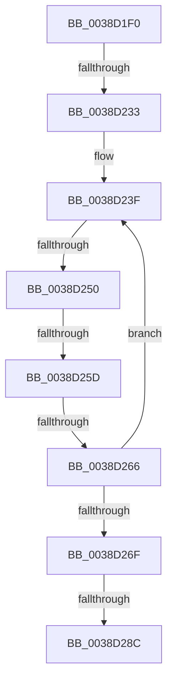

# FsRtlFastUnlockSingleShared

- RVA: `0x0038D1F0`–`0x0038D2A1` (길이 `177` bytes)
- VA: `0x000000014038D1F0`
- 실행 섹션: `.text`
- PDB 이름 있음: `예`; PDB Function 태그: `예`
- unwind 정보 RVA: `0x00080434`
- 디코드: `48`개 명령, `177/177` bytes 표시
- 미해석 바이트: `0` (있으면 어셈블리에 `.byte`로 보존)

> 이 문서는 커널 이미지의 기계어와 PDB 기호를 분석해 생성했습니다. 4번과 5번은 함수 원형과 자료형을 바이너리 사용 방식에서 추정한 C 해석이며 원본 소스 복구 결과는 아닙니다.

## 1. Dependencies

- 직접 호출 지점: **1**; 고유 호출 대상: **1**
- 직접 호출자로 확인된 함수: **1**
- RIP 상대 이미지 참조: **0**

### Outgoing calls
- `0x0038D216` → [KeAcquireSpinLockRaiseToDpc](../20/KeAcquireSpinLockRaiseToDpc_function_00208470.md) (function, `0x00208470`)

### Direct callers
- [FsRtlPrivateRemoveLock](../4E/FsRtlPrivateRemoveLock_function_004E3244.md) at `0x004E3283`

### Static image references
- 디코드된 RIP-relative 메모리 참조가 없습니다.

## 2. Other-region calls and transfers

- 다른 실행 섹션으로 향하는 call: **0**
- call이 아닌 외부 분기/꼬리 이동: **5**
  - `0x0038D22D` → [sub_0038D6B0](Unknown_function_0038D6B0.md) (`tail-transfer`)
  - `0x0038D24A` → [sub_0038D66F + 0xB](Unknown_function_0038D66F.md) (`tail-transfer`)
  - `0x0038D257` → [sub_0038D66F](Unknown_function_0038D66F.md) (`tail-transfer`)
  - `0x0038D260` → [sub_0038D588](Unknown_function_0038D588.md) (`tail-transfer`)
  - `0x0038D286` → [sub_0038D6B0](Unknown_function_0038D6B0.md) (`tail-transfer`)

## 3. Assembly (complete function range)

```asm
0038D1F0  48 89 4C 24 08                  mov qword ptr [rsp + 8], rcx
0038D1F5  53                              push rbx
0038D1F6  55                              push rbp
0038D1F7  56                              push rsi
0038D1F8  57                              push rdi
0038D1F9  41 55                           push r13
0038D1FB  41 56                           push r14
0038D1FD  48 83 EC 58                     sub rsp, 0x58
0038D201  49 8B 18                        mov rbx, qword ptr [r8]
0038D204  48 8D 79 18                     lea rdi, [rcx + 0x18]
0038D208  48 8B CF                        mov rcx, rdi
0038D20B  48 89 7C 24 30                  mov qword ptr [rsp + 0x30], rdi
0038D210  49 8B E9                        mov rbp, r9
0038D213  4C 8B EA                        mov r13, rdx
0038D216  E8 55 B2 E7 FF                  call 0x140208470
0038D21B  4C 8B 57 08                     mov r10, qword ptr [rdi + 8]
0038D21F  44 0F B6 F0                     movzx r14d, al
0038D223  88 84 24 A0 00 00 00            mov byte ptr [rsp + 0xa0], al
0038D22A  4D 85 D2                        test r10, r10
0038D22D  0F 84 7D 04 00 00               je 0x14038d6b0
0038D233  4C 8B 45 00                     mov r8, qword ptr [rbp]
0038D237  49 FF C8                        dec r8
0038D23A  4C 03 C3                        add r8, rbx
0038D23D  33 D2                           xor edx, edx
0038D23F  49 8D 4A E8                     lea rcx, [r10 - 0x18]
0038D243  4C 8B 09                        mov r9, qword ptr [rcx]
0038D246  49 39 5A F8                     cmp qword ptr [r10 - 8], rbx
0038D24A  0F 82 2A 04 00 00               jb 0x14038d67a
0038D250  49 8B 41 08                     mov rax, qword ptr [r9 + 8]
0038D254  48 85 C0                        test rax, rax
0038D257  0F 84 12 04 00 00               je 0x14038d66f
0038D25D  49 3B C0                        cmp rax, r8
0038D260  0F 86 22 03 00 00               jbe 0x14038d588
0038D266  4D 8B 52 08                     mov r10, qword ptr [r10 + 8]
0038D26A  4D 85 D2                        test r10, r10
0038D26D  75 D0                           jne 0x14038d23f
0038D26F  4D 85 D2                        test r10, r10
0038D272  48 0F 45 D1                     cmovne rdx, rcx
0038D276  33 F6                           xor esi, esi
0038D278  48 85 D2                        test rdx, rdx
0038D27B  48 8D 42 18                     lea rax, [rdx + 0x18]
0038D27F  48 0F 45 F0                     cmovne rsi, rax
0038D283  48 85 F6                        test rsi, rsi
0038D286  0F 84 24 04 00 00               je 0x14038d6b0
0038D28C  4C 8B 45 00                     mov r8, qword ptr [rbp]
0038D290  33 FF                           xor edi, edi
0038D292  8B 8C 24 B8 00 00 00            mov ecx, dword ptr [rsp + 0xb8]
0038D299  48 8B 94 24 B0 00 00 00         mov rdx, qword ptr [rsp + 0xb0]
```

## 4. C-style interpretation (structured pseudocode)

```c
__int64 __fastcall FsRtlFastUnlockSingleShared(__int64 a1, __int64 a2, __int64 a3, __int64 a4, __int64 a5, unsigned int a6)
{
    __int64 result;
    __int64 v_rdi;
    __int64 v_rsi;
    __int64 v_rsp;
    unsigned __int64 v_stack_m58;
    unsigned __int8 v_stack_p18;
    unsigned __int64 v_stack_p8;

    v_stack_p8 = a1;
    v_rsp = (v_rsp) - (88);
    v_stack_m58 = a1 + 24;
    result = KeAcquireSpinLockRaiseToDpc(a1 + 24, a2, a3, a4);
    v_stack_p18 = (unsigned __int8)(result);
    a3 = (*(unsigned __int64 *)(a4)) - 1;
    a3 = (a3) + (*(unsigned __int64 *)(a3));
    a2 = 0;
loc_0038D23F:
    if (*(unsigned __int64 *)(*(unsigned __int64 *)(a1 + 24 + 8) + 8) != 0) goto loc_0038D23F;
    if (*(unsigned __int64 *)(*(unsigned __int64 *)(a1 + 24 + 8) + 8) != 0) { a2 = *(unsigned __int64 *)(a1 + 24 + 8) - 24; }
    v_rsi = 0;
    if (a2 != 0) { v_rsi = a2 + 24; }
    v_rdi = 0;
    return a2 + 24;
}
```

## 5. (Beta) C Style

```c
int64_t FsRtlFastUnlockSingleShared(void *Arg1, int64_t Arg2, void *Arg3, void *Arg4, int64_t Arg5, uint32_t Arg6)
{
    uint8_t *arg1 = (uint8_t *)Arg1;
    uint8_t *arg3 = (uint8_t *)Arg3;
    uint8_t *arg4 = (uint8_t *)Arg4;

    int64_t result;
    int64_t local_rdi;
    int64_t local_rsi;
    int64_t local_rsp;
    uint64_t v_stack_m58;
    uint8_t v_stack_p18;
    uint64_t v_stack_p8;

    v_stack_p8 = Arg1;
    local_rsp = (local_rsp) - (88);
    v_stack_m58 = Arg1 + 24;
    result = KeAcquireSpinLockRaiseToDpc(Arg1 + 24, Arg2, Arg3, Arg4);
    v_stack_p18 = (uint8_t)(result);
    Arg3 = (*(uint64_t *)(arg4)) - 1;
    Arg3 = (Arg3) + (*(uint64_t *)(arg3));
    Arg2 = 0;
loc_0038D23F:
    if (*(uint64_t *)(*(uint64_t *)(arg1 + 0x18 + 0x8) + 0x8) != 0) goto loc_0038D23F;
    if (*(uint64_t *)(*(uint64_t *)(arg1 + 0x18 + 0x8) + 0x8) != 0) { Arg2 = *(uint64_t *)(arg1 + 0x18 + 0x8) - 24; }
    local_rsi = 0;
    if (Arg2 != 0) { local_rsi = Arg2 + 24; }
    local_rdi = 0;
    return Arg2 + 24;
}
```

### 관측된 메모리 오프셋

구조체 형식이 확인되지 않은 접근은 인자 기준의 오프셋으로만 기록했습니다.

| 기준 인자 | 오프셋 표현 | 폭 (bit) | 접근 |
|---|---:|---:|---|
| `Arg1` | `+ 0x8` | `64` | `R` |
| `Arg1` | `+ 0x18` | `64` | `R` |
| `Arg3` | `+ 0x0` | `64` | `R` |
| `Arg4` | `+ 0x0` | `64` | `R` |

## 6. Execution-region graph

[열기: 2D/3D 그래프와 함수 탐색 컨트롤 패널](../../../control-panel.html?section=text&rva=0x0038D1F0&view=graph)

- 2D 그래프는 위에서 아래로 흐르고, 3D 그래프는 빈 공간을 드래그해 회전합니다. Shift+드래그는 이동, 휠은 확대·축소, 함수 노드 선택은 대상 보고서 이동입니다.

### Static fallback


