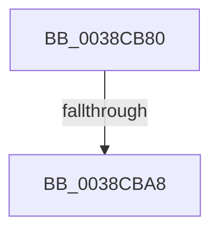

# FsRtlFastUnlockSingle

- RVA: `0x0038CB80`–`0x0038CBAB` (길이 `43` bytes)
- VA: `0x000000014038CB80`
- 실행 섹션: `.text`
- PDB 이름 있음: `예`; PDB Function 태그: `예`
- unwind 정보 RVA: `0x0008033C`
- 디코드: `14`개 명령, `43/43` bytes 표시
- 미해석 바이트: `0` (있으면 어셈블리에 `.byte`로 보존)

> 이 문서는 커널 이미지의 기계어와 PDB 기호를 분석해 생성했습니다. 4번과 5번은 함수 원형과 자료형을 바이너리 사용 방식에서 추정한 C 해석이며 원본 소스 복구 결과는 아닙니다.

## 1. Dependencies

- 직접 호출 지점: **0**; 고유 호출 대상: **0**
- 직접 호출자로 확인된 함수: **1**
- RIP 상대 이미지 참조: **0**

### Outgoing calls
- 직접 디코드된 call 명령이 없습니다.

### Direct callers
- [FsRtlProcessFileLock](../3F/FsRtlProcessFileLock_function_003FD0E0.md) at `0x003FD1E5`

### Static image references
- 디코드된 RIP-relative 메모리 참조가 없습니다.

## 2. Other-region calls and transfers

- 다른 실행 섹션으로 향하는 call: **0**
- call이 아닌 외부 분기/꼬리 이동: **1**
  - `0x0038CBA2` → [sub_0038D011](Unknown_function_0038D011.md) (`tail-transfer`)

## 3. Assembly (complete function range)

```asm
0038CB80  48 89 54 24 10                  mov qword ptr [rsp + 0x10], rdx
0038CB85  56                              push rsi
0038CB86  41 54                           push r12
0038CB88  41 55                           push r13
0038CB8A  41 56                           push r14
0038CB8C  41 57                           push r15
0038CB8E  48 83 EC 60                     sub rsp, 0x60
0038CB92  48 8B 71 18                     mov rsi, qword ptr [rcx + 0x18]
0038CB96  4D 8B E9                        mov r13, r9
0038CB99  4D 8B F0                        mov r14, r8
0038CB9C  4C 8B F9                        mov r15, rcx
0038CB9F  48 85 F6                        test rsi, rsi
0038CBA2  0F 84 69 04 00 00               je 0x14038d011
0038CBA8  49 8B 09                        mov rcx, qword ptr [r9]
```

## 4. C-style interpretation (structured pseudocode)

```c
void __fastcall FsRtlFastUnlockSingle(__int64 a1, __int64 a2, __int64 a3, __int64 a4)
{
    __int64 v_rsp;
    unsigned __int64 v_stack_p10;

    v_stack_p10 = a2;
    v_rsp = (v_rsp) - (96);
    return;
}
```

## 5. (Beta) C Style

```c
void FsRtlFastUnlockSingle(void *Arg1, int64_t Arg2, int64_t Arg3, void *Arg4)
{
    uint8_t *arg1 = (uint8_t *)Arg1;
    uint8_t *arg4 = (uint8_t *)Arg4;

    int64_t local_rsp;
    uint64_t v_stack_p10;

    v_stack_p10 = Arg2;
    local_rsp = (local_rsp) - (96);
    return;
}
```

### 관측된 메모리 오프셋

구조체 형식이 확인되지 않은 접근은 인자 기준의 오프셋으로만 기록했습니다.

| 기준 인자 | 오프셋 표현 | 폭 (bit) | 접근 |
|---|---:|---:|---|
| `Arg1` | `+ 0x18` | `64` | `R` |
| `Arg4` | `+ 0x0` | `64` | `R` |

## 6. Execution-region graph

[열기: 2D/3D 그래프와 함수 탐색 컨트롤 패널](../../../control-panel.html?section=text&rva=0x0038CB80&view=graph)

- 2D 그래프는 위에서 아래로 흐르고, 3D 그래프는 빈 공간을 드래그해 회전합니다. Shift+드래그는 이동, 휠은 확대·축소, 함수 노드 선택은 대상 보고서 이동입니다.

### Static fallback


