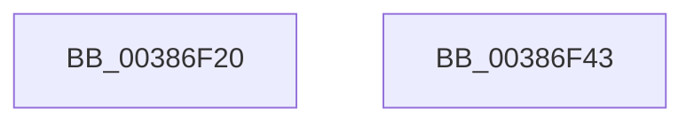

# FsRtlFreeFileLock

- RVA: `0x00386F20`–`0x00386F44` (길이 `36` bytes)
- VA: `0x0000000140386F20`
- 실행 섹션: `.text`
- PDB 이름 있음: `예`; PDB Function 태그: `아니요`
- unwind 정보 RVA: `0x0005CF00`
- 디코드: `11`개 명령, `36/36` bytes 표시
- 미해석 바이트: `0` (있으면 어셈블리에 `.byte`로 보존)

> 이 문서는 커널 이미지의 기계어와 PDB 기호를 분석해 생성했습니다. 4번과 5번은 함수 원형과 자료형을 바이너리 사용 방식에서 추정한 C 해석이며 원본 소스 복구 결과는 아닙니다.

## 1. Dependencies

- 직접 호출 지점: **2**; 고유 호출 대상: **2**
- 직접 호출자로 확인된 함수: **0**
- RIP 상대 이미지 참조: **1**

### Outgoing calls
- `0x00386F29` → [FsRtlUninitializeFileLock](FsRtlUninitializeFileLock_function_00386F50.md) (function, `0x00386F50`)
- `0x00386F38` → [ExFreeToPagedLookasideList](ExFreeToPagedLookasideList_function_00387D30.md) (function, `0x00387D30`)

### Direct callers
- 이 함수 시작 RVA로 연결되는 직접 call은 확인되지 않았습니다. 간접 호출은 완전히 역산할 수 없습니다.

### Static image references
- `0x00386F31` → RVA `0x00E12080` (`.data`; read)

## 2. Other-region calls and transfers

- 다른 실행 섹션으로 향하는 call: **0**
- 별도 외부 분기/꼬리 이동을 확인하지 못했습니다.

## 3. Assembly (complete function range)

```asm
00386F20  40 53                           push rbx
00386F22  48 83 EC 20                     sub rsp, 0x20
00386F26  48 8B D9                        mov rbx, rcx
00386F29  E8 22 00 00 00                  call 0x140386f50
00386F2E  48 8B D3                        mov rdx, rbx
00386F31  48 8D 0D 48 B1 A8 00            lea rcx, [rip + 0xa8b148]
00386F38  E8 F3 0D 00 00                  call 0x140387d30
00386F3D  48 83 C4 20                     add rsp, 0x20
00386F41  5B                              pop rbx
00386F42  C3                              ret
00386F43  CC                              int3
```

## 4. C-style interpretation (structured pseudocode)

```c
__int64 __fastcall FsRtlFreeFileLock(__int64 a1)
{
    __int64 result;
    __int64 v_rsp;

    v_rsp = (v_rsp) - (32);
    result = FsRtlUninitializeFileLock(a1, a2, a3, a4);
    result = ExFreeToPagedLookasideList(v_rip + 11055432, a1, a3, a4);
    v_rsp = (v_rsp) + (32);
    return result;
}
```

## 5. (Beta) C Style

```c
int64_t FsRtlFreeFileLock(int64_t Arg1)
{
    int64_t result;
    int64_t local_rsp;

    local_rsp = (local_rsp) - (32);
    result = FsRtlUninitializeFileLock(Arg1, a2, a3, a4);
    result = ExFreeToPagedLookasideList(v_rip + 11055432, Arg1, a3, a4);
    local_rsp = (local_rsp) + (32);
    return result;
}
```

## 6. Execution-region graph

[열기: 2D/3D 그래프와 함수 탐색 컨트롤 패널](../../../control-panel.html?section=text&rva=0x00386F20&view=graph)

- 2D 그래프는 위에서 아래로 흐르고, 3D 그래프는 빈 공간을 드래그해 회전합니다. Shift+드래그는 이동, 휠은 확대·축소, 함수 노드 선택은 대상 보고서 이동입니다.

### Static fallback


