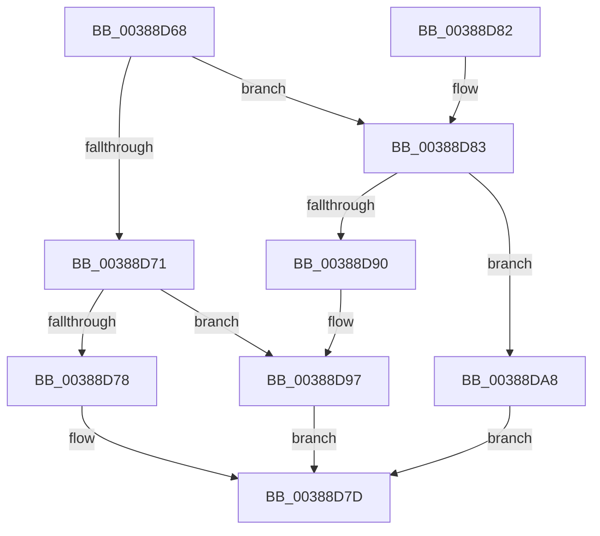

# FsRtlFreeTunnelNode

- RVA: `0x00388D68`–`0x00388DB8` (길이 `80` bytes)
- VA: `0x0000000140388D68`
- 실행 섹션: `.text`
- PDB 이름 있음: `예`; PDB Function 태그: `아니요`
- unwind 정보 RVA: `0x000685EC`
- 디코드: `25`개 명령, `80/80` bytes 표시
- 미해석 바이트: `0` (있으면 어셈블리에 `.byte`로 보존)

> 이 문서는 커널 이미지의 기계어와 PDB 기호를 분석해 생성했습니다. 4번과 5번은 함수 원형과 자료형을 바이너리 사용 방식에서 추정한 C 해석이며 원본 소스 복구 결과는 아닙니다.

## 1. Dependencies

- 직접 호출 지점: **2**; 고유 호출 대상: **2**
- 직접 호출자로 확인된 함수: **2**
- RIP 상대 이미지 참조: **1**

### Outgoing calls
- `0x00388D78` → [ExFreePoolWithTag](../../poolcode/B8/ExFreePoolWithTag_function_00B82870.md) (function, `0x00B82870`)
- `0x00388DA1` → [ExFreeToPagedLookasideList](ExFreeToPagedLookasideList_function_00387D30.md) (function, `0x00387D30`)

### Direct callers
- [FsRtlRemoveNodeFromTunnel](FsRtlRemoveNodeFromTunnel_function_0038A450.md) at `0x0038A4CB`
- [FsRtlPruneTunnelCache](../../page/93/FsRtlPruneTunnelCache_function_009380F0.md) at `0x009381C7`

### Static image references
- `0x00388D9A` → RVA `0x00E11F00` (`.data`; read)

## 2. Other-region calls and transfers

- 다른 실행 섹션으로 향하는 call: **1**
  - `0x00388D78` → [ExFreePoolWithTag](../../poolcode/B8/ExFreePoolWithTag_function_00B82870.md) (`.text` → `POOLCODE`)
- 별도 외부 분기/꼬리 이동을 확인하지 못했습니다.

## 3. Assembly (complete function range)

```asm
00388D68  48 83 EC 28                     sub rsp, 0x28
00388D6C  48 85 D2                        test rdx, rdx
00388D6F  75 12                           jne 0x140388d83
00388D71  8B 41 38                        mov eax, dword ptr [rcx + 0x38]
00388D74  A8 01                           test al, 1
00388D76  74 1F                           je 0x140388d97
00388D78  E8 F3 9A 7F 00                  call 0x140b82870
00388D7D  48 83 C4 28                     add rsp, 0x28
00388D81  C3                              ret
00388D82  CC                              int3
00388D83  48 8B 02                        mov rax, qword ptr [rdx]
00388D86  48 83 C1 18                     add rcx, 0x18
00388D8A  48 39 50 08                     cmp qword ptr [rax + 8], rdx
00388D8E  74 18                           je 0x140388da8
00388D90  B9 03 00 00 00                  mov ecx, 3
00388D95  CD 29                           int 0x29
00388D97  48 8B D1                        mov rdx, rcx
00388D9A  48 8D 0D 5F 91 A8 00            lea rcx, [rip + 0xa8915f]
00388DA1  E8 8A EF FF FF                  call 0x140387d30
00388DA6  EB D5                           jmp 0x140388d7d
00388DA8  48 89 01                        mov qword ptr [rcx], rax
00388DAB  48 89 51 08                     mov qword ptr [rcx + 8], rdx
00388DAF  48 89 48 08                     mov qword ptr [rax + 8], rcx
00388DB3  48 89 0A                        mov qword ptr [rdx], rcx
00388DB6  EB C5                           jmp 0x140388d7d
```

## 4. C-style interpretation (structured pseudocode)

```c
__int64 __fastcall FsRtlFreeTunnelNode(__int64 a1, __int64 a2)
{
    __int64 result;
    __int64 v_rsp;

    v_rsp = (v_rsp) - (40);
    if (a2 != 0) goto loc_00388D83;
    if ((((unsigned __int8)((unsigned int)(*(unsigned int *)(a1 + 56)))) & (1)) == 0) goto loc_00388D97;
    result = ExFreePoolWithTag(a1, a2, a3, a4);
loc_00388D7D:
    v_rsp = (v_rsp) + (40);
    return result;
loc_00388D83:
    a1 = (a1) + (24);
    if ((*(unsigned __int64 *)(*(unsigned __int64 *)(a2) + 8)) == a2) goto loc_00388DA8;
loc_00388D97:
    result = ExFreeToPagedLookasideList(v_rip + 11047263, 3, a3, a4);
    goto loc_00388D7D;
loc_00388DA8:
    *(unsigned __int64 *)(v_rip + 11047263) = result;
    *(unsigned __int64 *)(v_rip + 11047263 + 8) = 3;
    *(unsigned __int64 *)(result + 8) = v_rip + 11047263;
    *(unsigned __int64 *)(3) = v_rip + 11047263;
    goto loc_00388D7D;
}
```

## 5. (Beta) C Style

```c
int64_t FsRtlFreeTunnelNode(void *Arg1, int64_t Arg2)
{
    uint8_t *arg1 = (uint8_t *)Arg1;

    int64_t result;
    int64_t local_rsp;

    local_rsp = (local_rsp) - (40);
    if (Arg2 != 0) goto loc_00388D83;
    if ((((uint8_t)((uint32_t)(*(uint32_t *)(arg1 + 0x38)))) & (1)) == 0) goto loc_00388D97;
    result = ExFreePoolWithTag(Arg1, Arg2, a3, a4);
loc_00388D7D:
    local_rsp = (local_rsp) + (40);
    return result;
loc_00388D83:
    Arg1 = (Arg1) + (24);
    if ((*(uint64_t *)(*(uint64_t *)(Arg2) + 0x8)) == Arg2) goto loc_00388DA8;
loc_00388D97:
    result = ExFreeToPagedLookasideList(v_rip + 11047263, 3, a3, a4);
    goto loc_00388D7D;
loc_00388DA8:
    *(uint64_t *)(v_rip + 0xA8915F) = result;
    *(uint64_t *)(v_rip + 0xA8915F + 0x8) = 3;
    *(uint64_t *)(result + 0x8) = v_rip + 11047263;
    *(uint64_t *)(3) = v_rip + 11047263;
    goto loc_00388D7D;
}
```

### 관측된 메모리 오프셋

구조체 형식이 확인되지 않은 접근은 인자 기준의 오프셋으로만 기록했습니다.

| 기준 인자 | 오프셋 표현 | 폭 (bit) | 접근 |
|---|---:|---:|---|
| `Arg1` | `+ 0x0` | `64` | `W` |
| `Arg1` | `+ 0x8` | `64` | `W` |
| `Arg1` | `+ 0x38` | `32` | `R` |

## 6. Execution-region graph

[열기: 2D/3D 그래프와 함수 탐색 컨트롤 패널](../../../control-panel.html?section=text&rva=0x00388D68&view=graph)

- 2D 그래프는 위에서 아래로 흐르고, 3D 그래프는 빈 공간을 드래그해 회전합니다. Shift+드래그는 이동, 휠은 확대·축소, 함수 노드 선택은 대상 보고서 이동입니다.

### Static fallback


