# FsRtlPrivateCheckForExclusiveLockAccess

- RVA: `0x0038EA28`–`0x0038EBF3` (길이 `459` bytes)
- VA: `0x000000014038EA28`
- 실행 섹션: `.text`
- PDB 이름 있음: `예`; PDB Function 태그: `아니요`
- unwind 정보 RVA: `0x000806C4`
- 디코드: `139`개 명령, `459/459` bytes 표시
- 미해석 바이트: `0` (있으면 어셈블리에 `.byte`로 보존)

> 이 문서는 커널 이미지의 기계어와 PDB 기호를 분석해 생성했습니다. 4번과 5번은 함수 원형과 자료형을 바이너리 사용 방식에서 추정한 C 해석이며 원본 소스 복구 결과는 아닙니다.

## 1. Dependencies

- 직접 호출 지점: **3**; 고유 호출 대상: **2**
- 직접 호출자로 확인된 함수: **2**
- RIP 상대 이미지 참조: **0**

### Outgoing calls
- `0x0038EA62` → [RtlSplay](RtlSplay_function_0038F1E0.md) (function, `0x0038F1E0`)
- `0x0038EB51` → [RtlSplay](RtlSplay_function_0038F1E0.md) (function, `0x0038F1E0`)
- `0x0038EBD3` → [FsRtlFindFirstOverlapInNode](../4F/FsRtlFindFirstOverlapInNode_function_004FC38C.md) (function, `0x004FC38C`)

### Direct callers
- [FsRtlPrivateCheckWaitingLocks](FsRtlPrivateCheckWaitingLocks_function_0038DCBC.md) at `0x0038DD56`
- [FsRtlPrivateLock](FsRtlPrivateLock_function_0038DF90.md) at `0x0038E15F`

### Static image references
- 디코드된 RIP-relative 메모리 참조가 없습니다.

## 2. Other-region calls and transfers

- 다른 실행 섹션으로 향하는 call: **0**
- 별도 외부 분기/꼬리 이동을 확인하지 못했습니다.

## 3. Assembly (complete function range)

```asm
0038EA28  48 89 5C 24 08                  mov qword ptr [rsp + 8], rbx
0038EA2D  48 89 6C 24 10                  mov qword ptr [rsp + 0x10], rbp
0038EA32  48 89 74 24 18                  mov qword ptr [rsp + 0x18], rsi
0038EA37  57                              push rdi
0038EA38  48 83 EC 20                     sub rsp, 0x20
0038EA3C  4C 8B 41 08                     mov r8, qword ptr [rcx + 8]
0038EA40  33 DB                           xor ebx, ebx
0038EA42  48 8B FA                        mov rdi, rdx
0038EA45  48 8B E9                        mov rbp, rcx
0038EA48  4D 85 C0                        test r8, r8
0038EA4B  0F 85 89 01 00 00               jne 0x14038ebda
0038EA51  48 8B 45 10                     mov rax, qword ptr [rbp + 0x10]
0038EA55  48 85 C0                        test rax, rax
0038EA58  75 29                           jne 0x14038ea83
0038EA5A  48 85 DB                        test rbx, rbx
0038EA5D  74 0C                           je 0x14038ea6b
0038EA5F  48 8B CB                        mov rcx, rbx
0038EA62  E8 79 07 00 00                  call 0x14038f1e0
0038EA67  48 89 45 10                     mov qword ptr [rbp + 0x10], rax
0038EA6B  B0 01                           mov al, 1
0038EA6D  48 8B 5C 24 30                  mov rbx, qword ptr [rsp + 0x30]
0038EA72  48 8B 6C 24 38                  mov rbp, qword ptr [rsp + 0x38]
0038EA77  48 8B 74 24 40                  mov rsi, qword ptr [rsp + 0x40]
0038EA7C  48 83 C4 20                     add rsp, 0x20
0038EA80  5F                              pop rdi
0038EA81  C3                              ret
0038EA82  CC                              int3
0038EA83  4C 8B 07                        mov r8, qword ptr [rdi]
0038EA86  33 DB                           xor ebx, ebx
0038EA88  33 C9                           xor ecx, ecx
0038EA8A  4C 8B 50 40                     mov r10, qword ptr [rax + 0x40]
0038EA8E  4C 8B D8                        mov r11, rax
0038EA91  4D 3B D0                        cmp r10, r8
0038EA94  72 3F                           jb 0x14038ead5
0038EA96  4C 8B 48 18                     mov r9, qword ptr [rax + 0x18]
0038EA9A  4D 85 C9                        test r9, r9
0038EA9D  74 4A                           je 0x14038eae9
0038EA9F  48 8B 57 28                     mov rdx, qword ptr [rdi + 0x28]
0038EAA3  4C 3B CA                        cmp r9, rdx
0038EAA6  77 53                           ja 0x14038eafb
0038EAA8  48 83 FA FF                     cmp rdx, -1
0038EAAC  0F 84 33 01 00 00               je 0x14038ebe5
0038EAB2  4D 3B C8                        cmp r9, r8
0038EAB5  77 41                           ja 0x14038eaf8
0038EAB7  48 85 C0                        test rax, rax
0038EABA  49 0F 45 CB                     cmovne rcx, r11
0038EABE  48 85 C9                        test rcx, rcx
0038EAC1  74 97                           je 0x14038ea5a
0038EAC3  48 83 7F 08 00                  cmp qword ptr [rdi + 8], 0
0038EAC8  75 07                           jne 0x14038ead1
0038EACA  48 83 79 20 00                  cmp qword ptr [rcx + 0x20], 0
0038EACF  74 89                           je 0x14038ea5a
0038EAD1  32 C0                           xor al, al
0038EAD3  EB 98                           jmp 0x14038ea6d
0038EAD5  4C 3B 57 28                     cmp r10, qword ptr [rdi + 0x28]
0038EAD9  74 17                           je 0x14038eaf2
0038EADB  48 8B D8                        mov rbx, rax
0038EADE  48 8B 40 10                     mov rax, qword ptr [rax + 0x10]
0038EAE2  48 85 C0                        test rax, rax
0038EAE5  75 A3                           jne 0x14038ea8a
0038EAE7  EB CE                           jmp 0x14038eab7
0038EAE9  48 83 78 20 00                  cmp qword ptr [rax + 0x20], 0
0038EAEE  75 AF                           jne 0x14038ea9f
0038EAF0  EB E3                           jmp 0x14038ead5
0038EAF2  4C 39 40 18                     cmp qword ptr [rax + 0x18], r8
0038EAF6  75 E3                           jne 0x14038eadb
0038EAF8  48 8B C8                        mov rcx, rax
0038EAFB  48 8B D8                        mov rbx, rax
0038EAFE  48 8B 40 08                     mov rax, qword ptr [rax + 8]
0038EB02  EB DE                           jmp 0x14038eae2
0038EB04  49 8D 70 E8                     lea rsi, [r8 - 0x18]
0038EB08  4C 8B 0E                        mov r9, qword ptr [rsi]
0038EB0B  48 39 56 10                     cmp qword ptr [rsi + 0x10], rdx
0038EB0F  72 67                           jb 0x14038eb78
0038EB11  4D 8B 51 08                     mov r10, qword ptr [r9 + 8]
0038EB15  4D 85 D2                        test r10, r10
0038EB18  74 57                           je 0x14038eb71
0038EB1A  48 8B 47 28                     mov rax, qword ptr [rdi + 0x28]
0038EB1E  4C 3B D0                        cmp r10, rax
0038EB21  76 3E                           jbe 0x14038eb61
0038EB23  49 8B D8                        mov rbx, r8
0038EB26  4D 8B 40 08                     mov r8, qword ptr [r8 + 8]
0038EB2A  4D 85 C0                        test r8, r8
0038EB2D  75 D5                           jne 0x14038eb04
0038EB2F  4D 85 C0                        test r8, r8
0038EB32  4C 0F 45 DE                     cmovne r11, rsi
0038EB36  49 8D 43 18                     lea rax, [r11 + 0x18]
0038EB3A  49 F7 DB                        neg r11
0038EB3D  48 1B C9                        sbb rcx, rcx
0038EB40  48 23 C8                        and rcx, rax
0038EB43  75 46                           jne 0x14038eb8b
0038EB45  48 85 DB                        test rbx, rbx
0038EB48  0F 84 03 FF FF FF               je 0x14038ea51
0038EB4E  48 8B CB                        mov rcx, rbx
0038EB51  E8 8A 06 00 00                  call 0x14038f1e0
0038EB56  48 89 45 08                     mov qword ptr [rbp + 8], rax
0038EB5A  33 DB                           xor ebx, ebx
0038EB5C  E9 F0 FE FF FF                  jmp 0x14038ea51
0038EB61  48 83 F8 FF                     cmp rax, -1
0038EB65  74 4E                           je 0x14038ebb5
0038EB67  4C 3B D2                        cmp r10, rdx
0038EB6A  76 C3                           jbe 0x14038eb2f
0038EB6C  4C 8B DE                        mov r11, rsi
0038EB6F  EB B2                           jmp 0x14038eb23
0038EB71  49 83 79 10 00                  cmp qword ptr [r9 + 0x10], 0
0038EB76  75 A2                           jne 0x14038eb1a
0038EB78  48 8B 47 28                     mov rax, qword ptr [rdi + 0x28]
0038EB7C  49 39 41 30                     cmp qword ptr [r9 + 0x30], rax
0038EB80  74 3E                           je 0x14038ebc0
0038EB82  49 8B D8                        mov rbx, r8
0038EB85  4D 8B 40 10                     mov r8, qword ptr [r8 + 0x10]
0038EB89  EB 9F                           jmp 0x14038eb2a
0038EB8B  48 83 C1 E8                     add rcx, -0x18
0038EB8F  80 79 08 00                     cmp byte ptr [rcx + 8], 0
0038EB93  75 37                           jne 0x14038ebcc
0038EB95  48 8B 01                        mov rax, qword ptr [rcx]
0038EB98  48 85 C0                        test rax, rax
0038EB9B  74 A8                           je 0x14038eb45
0038EB9D  48 83 7F 08 00                  cmp qword ptr [rdi + 8], 0
0038EBA2  0F 85 29 FF FF FF               jne 0x14038ead1
0038EBA8  48 83 78 10 00                  cmp qword ptr [rax + 0x10], 0
0038EBAD  0F 85 1E FF FF FF               jne 0x14038ead1
0038EBB3  EB 90                           jmp 0x14038eb45
0038EBB5  48 85 D2                        test rdx, rdx
0038EBB8  0F 84 65 FF FF FF               je 0x14038eb23
0038EBBE  EB A7                           jmp 0x14038eb67
0038EBC0  49 39 51 08                     cmp qword ptr [r9 + 8], rdx
0038EBC4  0F 84 65 FF FF FF               je 0x14038eb2f
0038EBCA  EB B6                           jmp 0x14038eb82
0038EBCC  4C 8D 47 28                     lea r8, [rdi + 0x28]
0038EBD0  48 8B D7                        mov rdx, rdi
0038EBD3  E8 B4 D7 16 00                  call 0x1404fc38c
0038EBD8  EB BE                           jmp 0x14038eb98
0038EBDA  48 8B 12                        mov rdx, qword ptr [rdx]
0038EBDD  45 33 DB                        xor r11d, r11d
0038EBE0  E9 1F FF FF FF                  jmp 0x14038eb04
0038EBE5  4D 85 C0                        test r8, r8
0038EBE8  0F 84 0D FF FF FF               je 0x14038eafb
0038EBEE  E9 BF FE FF FF                  jmp 0x14038eab2
```

## 4. C-style interpretation (structured pseudocode)

```c
__int64 __fastcall FsRtlPrivateCheckForExclusiveLockAccess(__int64 a1, __int64 a2)
{
    __int64 result;
    __int64 v_r11;
    __int64 v_rbx;
    __int64 v_rsp;
    unsigned __int64 v_stack_p10;
    unsigned __int64 v_stack_p18;
    unsigned __int64 v_stack_p8;

    v_stack_p8 = v_rbx;
    v_stack_p10 = v_rbp;
    v_stack_p18 = v_rsi;
    v_rsp = (v_rsp) - (32);
    v_rbx = 0;
    if (*(unsigned __int64 *)(a1 + 8) != 0) goto loc_0038EBDA;
loc_0038EA51:
    if (*(unsigned __int64 *)(a1 + 16) != 0) goto loc_0038EA83;
loc_0038EA5A:
    result = *(unsigned __int64 *)(a1 + 16);
    if (0 != 0) {
        a1 = 0;
        result = RtlSplay(a1, a2, *(unsigned __int64 *)(a1 + 8), a4);
        *(unsigned __int64 *)(a1 + 16) = result;
    }
loc_0038EA6D:
    v_rsp = (v_rsp) + (32);
    return 1;
loc_0038EA83:
    v_rbx = 0;
    a1 = 0;
loc_0038EA8A:
    if ((*(unsigned __int64 *)(1 + 64)) < (*(unsigned __int64 *)(a2))) goto loc_0038EAD5;
    if (*(unsigned __int64 *)(1 + 24) == 0) goto loc_0038EAE9;
loc_0038EA9F:
    if ((*(unsigned __int64 *)(1 + 24)) > (*(unsigned __int64 *)(a2 + 40))) goto loc_0038EAFB;
    if ((*(unsigned __int64 *)(a2 + 40)) == -1) goto loc_0038EBE5;
loc_0038EAB2:
    if ((*(unsigned __int64 *)(1 + 24)) > (*(unsigned __int64 *)(a2))) goto loc_0038EAF8;
loc_0038EAB7:
    if (1 != 0) { a1 = 1; }
    if (a1 == 0) goto loc_0038EA5A;
    if ((*(unsigned __int64 *)(a2 + 8)) != 0) goto loc_0038EAD1;
    if ((*(unsigned __int64 *)(a1 + 32)) == 0) goto loc_0038EA5A;
loc_0038EAD1:
    result = 0;
    goto loc_0038EA6D;
loc_0038EAD5:
    if ((*(unsigned __int64 *)(1 + 64)) == (*(unsigned __int64 *)(a2 + 40))) goto loc_0038EAF2;
loc_0038EADB:
loc_0038EAE2:
    if (*(unsigned __int64 *)(result + 16) != 0) goto loc_0038EA8A;
    goto loc_0038EAB7;
loc_0038EAE9:
    if ((*(unsigned __int64 *)(*(unsigned __int64 *)(result + 16) + 32)) != 0) goto loc_0038EA9F;
    goto loc_0038EAD5;
loc_0038EAF2:
    if ((*(unsigned __int64 *)(*(unsigned __int64 *)(result + 16) + 24)) != (*(unsigned __int64 *)(a2))) goto loc_0038EADB;
loc_0038EAF8:
loc_0038EAFB:
    goto loc_0038EAE2;
loc_0038EB04:
    if ((*(unsigned __int64 *)(*(unsigned __int64 *)(a2) - 24 + 16)) < (*(unsigned __int64 *)(a2 + 40))) goto loc_0038EB78;
    if (*(unsigned __int64 *)(*(unsigned __int64 *)(*(unsigned __int64 *)(a2) - 24) + 8) == 0) goto loc_0038EB71;
loc_0038EB1A:
    if ((*(unsigned __int64 *)(*(unsigned __int64 *)(*(unsigned __int64 *)(a2) - 24) + 8)) <= (*(unsigned __int64 *)(a2 + 40))) goto loc_0038EB61;
loc_0038EB23:
loc_0038EB2A:
    if (*(unsigned __int64 *)(*(unsigned __int64 *)(a2) + 8) != 0) goto loc_0038EB04;
loc_0038EB2F:
    v_r11 = 1;
    if (*(unsigned __int64 *)(*(unsigned __int64 *)(a2) + 8) != 0) { v_r11 = *(unsigned __int64 *)(a2) - 24; }
    v_r11 = -(v_r11);
    a1 = (*(unsigned __int64 *)(result + 16)) & (v_r11 + 24);
    if (condition_is_not_equal) goto loc_0038EB8B;
loc_0038EB45:
    if (*(unsigned __int64 *)(a2) == 0) goto loc_0038EA51;
    result = RtlSplay(*(unsigned __int64 *)(a2), *(unsigned __int64 *)(a2 + 40), *(unsigned __int64 *)(*(unsigned __int64 *)(a2) + 8), *(unsigned __int64 *)(*(unsigned __int64 *)(a2) - 24));
    *(unsigned __int64 *)(v_stack_p10 + 8) = result;
    v_rbx = 0;
    goto loc_0038EA51;
loc_0038EB61:
    if (result == -1) goto loc_0038EBB5;
loc_0038EB67:
    if ((*(unsigned __int64 *)(*(unsigned __int64 *)(*(unsigned __int64 *)(a2) - 24) + 8)) <= (*(unsigned __int64 *)(a2 + 40))) goto loc_0038EB2F;
    goto loc_0038EB23;
loc_0038EB71:
    if ((*(unsigned __int64 *)(*(unsigned __int64 *)(*(unsigned __int64 *)(a2) - 24) + 16)) != 0) goto loc_0038EB1A;
loc_0038EB78:
    if ((*(unsigned __int64 *)(*(unsigned __int64 *)(*(unsigned __int64 *)(a2) - 24) + 48)) == (*(unsigned __int64 *)(a2 + 40))) goto loc_0038EBC0;
loc_0038EB82:
    goto loc_0038EB2A;
loc_0038EB8B:
    a1 = (*(unsigned __int64 *)(a2)) + (-24);
    if ((*(unsigned __int8 *)(a1 + 8)) != 0) goto loc_0038EBCC;
loc_0038EB98:
    if (*(unsigned __int64 *)(a1) == 0) goto loc_0038EB45;
    if ((*(unsigned __int64 *)(a2 + 8)) != 0) goto loc_0038EAD1;
    if ((*(unsigned __int64 *)(*(unsigned __int64 *)(a1) + 16)) != 0) goto loc_0038EAD1;
    goto loc_0038EB45;
loc_0038EBB5:
    if (*(unsigned __int64 *)(a2 + 40) == 0) goto loc_0038EB23;
    goto loc_0038EB67;
loc_0038EBC0:
    if ((*(unsigned __int64 *)(*(unsigned __int64 *)(*(unsigned __int64 *)(a2) - 24) + 8)) == (*(unsigned __int64 *)(a2 + 40))) goto loc_0038EB2F;
    goto loc_0038EB82;
loc_0038EBCC:
    result = FsRtlFindFirstOverlapInNode(a1, a2, a2 + 40, *(unsigned __int64 *)(*(unsigned __int64 *)(a2) - 24));
    goto loc_0038EB98;
loc_0038EBDA:
    v_r11 = 0;
    goto loc_0038EB04;
loc_0038EBE5:
    if (a2 + 40 == 0) goto loc_0038EAFB;
    goto loc_0038EAB2;
}
```

## 5. (Beta) C Style

```c
int64_t FsRtlPrivateCheckForExclusiveLockAccess(void *Arg1, void *Arg2)
{
    uint8_t *arg1 = (uint8_t *)Arg1;
    uint8_t *arg2 = (uint8_t *)Arg2;

    int64_t result;
    int64_t local_r11;
    int64_t local_rbx;
    int64_t local_rsp;
    uint64_t v_stack_p10;
    uint64_t v_stack_p18;
    uint64_t v_stack_p8;

    v_stack_p8 = local_rbx;
    v_stack_p10 = local_rbp;
    v_stack_p18 = local_rsi;
    local_rsp = (local_rsp) - (32);
    local_rbx = 0;
    if (*(uint64_t *)(arg1 + 0x8) != 0) goto loc_0038EBDA;
loc_0038EA51:
    if (*(uint64_t *)(arg1 + 0x10) != 0) goto loc_0038EA83;
loc_0038EA5A:
    result = *(uint64_t *)(arg1 + 0x10);
    if (0 != 0) {
        Arg1 = 0;
        result = RtlSplay(Arg1, Arg2, *(uint64_t *)(arg1 + 0x8), a4);
        *(uint64_t *)(arg1 + 0x10) = result;
    }
loc_0038EA6D:
    local_rsp = (local_rsp) + (32);
    return 1;
loc_0038EA83:
    local_rbx = 0;
    Arg1 = 0;
loc_0038EA8A:
    if ((*(uint64_t *)(1 + 0x40)) < (*(uint64_t *)(arg2))) goto loc_0038EAD5;
    if (*(uint64_t *)(1 + 0x18) == 0) goto loc_0038EAE9;
loc_0038EA9F:
    if ((*(uint64_t *)(1 + 0x18)) > (*(uint64_t *)(arg2 + 0x28))) goto loc_0038EAFB;
    if ((*(uint64_t *)(arg2 + 0x28)) == -1) goto loc_0038EBE5;
loc_0038EAB2:
    if ((*(uint64_t *)(1 + 0x18)) > (*(uint64_t *)(arg2))) goto loc_0038EAF8;
loc_0038EAB7:
    if (1 != 0) { Arg1 = 1; }
    if (Arg1 == NULL) goto loc_0038EA5A;
    if ((*(uint64_t *)(arg2 + 0x8)) != 0) goto loc_0038EAD1;
    if ((*(uint64_t *)(arg1 + 0x20)) == 0) goto loc_0038EA5A;
loc_0038EAD1:
    result = 0;
    goto loc_0038EA6D;
loc_0038EAD5:
    if ((*(uint64_t *)(1 + 0x40)) == (*(uint64_t *)(arg2 + 0x28))) goto loc_0038EAF2;
loc_0038EADB:
loc_0038EAE2:
    if (*(uint64_t *)(result + 0x10) != 0) goto loc_0038EA8A;
    goto loc_0038EAB7;
loc_0038EAE9:
    if ((*(uint64_t *)(*(uint64_t *)(result + 0x10) + 0x20)) != 0) goto loc_0038EA9F;
    goto loc_0038EAD5;
loc_0038EAF2:
    if ((*(uint64_t *)(*(uint64_t *)(result + 0x10) + 0x18)) != (*(uint64_t *)(arg2))) goto loc_0038EADB;
loc_0038EAF8:
loc_0038EAFB:
    goto loc_0038EAE2;
loc_0038EB04:
    if ((*(uint64_t *)(*(uint64_t *)(arg2) - 0x18 + 0x10)) < (*(uint64_t *)(arg2 + 0x28))) goto loc_0038EB78;
    if (*(uint64_t *)(*(uint64_t *)(*(uint64_t *)(arg2) - 0x18) + 0x8) == 0) goto loc_0038EB71;
loc_0038EB1A:
    if ((*(uint64_t *)(*(uint64_t *)(*(uint64_t *)(arg2) - 0x18) + 0x8)) <= (*(uint64_t *)(arg2 + 0x28))) goto loc_0038EB61;
loc_0038EB23:
loc_0038EB2A:
    if (*(uint64_t *)(*(uint64_t *)(arg2) + 0x8) != 0) goto loc_0038EB04;
loc_0038EB2F:
    local_r11 = 1;
    if (*(uint64_t *)(*(uint64_t *)(arg2) + 0x8) != 0) { local_r11 = *(uint64_t *)(arg2) - 24; }
    local_r11 = -(local_r11);
    Arg1 = (*(uint64_t *)(result + 0x10)) & (local_r11 + 24);
    if (condition_is_not_equal) goto loc_0038EB8B;
loc_0038EB45:
    if (*(uint64_t *)(arg2) == 0) goto loc_0038EA51;
    result = RtlSplay(*(uint64_t *)(arg2), *(uint64_t *)(arg2 + 0x28), *(uint64_t *)(*(uint64_t *)(arg2) + 0x8), *(uint64_t *)(*(uint64_t *)(arg2) - 0x18));
    *(uint64_t *)(v_stack_p10 + 0x8) = result;
    local_rbx = 0;
    goto loc_0038EA51;
loc_0038EB61:
    if (result == -1) goto loc_0038EBB5;
loc_0038EB67:
    if ((*(uint64_t *)(*(uint64_t *)(*(uint64_t *)(arg2) - 0x18) + 0x8)) <= (*(uint64_t *)(arg2 + 0x28))) goto loc_0038EB2F;
    goto loc_0038EB23;
loc_0038EB71:
    if ((*(uint64_t *)(*(uint64_t *)(*(uint64_t *)(arg2) - 0x18) + 0x10)) != 0) goto loc_0038EB1A;
loc_0038EB78:
    if ((*(uint64_t *)(*(uint64_t *)(*(uint64_t *)(arg2) - 0x18) + 0x30)) == (*(uint64_t *)(arg2 + 0x28))) goto loc_0038EBC0;
loc_0038EB82:
    goto loc_0038EB2A;
loc_0038EB8B:
    Arg1 = (*(uint64_t *)(arg2)) + (-24);
    if ((*(uint8_t *)(arg1 + 0x8)) != 0) goto loc_0038EBCC;
loc_0038EB98:
    if (*(uint64_t *)(arg1) == 0) goto loc_0038EB45;
    if ((*(uint64_t *)(arg2 + 0x8)) != 0) goto loc_0038EAD1;
    if ((*(uint64_t *)(*(uint64_t *)(arg1) + 0x10)) != 0) goto loc_0038EAD1;
    goto loc_0038EB45;
loc_0038EBB5:
    if (*(uint64_t *)(arg2 + 0x28) == 0) goto loc_0038EB23;
    goto loc_0038EB67;
loc_0038EBC0:
    if ((*(uint64_t *)(*(uint64_t *)(*(uint64_t *)(arg2) - 0x18) + 0x8)) == (*(uint64_t *)(arg2 + 0x28))) goto loc_0038EB2F;
    goto loc_0038EB82;
loc_0038EBCC:
    result = FsRtlFindFirstOverlapInNode(Arg1, Arg2, Arg2 + 40, *(uint64_t *)(*(uint64_t *)(arg2) - 0x18));
    goto loc_0038EB98;
loc_0038EBDA:
    local_r11 = 0;
    goto loc_0038EB04;
loc_0038EBE5:
    if (Arg2 + 40 == 0) goto loc_0038EAFB;
    goto loc_0038EAB2;
}
```

### 관측된 메모리 오프셋

구조체 형식이 확인되지 않은 접근은 인자 기준의 오프셋으로만 기록했습니다.

| 기준 인자 | 오프셋 표현 | 폭 (bit) | 접근 |
|---|---:|---:|---|
| `Arg1` | `+ 0x8` | `64` | `R` |
| `Arg1` | `+ 0x8` | `64` | `W` |
| `Arg1` | `+ 0x10` | `64` | `R` |
| `Arg1` | `+ 0x10` | `64` | `W` |
| `Arg2` | `+ 0x0` | `64` | `R` |
| `Arg2` | `+ 0x8` | `64` | `R` |
| `Arg2` | `+ 0x28` | `64` | `R` |

## 6. Execution-region graph

[열기: 2D/3D 그래프와 함수 탐색 컨트롤 패널](../../../control-panel.html?section=text&rva=0x0038EA28&view=graph)

- 2D 그래프는 위에서 아래로 흐르고, 3D 그래프는 빈 공간을 드래그해 회전합니다. Shift+드래그는 이동, 휠은 확대·축소, 함수 노드 선택은 대상 보고서 이동입니다.

### Static fallback

```mermaid
flowchart TD
  bb_0038EA28[BB_0038EA28]
  bb_0038EA51[BB_0038EA51]
  bb_0038EA5A[BB_0038EA5A]
  bb_0038EA5F[BB_0038EA5F]
  bb_0038EA6B[BB_0038EA6B]
  bb_0038EA6D[BB_0038EA6D]
  bb_0038EA82[BB_0038EA82]
  bb_0038EA83[BB_0038EA83]
  bb_0038EA8A[BB_0038EA8A]
  bb_0038EA96[BB_0038EA96]
  bb_0038EA9F[BB_0038EA9F]
  bb_0038EAA8[BB_0038EAA8]
  bb_0038EAB2[BB_0038EAB2]
  bb_0038EAB7[BB_0038EAB7]
  bb_0038EAC3[BB_0038EAC3]
  bb_0038EACA[BB_0038EACA]
  bb_0038EAD1[BB_0038EAD1]
  bb_0038EAD5[BB_0038EAD5]
  bb_0038EADB[BB_0038EADB]
  bb_0038EAE2[BB_0038EAE2]
  bb_0038EAE7[BB_0038EAE7]
  bb_0038EAE9[BB_0038EAE9]
  bb_0038EAF0[BB_0038EAF0]
  bb_0038EAF2[BB_0038EAF2]
  bb_0038EAF8[BB_0038EAF8]
  bb_0038EAFB[BB_0038EAFB]
  bb_0038EB04[BB_0038EB04]
  bb_0038EB11[BB_0038EB11]
  bb_0038EB1A[BB_0038EB1A]
  bb_0038EB23[BB_0038EB23]
  bb_0038EB2A[BB_0038EB2A]
  bb_0038EB2F[BB_0038EB2F]
  bb_0038EB45[BB_0038EB45]
  bb_0038EB4E[BB_0038EB4E]
  bb_0038EB61[BB_0038EB61]
  bb_0038EB67[BB_0038EB67]
  bb_0038EB6C[BB_0038EB6C]
  bb_0038EB71[BB_0038EB71]
  bb_0038EB78[BB_0038EB78]
  bb_0038EB82[BB_0038EB82]
  bb_0038EB8B[BB_0038EB8B]
  bb_0038EB95[BB_0038EB95]
  bb_0038EB98[BB_0038EB98]
  bb_0038EB9D[BB_0038EB9D]
  bb_0038EBA8[BB_0038EBA8]
  bb_0038EBB3[BB_0038EBB3]
  bb_0038EBB5[BB_0038EBB5]
  bb_0038EBBE[BB_0038EBBE]
  bb_0038EBC0[BB_0038EBC0]
  bb_0038EBCA[BB_0038EBCA]
  bb_0038EBCC[BB_0038EBCC]
  bb_0038EBDA[BB_0038EBDA]
  bb_0038EBE5[BB_0038EBE5]
  bb_0038EBEE[BB_0038EBEE]
  bb_0038EA28 -->|branch| bb_0038EBDA
  bb_0038EA28 -->|fallthrough| bb_0038EA51
  bb_0038EA51 -->|branch| bb_0038EA83
  bb_0038EA51 -->|fallthrough| bb_0038EA5A
  bb_0038EA5A -->|branch| bb_0038EA6B
  bb_0038EA5A -->|fallthrough| bb_0038EA5F
  bb_0038EA5F -->|flow| bb_0038EA6B
  bb_0038EA6B -->|flow| bb_0038EA6D
  bb_0038EA82 -->|flow| bb_0038EA83
  bb_0038EA83 -->|flow| bb_0038EA8A
  bb_0038EA8A -->|branch| bb_0038EAD5
  bb_0038EA8A -->|fallthrough| bb_0038EA96
  bb_0038EA96 -->|branch| bb_0038EAE9
  bb_0038EA96 -->|fallthrough| bb_0038EA9F
  bb_0038EA9F -->|branch| bb_0038EAFB
  bb_0038EA9F -->|fallthrough| bb_0038EAA8
  bb_0038EAA8 -->|branch| bb_0038EBE5
  bb_0038EAA8 -->|fallthrough| bb_0038EAB2
  bb_0038EAB2 -->|branch| bb_0038EAF8
  bb_0038EAB2 -->|fallthrough| bb_0038EAB7
  bb_0038EAB7 -->|branch| bb_0038EA5A
  bb_0038EAB7 -->|fallthrough| bb_0038EAC3
  bb_0038EAC3 -->|branch| bb_0038EAD1
  bb_0038EAC3 -->|fallthrough| bb_0038EACA
  bb_0038EACA -->|branch| bb_0038EA5A
  bb_0038EACA -->|fallthrough| bb_0038EAD1
  bb_0038EAD1 -->|branch| bb_0038EA6D
  bb_0038EAD5 -->|branch| bb_0038EAF2
  bb_0038EAD5 -->|fallthrough| bb_0038EADB
  bb_0038EADB -->|flow| bb_0038EAE2
  bb_0038EAE2 -->|branch| bb_0038EA8A
  bb_0038EAE2 -->|fallthrough| bb_0038EAE7
  bb_0038EAE7 -->|branch| bb_0038EAB7
  bb_0038EAE9 -->|branch| bb_0038EA9F
  bb_0038EAE9 -->|fallthrough| bb_0038EAF0
  bb_0038EAF0 -->|branch| bb_0038EAD5
  bb_0038EAF2 -->|branch| bb_0038EADB
  bb_0038EAF2 -->|fallthrough| bb_0038EAF8
  bb_0038EAF8 -->|flow| bb_0038EAFB
  bb_0038EAFB -->|branch| bb_0038EAE2
  bb_0038EB04 -->|branch| bb_0038EB78
  bb_0038EB04 -->|fallthrough| bb_0038EB11
  bb_0038EB11 -->|branch| bb_0038EB71
  bb_0038EB11 -->|fallthrough| bb_0038EB1A
  bb_0038EB1A -->|branch| bb_0038EB61
  bb_0038EB1A -->|fallthrough| bb_0038EB23
  bb_0038EB23 -->|flow| bb_0038EB2A
  bb_0038EB2A -->|branch| bb_0038EB04
  bb_0038EB2A -->|fallthrough| bb_0038EB2F
  bb_0038EB2F -->|branch| bb_0038EB8B
  bb_0038EB2F -->|fallthrough| bb_0038EB45
  bb_0038EB45 -->|branch| bb_0038EA51
  bb_0038EB45 -->|fallthrough| bb_0038EB4E
  bb_0038EB4E -->|branch| bb_0038EA51
  bb_0038EB61 -->|branch| bb_0038EBB5
  bb_0038EB61 -->|fallthrough| bb_0038EB67
  bb_0038EB67 -->|branch| bb_0038EB2F
  bb_0038EB67 -->|fallthrough| bb_0038EB6C
  bb_0038EB6C -->|branch| bb_0038EB23
  bb_0038EB71 -->|branch| bb_0038EB1A
  bb_0038EB71 -->|fallthrough| bb_0038EB78
  bb_0038EB78 -->|branch| bb_0038EBC0
  bb_0038EB78 -->|fallthrough| bb_0038EB82
  bb_0038EB82 -->|branch| bb_0038EB2A
  bb_0038EB8B -->|branch| bb_0038EBCC
  bb_0038EB8B -->|fallthrough| bb_0038EB95
  bb_0038EB95 -->|flow| bb_0038EB98
  bb_0038EB98 -->|branch| bb_0038EB45
  bb_0038EB98 -->|fallthrough| bb_0038EB9D
  bb_0038EB9D -->|branch| bb_0038EAD1
  bb_0038EB9D -->|fallthrough| bb_0038EBA8
  bb_0038EBA8 -->|branch| bb_0038EAD1
  bb_0038EBA8 -->|fallthrough| bb_0038EBB3
  bb_0038EBB3 -->|branch| bb_0038EB45
  bb_0038EBB5 -->|branch| bb_0038EB23
  bb_0038EBB5 -->|fallthrough| bb_0038EBBE
  bb_0038EBBE -->|branch| bb_0038EB67
  bb_0038EBC0 -->|branch| bb_0038EB2F
  bb_0038EBC0 -->|fallthrough| bb_0038EBCA
  bb_0038EBCA -->|branch| bb_0038EB82
  bb_0038EBCC -->|branch| bb_0038EB98
  bb_0038EBDA -->|branch| bb_0038EB04
  bb_0038EBE5 -->|branch| bb_0038EAFB
  bb_0038EBE5 -->|fallthrough| bb_0038EBEE
  bb_0038EBEE -->|branch| bb_0038EAB2
```


