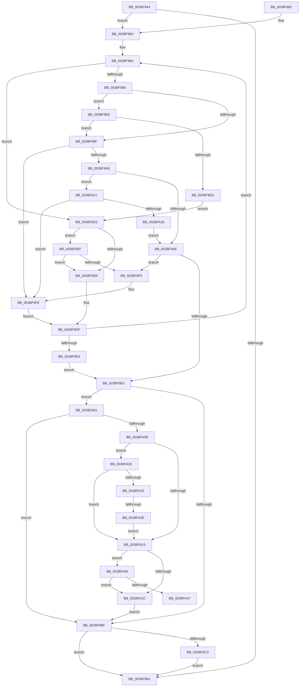

# FsRtlPrivateCheckForSharedLockAccess

- RVA: `0x0038F944`–`0x0038FA4C` (길이 `264` bytes)
- VA: `0x000000014038F944`
- 실행 섹션: `.text`
- PDB 이름 있음: `예`; PDB Function 태그: `예`
- unwind 정보 RVA: `0x00065F58`
- 디코드: `85`개 명령, `264/264` bytes 표시
- 미해석 바이트: `0` (있으면 어셈블리에 `.byte`로 보존)

> 이 문서는 커널 이미지의 기계어와 PDB 기호를 분석해 생성했습니다. 4번과 5번은 함수 원형과 자료형을 바이너리 사용 방식에서 추정한 C 해석이며 원본 소스 복구 결과는 아닙니다.

## 1. Dependencies

- 직접 호출 지점: **1**; 고유 호출 대상: **1**
- 직접 호출자로 확인된 함수: **1**
- RIP 상대 이미지 참조: **0**

### Outgoing calls
- `0x0038F9C7` → [RtlSplay](RtlSplay_function_0038F1E0.md) (function, `0x0038F1E0`)

### Direct callers
- [FsRtlPrivateCheckWaitingLocks](FsRtlPrivateCheckWaitingLocks_function_0038DCBC.md) at `0x0038DD61`

### Static image references
- 디코드된 RIP-relative 메모리 참조가 없습니다.

## 2. Other-region calls and transfers

- 다른 실행 섹션으로 향하는 call: **0**
- call이 아닌 외부 분기/꼬리 이동: **2**
  - `0x0038FA38` → [sub_006E576A](../6E/Unknown_function_006E576A.md) (`tail-transfer`)
  - `0x0038FA47` → [sub_006E576A](../6E/Unknown_function_006E576A.md) (`tail-transfer`)

## 3. Assembly (complete function range)

```asm
0038F944  48 89 5C 24 08                  mov qword ptr [rsp + 8], rbx
0038F949  48 89 6C 24 10                  mov qword ptr [rsp + 0x10], rbp
0038F94E  48 89 74 24 18                  mov qword ptr [rsp + 0x18], rsi
0038F953  57                              push rdi
0038F954  48 83 EC 20                     sub rsp, 0x20
0038F958  48 8B 41 10                     mov rax, qword ptr [rcx + 0x10]
0038F95C  48 8B DA                        mov rbx, rdx
0038F95F  48 8B E9                        mov rbp, rcx
0038F962  40 B6 01                        mov sil, 1
0038F965  48 85 C0                        test rax, rax
0038F968  75 19                           jne 0x14038f983
0038F96A  48 8B 5C 24 30                  mov rbx, qword ptr [rsp + 0x30]
0038F96F  40 8A C6                        mov al, sil
0038F972  48 8B 74 24 40                  mov rsi, qword ptr [rsp + 0x40]
0038F977  48 8B 6C 24 38                  mov rbp, qword ptr [rsp + 0x38]
0038F97C  48 83 C4 20                     add rsp, 0x20
0038F980  5F                              pop rdi
0038F981  C3                              ret
0038F982  CC                              int3
0038F983  4C 8B 02                        mov r8, qword ptr [rdx]
0038F986  33 FF                           xor edi, edi
0038F988  33 C9                           xor ecx, ecx
0038F98A  4C 8B 50 40                     mov r10, qword ptr [rax + 0x40]
0038F98E  4C 8B D8                        mov r11, rax
0038F991  4D 3B D0                        cmp r10, r8
0038F994  72 3C                           jb 0x14038f9d2
0038F996  4C 8B 48 18                     mov r9, qword ptr [rax + 0x18]
0038F99A  4D 85 C9                        test r9, r9
0038F99D  74 47                           je 0x14038f9e6
0038F99F  48 8B 53 28                     mov rdx, qword ptr [rbx + 0x28]
0038F9A3  4C 3B CA                        cmp r9, rdx
0038F9A6  77 50                           ja 0x14038f9f8
0038F9A8  48 83 FA FF                     cmp rdx, -1
0038F9AC  74 73                           je 0x14038fa21
0038F9AE  4D 3B C8                        cmp r9, r8
0038F9B1  77 42                           ja 0x14038f9f5
0038F9B3  48 85 C0                        test rax, rax
0038F9B6  49 0F 45 CB                     cmovne rcx, r11
0038F9BA  48 85 C9                        test rcx, rcx
0038F9BD  75 42                           jne 0x14038fa01
0038F9BF  48 85 FF                        test rdi, rdi
0038F9C2  74 A6                           je 0x14038f96a
0038F9C4  48 8B CF                        mov rcx, rdi
0038F9C7  E8 14 F8 FF FF                  call 0x14038f1e0
0038F9CC  48 89 45 10                     mov qword ptr [rbp + 0x10], rax
0038F9D0  EB 98                           jmp 0x14038f96a
0038F9D2  4C 3B 53 28                     cmp r10, qword ptr [rbx + 0x28]
0038F9D6  74 17                           je 0x14038f9ef
0038F9D8  48 8B F8                        mov rdi, rax
0038F9DB  48 8B 40 10                     mov rax, qword ptr [rax + 0x10]
0038F9DF  48 85 C0                        test rax, rax
0038F9E2  75 A6                           jne 0x14038f98a
0038F9E4  EB CD                           jmp 0x14038f9b3
0038F9E6  48 83 78 20 00                  cmp qword ptr [rax + 0x20], 0
0038F9EB  75 B2                           jne 0x14038f99f
0038F9ED  EB E3                           jmp 0x14038f9d2
0038F9EF  4C 39 40 18                     cmp qword ptr [rax + 0x18], r8
0038F9F3  75 E3                           jne 0x14038f9d8
0038F9F5  48 8B C8                        mov rcx, rax
0038F9F8  48 8B F8                        mov rdi, rax
0038F9FB  48 8B 40 08                     mov rax, qword ptr [rax + 8]
0038F9FF  EB DE                           jmp 0x14038f9df
0038FA01  48 8B 43 28                     mov rax, qword ptr [rbx + 0x28]
0038FA05  48 39 41 18                     cmp qword ptr [rcx + 0x18], rax
0038FA09  77 B4                           ja 0x14038f9bf
0038FA0B  48 8B 43 18                     mov rax, qword ptr [rbx + 0x18]
0038FA0F  48 39 41 30                     cmp qword ptr [rcx + 0x30], rax
0038FA13  74 13                           je 0x14038fa28
0038FA15  48 83 7B 08 00                  cmp qword ptr [rbx + 8], 0
0038FA1A  74 24                           je 0x14038fa40
0038FA1C  40 32 F6                        xor sil, sil
0038FA1F  EB 9E                           jmp 0x14038f9bf
0038FA21  4D 85 C0                        test r8, r8
0038FA24  74 D2                           je 0x14038f9f8
0038FA26  EB 86                           jmp 0x14038f9ae
0038FA28  48 8B 43 20                     mov rax, qword ptr [rbx + 0x20]
0038FA2C  48 39 41 38                     cmp qword ptr [rcx + 0x38], rax
0038FA30  75 E3                           jne 0x14038fa15
0038FA32  8B 43 14                        mov eax, dword ptr [rbx + 0x14]
0038FA35  39 41 2C                        cmp dword ptr [rcx + 0x2c], eax
0038FA38  0F 84 2C 5D 35 00               je 0x1406e576a
0038FA3E  EB D5                           jmp 0x14038fa15
0038FA40  48 83 79 20 00                  cmp qword ptr [rcx + 0x20], 0
0038FA45  75 D5                           jne 0x14038fa1c
0038FA47  E9 1E 5D 35 00                  jmp 0x1406e576a
```

## 4. C-style interpretation (structured pseudocode)

```c
__int64 __fastcall FsRtlPrivateCheckForSharedLockAccess(__int64 a1, __int64 a2)
{
    __int64 result;
    __int64 v_rdi;
    __int64 v_rsi;
    __int64 v_rsp;
    unsigned __int64 v_stack_p10;
    unsigned __int64 v_stack_p18;
    unsigned __int64 v_stack_p8;

    v_stack_p8 = v_rbx;
    v_stack_p10 = v_rbp;
    v_stack_p18 = v_rsi;
    v_rsp = (v_rsp) - (32);
    if (*(unsigned __int64 *)(a1 + 16) != 0) goto loc_0038F983;
loc_0038F96A:
    v_rsp = (v_rsp) + (32);
    return 1;
loc_0038F983:
    v_rdi = 0;
    a1 = 0;
loc_0038F98A:
    if ((*(unsigned __int64 *)(1 + 64)) < (*(unsigned __int64 *)(a2))) goto loc_0038F9D2;
    if (*(unsigned __int64 *)(1 + 24) == 0) goto loc_0038F9E6;
loc_0038F99F:
    if ((*(unsigned __int64 *)(1 + 24)) > (*(unsigned __int64 *)(v_stack_p8 + 40))) goto loc_0038F9F8;
    if ((*(unsigned __int64 *)(v_stack_p8 + 40)) == -1) goto loc_0038FA21;
loc_0038F9AE:
    if ((*(unsigned __int64 *)(1 + 24)) > (*(unsigned __int64 *)(a2))) goto loc_0038F9F5;
loc_0038F9B3:
    if (1 != 0) { a1 = 1; }
    if (a1 != 0) goto loc_0038FA01;
loc_0038F9BF:
    if (0 == 0) goto loc_0038F96A;
    result = RtlSplay(0, *(unsigned __int64 *)(v_stack_p8 + 40), *(unsigned __int64 *)(a2), *(unsigned __int64 *)(1 + 24));
    *(unsigned __int64 *)(v_stack_p10 + 16) = result;
    goto loc_0038F96A;
loc_0038F9D2:
    if ((*(unsigned __int64 *)(1 + 64)) == (*(unsigned __int64 *)(v_stack_p8 + 40))) goto loc_0038F9EF;
loc_0038F9D8:
loc_0038F9DF:
    if (*(unsigned __int64 *)(result + 16) != 0) goto loc_0038F98A;
    goto loc_0038F9B3;
loc_0038F9E6:
    if ((*(unsigned __int64 *)(*(unsigned __int64 *)(result + 16) + 32)) != 0) goto loc_0038F99F;
    goto loc_0038F9D2;
loc_0038F9EF:
    if ((*(unsigned __int64 *)(*(unsigned __int64 *)(result + 16) + 24)) != (*(unsigned __int64 *)(a2))) goto loc_0038F9D8;
loc_0038F9F5:
loc_0038F9F8:
    goto loc_0038F9DF;
loc_0038FA01:
    if ((*(unsigned __int64 *)(*(unsigned __int64 *)(result + 16) + 24)) > (*(unsigned __int64 *)(v_stack_p8 + 40))) goto loc_0038F9BF;
    if ((*(unsigned __int64 *)(*(unsigned __int64 *)(result + 16) + 48)) == (*(unsigned __int64 *)(v_stack_p8 + 24))) goto loc_0038FA28;
loc_0038FA15:
    if ((*(unsigned __int64 *)(v_stack_p8 + 8)) == 0) goto loc_0038FA40;
loc_0038FA1C:
    v_rsi = 0;
    goto loc_0038F9BF;
loc_0038FA21:
    if (*(unsigned __int64 *)(a2) == 0) goto loc_0038F9F8;
    goto loc_0038F9AE;
loc_0038FA28:
    if ((*(unsigned __int64 *)(*(unsigned __int64 *)(result + 16) + 56)) != (*(unsigned __int64 *)(v_stack_p8 + 32))) goto loc_0038FA15;
    goto loc_0038FA15;
loc_0038FA40:
    if ((*(unsigned __int64 *)(*(unsigned __int64 *)(result + 16) + 32)) != 0) goto loc_0038FA1C;
}
```

## 5. (Beta) C Style

```c
int64_t FsRtlPrivateCheckForSharedLockAccess(void *Arg1, void *Arg2)
{
    uint8_t *arg1 = (uint8_t *)Arg1;
    uint8_t *arg2 = (uint8_t *)Arg2;

    int64_t result;
    int64_t local_rdi;
    int64_t local_rsi;
    int64_t local_rsp;
    uint64_t v_stack_p10;
    uint64_t v_stack_p18;
    uint64_t v_stack_p8;

    v_stack_p8 = local_rbx;
    v_stack_p10 = local_rbp;
    v_stack_p18 = local_rsi;
    local_rsp = (local_rsp) - (32);
    if (*(uint64_t *)(arg1 + 0x10) != 0) goto loc_0038F983;
loc_0038F96A:
    local_rsp = (local_rsp) + (32);
    return 1;
loc_0038F983:
    local_rdi = 0;
    Arg1 = 0;
loc_0038F98A:
    if ((*(uint64_t *)(1 + 0x40)) < (*(uint64_t *)(arg2))) goto loc_0038F9D2;
    if (*(uint64_t *)(1 + 0x18) == 0) goto loc_0038F9E6;
loc_0038F99F:
    if ((*(uint64_t *)(1 + 0x18)) > (*(uint64_t *)(v_stack_p8 + 0x28))) goto loc_0038F9F8;
    if ((*(uint64_t *)(v_stack_p8 + 0x28)) == -1) goto loc_0038FA21;
loc_0038F9AE:
    if ((*(uint64_t *)(1 + 0x18)) > (*(uint64_t *)(arg2))) goto loc_0038F9F5;
loc_0038F9B3:
    if (1 != 0) { Arg1 = 1; }
    if (Arg1 != NULL) goto loc_0038FA01;
loc_0038F9BF:
    if (0 == 0) goto loc_0038F96A;
    result = RtlSplay(0, *(uint64_t *)(v_stack_p8 + 0x28), *(uint64_t *)(arg2), *(uint64_t *)(1 + 0x18));
    *(uint64_t *)(v_stack_p10 + 0x10) = result;
    goto loc_0038F96A;
loc_0038F9D2:
    if ((*(uint64_t *)(1 + 0x40)) == (*(uint64_t *)(v_stack_p8 + 0x28))) goto loc_0038F9EF;
loc_0038F9D8:
loc_0038F9DF:
    if (*(uint64_t *)(result + 0x10) != 0) goto loc_0038F98A;
    goto loc_0038F9B3;
loc_0038F9E6:
    if ((*(uint64_t *)(*(uint64_t *)(result + 0x10) + 0x20)) != 0) goto loc_0038F99F;
    goto loc_0038F9D2;
loc_0038F9EF:
    if ((*(uint64_t *)(*(uint64_t *)(result + 0x10) + 0x18)) != (*(uint64_t *)(arg2))) goto loc_0038F9D8;
loc_0038F9F5:
loc_0038F9F8:
    goto loc_0038F9DF;
loc_0038FA01:
    if ((*(uint64_t *)(*(uint64_t *)(result + 0x10) + 0x18)) > (*(uint64_t *)(v_stack_p8 + 0x28))) goto loc_0038F9BF;
    if ((*(uint64_t *)(*(uint64_t *)(result + 0x10) + 0x30)) == (*(uint64_t *)(v_stack_p8 + 0x18))) goto loc_0038FA28;
loc_0038FA15:
    if ((*(uint64_t *)(v_stack_p8 + 0x8)) == 0) goto loc_0038FA40;
loc_0038FA1C:
    local_rsi = 0;
    goto loc_0038F9BF;
loc_0038FA21:
    if (*(uint64_t *)(arg2) == 0) goto loc_0038F9F8;
    goto loc_0038F9AE;
loc_0038FA28:
    if ((*(uint64_t *)(*(uint64_t *)(result + 0x10) + 0x38)) != (*(uint64_t *)(v_stack_p8 + 0x20))) goto loc_0038FA15;
    goto loc_0038FA15;
loc_0038FA40:
    if ((*(uint64_t *)(*(uint64_t *)(result + 0x10) + 0x20)) != 0) goto loc_0038FA1C;
}
```

### 관측된 메모리 오프셋

구조체 형식이 확인되지 않은 접근은 인자 기준의 오프셋으로만 기록했습니다.

| 기준 인자 | 오프셋 표현 | 폭 (bit) | 접근 |
|---|---:|---:|---|
| `Arg1` | `+ 0x10` | `64` | `R` |
| `Arg1` | `+ 0x10` | `64` | `W` |
| `Arg2` | `+ 0x0` | `64` | `R` |
| `Arg2` | `+ 0x8` | `64` | `R` |
| `Arg2` | `+ 0x14` | `32` | `R` |
| `Arg2` | `+ 0x18` | `64` | `R` |
| `Arg2` | `+ 0x20` | `64` | `R` |
| `Arg2` | `+ 0x28` | `64` | `R` |

## 6. Execution-region graph

[열기: 2D/3D 그래프와 함수 탐색 컨트롤 패널](../../../control-panel.html?section=text&rva=0x0038F944&view=graph)

- 2D 그래프는 위에서 아래로 흐르고, 3D 그래프는 빈 공간을 드래그해 회전합니다. Shift+드래그는 이동, 휠은 확대·축소, 함수 노드 선택은 대상 보고서 이동입니다.

### Static fallback


