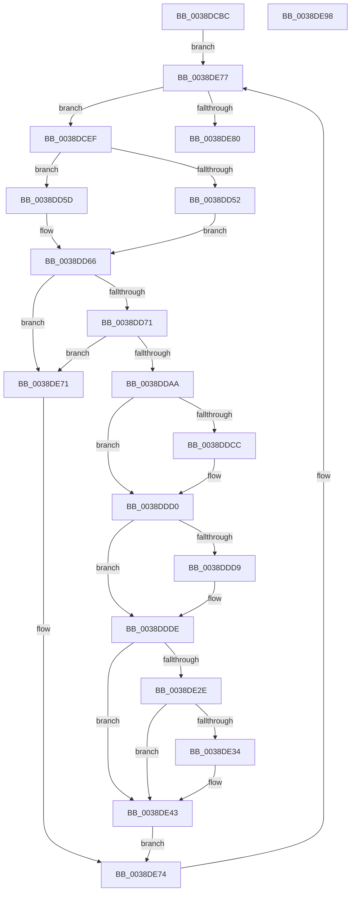

# FsRtlPrivateCheckWaitingLocks

- RVA: `0x0038DCBC`–`0x0038DE99` (길이 `477` bytes)
- VA: `0x000000014038DCBC`
- 실행 섹션: `.text`
- PDB 이름 있음: `예`; PDB Function 태그: `아니요`
- unwind 정보 RVA: `0x000805A0`
- 디코드: `134`개 명령, `477/477` bytes 표시
- 미해석 바이트: `0` (있으면 어셈블리에 `.byte`로 보존)

> 이 문서는 커널 이미지의 기계어와 PDB 기호를 분석해 생성했습니다. 4번과 5번은 함수 원형과 자료형을 바이너리 사용 방식에서 추정한 C 해석이며 원본 소스 복구 결과는 아닙니다.

## 1. Dependencies

- 직접 호출 지점: **14**; 고유 호출 대상: **14**
- 직접 호출자로 확인된 함수: **5**
- RIP 상대 이미지 참조: **1**

### Outgoing calls
- `0x0038DD36` → [IoGetRequestorProcess](../3F/IoGetRequestorProcess_function_003FD4E0.md) (function, `0x003FD4E0`)
- `0x0038DD56` → [FsRtlPrivateCheckForExclusiveLockAccess](FsRtlPrivateCheckForExclusiveLockAccess_function_0038EA28.md) (function, `0x0038EA28`)
- `0x0038DD61` → [FsRtlPrivateCheckForSharedLockAccess](FsRtlPrivateCheckForSharedLockAccess_function_0038F944.md) (function, `0x0038F944`)
- `0x0038DD76` → [KeAcquireQueuedSpinLock](../27/KeAcquireQueuedSpinLock_function_00273D80.md) (function, `0x00273D80`)
- `0x0038DD92` → [KeReleaseQueuedSpinLock](../27/KeReleaseQueuedSpinLock_function_00272540.md) (function, `0x00272540`)
- `0x0038DDB9` → [FsRtlPrivateInsertLock](FsRtlPrivateInsertLock_function_0038E5D0.md) (function, `0x0038E5D0`)
- `0x0038DDD0` → [Feature_3273361723__private_IsEnabledDeviceUsageNoInline](../58/Feature_3273361723__private_IsEnabledDeviceUsageNoInline_function_00581798.md) (function, `0x00581798`)
- `0x0038DDE4` → [KeReleaseSpinLock](../39/KeReleaseSpinLock_function_00392BA0.md) (function, `0x00392BA0`)
- `0x0038DDF2` → [ObfReferenceObjectWithTag](../21/ObfReferenceObjectWithTag_function_00210710.md) (function, `0x00210710`)
- `0x0038DE25` → [FsRtlCompleteLockIrpReal](../49/FsRtlCompleteLockIrpReal_function_004973AC.md) (function, `0x004973AC`)
- `0x0038DE3E` → [FsRtlPrivateRemoveLock](../4E/FsRtlPrivateRemoveLock_function_004E3244.md) (function, `0x004E3244`)
- `0x0038DE4C` → [ObfDereferenceObjectWithTag](../2F/ObfDereferenceObjectWithTag_function_002F78E0.md) (function, `0x002F78E0`)
- `0x0038DE54` → [KeAcquireSpinLockRaiseToDpc](../20/KeAcquireSpinLockRaiseToDpc_function_00208470.md) (function, `0x00208470`)
- `0x0038DE6A` → [ExFreeToNPagedLookasideList](ExFreeToNPagedLookasideList_function_0038D9D0.md) (function, `0x0038D9D0`)

### Direct callers
- [FsRtlFastUnlockSingleExclusive](FsRtlFastUnlockSingleExclusive_function_0038C8E0.md) at `0x0038CA81`
- [sub_0038CE61](Unknown_function_0038CE61.md) at `0x0038CF79`
- [sub_0038D07B](Unknown_function_0038D07B.md) at `0x0038D1D5`
- [sub_0038D785](Unknown_function_0038D785.md) at `0x0038D894`
- [FsRtlPrivateFastUnlockAll](../3F/FsRtlPrivateFastUnlockAll_function_003FD554.md) at `0x003FD6BF`

### Static image references
- `0x0038DE5F` → RVA `0x00E12000` (`.data`; read)

## 2. Other-region calls and transfers

- 다른 실행 섹션으로 향하는 call: **0**
- 별도 외부 분기/꼬리 이동을 확인하지 못했습니다.

## 3. Assembly (complete function range)

```asm
0038DCBC  48 89 5C 24 08                  mov qword ptr [rsp + 8], rbx
0038DCC1  44 88 44 24 18                  mov byte ptr [rsp + 0x18], r8b
0038DCC6  55                              push rbp
0038DCC7  56                              push rsi
0038DCC8  57                              push rdi
0038DCC9  41 54                           push r12
0038DCCB  41 55                           push r13
0038DCCD  41 56                           push r14
0038DCCF  41 57                           push r15
0038DCD1  48 8B EC                        mov rbp, rsp
0038DCD4  48 83 EC 60                     sub rsp, 0x60
0038DCD8  83 65 48 00                     and dword ptr [rbp + 0x48], 0
0038DCDC  48 8D 72 18                     lea rsi, [rdx + 0x18]
0038DCE0  48 8B 7A 18                     mov rdi, qword ptr [rdx + 0x18]
0038DCE4  4C 8B F2                        mov r14, rdx
0038DCE7  4C 8B E9                        mov r13, rcx
0038DCEA  E9 88 01 00 00                  jmp 0x14038de77
0038DCEF  4C 8B 7F 18                     mov r15, qword ptr [rdi + 0x18]
0038DCF3  0F 57 C0                        xorps xmm0, xmm0
0038DCF6  0F 11 45 D0                     movups xmmword ptr [rbp - 0x30], xmm0
0038DCFA  0F 11 45 E0                     movups xmmword ptr [rbp - 0x20], xmm0
0038DCFE  0F 11 45 F0                     movups xmmword ptr [rbp - 0x10], xmm0
0038DD02  49 8B 9F B8 00 00 00            mov rbx, qword ptr [r15 + 0xb8]
0038DD09  48 89 5D 58                     mov qword ptr [rbp + 0x58], rbx
0038DD0D  48 8B 53 18                     mov rdx, qword ptr [rbx + 0x18]
0038DD11  48 89 55 D0                     mov qword ptr [rbp - 0x30], rdx
0038DD15  48 8B 43 08                     mov rax, qword ptr [rbx + 8]
0038DD19  48 8B 08                        mov rcx, qword ptr [rax]
0038DD1C  48 8D 42 FF                     lea rax, [rdx - 1]
0038DD20  48 03 C1                        add rax, rcx
0038DD23  48 89 4D D8                     mov qword ptr [rbp - 0x28], rcx
0038DD27  48 89 45 F8                     mov qword ptr [rbp - 8], rax
0038DD2B  49 8B CF                        mov rcx, r15
0038DD2E  48 8B 43 30                     mov rax, qword ptr [rbx + 0x30]
0038DD32  48 89 45 E8                     mov qword ptr [rbp - 0x18], rax
0038DD36  E8 A5 F7 06 00                  call 0x1403fd4e0
0038DD3B  48 89 45 F0                     mov qword ptr [rbp - 0x10], rax
0038DD3F  48 8D 55 D0                     lea rdx, [rbp - 0x30]
0038DD43  8B 43 10                        mov eax, dword ptr [rbx + 0x10]
0038DD46  49 8B CE                        mov rcx, r14
0038DD49  89 45 E4                        mov dword ptr [rbp - 0x1c], eax
0038DD4C  F6 43 02 02                     test byte ptr [rbx + 2], 2
0038DD50  74 0B                           je 0x14038dd5d
0038DD52  C6 45 E0 01                     mov byte ptr [rbp - 0x20], 1
0038DD56  E8 CD 0C 00 00                  call 0x14038ea28
0038DD5B  EB 09                           jmp 0x14038dd66
0038DD5D  C6 45 E0 00                     mov byte ptr [rbp - 0x20], 0
0038DD61  E8 DE 1B 00 00                  call 0x14038f944
0038DD66  44 8A E0                        mov r12b, al
0038DD69  84 C0                           test al, al
0038DD6B  0F 84 00 01 00 00               je 0x14038de71
0038DD71  B9 07 00 00 00                  mov ecx, 7
0038DD76  E8 05 60 EE FF                  call 0x140273d80
0038DD7B  41 88 47 45                     mov byte ptr [r15 + 0x45], al
0038DD7F  B9 07 00 00 00                  mov ecx, 7
0038DD84  33 C0                           xor eax, eax
0038DD86  49 87 47 68                     xchg qword ptr [r15 + 0x68], rax
0038DD8A  41 8A 57 45                     mov dl, byte ptr [r15 + 0x45]
0038DD8E  41 8A 5F 44                     mov bl, byte ptr [r15 + 0x44]
0038DD92  E8 A9 47 EE FF                  call 0x140272540
0038DD97  33 C9                           xor ecx, ecx
0038DD99  41 0F B6 C4                     movzx eax, r12b
0038DD9D  84 DB                           test bl, bl
0038DD9F  0F 44 C8                        cmove ecx, eax
0038DDA2  84 C9                           test cl, cl
0038DDA4  0F 84 C7 00 00 00               je 0x14038de71
0038DDAA  48 8B 55 58                     mov rdx, qword ptr [rbp + 0x58]
0038DDAE  4C 8D 45 D0                     lea r8, [rbp - 0x30]
0038DDB2  49 8B CD                        mov rcx, r13
0038DDB5  48 8B 52 30                     mov rdx, qword ptr [rdx + 0x30]
0038DDB9  E8 12 08 00 00                  call 0x14038e5d0
0038DDBE  48 8B 0F                        mov rcx, qword ptr [rdi]
0038DDC1  8A D8                           mov bl, al
0038DDC3  48 89 0E                        mov qword ptr [rsi], rcx
0038DDC6  49 3B 7E 20                     cmp rdi, qword ptr [r14 + 0x20]
0038DDCA  75 04                           jne 0x14038ddd0
0038DDCC  49 89 76 20                     mov qword ptr [r14 + 0x20], rsi
0038DDD0  E8 C3 39 1F 00                  call 0x140581798
0038DDD5  85 C0                           test eax, eax
0038DDD7  74 05                           je 0x14038ddde
0038DDD9  49 83 67 38 00                  and qword ptr [r15 + 0x38], 0
0038DDDE  8A 55 50                        mov dl, byte ptr [rbp + 0x50]
0038DDE1  49 8B CE                        mov rcx, r14
0038DDE4  E8 B7 4D 00 00                  call 0x140392ba0
0038DDE9  48 8B 4D E8                     mov rcx, qword ptr [rbp - 0x18]
0038DDED  BA 44 66 6C 74                  mov edx, 0x746c6644
0038DDF2  E8 19 29 E8 FF                  call 0x140210710
0038DDF7  48 8B 57 10                     mov rdx, qword ptr [rdi + 0x10]
0038DDFB  8A C3                           mov al, bl
0038DDFD  49 8B 4D 08                     mov rcx, qword ptr [r13 + 8]
0038DE01  F6 D8                           neg al
0038DE03  48 8B 45 E8                     mov rax, qword ptr [rbp - 0x18]
0038DE07  4D 8B C7                        mov r8, r15
0038DE0A  45 1B C9                        sbb r9d, r9d
0038DE0D  48 89 44 24 28                  mov qword ptr [rsp + 0x28], rax
0038DE12  41 F7 D1                        not r9d
0038DE15  48 8D 45 48                     lea rax, [rbp + 0x48]
0038DE19  41 81 E1 9A 00 00 C0            and r9d, 0xc000009a
0038DE20  48 89 44 24 20                  mov qword ptr [rsp + 0x20], rax
0038DE25  E8 82 95 10 00                  call 0x1404973ac
0038DE2A  84 DB                           test bl, bl
0038DE2C  74 15                           je 0x14038de43
0038DE2E  83 7D 48 00                     cmp dword ptr [rbp + 0x48], 0
0038DE32  7D 0F                           jge 0x14038de43
0038DE34  45 33 C0                        xor r8d, r8d
0038DE37  48 8D 55 D0                     lea rdx, [rbp - 0x30]
0038DE3B  49 8B CD                        mov rcx, r13
0038DE3E  E8 01 54 15 00                  call 0x1404e3244
0038DE43  48 8B 4D E8                     mov rcx, qword ptr [rbp - 0x18]
0038DE47  BA 44 66 6C 74                  mov edx, 0x746c6644
0038DE4C  E8 8F 9A F6 FF                  call 0x1402f78e0
0038DE51  49 8B CE                        mov rcx, r14
0038DE54  E8 17 A6 E7 FF                  call 0x140208470
0038DE59  48 8B D7                        mov rdx, rdi
0038DE5C  88 45 50                        mov byte ptr [rbp + 0x50], al
0038DE5F  48 8D 0D 9A 41 A8 00            lea rcx, [rip + 0xa8419a]
0038DE66  49 8D 76 18                     lea rsi, [r14 + 0x18]
0038DE6A  E8 61 FB FF FF                  call 0x14038d9d0
0038DE6F  EB 03                           jmp 0x14038de74
0038DE71  48 8B F7                        mov rsi, rdi
0038DE74  48 8B 3E                        mov rdi, qword ptr [rsi]
0038DE77  48 85 FF                        test rdi, rdi
0038DE7A  0F 85 6F FE FF FF               jne 0x14038dcef
0038DE80  48 8B 9C 24 A0 00 00 00         mov rbx, qword ptr [rsp + 0xa0]
0038DE88  48 83 C4 60                     add rsp, 0x60
0038DE8C  41 5F                           pop r15
0038DE8E  41 5E                           pop r14
0038DE90  41 5D                           pop r13
0038DE92  41 5C                           pop r12
0038DE94  5F                              pop rdi
0038DE95  5E                              pop rsi
0038DE96  5D                              pop rbp
0038DE97  C3                              ret
0038DE98  CC                              int3
```

## 4. C-style interpretation (structured pseudocode)

```c
__int64 __fastcall FsRtlPrivateCheckWaitingLocks(__int64 a1, __int64 a2, unsigned __int8 a3, int a4)
{
    __int64 result;
    __int64 v_rsp;
    unsigned __int64 v_stack_m40;
    unsigned __int64 v_stack_m48;
    unsigned __int64 v_stack_m50;
    unsigned int v_stack_m54;
    unsigned __int64 v_stack_m58;
    unsigned __int64 v_stack_m60;
    unsigned __int64 v_stack_m68;
    unsigned __int64 v_stack_m70;
    unsigned __int64 v_stack_m78;
    unsigned int v_stack_p10;
    unsigned __int8 v_stack_p18;
    unsigned __int64 v_stack_p20;
    unsigned __int64 v_stack_p8;

    v_stack_p8 = v_rbx;
    v_stack_p18 = a3;
    v_rsp = (v_rsp) - (96);
    goto loc_0038DE77;
loc_0038DCEF:
    v_stack_m68 = v_xmm0;
    v_stack_m58 = v_xmm0;
    v_stack_m48 = v_xmm0;
    v_stack_p20 = *(unsigned __int64 *)(*(unsigned __int64 *)(*(unsigned __int64 *)(a2 + 24) + 24) + 184);
    v_stack_m68 = *(unsigned __int64 *)(*(unsigned __int64 *)(*(unsigned __int64 *)(*(unsigned __int64 *)(a2 + 24) + 24) + 184) + 24);
    result = (*(unsigned __int64 *)(*(unsigned __int64 *)(*(unsigned __int64 *)(*(unsigned __int64 *)(a2 + 24) + 24) + 184) + 24) - 1) + (*(unsigned __int64 *)(*(unsigned __int64 *)(*(unsigned __int64 *)(*(unsigned __int64 *)(*(unsigned __int64 *)(a2 + 24) + 24) + 184) + 8)));
    v_stack_m60 = *(unsigned __int64 *)(*(unsigned __int64 *)(*(unsigned __int64 *)(*(unsigned __int64 *)(*(unsigned __int64 *)(a2 + 24) + 24) + 184) + 8));
    v_stack_m40 = result;
    v_stack_m50 = *(unsigned __int64 *)(*(unsigned __int64 *)(*(unsigned __int64 *)(*(unsigned __int64 *)(a2 + 24) + 24) + 184) + 48);
    result = IoGetRequestorProcess(*(unsigned __int64 *)(*(unsigned __int64 *)(a2 + 24) + 24), *(unsigned __int64 *)(*(unsigned __int64 *)(*(unsigned __int64 *)(*(unsigned __int64 *)(a2 + 24) + 24) + 184) + 24), a3, a4);
    v_stack_m48 = result;
    v_stack_m54 = (unsigned int)((unsigned int)(*(unsigned int *)(*(unsigned __int64 *)(*(unsigned __int64 *)(*(unsigned __int64 *)(a2 + 24) + 24) + 184) + 16)));
    if (((*(unsigned __int8 *)(*(unsigned __int64 *)(*(unsigned __int64 *)(*(unsigned __int64 *)(a2 + 24) + 24) + 184) + 2)) & (2)) == 0) goto loc_0038DD5D;
    v_stack_m58 = 1;
    result = FsRtlPrivateCheckForExclusiveLockAccess(a2, v_stack_m68, a3, a4);
    goto loc_0038DD66;
loc_0038DD5D:
    v_stack_m58 = 0;
    result = FsRtlPrivateCheckForSharedLockAccess(a2, v_stack_m68, a3, a4);
loc_0038DD66:
    if ((unsigned __int8)(result) == 0) goto loc_0038DE71;
    result = KeAcquireQueuedSpinLock(7, v_stack_m68, a3, a4);
    *(unsigned __int8 *)(*(unsigned __int64 *)(*(unsigned __int64 *)(a2 + 24) + 24) + 69) = (unsigned __int8)(result);
    result = 0;
    result = KeReleaseQueuedSpinLock(7, *(unsigned __int8 *)(*(unsigned __int64 *)(*(unsigned __int64 *)(a2 + 24) + 24) + 69), a3, a4);
    a1 = 0;
    if ((unsigned __int8)(*(unsigned __int8 *)(*(unsigned __int64 *)(*(unsigned __int64 *)(a2 + 24) + 24) + 68)) == 0) { a1 = (unsigned int)((unsigned __int8)((unsigned __int8)(result))); }
    if ((unsigned __int8)(a1) == 0) goto loc_0038DE71;
    result = FsRtlPrivateInsertLock(a1, *(unsigned __int64 *)(v_stack_p20 + 48), v_stack_m68, a4);
    *(unsigned __int64 *)(a2 + 24) = *(unsigned __int64 *)(*(unsigned __int64 *)(a2 + 24));
    if ((*(unsigned __int64 *)(a2 + 24)) == (*(unsigned __int64 *)(a2 + 32))) {
        *(unsigned __int64 *)(a2 + 32) = a2 + 24;
    }
    result = Feature_3273361723__private_IsEnabledDeviceUsageNoInline(*(unsigned __int64 *)(*(unsigned __int64 *)(a2 + 24)), *(unsigned __int64 *)(v_stack_p20 + 48), v_stack_m68, a4);
    if ((unsigned int)(result) != 0) {
    }
    result = KeReleaseSpinLock(a2, v_stack_p18, v_stack_m68, a4);
    result = ObfReferenceObjectWithTag(v_stack_m50, (unsigned int)(0x746C6644ULL), v_stack_m68, a4);
    result = (unsigned __int8)(-((unsigned __int8)((unsigned __int8)(result))));
    v_stack_m70 = v_stack_m50;
    a4 = (unsigned int)(~(a4));
    a4 = (unsigned int)((a4) & (0xC000009AULL));
    v_stack_m78 = v_stack_p10;
    result = FsRtlCompleteLockIrpReal(*(unsigned __int64 *)(a1 + 8), *(unsigned __int64 *)(*(unsigned __int64 *)(a2 + 24) + 16), *(unsigned __int64 *)(*(unsigned __int64 *)(a2 + 24) + 24), a4);
    if ((unsigned __int8)((unsigned __int8)(result)) == 0) goto loc_0038DE43;
    if (v_stack_p10 < 0) {
        a3 = 0;
        a2 = v_stack_m68;
        a1 = a1;
        result = FsRtlPrivateRemoveLock(a1, a2, a3, a4);
    }
    result = ObfDereferenceObjectWithTag(v_stack_m50, (unsigned int)(0x746C6644ULL), a3, a4);
    result = KeAcquireSpinLockRaiseToDpc(a2, (unsigned int)(0x746C6644ULL), a3, a4);
    v_stack_p18 = (unsigned __int8)(result);
    result = ExFreeToNPagedLookasideList(v_rip + 11026842, *(unsigned __int64 *)(a2 + 24), a3, a4);
    goto loc_0038DE74;
loc_0038DE71:
loc_0038DE74:
loc_0038DE77:
    if (*(unsigned __int64 *)(*(unsigned __int64 *)(a2 + 24)) != 0) goto loc_0038DCEF;
    v_rsp = (v_rsp) + (96);
    return result;
}
```

## 5. (Beta) C Style

```c
int64_t FsRtlPrivateCheckWaitingLocks(void *Arg1, void *Arg2, uint8_t Arg3, int32_t Arg4)
{
    uint8_t *arg1 = (uint8_t *)Arg1;
    uint8_t *arg2 = (uint8_t *)Arg2;

    int64_t result;
    int64_t local_rsp;
    uint64_t v_stack_m40;
    uint64_t v_stack_m48;
    uint64_t v_stack_m50;
    uint32_t v_stack_m54;
    uint64_t v_stack_m58;
    uint64_t v_stack_m60;
    uint64_t v_stack_m68;
    uint64_t v_stack_m70;
    uint64_t v_stack_m78;
    uint32_t v_stack_p10;
    uint8_t v_stack_p18;
    uint64_t v_stack_p20;
    uint64_t v_stack_p8;

    v_stack_p8 = local_rbx;
    v_stack_p18 = Arg3;
    local_rsp = (local_rsp) - (96);
    goto loc_0038DE77;
loc_0038DCEF:
    v_stack_m68 = v_xmm0;
    v_stack_m58 = v_xmm0;
    v_stack_m48 = v_xmm0;
    v_stack_p20 = *(uint64_t *)(*(uint64_t *)(*(uint64_t *)(arg2 + 0x18) + 0x18) + 0xB8);
    v_stack_m68 = *(uint64_t *)(*(uint64_t *)(*(uint64_t *)(*(uint64_t *)(arg2 + 0x18) + 0x18) + 0xB8) + 0x18);
    result = (*(uint64_t *)(*(uint64_t *)(*(uint64_t *)(*(uint64_t *)(arg2 + 0x18) + 0x18) + 0xB8) + 0x18) - 1) + (*(uint64_t *)(*(uint64_t *)(*(uint64_t *)(*(uint64_t *)(*(uint64_t *)(arg2 + 0x18) + 0x18) + 0xB8) + 0x8)));
    v_stack_m60 = *(uint64_t *)(*(uint64_t *)(*(uint64_t *)(*(uint64_t *)(*(uint64_t *)(arg2 + 0x18) + 0x18) + 0xB8) + 0x8));
    v_stack_m40 = result;
    v_stack_m50 = *(uint64_t *)(*(uint64_t *)(*(uint64_t *)(*(uint64_t *)(arg2 + 0x18) + 0x18) + 0xB8) + 0x30);
    result = IoGetRequestorProcess(*(uint64_t *)(*(uint64_t *)(arg2 + 0x18) + 0x18), *(uint64_t *)(*(uint64_t *)(*(uint64_t *)(*(uint64_t *)(arg2 + 0x18) + 0x18) + 0xB8) + 0x18), Arg3, Arg4);
    v_stack_m48 = result;
    v_stack_m54 = (uint32_t)((uint32_t)(*(uint32_t *)(*(uint64_t *)(*(uint64_t *)(*(uint64_t *)(arg2 + 0x18) + 0x18) + 0xB8) + 0x10)));
    if (((*(uint8_t *)(*(uint64_t *)(*(uint64_t *)(*(uint64_t *)(arg2 + 0x18) + 0x18) + 0xB8) + 0x2)) & (2)) == 0) goto loc_0038DD5D;
    v_stack_m58 = 1;
    result = FsRtlPrivateCheckForExclusiveLockAccess(Arg2, v_stack_m68, Arg3, Arg4);
    goto loc_0038DD66;
loc_0038DD5D:
    v_stack_m58 = 0;
    result = FsRtlPrivateCheckForSharedLockAccess(Arg2, v_stack_m68, Arg3, Arg4);
loc_0038DD66:
    if ((uint8_t)(result) == 0) goto loc_0038DE71;
    result = KeAcquireQueuedSpinLock(7, v_stack_m68, Arg3, Arg4);
    *(uint8_t *)(*(uint64_t *)(*(uint64_t *)(arg2 + 0x18) + 0x18) + 0x45) = (uint8_t)(result);
    result = 0;
    result = KeReleaseQueuedSpinLock(7, *(uint8_t *)(*(uint64_t *)(*(uint64_t *)(arg2 + 0x18) + 0x18) + 0x45), Arg3, Arg4);
    Arg1 = 0;
    if ((uint8_t)(*(uint8_t *)(*(uint64_t *)(*(uint64_t *)(arg2 + 0x18) + 0x18) + 0x44)) == 0) { Arg1 = (uint32_t)((uint8_t)((uint8_t)(result))); }
    if ((uint8_t)(Arg1) == 0) goto loc_0038DE71;
    result = FsRtlPrivateInsertLock(Arg1, *(uint64_t *)(v_stack_p20 + 0x30), v_stack_m68, Arg4);
    *(uint64_t *)(arg2 + 0x18) = *(uint64_t *)(*(uint64_t *)(arg2 + 0x18));
    if ((*(uint64_t *)(arg2 + 0x18)) == (*(uint64_t *)(arg2 + 0x20))) {
        *(void **)(arg2 + 0x20) = Arg2 + 24;
    }
    result = Feature_3273361723__private_IsEnabledDeviceUsageNoInline(*(uint64_t *)(*(uint64_t *)(arg2 + 0x18)), *(uint64_t *)(v_stack_p20 + 0x30), v_stack_m68, Arg4);
    if ((uint32_t)(result) != 0) {
    }
    result = KeReleaseSpinLock(Arg2, v_stack_p18, v_stack_m68, Arg4);
    result = ObfReferenceObjectWithTag(v_stack_m50, (uint32_t)(0x746C6644ULL), v_stack_m68, Arg4);
    result = (uint8_t)(-((uint8_t)((uint8_t)(result))));
    v_stack_m70 = v_stack_m50;
    Arg4 = (uint32_t)(~(Arg4));
    Arg4 = (uint32_t)((Arg4) & (0xC000009AULL));
    v_stack_m78 = v_stack_p10;
    result = FsRtlCompleteLockIrpReal(*(uint64_t *)(arg1 + 0x8), *(uint64_t *)(*(uint64_t *)(arg2 + 0x18) + 0x10), *(uint64_t *)(*(uint64_t *)(arg2 + 0x18) + 0x18), Arg4);
    if ((uint8_t)((uint8_t)(result)) == 0) goto loc_0038DE43;
    if (v_stack_p10 < 0) {
        Arg3 = 0;
        Arg2 = v_stack_m68;
        Arg1 = Arg1;
        result = FsRtlPrivateRemoveLock(Arg1, Arg2, Arg3, Arg4);
    }
    result = ObfDereferenceObjectWithTag(v_stack_m50, (uint32_t)(0x746C6644ULL), Arg3, Arg4);
    result = KeAcquireSpinLockRaiseToDpc(Arg2, (uint32_t)(0x746C6644ULL), Arg3, Arg4);
    v_stack_p18 = (uint8_t)(result);
    result = ExFreeToNPagedLookasideList(v_rip + 11026842, *(uint64_t *)(arg2 + 0x18), Arg3, Arg4);
    goto loc_0038DE74;
loc_0038DE71:
loc_0038DE74:
loc_0038DE77:
    if (*(uint64_t *)(*(uint64_t *)(arg2 + 0x18)) != 0) goto loc_0038DCEF;
    local_rsp = (local_rsp) + (96);
    return result;
}
```

### 관측된 메모리 오프셋

구조체 형식이 확인되지 않은 접근은 인자 기준의 오프셋으로만 기록했습니다.

| 기준 인자 | 오프셋 표현 | 폭 (bit) | 접근 |
|---|---:|---:|---|
| `Arg1` | `+ 0x8` | `64` | `R` |
| `Arg2` | `+ 0x18` | `64` | `R` |
| `Arg2` | `+ 0x20` | `64` | `R` |
| `Arg2` | `+ 0x20` | `64` | `W` |

## 6. Execution-region graph

[열기: 2D/3D 그래프와 함수 탐색 컨트롤 패널](../../../control-panel.html?section=text&rva=0x0038DCBC&view=graph)

- 2D 그래프는 위에서 아래로 흐르고, 3D 그래프는 빈 공간을 드래그해 회전합니다. Shift+드래그는 이동, 휠은 확대·축소, 함수 노드 선택은 대상 보고서 이동입니다.

### Static fallback


