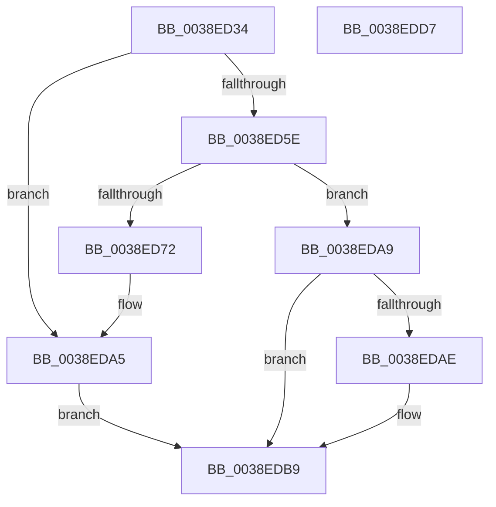

# FsRtlPrivateInitializeFileLock

- RVA: `0x0038ED34`–`0x0038EDD8` (길이 `164` bytes)
- VA: `0x000000014038ED34`
- 실행 섹션: `.text`
- PDB 이름 있음: `예`; PDB Function 태그: `아니요`
- unwind 정보 RVA: `0x00080704`
- 디코드: `46`개 명령, `164/164` bytes 표시
- 미해석 바이트: `0` (있으면 어셈블리에 `.byte`로 보존)

> 이 문서는 커널 이미지의 기계어와 PDB 기호를 분석해 생성했습니다. 4번과 5번은 함수 원형과 자료형을 바이너리 사용 방식에서 추정한 C 해석이며 원본 소스 복구 결과는 아닙니다.

## 1. Dependencies

- 직접 호출 지점: **4**; 고유 호출 대상: **4**
- 직접 호출자로 확인된 함수: **1**
- RIP 상대 이미지 참조: **2**

### Outgoing calls
- `0x0038ED50` → [ExAcquireFastMutex](../20/ExAcquireFastMutex_function_0020E5A0.md) (function, `0x0020E5A0`)
- `0x0038ED65` → [ExAllocateFromNPagedLookasideList](ExAllocateFromNPagedLookasideList_function_0038E6C0.md) (function, `0x0038E6C0`)
- `0x0038EDB3` → [RtlRaiseStatus](../2F/RtlRaiseStatus_function_002F6A50.md) (function, `0x002F6A50`)
- `0x0038EDC0` → [ExReleaseFastMutex](../25/ExReleaseFastMutex_function_002519C0.md) (function, `0x002519C0`)

### Direct callers
- [FsRtlPrivateLock](FsRtlPrivateLock_function_0038DF90.md) at `0x0038E00C`

### Static image references
- `0x0038ED49` → RVA `0x00F8F0A0` (`.data`; read)
- `0x0038ED5E` → RVA `0x00E12100` (`.data`; read)

## 2. Other-region calls and transfers

- 다른 실행 섹션으로 향하는 call: **0**
- 별도 외부 분기/꼬리 이동을 확인하지 못했습니다.

## 3. Assembly (complete function range)

```asm
0038ED34  48 89 5C 24 08                  mov qword ptr [rsp + 8], rbx
0038ED39  48 89 74 24 10                  mov qword ptr [rsp + 0x10], rsi
0038ED3E  57                              push rdi
0038ED3F  48 83 EC 20                     sub rsp, 0x20
0038ED43  40 8A F2                        mov sil, dl
0038ED46  48 8B F9                        mov rdi, rcx
0038ED49  48 8D 0D 50 03 C0 00            lea rcx, [rip + 0xc00350]
0038ED50  E8 4B F8 E7 FF                  call 0x14020e5a0
0038ED55  90                              nop
0038ED56  33 DB                           xor ebx, ebx
0038ED58  48 39 5F 18                     cmp qword ptr [rdi + 0x18], rbx
0038ED5C  75 47                           jne 0x14038eda5
0038ED5E  48 8D 0D 9B 33 A8 00            lea rcx, [rip + 0xa8339b]
0038ED65  E8 56 F9 FF FF                  call 0x14038e6c0
0038ED6A  48 8B C8                        mov rcx, rax
0038ED6D  48 85 C0                        test rax, rax
0038ED70  74 37                           je 0x14038eda9
0038ED72  48 83 08 FF                     or qword ptr [rax], 0xffffffffffffffff
0038ED76  48 89 58 18                     mov qword ptr [rax + 0x18], rbx
0038ED7A  48 89 58 20                     mov qword ptr [rax + 0x20], rbx
0038ED7E  48 89 58 28                     mov qword ptr [rax + 0x28], rbx
0038ED82  48 89 58 30                     mov qword ptr [rax + 0x30], rbx
0038ED86  48 89 58 38                     mov qword ptr [rax + 0x38], rbx
0038ED8A  48 8B 07                        mov rax, qword ptr [rdi]
0038ED8D  48 89 41 08                     mov qword ptr [rcx + 8], rax
0038ED91  48 8B 47 08                     mov rax, qword ptr [rdi + 8]
0038ED95  48 89 41 10                     mov qword ptr [rcx + 0x10], rax
0038ED99  48 89 5F 38                     mov qword ptr [rdi + 0x38], rbx
0038ED9D  48 89 5F 50                     mov qword ptr [rdi + 0x50], rbx
0038EDA1  48 89 4F 18                     mov qword ptr [rdi + 0x18], rcx
0038EDA5  B3 01                           mov bl, 1
0038EDA7  EB 10                           jmp 0x14038edb9
0038EDA9  40 84 F6                        test sil, sil
0038EDAC  75 0B                           jne 0x14038edb9
0038EDAE  B9 9A 00 00 C0                  mov ecx, 0xc000009a
0038EDB3  E8 98 7C F6 FF                  call 0x1402f6a50
0038EDB8  90                              nop
0038EDB9  48 8D 0D E0 02 C0 00            lea rcx, [rip + 0xc002e0]
0038EDC0  E8 FB 2B EC FF                  call 0x1402519c0
0038EDC5  8A C3                           mov al, bl
0038EDC7  48 8B 5C 24 30                  mov rbx, qword ptr [rsp + 0x30]
0038EDCC  48 8B 74 24 38                  mov rsi, qword ptr [rsp + 0x38]
0038EDD1  48 83 C4 20                     add rsp, 0x20
0038EDD5  5F                              pop rdi
0038EDD6  C3                              ret
0038EDD7  CC                              int3
```

## 4. C-style interpretation (structured pseudocode)

```c
__int64 __fastcall FsRtlPrivateInitializeFileLock(__int64 a1, unsigned __int8 a2)
{
    __int64 result;
    __int64 v_rbx;
    __int64 v_rsp;
    unsigned __int64 v_stack_p10;
    unsigned __int64 v_stack_p8;

    v_stack_p8 = v_rbx;
    v_stack_p10 = v_rsi;
    v_rsp = (v_rsp) - (32);
    result = ExAcquireFastMutex(v_rip + 12583760, a2, a3, a4);
    v_rbx = 0;
    if ((*(unsigned __int64 *)(a1 + 24)) != 0) goto loc_0038EDA5;
    result = ExAllocateFromNPagedLookasideList(v_rip + 11023259, a2, a3, a4);
    if (result == 0) goto loc_0038EDA9;
    *(unsigned __int64 *)(result + 24) = 0;
    *(unsigned __int64 *)(result + 32) = 0;
    *(unsigned __int64 *)(result + 40) = 0;
    *(unsigned __int64 *)(result + 48) = 0;
    *(unsigned __int64 *)(result + 56) = 0;
    *(unsigned __int64 *)(result + 8) = *(unsigned __int64 *)(a1);
    *(unsigned __int64 *)(result + 16) = *(unsigned __int64 *)(a1 + 8);
    *(unsigned __int64 *)(a1 + 56) = 0;
    *(unsigned __int64 *)(a1 + 80) = 0;
    *(unsigned __int64 *)(a1 + 24) = result;
loc_0038EDA5:
    goto loc_0038EDB9;
loc_0038EDA9:
    result = *(unsigned __int64 *)(a1 + 8);
    if (a2 == 0) {
        a1 = 0xC000009AULL;
        result = RtlRaiseStatus(a1, a2, a3, a4);
    }
    result = ExReleaseFastMutex(v_rip + 12583648, a2, a3, a4);
    v_rsp = (v_rsp) + (32);
    return 1;
}
```

## 5. (Beta) C Style

```c
int64_t FsRtlPrivateInitializeFileLock(void *Arg1, uint8_t Arg2)
{
    uint8_t *arg1 = (uint8_t *)Arg1;

    int64_t result;
    int64_t local_rbx;
    int64_t local_rsp;
    uint64_t v_stack_p10;
    uint64_t v_stack_p8;

    v_stack_p8 = local_rbx;
    v_stack_p10 = local_rsi;
    local_rsp = (local_rsp) - (32);
    result = ExAcquireFastMutex(v_rip + 12583760, Arg2, a3, a4);
    local_rbx = 0;
    if ((*(uint64_t *)(arg1 + 0x18)) != 0) goto loc_0038EDA5;
    result = ExAllocateFromNPagedLookasideList(v_rip + 11023259, Arg2, a3, a4);
    if (result == 0) goto loc_0038EDA9;
    *(uint64_t *)(result + 0x18) = 0;
    *(uint64_t *)(result + 0x20) = 0;
    *(uint64_t *)(result + 0x28) = 0;
    *(uint64_t *)(result + 0x30) = 0;
    *(uint64_t *)(result + 0x38) = 0;
    *(uint64_t *)(result + 0x8) = *(uint64_t *)(arg1);
    *(uint64_t *)(result + 0x10) = *(uint64_t *)(arg1 + 0x8);
    *(uint64_t *)(arg1 + 0x38) = 0;
    *(uint64_t *)(arg1 + 0x50) = 0;
    *(uint64_t *)(arg1 + 0x18) = result;
loc_0038EDA5:
    goto loc_0038EDB9;
loc_0038EDA9:
    result = *(uint64_t *)(arg1 + 0x8);
    if (Arg2 == 0) {
        Arg1 = 0xC000009AULL;
        result = RtlRaiseStatus(Arg1, Arg2, a3, a4);
    }
    result = ExReleaseFastMutex(v_rip + 12583648, Arg2, a3, a4);
    local_rsp = (local_rsp) + (32);
    return 1;
}
```

### 관측된 메모리 오프셋

구조체 형식이 확인되지 않은 접근은 인자 기준의 오프셋으로만 기록했습니다.

| 기준 인자 | 오프셋 표현 | 폭 (bit) | 접근 |
|---|---:|---:|---|
| `Arg1` | `+ 0x0` | `64` | `R` |
| `Arg1` | `+ 0x8` | `64` | `R` |
| `Arg1` | `+ 0x18` | `64` | `R` |
| `Arg1` | `+ 0x18` | `64` | `W` |
| `Arg1` | `+ 0x38` | `64` | `W` |
| `Arg1` | `+ 0x50` | `64` | `W` |

## 6. Execution-region graph

[열기: 2D/3D 그래프와 함수 탐색 컨트롤 패널](../../../control-panel.html?section=text&rva=0x0038ED34&view=graph)

- 2D 그래프는 위에서 아래로 흐르고, 3D 그래프는 빈 공간을 드래그해 회전합니다. Shift+드래그는 이동, 휠은 확대·축소, 함수 노드 선택은 대상 보고서 이동입니다.

### Static fallback


