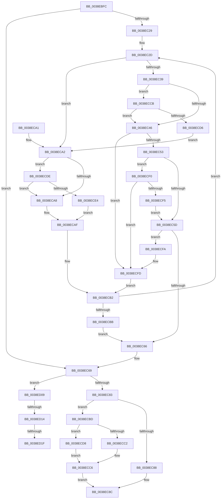

# FsRtlPrivateInsertExclusiveLock

- RVA: `0x0038EBFC`–`0x0038ED2D` (길이 `305` bytes)
- VA: `0x000000014038EBFC`
- 실행 섹션: `.text`
- PDB 이름 있음: `예`; PDB Function 태그: `예`
- unwind 정보 RVA: `0x000806DC`
- 디코드: `86`개 명령, `305/305` bytes 표시
- 미해석 바이트: `0` (있으면 어셈블리에 `.byte`로 보존)

> 이 문서는 커널 이미지의 기계어와 PDB 기호를 분석해 생성했습니다. 4번과 5번은 함수 원형과 자료형을 바이너리 사용 방식에서 추정한 C 해석이며 원본 소스 복구 결과는 아닙니다.

## 1. Dependencies

- 직접 호출 지점: **1**; 고유 호출 대상: **1**
- 직접 호출자로 확인된 함수: **2**
- RIP 상대 이미지 참조: **0**

### Outgoing calls
- `0x0038ED22` → [RtlRealSuccessor](RtlRealSuccessor_function_0038DF40.md) (function, `0x0038DF40`)

### Direct callers
- [FsRtlPrivateLock](FsRtlPrivateLock_function_0038DF90.md) at `0x0038E1D5`
- [FsRtlPrivateInsertLock](FsRtlPrivateInsertLock_function_0038E5D0.md) at `0x0038E69D`

### Static image references
- 디코드된 RIP-relative 메모리 참조가 없습니다.

## 2. Other-region calls and transfers

- 다른 실행 섹션으로 향하는 call: **0**
- call이 아닌 외부 분기/꼬리 이동: **3**
  - `0x0038ED0E` → [sub_006E5740 + 0x6](../6E/Unknown_function_006E5740.md) (`tail-transfer`)
  - `0x0038ED19` → [sub_006E5740](../6E/Unknown_function_006E5740.md) (`tail-transfer`)
  - `0x0038ED28` → [sub_006E5740](../6E/Unknown_function_006E5740.md) (`tail-transfer`)

## 3. Assembly (complete function range)

```asm
0038EBFC  48 89 5C 24 08                  mov qword ptr [rsp + 8], rbx
0038EC01  48 89 6C 24 10                  mov qword ptr [rsp + 0x10], rbp
0038EC06  48 89 74 24 18                  mov qword ptr [rsp + 0x18], rsi
0038EC0B  57                              push rdi
0038EC0C  48 83 EC 20                     sub rsp, 0x20
0038EC10  48 8B DA                        mov rbx, rdx
0038EC13  33 ED                           xor ebp, ebp
0038EC15  48 8B 51 10                     mov rdx, qword ptr [rcx + 0x10]
0038EC19  45 33 C0                        xor r8d, r8d
0038EC1C  45 32 C9                        xor r9b, r9b
0038EC1F  33 C0                           xor eax, eax
0038EC21  48 8B F1                        mov rsi, rcx
0038EC24  48 85 D2                        test rdx, rdx
0038EC27  74 40                           je 0x14038ec69
0038EC29  4C 8B 53 18                     mov r10, qword ptr [rbx + 0x18]
0038EC2D  48 8B 7A 40                     mov rdi, qword ptr [rdx + 0x40]
0038EC31  48 8B EA                        mov rbp, rdx
0038EC34  49 3B FA                        cmp rdi, r10
0038EC37  72 69                           jb 0x14038eca2
0038EC39  4C 8B 5A 18                     mov r11, qword ptr [rdx + 0x18]
0038EC3D  4D 85 DB                        test r11, r11
0038EC40  0F 84 85 00 00 00               je 0x14038eccb
0038EC46  48 8B 4B 40                     mov rcx, qword ptr [rbx + 0x40]
0038EC4A  4C 3B D9                        cmp r11, rcx
0038EC4D  0F 87 AA 00 00 00               ja 0x14038ecfd
0038EC53  48 83 F9 FF                     cmp rcx, -1
0038EC57  0F 84 93 00 00 00               je 0x14038ecf0
0038EC5D  4D 3B DA                        cmp r11, r10
0038EC60  0F 87 94 00 00 00               ja 0x14038ecfa
0038EC66  48 85 D2                        test rdx, rdx
0038EC69  48 0F 45 C5                     cmovne rax, rbp
0038EC6D  48 89 1B                        mov qword ptr [rbx], rbx
0038EC70  48 83 63 08 00                  and qword ptr [rbx + 8], 0
0038EC75  48 83 63 10 00                  and qword ptr [rbx + 0x10], 0
0038EC7A  48 85 C0                        test rax, rax
0038EC7D  0F 85 86 00 00 00               jne 0x14038ed09
0038EC83  4D 85 C0                        test r8, r8
0038EC86  75 35                           jne 0x14038ecbd
0038EC88  48 89 5E 10                     mov qword ptr [rsi + 0x10], rbx
0038EC8C  48 8B 5C 24 30                  mov rbx, qword ptr [rsp + 0x30]
0038EC91  48 8B 6C 24 38                  mov rbp, qword ptr [rsp + 0x38]
0038EC96  48 8B 74 24 40                  mov rsi, qword ptr [rsp + 0x40]
0038EC9B  48 83 C4 20                     add rsp, 0x20
0038EC9F  5F                              pop rdi
0038ECA0  C3                              ret
0038ECA1  CC                              int3
0038ECA2  48 3B 7B 40                     cmp rdi, qword ptr [rbx + 0x40]
0038ECA6  74 36                           je 0x14038ecde
0038ECA8  4C 8B C2                        mov r8, rdx
0038ECAB  48 8B 52 10                     mov rdx, qword ptr [rdx + 0x10]
0038ECAF  45 32 C9                        xor r9b, r9b
0038ECB2  48 85 D2                        test rdx, rdx
0038ECB5  0F 85 72 FF FF FF               jne 0x14038ec2d
0038ECBB  EB A9                           jmp 0x14038ec66
0038ECBD  45 84 C9                        test r9b, r9b
0038ECC0  75 16                           jne 0x14038ecd8
0038ECC2  49 89 58 10                     mov qword ptr [r8 + 0x10], rbx
0038ECC6  4C 89 03                        mov qword ptr [rbx], r8
0038ECC9  EB C1                           jmp 0x14038ec8c
0038ECCB  48 83 7A 20 00                  cmp qword ptr [rdx + 0x20], 0
0038ECD0  0F 85 70 FF FF FF               jne 0x14038ec46
0038ECD6  EB CA                           jmp 0x14038eca2
0038ECD8  49 89 58 08                     mov qword ptr [r8 + 8], rbx
0038ECDC  EB E8                           jmp 0x14038ecc6
0038ECDE  4C 39 52 18                     cmp qword ptr [rdx + 0x18], r10
0038ECE2  75 C4                           jne 0x14038eca8
0038ECE4  48 8B C2                        mov rax, rdx
0038ECE7  4C 8B C2                        mov r8, rdx
0038ECEA  48 8B 52 08                     mov rdx, qword ptr [rdx + 8]
0038ECEE  EB BF                           jmp 0x14038ecaf
0038ECF0  4D 85 D2                        test r10, r10
0038ECF3  74 08                           je 0x14038ecfd
0038ECF5  E9 63 FF FF FF                  jmp 0x14038ec5d
0038ECFA  48 8B C2                        mov rax, rdx
0038ECFD  4C 8B C2                        mov r8, rdx
0038ED00  41 B1 01                        mov r9b, 1
0038ED03  48 8B 52 08                     mov rdx, qword ptr [rdx + 8]
0038ED07  EB A9                           jmp 0x14038ecb2
0038ED09  48 83 78 10 00                  cmp qword ptr [rax + 0x10], 0
0038ED0E  0F 84 32 6A 35 00               je 0x1406e5746
0038ED14  48 83 78 08 00                  cmp qword ptr [rax + 8], 0
0038ED19  0F 84 21 6A 35 00               je 0x1406e5740
0038ED1F  48 8B C8                        mov rcx, rax
0038ED22  E8 19 F2 FF FF                  call 0x14038df40
0038ED27  90                              nop
0038ED28  E9 13 6A 35 00                  jmp 0x1406e5740
```

## 4. C-style interpretation (structured pseudocode)

```c
__int64 __fastcall FsRtlPrivateInsertExclusiveLock(__int64 a1, __int64 a2, int a3, unsigned __int8 a4)
{
    __int64 result;
    __int64 v_rbp;
    __int64 v_rsp;
    unsigned __int64 v_stack_p10;
    unsigned __int64 v_stack_p18;
    unsigned __int64 v_stack_p8;

    v_stack_p8 = v_rbx;
    v_stack_p10 = v_rbp;
    v_stack_p18 = v_rsi;
    v_rsp = (v_rsp) - (32);
    v_rbp = 0;
    a3 = 0;
    a4 = 0;
    result = 0;
    if (*(unsigned __int64 *)(a1 + 16) == 0) goto loc_0038EC69;
loc_0038EC2D:
    if ((*(unsigned __int64 *)(*(unsigned __int64 *)(a1 + 16) + 64)) < (*(unsigned __int64 *)(a2 + 24))) goto loc_0038ECA2;
    if (*(unsigned __int64 *)(*(unsigned __int64 *)(a1 + 16) + 24) == 0) goto loc_0038ECCB;
loc_0038EC46:
    if ((*(unsigned __int64 *)(*(unsigned __int64 *)(a1 + 16) + 24)) > (*(unsigned __int64 *)(a2 + 64))) goto loc_0038ECFD;
    if ((*(unsigned __int64 *)(a2 + 64)) == -1) goto loc_0038ECF0;
loc_0038EC5D:
    if ((*(unsigned __int64 *)(*(unsigned __int64 *)(a1 + 16) + 24)) > (*(unsigned __int64 *)(a2 + 24))) goto loc_0038ECFA;
loc_0038EC66:
loc_0038EC69:
    if (*(unsigned __int64 *)(a1 + 16) != 0) { result = *(unsigned __int64 *)(a1 + 16); }
    *(unsigned __int64 *)(a2) = a2;
    if (result != 0) goto loc_0038ED09;
    if (0 != 0) goto loc_0038ECBD;
    *(unsigned __int64 *)(a1 + 16) = a2;
loc_0038EC8C:
    v_rsp = (v_rsp) + (32);
    return result;
loc_0038ECA2:
    if ((*(unsigned __int64 *)(*(unsigned __int64 *)(a1 + 16) + 64)) == (*(unsigned __int64 *)(v_stack_p8 + 64))) goto loc_0038ECDE;
loc_0038ECA8:
loc_0038ECAF:
    a4 = 0;
loc_0038ECB2:
    if (*(unsigned __int64 *)(*(unsigned __int64 *)(a1 + 16) + 16) != 0) goto loc_0038EC2D;
    goto loc_0038EC66;
loc_0038ECBD:
    if (0 != 0) goto loc_0038ECD8;
    *(unsigned __int64 *)(*(unsigned __int64 *)(a1 + 16) + 16) = v_stack_p8;
loc_0038ECC6:
    *(unsigned __int64 *)(v_stack_p8) = *(unsigned __int64 *)(a1 + 16);
    goto loc_0038EC8C;
loc_0038ECCB:
    if ((*(unsigned __int64 *)(*(unsigned __int64 *)(*(unsigned __int64 *)(a1 + 16) + 16) + 32)) != 0) goto loc_0038EC46;
    goto loc_0038ECA2;
loc_0038ECD8:
    *(unsigned __int64 *)(*(unsigned __int64 *)(a1 + 16) + 8) = v_stack_p8;
    goto loc_0038ECC6;
loc_0038ECDE:
    if ((*(unsigned __int64 *)(*(unsigned __int64 *)(*(unsigned __int64 *)(a1 + 16) + 16) + 24)) != (*(unsigned __int64 *)(a2 + 24))) goto loc_0038ECA8;
    goto loc_0038ECAF;
loc_0038ECF0:
    if (*(unsigned __int64 *)(a2 + 24) == 0) goto loc_0038ECFD;
    goto loc_0038EC5D;
loc_0038ECFA:
loc_0038ECFD:
    goto loc_0038ECB2;
loc_0038ED09:
    result = RtlRealSuccessor(*(unsigned __int64 *)(*(unsigned __int64 *)(*(unsigned __int64 *)(a1 + 16) + 16) + 8), *(unsigned __int64 *)(*(unsigned __int64 *)(*(unsigned __int64 *)(*(unsigned __int64 *)(a1 + 16) + 16) + 8) + 8), *(unsigned __int64 *)(*(unsigned __int64 *)(*(unsigned __int64 *)(a1 + 16) + 16) + 8), 1);
}
```

## 5. (Beta) C Style

```c
int64_t FsRtlPrivateInsertExclusiveLock(void *Arg1, void *Arg2, int32_t Arg3, uint8_t Arg4)
{
    uint8_t *arg1 = (uint8_t *)Arg1;
    uint8_t *arg2 = (uint8_t *)Arg2;

    int64_t result;
    int64_t local_rbp;
    int64_t local_rsp;
    uint64_t v_stack_p10;
    uint64_t v_stack_p18;
    uint64_t v_stack_p8;

    v_stack_p8 = local_rbx;
    v_stack_p10 = local_rbp;
    v_stack_p18 = local_rsi;
    local_rsp = (local_rsp) - (32);
    local_rbp = 0;
    Arg3 = 0;
    Arg4 = 0;
    result = 0;
    if (*(uint64_t *)(arg1 + 0x10) == 0) goto loc_0038EC69;
loc_0038EC2D:
    if ((*(uint64_t *)(*(uint64_t *)(arg1 + 0x10) + 0x40)) < (*(uint64_t *)(arg2 + 0x18))) goto loc_0038ECA2;
    if (*(uint64_t *)(*(uint64_t *)(arg1 + 0x10) + 0x18) == 0) goto loc_0038ECCB;
loc_0038EC46:
    if ((*(uint64_t *)(*(uint64_t *)(arg1 + 0x10) + 0x18)) > (*(uint64_t *)(arg2 + 0x40))) goto loc_0038ECFD;
    if ((*(uint64_t *)(arg2 + 0x40)) == -1) goto loc_0038ECF0;
loc_0038EC5D:
    if ((*(uint64_t *)(*(uint64_t *)(arg1 + 0x10) + 0x18)) > (*(uint64_t *)(arg2 + 0x18))) goto loc_0038ECFA;
loc_0038EC66:
loc_0038EC69:
    if (*(uint64_t *)(arg1 + 0x10) != 0) { result = *(uint64_t *)(arg1 + 0x10); }
    *(void **)(arg2) = Arg2;
    if (result != 0) goto loc_0038ED09;
    if (0 != 0) goto loc_0038ECBD;
    *(void **)(arg1 + 0x10) = Arg2;
loc_0038EC8C:
    local_rsp = (local_rsp) + (32);
    return result;
loc_0038ECA2:
    if ((*(uint64_t *)(*(uint64_t *)(arg1 + 0x10) + 0x40)) == (*(uint64_t *)(v_stack_p8 + 0x40))) goto loc_0038ECDE;
loc_0038ECA8:
loc_0038ECAF:
    Arg4 = 0;
loc_0038ECB2:
    if (*(uint64_t *)(*(uint64_t *)(arg1 + 0x10) + 0x10) != 0) goto loc_0038EC2D;
    goto loc_0038EC66;
loc_0038ECBD:
    if (0 != 0) goto loc_0038ECD8;
    *(uint64_t *)(*(uint64_t *)(arg1 + 0x10) + 0x10) = v_stack_p8;
loc_0038ECC6:
    *(uint64_t *)(v_stack_p8) = *(uint64_t *)(arg1 + 0x10);
    goto loc_0038EC8C;
loc_0038ECCB:
    if ((*(uint64_t *)(*(uint64_t *)(*(uint64_t *)(arg1 + 0x10) + 0x10) + 0x20)) != 0) goto loc_0038EC46;
    goto loc_0038ECA2;
loc_0038ECD8:
    *(uint64_t *)(*(uint64_t *)(arg1 + 0x10) + 0x8) = v_stack_p8;
    goto loc_0038ECC6;
loc_0038ECDE:
    if ((*(uint64_t *)(*(uint64_t *)(*(uint64_t *)(arg1 + 0x10) + 0x10) + 0x18)) != (*(uint64_t *)(arg2 + 0x18))) goto loc_0038ECA8;
    goto loc_0038ECAF;
loc_0038ECF0:
    if (*(uint64_t *)(arg2 + 0x18) == 0) goto loc_0038ECFD;
    goto loc_0038EC5D;
loc_0038ECFA:
loc_0038ECFD:
    goto loc_0038ECB2;
loc_0038ED09:
    result = RtlRealSuccessor(*(uint64_t *)(*(uint64_t *)(*(uint64_t *)(arg1 + 0x10) + 0x10) + 0x8), *(uint64_t *)(*(uint64_t *)(*(uint64_t *)(*(uint64_t *)(arg1 + 0x10) + 0x10) + 0x8) + 0x8), *(uint64_t *)(*(uint64_t *)(*(uint64_t *)(arg1 + 0x10) + 0x10) + 0x8), 1);
}
```

### 관측된 메모리 오프셋

구조체 형식이 확인되지 않은 접근은 인자 기준의 오프셋으로만 기록했습니다.

| 기준 인자 | 오프셋 표현 | 폭 (bit) | 접근 |
|---|---:|---:|---|
| `Arg1` | `+ 0x10` | `64` | `R` |
| `Arg1` | `+ 0x10` | `64` | `W` |
| `Arg2` | `+ 0x0` | `64` | `W` |
| `Arg2` | `+ 0x8` | `64` | `R/W` |
| `Arg2` | `+ 0x10` | `64` | `R/W` |
| `Arg2` | `+ 0x18` | `64` | `R` |
| `Arg2` | `+ 0x40` | `64` | `R` |

## 6. Execution-region graph

[열기: 2D/3D 그래프와 함수 탐색 컨트롤 패널](../../../control-panel.html?section=text&rva=0x0038EBFC&view=graph)

- 2D 그래프는 위에서 아래로 흐르고, 3D 그래프는 빈 공간을 드래그해 회전합니다. Shift+드래그는 이동, 휠은 확대·축소, 함수 노드 선택은 대상 보고서 이동입니다.

### Static fallback


