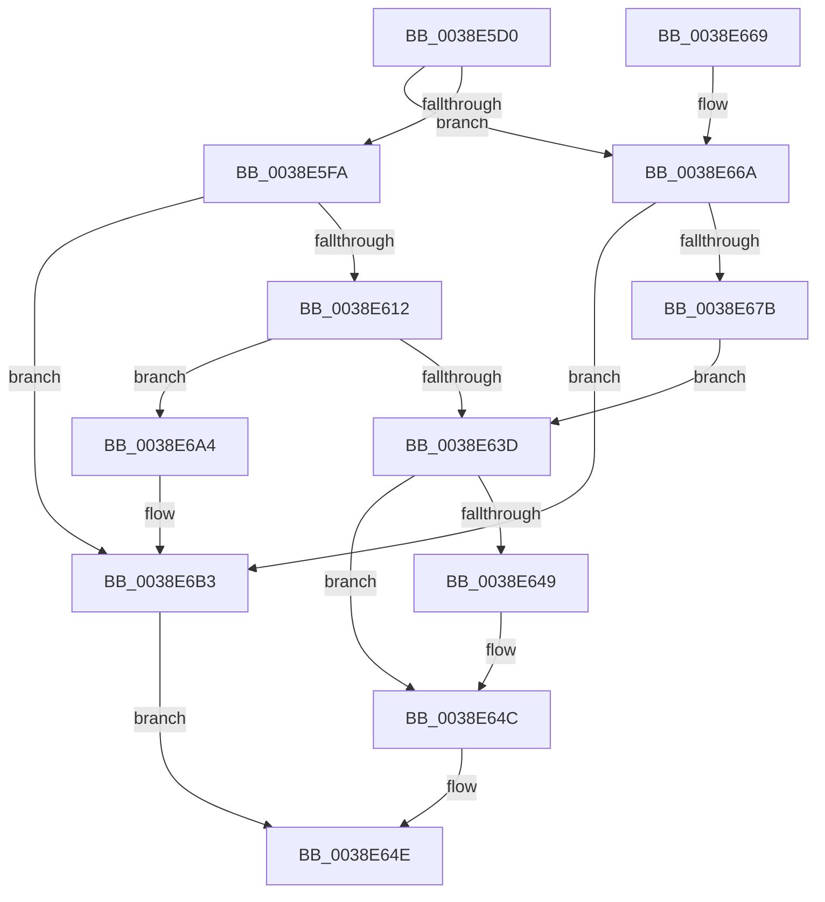

# FsRtlPrivateInsertLock

- RVA: `0x0038E5D0`–`0x0038E6B7` (길이 `231` bytes)
- VA: `0x000000014038E5D0`
- 실행 섹션: `.text`
- PDB 이름 있음: `예`; PDB Function 태그: `아니요`
- unwind 정보 RVA: `0x00080624`
- 디코드: `62`개 명령, `231/231` bytes 표시
- 미해석 바이트: `0` (있으면 어셈블리에 `.byte`로 보존)

> 이 문서는 커널 이미지의 기계어와 PDB 기호를 분석해 생성했습니다. 4번과 5번은 함수 원형과 자료형을 바이너리 사용 방식에서 추정한 C 해석이며 원본 소스 복구 결과는 아닙니다.

## 1. Dependencies

- 직접 호출 지점: **5**; 고유 호출 대상: **4**
- 직접 호출자로 확인된 함수: **1**
- RIP 상대 이미지 참조: **2**

### Outgoing calls
- `0x0038E601` → [ExAllocateFromNPagedLookasideList](ExAllocateFromNPagedLookasideList_function_0038E6C0.md) (function, `0x0038E6C0`)
- `0x0038E634` → [FsRtlPrivateInsertSharedLock](FsRtlPrivateInsertSharedLock_function_0038E810.md) (function, `0x0038E810`)
- `0x0038E671` → [ExAllocateFromNPagedLookasideList](ExAllocateFromNPagedLookasideList_function_0038E6C0.md) (function, `0x0038E6C0`)
- `0x0038E69D` → [FsRtlPrivateInsertExclusiveLock](FsRtlPrivateInsertExclusiveLock_function_0038EBFC.md) (function, `0x0038EBFC`)
- `0x0038E6AE` → [ExFreeToNPagedLookasideList](ExFreeToNPagedLookasideList_function_0038D9D0.md) (function, `0x0038D9D0`)

### Direct callers
- [FsRtlPrivateCheckWaitingLocks](FsRtlPrivateCheckWaitingLocks_function_0038DCBC.md) at `0x0038DDB9`

### Static image references
- `0x0038E5FA` → RVA `0x00E12200` (`.data`; read)
- `0x0038E66A` → RVA `0x00E12180` (`.data`; read)

## 2. Other-region calls and transfers

- 다른 실행 섹션으로 향하는 call: **0**
- 별도 외부 분기/꼬리 이동을 확인하지 못했습니다.

## 3. Assembly (complete function range)

```asm
0038E5D0  48 89 5C 24 08                  mov qword ptr [rsp + 8], rbx
0038E5D5  48 89 6C 24 10                  mov qword ptr [rsp + 0x10], rbp
0038E5DA  48 89 74 24 18                  mov qword ptr [rsp + 0x18], rsi
0038E5DF  48 89 7C 24 20                  mov qword ptr [rsp + 0x20], rdi
0038E5E4  41 56                           push r14
0038E5E6  48 83 EC 20                     sub rsp, 0x20
0038E5EA  41 80 78 10 00                  cmp byte ptr [r8 + 0x10], 0
0038E5EF  49 8B D8                        mov rbx, r8
0038E5F2  48 8B F2                        mov rsi, rdx
0038E5F5  48 8B F9                        mov rdi, rcx
0038E5F8  75 70                           jne 0x14038e66a
0038E5FA  48 8D 0D FF 3B A8 00            lea rcx, [rip + 0xa83bff]
0038E601  E8 BA 00 00 00                  call 0x14038e6c0
0038E606  4C 8B F0                        mov r14, rax
0038E609  48 85 C0                        test rax, rax
0038E60C  0F 84 A1 00 00 00               je 0x14038e6b3
0038E612  0F 10 03                        movups xmm0, xmmword ptr [rbx]
0038E615  48 8D 68 08                     lea rbp, [rax + 8]
0038E619  48 8B D0                        mov rdx, rax
0038E61C  48 8D 4F 18                     lea rcx, [rdi + 0x18]
0038E620  0F 11 45 00                     movups xmmword ptr [rbp], xmm0
0038E624  0F 10 4B 10                     movups xmm1, xmmword ptr [rbx + 0x10]
0038E628  0F 11 4D 10                     movups xmmword ptr [rbp + 0x10], xmm1
0038E62C  0F 10 43 20                     movups xmm0, xmmword ptr [rbx + 0x20]
0038E630  0F 11 45 20                     movups xmmword ptr [rbp + 0x20], xmm0
0038E634  E8 D7 01 00 00                  call 0x14038e810
0038E639  84 C0                           test al, al
0038E63B  74 67                           je 0x14038e6a4
0038E63D  48 89 6E 78                     mov qword ptr [rsi + 0x78], rbp
0038E641  48 8B 03                        mov rax, qword ptr [rbx]
0038E644  48 3B 07                        cmp rax, qword ptr [rdi]
0038E647  73 03                           jae 0x14038e64c
0038E649  48 89 07                        mov qword ptr [rdi], rax
0038E64C  B0 01                           mov al, 1
0038E64E  48 8B 5C 24 30                  mov rbx, qword ptr [rsp + 0x30]
0038E653  48 8B 6C 24 38                  mov rbp, qword ptr [rsp + 0x38]
0038E658  48 8B 74 24 40                  mov rsi, qword ptr [rsp + 0x40]
0038E65D  48 8B 7C 24 48                  mov rdi, qword ptr [rsp + 0x48]
0038E662  48 83 C4 20                     add rsp, 0x20
0038E666  41 5E                           pop r14
0038E668  C3                              ret
0038E669  CC                              int3
0038E66A  48 8D 0D 0F 3B A8 00            lea rcx, [rip + 0xa83b0f]
0038E671  E8 4A 00 00 00                  call 0x14038e6c0
0038E676  48 85 C0                        test rax, rax
0038E679  74 38                           je 0x14038e6b3
0038E67B  0F 10 03                        movups xmm0, xmmword ptr [rbx]
0038E67E  48 8D 68 18                     lea rbp, [rax + 0x18]
0038E682  48 8B D0                        mov rdx, rax
0038E685  48 8D 4F 18                     lea rcx, [rdi + 0x18]
0038E689  0F 11 45 00                     movups xmmword ptr [rbp], xmm0
0038E68D  0F 10 4B 10                     movups xmm1, xmmword ptr [rbx + 0x10]
0038E691  0F 11 4D 10                     movups xmmword ptr [rbp + 0x10], xmm1
0038E695  0F 10 43 20                     movups xmm0, xmmword ptr [rbx + 0x20]
0038E699  0F 11 45 20                     movups xmmword ptr [rbp + 0x20], xmm0
0038E69D  E8 5A 05 00 00                  call 0x14038ebfc
0038E6A2  EB 99                           jmp 0x14038e63d
0038E6A4  49 8B D6                        mov rdx, r14
0038E6A7  48 8D 0D 52 3B A8 00            lea rcx, [rip + 0xa83b52]
0038E6AE  E8 1D F3 FF FF                  call 0x14038d9d0
0038E6B3  32 C0                           xor al, al
0038E6B5  EB 97                           jmp 0x14038e64e
```

## 4. C-style interpretation (structured pseudocode)

```c
__int64 __fastcall FsRtlPrivateInsertLock(__int64 a1, __int64 a2, __int64 a3)
{
    __int64 result;
    __int64 v_rsp;
    unsigned __int64 v_stack_p10;
    unsigned __int64 v_stack_p18;
    unsigned __int64 v_stack_p20;
    unsigned __int64 v_stack_p8;

    v_stack_p8 = v_rbx;
    v_stack_p10 = v_rbp;
    v_stack_p18 = v_rsi;
    v_stack_p20 = v_rdi;
    v_rsp = (v_rsp) - (32);
    if ((*(unsigned __int8 *)(a3 + 16)) != 0) goto loc_0038E66A;
    result = ExAllocateFromNPagedLookasideList(v_rip + 11025407, a2, a3, a4);
    if (result == 0) goto loc_0038E6B3;
    *(unsigned __int64 *)(result + 8) = v_xmm0;
    *(unsigned __int64 *)(result + 8 + 16) = v_xmm1;
    *(unsigned __int64 *)(result + 8 + 32) = v_xmm0;
    result = FsRtlPrivateInsertSharedLock(a1 + 24, result, a3, a4);
    if ((unsigned __int8)(result) == 0) goto loc_0038E6A4;
loc_0038E63D:
    *(unsigned __int64 *)(a2 + 120) = result + 8;
    if ((*(unsigned __int64 *)(a3)) < (*(unsigned __int64 *)(a1))) {
        *(unsigned __int64 *)(a1) = *(unsigned __int64 *)(a3);
    }
loc_0038E64E:
    v_rsp = (v_rsp) + (32);
    return 1;
loc_0038E66A:
    result = ExAllocateFromNPagedLookasideList(v_rip + 11025167, result, a3, a4);
    if (result == 0) goto loc_0038E6B3;
    *(unsigned __int64 *)(result + 24) = v_xmm0;
    *(unsigned __int64 *)(result + 24 + 16) = v_xmm1;
    *(unsigned __int64 *)(result + 24 + 32) = v_xmm0;
    result = FsRtlPrivateInsertExclusiveLock(v_stack_p20 + 24, result, a3, a4);
    goto loc_0038E63D;
loc_0038E6A4:
    result = ExFreeToNPagedLookasideList(v_rip + 11025234, result, a3, a4);
loc_0038E6B3:
    result = 0;
    goto loc_0038E64E;
}
```

## 5. (Beta) C Style

```c
int64_t FsRtlPrivateInsertLock(void *Arg1, void *Arg2, void *Arg3)
{
    uint8_t *arg1 = (uint8_t *)Arg1;
    uint8_t *arg2 = (uint8_t *)Arg2;
    uint8_t *arg3 = (uint8_t *)Arg3;

    int64_t result;
    int64_t local_rsp;
    uint64_t v_stack_p10;
    uint64_t v_stack_p18;
    uint64_t v_stack_p20;
    uint64_t v_stack_p8;

    v_stack_p8 = local_rbx;
    v_stack_p10 = local_rbp;
    v_stack_p18 = local_rsi;
    v_stack_p20 = local_rdi;
    local_rsp = (local_rsp) - (32);
    if ((*(uint8_t *)(arg3 + 0x10)) != 0) goto loc_0038E66A;
    result = ExAllocateFromNPagedLookasideList(v_rip + 11025407, Arg2, Arg3, a4);
    if (result == 0) goto loc_0038E6B3;
    *(uint64_t *)(result + 0x8) = v_xmm0;
    *(uint64_t *)(result + 0x8 + 0x10) = v_xmm1;
    *(uint64_t *)(result + 0x8 + 0x20) = v_xmm0;
    result = FsRtlPrivateInsertSharedLock(Arg1 + 24, result, Arg3, a4);
    if ((uint8_t)(result) == 0) goto loc_0038E6A4;
loc_0038E63D:
    *(uint64_t *)(arg2 + 0x78) = result + 8;
    if ((*(uint64_t *)(arg3)) < (*(uint64_t *)(arg1))) {
        *(uint64_t *)(arg1) = *(uint64_t *)(arg3);
    }
loc_0038E64E:
    local_rsp = (local_rsp) + (32);
    return 1;
loc_0038E66A:
    result = ExAllocateFromNPagedLookasideList(v_rip + 11025167, result, Arg3, a4);
    if (result == 0) goto loc_0038E6B3;
    *(uint64_t *)(result + 0x18) = v_xmm0;
    *(uint64_t *)(result + 0x18 + 0x10) = v_xmm1;
    *(uint64_t *)(result + 0x18 + 0x20) = v_xmm0;
    result = FsRtlPrivateInsertExclusiveLock(v_stack_p20 + 24, result, Arg3, a4);
    goto loc_0038E63D;
loc_0038E6A4:
    result = ExFreeToNPagedLookasideList(v_rip + 11025234, result, Arg3, a4);
loc_0038E6B3:
    result = 0;
    goto loc_0038E64E;
}
```

### 관측된 메모리 오프셋

구조체 형식이 확인되지 않은 접근은 인자 기준의 오프셋으로만 기록했습니다.

| 기준 인자 | 오프셋 표현 | 폭 (bit) | 접근 |
|---|---:|---:|---|
| `Arg1` | `+ 0x0` | `64` | `R` |
| `Arg1` | `+ 0x0` | `64` | `W` |
| `Arg1` | `+ 0x18` | `64` | `R` |
| `Arg2` | `+ 0x78` | `64` | `W` |
| `Arg3` | `+ 0x0` | `64` | `R` |
| `Arg3` | `+ 0x0` | `128` | `R` |
| `Arg3` | `+ 0x10` | `8` | `R` |
| `Arg3` | `+ 0x10` | `128` | `R` |
| `Arg3` | `+ 0x20` | `128` | `R` |

## 6. Execution-region graph

[열기: 2D/3D 그래프와 함수 탐색 컨트롤 패널](../../../control-panel.html?section=text&rva=0x0038E5D0&view=graph)

- 2D 그래프는 위에서 아래로 흐르고, 3D 그래프는 빈 공간을 드래그해 회전합니다. Shift+드래그는 이동, 휠은 확대·축소, 함수 노드 선택은 대상 보고서 이동입니다.

### Static fallback


