# FsRtlPrivateInsertSharedLock

- RVA: `0x0038E810`–`0x0038EA22` (길이 `530` bytes)
- VA: `0x000000014038E810`
- 실행 섹션: `.text`
- PDB 이름 있음: `예`; PDB Function 태그: `예`
- unwind 정보 RVA: `0x00080698`
- 디코드: `145`개 명령, `530/530` bytes 표시
- 미해석 바이트: `0` (있으면 어셈블리에 `.byte`로 보존)

> 이 문서는 커널 이미지의 기계어와 PDB 기호를 분석해 생성했습니다. 4번과 5번은 함수 원형과 자료형을 바이너리 사용 방식에서 추정한 C 해석이며 원본 소스 복구 결과는 아닙니다.

## 1. Dependencies

- 직접 호출 지점: **5**; 고유 호출 대상: **4**
- 직접 호출자로 확인된 함수: **2**
- RIP 상대 이미지 참조: **1**

### Outgoing calls
- `0x0038E8A9` → [ExAllocateFromNPagedLookasideList](ExAllocateFromNPagedLookasideList_function_0038E6C0.md) (function, `0x0038E6C0`)
- `0x0038E8FA` → [RtlSplay](RtlSplay_function_0038F1E0.md) (function, `0x0038F1E0`)
- `0x0038E999` → [RtlSplay](RtlSplay_function_0038F1E0.md) (function, `0x0038F1E0`)
- `0x0038E9C2` → [FsRtlSplitLocks](../3F/FsRtlSplitLocks_function_003FD8DC.md) (function, `0x003FD8DC`)
- `0x0038EA10` → [RtlRealSuccessor](RtlRealSuccessor_function_0038DF40.md) (function, `0x0038DF40`)

### Direct callers
- [FsRtlPrivateLock](FsRtlPrivateLock_function_0038DF90.md) at `0x0038E123`
- [FsRtlPrivateInsertLock](FsRtlPrivateInsertLock_function_0038E5D0.md) at `0x0038E634`

### Static image references
- `0x0038E8A2` → RVA `0x00E11F80` (`.data`; read)

## 2. Other-region calls and transfers

- 다른 실행 섹션으로 향하는 call: **0**
- call이 아닌 외부 분기/꼬리 이동: **1**
  - `0x0038EA1D` → [sub_006E56AC](../6E/Unknown_function_006E56AC.md) (`tail-transfer`)

## 3. Assembly (complete function range)

```asm
0038E810  48 89 5C 24 08                  mov qword ptr [rsp + 8], rbx
0038E815  48 89 6C 24 10                  mov qword ptr [rsp + 0x10], rbp
0038E81A  48 89 74 24 18                  mov qword ptr [rsp + 0x18], rsi
0038E81F  57                              push rdi
0038E820  41 56                           push r14
0038E822  41 57                           push r15
0038E824  48 83 EC 20                     sub rsp, 0x20
0038E828  45 33 FF                        xor r15d, r15d
0038E82B  48 8B DA                        mov rbx, rdx
0038E82E  48 8B 51 08                     mov rdx, qword ptr [rcx + 8]
0038E832  45 32 F6                        xor r14b, r14b
0038E835  48 8B F9                        mov rdi, rcx
0038E838  45 8B C7                        mov r8d, r15d
0038E83B  41 8B F7                        mov esi, r15d
0038E83E  41 8B CF                        mov ecx, r15d
0038E841  48 85 D2                        test rdx, rdx
0038E844  74 41                           je 0x14038e887
0038E846  4C 8B 53 08                     mov r10, qword ptr [rbx + 8]
0038E84A  4C 8D 42 E8                     lea r8, [rdx - 0x18]
0038E84E  4D 8B 08                        mov r9, qword ptr [r8]
0038E851  4D 39 50 10                     cmp qword ptr [r8 + 0x10], r10
0038E855  0F 82 EB 00 00 00               jb 0x14038e946
0038E85B  49 8B 41 08                     mov rax, qword ptr [r9 + 8]
0038E85F  48 85 C0                        test rax, rax
0038E862  0F 84 D4 00 00 00               je 0x14038e93c
0038E868  4C 8B 4B 30                     mov r9, qword ptr [rbx + 0x30]
0038E86C  49 3B C1                        cmp rax, r9
0038E86F  0F 86 AA 00 00 00               jbe 0x14038e91f
0038E875  48 8B F2                        mov rsi, rdx
0038E878  41 B6 01                        mov r14b, 1
0038E87B  48 8B 52 08                     mov rdx, qword ptr [rdx + 8]
0038E87F  48 85 D2                        test rdx, rdx
0038E882  75 C6                           jne 0x14038e84a
0038E884  48 85 D2                        test rdx, rdx
0038E887  49 0F 45 C8                     cmovne rcx, r8
0038E88B  49 8B EF                        mov rbp, r15
0038E88E  48 85 C9                        test rcx, rcx
0038E891  48 8D 41 18                     lea rax, [rcx + 0x18]
0038E895  48 0F 45 E8                     cmovne rbp, rax
0038E899  48 85 ED                        test rbp, rbp
0038E89C  0F 85 C1 00 00 00               jne 0x14038e963
0038E8A2  48 8D 0D D7 36 A8 00            lea rcx, [rip + 0xa836d7]
0038E8A9  E8 12 FE FF FF                  call 0x14038e6c0
0038E8AE  48 8B D0                        mov rdx, rax
0038E8B1  48 85 C0                        test rax, rax
0038E8B4  0F 84 80 00 00 00               je 0x14038e93a
0038E8BA  4C 89 78 20                     mov qword ptr [rax + 0x20], r15
0038E8BE  48 83 C0 18                     add rax, 0x18
0038E8C2  48 89 00                        mov qword ptr [rax], rax
0038E8C5  4C 89 78 10                     mov qword ptr [rax + 0x10], r15
0038E8C9  44 88 7A 08                     mov byte ptr [rdx + 8], r15b
0038E8CD  48 89 5A 30                     mov qword ptr [rdx + 0x30], rbx
0038E8D1  48 89 1A                        mov qword ptr [rdx], rbx
0038E8D4  48 8B 4B 30                     mov rcx, qword ptr [rbx + 0x30]
0038E8D8  48 89 4A 10                     mov qword ptr [rdx + 0x10], rcx
0038E8DC  4C 89 3B                        mov qword ptr [rbx], r15
0038E8DF  48 85 F6                        test rsi, rsi
0038E8E2  74 1B                           je 0x14038e8ff
0038E8E4  48 8B C8                        mov rcx, rax
0038E8E7  45 84 F6                        test r14b, r14b
0038E8EA  0F 84 F9 00 00 00               je 0x14038e9e9
0038E8F0  48 89 46 08                     mov qword ptr [rsi + 8], rax
0038E8F4  48 89 31                        mov qword ptr [rcx], rsi
0038E8F7  48 8B C8                        mov rcx, rax
0038E8FA  E8 E1 08 00 00                  call 0x14038f1e0
0038E8FF  48 89 47 08                     mov qword ptr [rdi + 8], rax
0038E903  B0 01                           mov al, 1
0038E905  48 8B 5C 24 40                  mov rbx, qword ptr [rsp + 0x40]
0038E90A  48 8B 6C 24 48                  mov rbp, qword ptr [rsp + 0x48]
0038E90F  48 8B 74 24 50                  mov rsi, qword ptr [rsp + 0x50]
0038E914  48 83 C4 20                     add rsp, 0x20
0038E918  41 5F                           pop r15
0038E91A  41 5E                           pop r14
0038E91C  5F                              pop rdi
0038E91D  C3                              ret
0038E91E  CC                              int3
0038E91F  49 83 F9 FF                     cmp r9, -1
0038E923  0F 84 A3 00 00 00               je 0x14038e9cc
0038E929  49 3B C2                        cmp rax, r10
0038E92C  0F 86 52 FF FF FF               jbe 0x14038e884
0038E932  49 8B C8                        mov rcx, r8
0038E935  E9 3B FF FF FF                  jmp 0x14038e875
0038E93A  EB C9                           jmp 0x14038e905
0038E93C  4D 39 79 10                     cmp qword ptr [r9 + 0x10], r15
0038E940  0F 85 22 FF FF FF               jne 0x14038e868
0038E946  48 8B 43 30                     mov rax, qword ptr [rbx + 0x30]
0038E94A  49 39 41 30                     cmp qword ptr [r9 + 0x30], rax
0038E94E  0F 84 86 00 00 00               je 0x14038e9da
0038E954  48 8B F2                        mov rsi, rdx
0038E957  45 32 F6                        xor r14b, r14b
0038E95A  48 8B 52 10                     mov rdx, qword ptr [rdx + 0x10]
0038E95E  E9 1C FF FF FF                  jmp 0x14038e87f
0038E963  48 8B 45 E8                     mov rax, qword ptr [rbp - 0x18]
0038E967  48 8D 4D E8                     lea rcx, [rbp - 0x18]
0038E96B  48 85 C0                        test rax, rax
0038E96E  74 18                           je 0x14038e988
0038E970  4C 8B 43 08                     mov r8, qword ptr [rbx + 8]
0038E974  4C 3B 40 08                     cmp r8, qword ptr [rax + 8]
0038E978  72 0E                           jb 0x14038e988
0038E97A  75 76                           jne 0x14038e9f2
0038E97C  4C 39 7B 10                     cmp qword ptr [rbx + 0x10], r15
0038E980  74 06                           je 0x14038e988
0038E982  4C 39 78 10                     cmp qword ptr [rax + 0x10], r15
0038E986  74 6A                           je 0x14038e9f2
0038E988  4C 39 39                        cmp qword ptr [rcx], r15
0038E98B  74 76                           je 0x14038ea03
0038E98D  48 8B 01                        mov rax, qword ptr [rcx]
0038E990  48 89 03                        mov qword ptr [rbx], rax
0038E993  48 89 19                        mov qword ptr [rcx], rbx
0038E996  48 8B CD                        mov rcx, rbp
0038E999  E8 42 08 00 00                  call 0x14038f1e0
0038E99E  48 89 47 08                     mov qword ptr [rdi + 8], rax
0038E9A2  48 8B 43 30                     mov rax, qword ptr [rbx + 0x30]
0038E9A6  48 3B 45 F8                     cmp rax, qword ptr [rbp - 8]
0038E9AA  77 5D                           ja 0x14038ea09
0038E9AC  44 38 7D F0                     cmp byte ptr [rbp - 0x10], r15b
0038E9B0  0F 84 4D FF FF FF               je 0x14038e903
0038E9B6  45 33 C9                        xor r9d, r9d
0038E9B9  48 8D 4D E8                     lea rcx, [rbp - 0x18]
0038E9BD  45 33 C0                        xor r8d, r8d
0038E9C0  33 D2                           xor edx, edx
0038E9C2  E8 15 EF 06 00                  call 0x1403fd8dc
0038E9C7  E9 37 FF FF FF                  jmp 0x14038e903
0038E9CC  4D 85 D2                        test r10, r10
0038E9CF  0F 84 A0 FE FF FF               je 0x14038e875
0038E9D5  E9 4F FF FF FF                  jmp 0x14038e929
0038E9DA  4D 39 51 08                     cmp qword ptr [r9 + 8], r10
0038E9DE  0F 84 A0 FE FF FF               je 0x14038e884
0038E9E4  E9 6B FF FF FF                  jmp 0x14038e954
0038E9E9  48 89 46 10                     mov qword ptr [rsi + 0x10], rax
0038E9ED  E9 02 FF FF FF                  jmp 0x14038e8f4
0038E9F2  48 8B C8                        mov rcx, rax
0038E9F5  48 8B 00                        mov rax, qword ptr [rax]
0038E9F8  48 85 C0                        test rax, rax
0038E9FB  0F 85 73 FF FF FF               jne 0x14038e974
0038EA01  EB 85                           jmp 0x14038e988
0038EA03  48 89 5D 18                     mov qword ptr [rbp + 0x18], rbx
0038EA07  EB 84                           jmp 0x14038e98d
0038EA09  48 8B CD                        mov rcx, rbp
0038EA0C  48 89 45 F8                     mov qword ptr [rbp - 8], rax
0038EA10  E8 2B F5 FF FF                  call 0x14038df40
0038EA15  4C 8B F0                        mov r14, rax
0038EA18  48 85 C0                        test rax, rax
0038EA1B  74 8F                           je 0x14038e9ac
0038EA1D  E9 8A 6C 35 00                  jmp 0x1406e56ac
```

## 4. C-style interpretation (structured pseudocode)

```c
__int64 __fastcall FsRtlPrivateInsertSharedLock(__int64 a1, __int64 a2)
{
    __int64 result;
    __int64 v_r14;
    __int64 v_r15;
    __int64 v_rbp;
    __int64 v_rsp;
    unsigned __int64 v_stack_p10;
    unsigned __int64 v_stack_p18;
    unsigned __int64 v_stack_p8;

    v_stack_p8 = v_rbx;
    v_stack_p10 = v_rbp;
    v_stack_p18 = v_rsi;
    v_rsp = (v_rsp) - (32);
    v_r15 = 0;
    v_r14 = 0;
    if (*(unsigned __int64 *)(a1 + 8) == 0) goto loc_0038E887;
loc_0038E84A:
    if ((*(unsigned __int64 *)(*(unsigned __int64 *)(a1 + 8) - 24 + 16)) < (*(unsigned __int64 *)(a2 + 8))) goto loc_0038E946;
    if (*(unsigned __int64 *)(*(unsigned __int64 *)(*(unsigned __int64 *)(a1 + 8) - 24) + 8) == 0) goto loc_0038E93C;
loc_0038E868:
    if ((*(unsigned __int64 *)(*(unsigned __int64 *)(*(unsigned __int64 *)(a1 + 8) - 24) + 8)) <= (*(unsigned __int64 *)(a2 + 48))) goto loc_0038E91F;
loc_0038E875:
loc_0038E87F:
    if (*(unsigned __int64 *)(*(unsigned __int64 *)(a1 + 8) + 8) != 0) goto loc_0038E84A;
loc_0038E884:
loc_0038E887:
    a1 = 0;
    if (*(unsigned __int64 *)(*(unsigned __int64 *)(a1 + 8) + 8) != 0) { a1 = *(unsigned __int64 *)(a1 + 8) - 24; }
    v_rbp = 0;
    if (a1 != 0) { v_rbp = a1 + 24; }
    if (v_rbp != 0) goto loc_0038E963;
    result = ExAllocateFromNPagedLookasideList(v_rip + 11024087, *(unsigned __int64 *)(*(unsigned __int64 *)(a1 + 8) + 8), *(unsigned __int64 *)(a1 + 8) - 24, *(unsigned __int64 *)(a2 + 48));
    if (result == 0) goto loc_0038E93A;
    *(unsigned __int64 *)(result + 32) = 0;
    result = (result) + (24);
    *(unsigned __int64 *)(result) = result;
    *(unsigned __int64 *)(result + 16) = 0;
    *(unsigned __int8 *)(result + 8) = 0;
    *(unsigned __int64 *)(result + 48) = a2;
    *(unsigned __int64 *)(result) = a2;
    *(unsigned __int64 *)(result + 16) = *(unsigned __int64 *)(a2 + 48);
    *(unsigned __int64 *)(a2) = 0;
    if (*(unsigned __int64 *)(a1 + 8) == 0) goto loc_0038E8FF;
    if (1 == 0) goto loc_0038E9E9;
    *(unsigned __int64 *)(*(unsigned __int64 *)(a1 + 8) + 8) = result;
loc_0038E8F4:
    *(unsigned __int64 *)(result) = *(unsigned __int64 *)(a1 + 8);
    result = RtlSplay(result, result, *(unsigned __int64 *)(a1 + 8) - 24, *(unsigned __int64 *)(a2 + 48));
loc_0038E8FF:
    *(unsigned __int64 *)(a1 + 8) = result;
loc_0038E903:
loc_0038E905:
    v_rsp = (v_rsp) + (32);
    return 1;
loc_0038E91F:
    if ((*(unsigned __int64 *)(a2 + 48)) == -1) goto loc_0038E9CC;
loc_0038E929:
    if (1 <= (*(unsigned __int64 *)(a2 + 8))) goto loc_0038E884;
    goto loc_0038E875;
loc_0038E93A:
    goto loc_0038E905;
loc_0038E93C:
    if ((*(unsigned __int64 *)(*(unsigned __int64 *)(a2 + 48) + 16)) != 0) goto loc_0038E868;
loc_0038E946:
    if ((*(unsigned __int64 *)(*(unsigned __int64 *)(a2 + 48) + 48)) == (*(unsigned __int64 *)(v_stack_p8 + 48))) goto loc_0038E9DA;
loc_0038E954:
    v_r14 = 0;
    goto loc_0038E87F;
loc_0038E963:
    if (*(unsigned __int64 *)(v_stack_p10 - 24) == 0) goto loc_0038E988;
loc_0038E974:
    if ((*(unsigned __int64 *)(v_stack_p8 + 8)) < (*(unsigned __int64 *)(*(unsigned __int64 *)(v_stack_p10 - 24) + 8))) goto loc_0038E988;
    if ((*(unsigned __int64 *)(v_stack_p8 + 8)) != (*(unsigned __int64 *)(*(unsigned __int64 *)(v_stack_p10 - 24) + 8))) goto loc_0038E9F2;
    if ((*(unsigned __int64 *)(v_stack_p8 + 16)) == 0) goto loc_0038E988;
    if ((*(unsigned __int64 *)(*(unsigned __int64 *)(v_stack_p10 - 24) + 16)) == 0) goto loc_0038E9F2;
loc_0038E988:
    if ((*(unsigned __int64 *)(v_stack_p10 - 24)) == 0) goto loc_0038EA03;
loc_0038E98D:
    *(unsigned __int64 *)(v_stack_p8) = *(unsigned __int64 *)(v_stack_p10 - 24);
    *(unsigned __int64 *)(v_stack_p10 - 24) = v_stack_p8;
    result = RtlSplay(v_stack_p10, *(unsigned __int64 *)(result + 16), *(unsigned __int64 *)(v_stack_p8 + 8), *(unsigned __int64 *)(a2 + 48));
    *(unsigned __int64 *)(a1 + 8) = result;
    if ((*(unsigned __int64 *)(v_stack_p8 + 48)) > (*(unsigned __int64 *)(v_stack_p10 - 8))) goto loc_0038EA09;
loc_0038E9AC:
    if ((*(unsigned __int8 *)(v_stack_p10 - 16)) == 0) goto loc_0038E903;
    a4 = 0;
    a3 = 0;
    a2 = 0;
    result = FsRtlSplitLocks(v_stack_p10 - 24, a2, a3, a4);
    goto loc_0038E903;
loc_0038E9CC:
    if (*(unsigned __int64 *)(a2 + 8) == 0) goto loc_0038E875;
    goto loc_0038E929;
loc_0038E9DA:
    if ((*(unsigned __int64 *)(a4 + 8)) == (*(unsigned __int64 *)(a2 + 8))) goto loc_0038E884;
    goto loc_0038E954;
loc_0038E9E9:
    *(unsigned __int64 *)(result + 16) = result;
    goto loc_0038E8F4;
loc_0038E9F2:
    if (*(unsigned __int64 *)(result) != 0) goto loc_0038E974;
    goto loc_0038E988;
loc_0038EA03:
    *(unsigned __int64 *)(v_stack_p10 + 24) = v_stack_p8;
    goto loc_0038E98D;
loc_0038EA09:
    *(unsigned __int64 *)(v_stack_p10 - 8) = *(unsigned __int64 *)(result);
    result = RtlRealSuccessor(v_stack_p10, a2, a3, a4);
    if (result == 0) goto loc_0038E9AC;
}
```

## 5. (Beta) C Style

```c
int64_t FsRtlPrivateInsertSharedLock(void *Arg1, void *Arg2)
{
    uint8_t *arg1 = (uint8_t *)Arg1;
    uint8_t *arg2 = (uint8_t *)Arg2;

    int64_t result;
    int64_t local_r14;
    int64_t local_r15;
    int64_t local_rbp;
    int64_t local_rsp;
    uint64_t v_stack_p10;
    uint64_t v_stack_p18;
    uint64_t v_stack_p8;

    v_stack_p8 = local_rbx;
    v_stack_p10 = local_rbp;
    v_stack_p18 = local_rsi;
    local_rsp = (local_rsp) - (32);
    local_r15 = 0;
    local_r14 = 0;
    if (*(uint64_t *)(arg1 + 0x8) == 0) goto loc_0038E887;
loc_0038E84A:
    if ((*(uint64_t *)(*(uint64_t *)(arg1 + 0x8) - 0x18 + 0x10)) < (*(uint64_t *)(arg2 + 0x8))) goto loc_0038E946;
    if (*(uint64_t *)(*(uint64_t *)(*(uint64_t *)(arg1 + 0x8) - 0x18) + 0x8) == 0) goto loc_0038E93C;
loc_0038E868:
    if ((*(uint64_t *)(*(uint64_t *)(*(uint64_t *)(arg1 + 0x8) - 0x18) + 0x8)) <= (*(uint64_t *)(arg2 + 0x30))) goto loc_0038E91F;
loc_0038E875:
loc_0038E87F:
    if (*(uint64_t *)(*(uint64_t *)(arg1 + 0x8) + 0x8) != 0) goto loc_0038E84A;
loc_0038E884:
loc_0038E887:
    Arg1 = 0;
    if (*(uint64_t *)(*(uint64_t *)(arg1 + 0x8) + 0x8) != 0) { Arg1 = *(uint64_t *)(arg1 + 0x8) - 24; }
    local_rbp = 0;
    if (Arg1 != NULL) { local_rbp = Arg1 + 24; }
    if (local_rbp != 0) goto loc_0038E963;
    result = ExAllocateFromNPagedLookasideList(v_rip + 11024087, *(uint64_t *)(*(uint64_t *)(arg1 + 0x8) + 0x8), *(uint64_t *)(arg1 + 0x8) - 24, *(uint64_t *)(arg2 + 0x30));
    if (result == 0) goto loc_0038E93A;
    *(uint64_t *)(result + 0x20) = 0;
    result = (result) + (24);
    *(uint64_t *)(result) = result;
    *(uint64_t *)(result + 0x10) = 0;
    *(uint8_t *)(result + 0x8) = 0;
    *(void **)(result + 0x30) = Arg2;
    *(void **)(result) = Arg2;
    *(uint64_t *)(result + 0x10) = *(uint64_t *)(arg2 + 0x30);
    *(uint64_t *)(arg2) = 0;
    if (*(uint64_t *)(arg1 + 0x8) == 0) goto loc_0038E8FF;
    if (1 == 0) goto loc_0038E9E9;
    *(uint64_t *)(*(uint64_t *)(arg1 + 0x8) + 0x8) = result;
loc_0038E8F4:
    *(uint64_t *)(result) = *(uint64_t *)(arg1 + 0x8);
    result = RtlSplay(result, result, *(uint64_t *)(arg1 + 0x8) - 24, *(uint64_t *)(arg2 + 0x30));
loc_0038E8FF:
    *(uint64_t *)(arg1 + 0x8) = result;
loc_0038E903:
loc_0038E905:
    local_rsp = (local_rsp) + (32);
    return 1;
loc_0038E91F:
    if ((*(uint64_t *)(arg2 + 0x30)) == -1) goto loc_0038E9CC;
loc_0038E929:
    if (1 <= (*(uint64_t *)(arg2 + 0x8))) goto loc_0038E884;
    goto loc_0038E875;
loc_0038E93A:
    goto loc_0038E905;
loc_0038E93C:
    if ((*(uint64_t *)(*(uint64_t *)(arg2 + 0x30) + 0x10)) != 0) goto loc_0038E868;
loc_0038E946:
    if ((*(uint64_t *)(*(uint64_t *)(arg2 + 0x30) + 0x30)) == (*(uint64_t *)(v_stack_p8 + 0x30))) goto loc_0038E9DA;
loc_0038E954:
    local_r14 = 0;
    goto loc_0038E87F;
loc_0038E963:
    if (*(uint64_t *)(v_stack_p10 - 0x18) == 0) goto loc_0038E988;
loc_0038E974:
    if ((*(uint64_t *)(v_stack_p8 + 0x8)) < (*(uint64_t *)(*(uint64_t *)(v_stack_p10 - 0x18) + 0x8))) goto loc_0038E988;
    if ((*(uint64_t *)(v_stack_p8 + 0x8)) != (*(uint64_t *)(*(uint64_t *)(v_stack_p10 - 0x18) + 0x8))) goto loc_0038E9F2;
    if ((*(uint64_t *)(v_stack_p8 + 0x10)) == 0) goto loc_0038E988;
    if ((*(uint64_t *)(*(uint64_t *)(v_stack_p10 - 0x18) + 0x10)) == 0) goto loc_0038E9F2;
loc_0038E988:
    if ((*(uint64_t *)(v_stack_p10 - 0x18)) == 0) goto loc_0038EA03;
loc_0038E98D:
    *(uint64_t *)(v_stack_p8) = *(uint64_t *)(v_stack_p10 - 0x18);
    *(uint64_t *)(v_stack_p10 - 0x18) = v_stack_p8;
    result = RtlSplay(v_stack_p10, *(uint64_t *)(result + 0x10), *(uint64_t *)(v_stack_p8 + 0x8), *(uint64_t *)(arg2 + 0x30));
    *(uint64_t *)(arg1 + 0x8) = result;
    if ((*(uint64_t *)(v_stack_p8 + 0x30)) > (*(uint64_t *)(v_stack_p10 - 0x8))) goto loc_0038EA09;
loc_0038E9AC:
    if ((*(uint8_t *)(v_stack_p10 - 0x10)) == 0) goto loc_0038E903;
    a4 = 0;
    a3 = 0;
    Arg2 = 0;
    result = FsRtlSplitLocks(v_stack_p10 - 24, Arg2, a3, a4);
    goto loc_0038E903;
loc_0038E9CC:
    if (*(uint64_t *)(arg2 + 0x8) == 0) goto loc_0038E875;
    goto loc_0038E929;
loc_0038E9DA:
    if ((*(uint64_t *)(a4 + 0x8)) == (*(uint64_t *)(arg2 + 0x8))) goto loc_0038E884;
    goto loc_0038E954;
loc_0038E9E9:
    *(uint64_t *)(result + 0x10) = result;
    goto loc_0038E8F4;
loc_0038E9F2:
    if (*(uint64_t *)(result) != 0) goto loc_0038E974;
    goto loc_0038E988;
loc_0038EA03:
    *(uint64_t *)(v_stack_p10 + 0x18) = v_stack_p8;
    goto loc_0038E98D;
loc_0038EA09:
    *(uint64_t *)(v_stack_p10 - 0x8) = *(uint64_t *)(result);
    result = RtlRealSuccessor(v_stack_p10, Arg2, a3, a4);
    if (result == 0) goto loc_0038E9AC;
}
```

### 관측된 메모리 오프셋

구조체 형식이 확인되지 않은 접근은 인자 기준의 오프셋으로만 기록했습니다.

| 기준 인자 | 오프셋 표현 | 폭 (bit) | 접근 |
|---|---:|---:|---|
| `Arg1` | `+ 0x8` | `64` | `R` |
| `Arg1` | `+ 0x8` | `64` | `W` |
| `Arg2` | `+ 0x0` | `64` | `W` |
| `Arg2` | `+ 0x8` | `64` | `R` |
| `Arg2` | `+ 0x10` | `64` | `R` |
| `Arg2` | `+ 0x30` | `64` | `R` |

## 6. Execution-region graph

[열기: 2D/3D 그래프와 함수 탐색 컨트롤 패널](../../../control-panel.html?section=text&rva=0x0038E810&view=graph)

- 2D 그래프는 위에서 아래로 흐르고, 3D 그래프는 빈 공간을 드래그해 회전합니다. Shift+드래그는 이동, 휠은 확대·축소, 함수 노드 선택은 대상 보고서 이동입니다.

### Static fallback

```mermaid
flowchart TD
  bb_0038E810[BB_0038E810]
  bb_0038E846[BB_0038E846]
  bb_0038E84A[BB_0038E84A]
  bb_0038E85B[BB_0038E85B]
  bb_0038E868[BB_0038E868]
  bb_0038E875[BB_0038E875]
  bb_0038E87F[BB_0038E87F]
  bb_0038E884[BB_0038E884]
  bb_0038E887[BB_0038E887]
  bb_0038E8A2[BB_0038E8A2]
  bb_0038E8BA[BB_0038E8BA]
  bb_0038E8E4[BB_0038E8E4]
  bb_0038E8F0[BB_0038E8F0]
  bb_0038E8F4[BB_0038E8F4]
  bb_0038E8FF[BB_0038E8FF]
  bb_0038E903[BB_0038E903]
  bb_0038E905[BB_0038E905]
  bb_0038E91E[BB_0038E91E]
  bb_0038E91F[BB_0038E91F]
  bb_0038E929[BB_0038E929]
  bb_0038E932[BB_0038E932]
  bb_0038E93A[BB_0038E93A]
  bb_0038E93C[BB_0038E93C]
  bb_0038E946[BB_0038E946]
  bb_0038E954[BB_0038E954]
  bb_0038E963[BB_0038E963]
  bb_0038E970[BB_0038E970]
  bb_0038E974[BB_0038E974]
  bb_0038E97A[BB_0038E97A]
  bb_0038E97C[BB_0038E97C]
  bb_0038E982[BB_0038E982]
  bb_0038E988[BB_0038E988]
  bb_0038E98D[BB_0038E98D]
  bb_0038E9AC[BB_0038E9AC]
  bb_0038E9B6[BB_0038E9B6]
  bb_0038E9CC[BB_0038E9CC]
  bb_0038E9D5[BB_0038E9D5]
  bb_0038E9DA[BB_0038E9DA]
  bb_0038E9E4[BB_0038E9E4]
  bb_0038E9E9[BB_0038E9E9]
  bb_0038E9F2[BB_0038E9F2]
  bb_0038EA01[BB_0038EA01]
  bb_0038EA03[BB_0038EA03]
  bb_0038EA09[BB_0038EA09]
  bb_0038EA1D[BB_0038EA1D]
  bb_0038E810 -->|branch| bb_0038E887
  bb_0038E810 -->|fallthrough| bb_0038E846
  bb_0038E846 -->|flow| bb_0038E84A
  bb_0038E84A -->|branch| bb_0038E946
  bb_0038E84A -->|fallthrough| bb_0038E85B
  bb_0038E85B -->|branch| bb_0038E93C
  bb_0038E85B -->|fallthrough| bb_0038E868
  bb_0038E868 -->|branch| bb_0038E91F
  bb_0038E868 -->|fallthrough| bb_0038E875
  bb_0038E875 -->|flow| bb_0038E87F
  bb_0038E87F -->|branch| bb_0038E84A
  bb_0038E87F -->|fallthrough| bb_0038E884
  bb_0038E884 -->|flow| bb_0038E887
  bb_0038E887 -->|branch| bb_0038E963
  bb_0038E887 -->|fallthrough| bb_0038E8A2
  bb_0038E8A2 -->|branch| bb_0038E93A
  bb_0038E8A2 -->|fallthrough| bb_0038E8BA
  bb_0038E8BA -->|branch| bb_0038E8FF
  bb_0038E8BA -->|fallthrough| bb_0038E8E4
  bb_0038E8E4 -->|branch| bb_0038E9E9
  bb_0038E8E4 -->|fallthrough| bb_0038E8F0
  bb_0038E8F0 -->|flow| bb_0038E8F4
  bb_0038E8F4 -->|flow| bb_0038E8FF
  bb_0038E8FF -->|flow| bb_0038E903
  bb_0038E903 -->|flow| bb_0038E905
  bb_0038E91E -->|flow| bb_0038E91F
  bb_0038E91F -->|branch| bb_0038E9CC
  bb_0038E91F -->|fallthrough| bb_0038E929
  bb_0038E929 -->|branch| bb_0038E884
  bb_0038E929 -->|fallthrough| bb_0038E932
  bb_0038E932 -->|branch| bb_0038E875
  bb_0038E93A -->|branch| bb_0038E905
  bb_0038E93C -->|branch| bb_0038E868
  bb_0038E93C -->|fallthrough| bb_0038E946
  bb_0038E946 -->|branch| bb_0038E9DA
  bb_0038E946 -->|fallthrough| bb_0038E954
  bb_0038E954 -->|branch| bb_0038E87F
  bb_0038E963 -->|branch| bb_0038E988
  bb_0038E963 -->|fallthrough| bb_0038E970
  bb_0038E970 -->|flow| bb_0038E974
  bb_0038E974 -->|branch| bb_0038E988
  bb_0038E974 -->|fallthrough| bb_0038E97A
  bb_0038E97A -->|branch| bb_0038E9F2
  bb_0038E97A -->|fallthrough| bb_0038E97C
  bb_0038E97C -->|branch| bb_0038E988
  bb_0038E97C -->|fallthrough| bb_0038E982
  bb_0038E982 -->|branch| bb_0038E9F2
  bb_0038E982 -->|fallthrough| bb_0038E988
  bb_0038E988 -->|branch| bb_0038EA03
  bb_0038E988 -->|fallthrough| bb_0038E98D
  bb_0038E98D -->|branch| bb_0038EA09
  bb_0038E98D -->|fallthrough| bb_0038E9AC
  bb_0038E9AC -->|branch| bb_0038E903
  bb_0038E9AC -->|fallthrough| bb_0038E9B6
  bb_0038E9B6 -->|branch| bb_0038E903
  bb_0038E9CC -->|branch| bb_0038E875
  bb_0038E9CC -->|fallthrough| bb_0038E9D5
  bb_0038E9D5 -->|branch| bb_0038E929
  bb_0038E9DA -->|branch| bb_0038E884
  bb_0038E9DA -->|fallthrough| bb_0038E9E4
  bb_0038E9E4 -->|branch| bb_0038E954
  bb_0038E9E9 -->|branch| bb_0038E8F4
  bb_0038E9F2 -->|branch| bb_0038E974
  bb_0038E9F2 -->|fallthrough| bb_0038EA01
  bb_0038EA01 -->|branch| bb_0038E988
  bb_0038EA03 -->|branch| bb_0038E98D
  bb_0038EA09 -->|branch| bb_0038E9AC
  bb_0038EA09 -->|fallthrough| bb_0038EA1D
```


