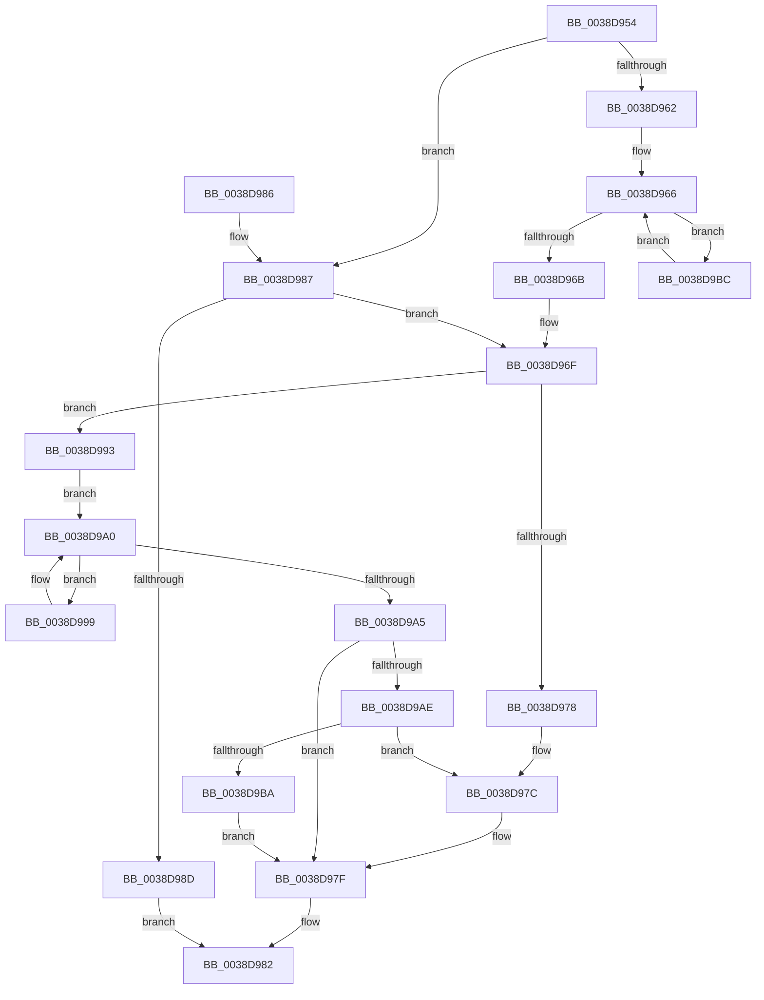

# FsRtlPrivateResetLowestLockOffset

- RVA: `0x0038D954`–`0x0038D9C5` (길이 `113` bytes)
- VA: `0x000000014038D954`
- 실행 섹션: `.text`
- PDB 이름 있음: `예`; PDB Function 태그: `아니요`
- unwind 정보 RVA: `0x000DB714`
- 디코드: `39`개 명령, `113/113` bytes 표시
- 미해석 바이트: `0` (있으면 어셈블리에 `.byte`로 보존)

> 이 문서는 커널 이미지의 기계어와 PDB 기호를 분석해 생성했습니다. 4번과 5번은 함수 원형과 자료형을 바이너리 사용 방식에서 추정한 C 해석이며 원본 소스 복구 결과는 아닙니다.

## 1. Dependencies

- 직접 호출 지점: **0**; 고유 호출 대상: **0**
- 직접 호출자로 확인된 함수: **5**
- RIP 상대 이미지 참조: **0**

### Outgoing calls
- 직접 디코드된 call 명령이 없습니다.

### Direct callers
- [FsRtlFastUnlockSingleExclusive](FsRtlFastUnlockSingleExclusive_function_0038C8E0.md) at `0x0038CA3C`
- [sub_0038CBC6](Unknown_function_0038CBC6.md) at `0x0038CD5E`
- [sub_0038CE61](Unknown_function_0038CE61.md) at `0x0038CF42`
- [sub_0038D2A1](Unknown_function_0038D2A1.md) at `0x0038D3EA`
- [FsRtlPrivateFastUnlockAll](../3F/FsRtlPrivateFastUnlockAll_function_003FD554.md) at `0x003FD6C7`

### Static image references
- 디코드된 RIP-relative 메모리 참조가 없습니다.

## 2. Other-region calls and transfers

- 다른 실행 섹션으로 향하는 call: **0**
- 별도 외부 분기/꼬리 이동을 확인하지 못했습니다.

## 3. Assembly (complete function range)

```asm
0038D954  48 8B 41 20                     mov rax, qword ptr [rcx + 0x20]
0038D958  33 D2                           xor edx, edx
0038D95A  4C 8B C1                        mov r8, rcx
0038D95D  48 85 C0                        test rax, rax
0038D960  74 25                           je 0x14038d987
0038D962  48 8B 48 08                     mov rcx, qword ptr [rax + 8]
0038D966  48 85 C9                        test rcx, rcx
0038D969  75 51                           jne 0x14038d9bc
0038D96B  48 8B 50 E8                     mov rdx, qword ptr [rax - 0x18]
0038D96F  49 8B 40 28                     mov rax, qword ptr [r8 + 0x28]
0038D973  48 85 C0                        test rax, rax
0038D976  75 1B                           jne 0x14038d993
0038D978  48 83 C2 08                     add rdx, 8
0038D97C  48 8B CA                        mov rcx, rdx
0038D97F  48 8B 01                        mov rax, qword ptr [rcx]
0038D982  49 89 00                        mov qword ptr [r8], rax
0038D985  C3                              ret
0038D986  CC                              int3
0038D987  48 39 51 28                     cmp qword ptr [rcx + 0x28], rdx
0038D98B  75 E2                           jne 0x14038d96f
0038D98D  48 83 C8 FF                     or rax, 0xffffffffffffffff
0038D991  EB EF                           jmp 0x14038d982
0038D993  48 8B 48 08                     mov rcx, qword ptr [rax + 8]
0038D997  EB 07                           jmp 0x14038d9a0
0038D999  48 8B C1                        mov rax, rcx
0038D99C  48 8B 49 08                     mov rcx, qword ptr [rcx + 8]
0038D9A0  48 85 C9                        test rcx, rcx
0038D9A3  75 F4                           jne 0x14038d999
0038D9A5  48 8D 48 18                     lea rcx, [rax + 0x18]
0038D9A9  48 85 D2                        test rdx, rdx
0038D9AC  74 D1                           je 0x14038d97f
0038D9AE  48 83 C2 08                     add rdx, 8
0038D9B2  48 8B 02                        mov rax, qword ptr [rdx]
0038D9B5  48 39 01                        cmp qword ptr [rcx], rax
0038D9B8  73 C2                           jae 0x14038d97c
0038D9BA  EB C3                           jmp 0x14038d97f
0038D9BC  48 8B C1                        mov rax, rcx
0038D9BF  48 8B 49 08                     mov rcx, qword ptr [rcx + 8]
0038D9C3  EB A1                           jmp 0x14038d966
```

## 4. C-style interpretation (structured pseudocode)

```c
__int64 __fastcall FsRtlPrivateResetLowestLockOffset(__int64 a1, int a2)
{
    __int64 result;

    a2 = 0;
    if (*(unsigned __int64 *)(a1 + 32) == 0) goto loc_0038D987;
loc_0038D966:
    if (*(unsigned __int64 *)(*(unsigned __int64 *)(a1 + 32) + 8) != 0) goto loc_0038D9BC;
loc_0038D96F:
    if (*(unsigned __int64 *)(a1 + 40) != 0) goto loc_0038D993;
    a2 = (*(unsigned __int64 *)(*(unsigned __int64 *)(a1 + 32) - 24)) + (8);
loc_0038D97C:
loc_0038D97F:
loc_0038D982:
    *(unsigned __int64 *)(a1) = *(unsigned __int64 *)(a2);
    return *(unsigned __int64 *)(a2);
loc_0038D987:
    if ((*(unsigned __int64 *)(a2 + 40)) != a2) goto loc_0038D96F;
    result = (*(unsigned __int64 *)(a2)) | (-1);
    goto loc_0038D982;
loc_0038D993:
    goto loc_0038D9A0;
loc_0038D999:
loc_0038D9A0:
    if (*(unsigned __int64 *)(*(unsigned __int64 *)(result + 8) + 8) != 0) goto loc_0038D999;
    if (a2 == 0) goto loc_0038D97F;
    a2 = (a2) + (8);
    if ((*(unsigned __int64 *)(*(unsigned __int64 *)(result + 8) + 24)) >= (*(unsigned __int64 *)(a2))) goto loc_0038D97C;
    goto loc_0038D97F;
loc_0038D9BC:
    goto loc_0038D966;
}
```

## 5. (Beta) C Style

```c
int64_t FsRtlPrivateResetLowestLockOffset(void *Arg1, int32_t Arg2)
{
    uint8_t *arg1 = (uint8_t *)Arg1;

    int64_t result;

    Arg2 = 0;
    if (*(uint64_t *)(arg1 + 0x20) == 0) goto loc_0038D987;
loc_0038D966:
    if (*(uint64_t *)(*(uint64_t *)(arg1 + 0x20) + 0x8) != 0) goto loc_0038D9BC;
loc_0038D96F:
    if (*(uint64_t *)(arg1 + 0x28) != 0) goto loc_0038D993;
    Arg2 = (*(uint64_t *)(*(uint64_t *)(arg1 + 0x20) - 0x18)) + (8);
loc_0038D97C:
loc_0038D97F:
loc_0038D982:
    *(uint64_t *)(arg1) = *(uint64_t *)(Arg2);
    return *(uint64_t *)(Arg2);
loc_0038D987:
    if ((*(uint64_t *)(Arg2 + 0x28)) != Arg2) goto loc_0038D96F;
    result = (*(uint64_t *)(Arg2)) | (-1);
    goto loc_0038D982;
loc_0038D993:
    goto loc_0038D9A0;
loc_0038D999:
loc_0038D9A0:
    if (*(uint64_t *)(*(uint64_t *)(result + 0x8) + 0x8) != 0) goto loc_0038D999;
    if (Arg2 == 0) goto loc_0038D97F;
    Arg2 = (Arg2) + (8);
    if ((*(uint64_t *)(*(uint64_t *)(result + 0x8) + 0x18)) >= (*(uint64_t *)(Arg2))) goto loc_0038D97C;
    goto loc_0038D97F;
loc_0038D9BC:
    goto loc_0038D966;
}
```

### 관측된 메모리 오프셋

구조체 형식이 확인되지 않은 접근은 인자 기준의 오프셋으로만 기록했습니다.

| 기준 인자 | 오프셋 표현 | 폭 (bit) | 접근 |
|---|---:|---:|---|
| `Arg1` | `+ 0x0` | `64` | `W` |
| `Arg1` | `+ 0x20` | `64` | `R` |
| `Arg1` | `+ 0x28` | `64` | `R` |

## 6. Execution-region graph

[열기: 2D/3D 그래프와 함수 탐색 컨트롤 패널](../../../control-panel.html?section=text&rva=0x0038D954&view=graph)

- 2D 그래프는 위에서 아래로 흐르고, 3D 그래프는 빈 공간을 드래그해 회전합니다. Shift+드래그는 이동, 휠은 확대·축소, 함수 노드 선택은 대상 보고서 이동입니다.

### Static fallback


