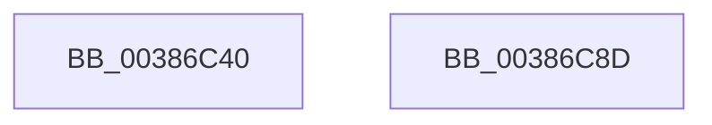

# FsRtlRemoveLargeMcbEntry

- RVA: `0x00386C40`–`0x00386C8E` (길이 `78` bytes)
- VA: `0x0000000140386C40`
- 실행 섹션: `.text`
- PDB 이름 있음: `예`; PDB Function 태그: `아니요`
- unwind 정보 RVA: `0x0007FC48`
- 디코드: `24`개 명령, `78/78` bytes 표시
- 미해석 바이트: `0` (있으면 어셈블리에 `.byte`로 보존)

> 이 문서는 커널 이미지의 기계어와 PDB 기호를 분석해 생성했습니다. 4번과 5번은 함수 원형과 자료형을 바이너리 사용 방식에서 추정한 C 해석이며 원본 소스 복구 결과는 아닙니다.

## 1. Dependencies

- 직접 호출 지점: **3**; 고유 호출 대상: **3**
- 직접 호출자로 확인된 함수: **1**
- RIP 상대 이미지 참조: **0**

### Outgoing calls
- `0x00386C60` → [ExAcquireFastMutex](../20/ExAcquireFastMutex_function_0020E5A0.md) (function, `0x0020E5A0`)
- `0x00386C6F` → [FsRtlRemoveBaseMcbEntry](FsRtlRemoveBaseMcbEntry_function_00387070.md) (function, `0x00387070`)
- `0x00386C78` → [ExReleaseFastMutex](../25/ExReleaseFastMutex_function_002519C0.md) (function, `0x002519C0`)

### Direct callers
- [FsRtlRemoveMcbEntry](../58/FsRtlRemoveMcbEntry_function_005813C0.md) at `0x005813C9`

### Static image references
- 디코드된 RIP-relative 메모리 참조가 없습니다.

## 2. Other-region calls and transfers

- 다른 실행 섹션으로 향하는 call: **0**
- 별도 외부 분기/꼬리 이동을 확인하지 못했습니다.

## 3. Assembly (complete function range)

```asm
00386C40  48 89 5C 24 10                  mov qword ptr [rsp + 0x10], rbx
00386C45  48 89 74 24 18                  mov qword ptr [rsp + 0x18], rsi
00386C4A  48 89 4C 24 08                  mov qword ptr [rsp + 8], rcx
00386C4F  57                              push rdi
00386C50  48 83 EC 20                     sub rsp, 0x20
00386C54  49 8B F8                        mov rdi, r8
00386C57  48 8B F2                        mov rsi, rdx
00386C5A  48 8B D9                        mov rbx, rcx
00386C5D  48 8B 09                        mov rcx, qword ptr [rcx]
00386C60  E8 3B 79 E8 FF                  call 0x14020e5a0
00386C65  90                              nop
00386C66  44 8B C7                        mov r8d, edi
00386C69  8B D6                           mov edx, esi
00386C6B  48 8D 4B 08                     lea rcx, [rbx + 8]
00386C6F  E8 FC 03 00 00                  call 0x140387070
00386C74  90                              nop
00386C75  48 8B 0B                        mov rcx, qword ptr [rbx]
00386C78  E8 43 AD EC FF                  call 0x1402519c0
00386C7D  48 8B 5C 24 38                  mov rbx, qword ptr [rsp + 0x38]
00386C82  48 8B 74 24 40                  mov rsi, qword ptr [rsp + 0x40]
00386C87  48 83 C4 20                     add rsp, 0x20
00386C8B  5F                              pop rdi
00386C8C  C3                              ret
00386C8D  CC                              int3
```

## 4. C-style interpretation (structured pseudocode)

```c
__int64 __fastcall FsRtlRemoveLargeMcbEntry(__int64 a1, __int64 a2, __int64 a3)
{
    __int64 result;
    __int64 v_rsp;
    unsigned __int64 v_stack_p10;
    unsigned __int64 v_stack_p18;
    unsigned __int64 v_stack_p8;

    v_stack_p10 = v_rbx;
    v_stack_p18 = v_rsi;
    v_stack_p8 = a1;
    v_rsp = (v_rsp) - (32);
    result = ExAcquireFastMutex(*(unsigned __int64 *)(a1), a2, a3, a4);
    result = FsRtlRemoveBaseMcbEntry(a1 + 8, (unsigned int)((unsigned int)(a2)), (unsigned int)((unsigned int)(a3)), a4);
    result = ExReleaseFastMutex(*(unsigned __int64 *)(a1), (unsigned int)((unsigned int)(a2)), (unsigned int)((unsigned int)(a3)), a4);
    v_rsp = (v_rsp) + (32);
    return result;
}
```

## 5. (Beta) C Style

```c
int64_t FsRtlRemoveLargeMcbEntry(void *Arg1, int64_t Arg2, int64_t Arg3)
{
    uint8_t *arg1 = (uint8_t *)Arg1;

    int64_t result;
    int64_t local_rsp;
    uint64_t v_stack_p10;
    uint64_t v_stack_p18;
    uint64_t v_stack_p8;

    v_stack_p10 = local_rbx;
    v_stack_p18 = local_rsi;
    v_stack_p8 = Arg1;
    local_rsp = (local_rsp) - (32);
    result = ExAcquireFastMutex(*(uint64_t *)(arg1), Arg2, Arg3, a4);
    result = FsRtlRemoveBaseMcbEntry(Arg1 + 8, (uint32_t)((uint32_t)(Arg2)), (uint32_t)((uint32_t)(Arg3)), a4);
    result = ExReleaseFastMutex(*(uint64_t *)(arg1), (uint32_t)((uint32_t)(Arg2)), (uint32_t)((uint32_t)(Arg3)), a4);
    local_rsp = (local_rsp) + (32);
    return result;
}
```

### 관측된 메모리 오프셋

구조체 형식이 확인되지 않은 접근은 인자 기준의 오프셋으로만 기록했습니다.

| 기준 인자 | 오프셋 표현 | 폭 (bit) | 접근 |
|---|---:|---:|---|
| `Arg1` | `+ 0x0` | `64` | `R` |
| `Arg1` | `+ 0x8` | `64` | `R` |

## 6. Execution-region graph

[열기: 2D/3D 그래프와 함수 탐색 컨트롤 패널](../../../control-panel.html?section=text&rva=0x00386C40&view=graph)

- 2D 그래프는 위에서 아래로 흐르고, 3D 그래프는 빈 공간을 드래그해 회전합니다. Shift+드래그는 이동, 휠은 확대·축소, 함수 노드 선택은 대상 보고서 이동입니다.

### Static fallback


