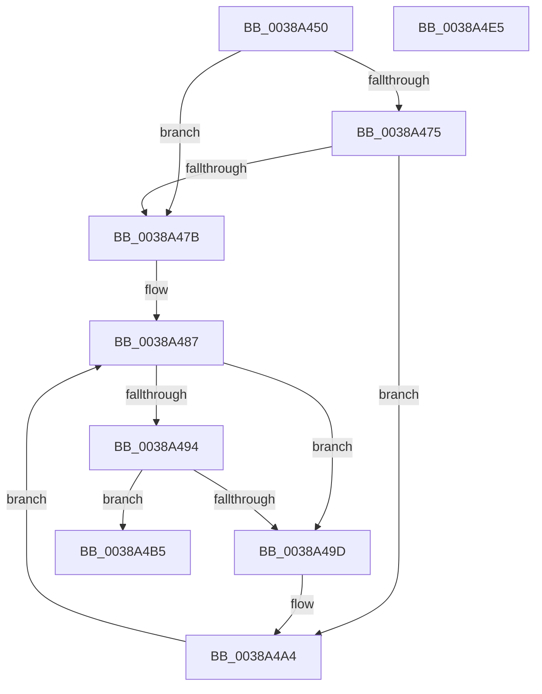

# FsRtlRemoveNodeFromTunnel

- RVA: `0x0038A450`–`0x0038A4E6` (길이 `150` bytes)
- VA: `0x000000014038A450`
- 실행 섹션: `.text`
- PDB 이름 있음: `예`; PDB Function 태그: `아니요`
- unwind 정보 RVA: `0x0005C954`
- 디코드: `44`개 명령, `150/150` bytes 표시
- 미해석 바이트: `0` (있으면 어셈블리에 `.byte`로 보존)

> 이 문서는 커널 이미지의 기계어와 PDB 기호를 분석해 생성했습니다. 4번과 5번은 함수 원형과 자료형을 바이너리 사용 방식에서 추정한 C 해석이며 원본 소스 복구 결과는 아닙니다.

## 1. Dependencies

- 직접 호출 지점: **3**; 고유 호출 대상: **3**
- 직접 호출자로 확인된 함수: **1**
- RIP 상대 이미지 참조: **0**

### Outgoing calls
- `0x0038A482` → [RtlDeleteNoSplay](RtlDeleteNoSplay_function_0038C410.md) (function, `0x0038C410`)
- `0x0038A4A7` → [RtlDelete](RtlDelete_function_0038D8B0.md) (function, `0x0038D8B0`)
- `0x0038A4CB` → [FsRtlFreeTunnelNode](FsRtlFreeTunnelNode_function_00388D68.md) (function, `0x00388D68`)

### Direct callers
- [FsRtlPruneTunnelCache](../../page/93/FsRtlPruneTunnelCache_function_009380F0.md) at `0x009381E4`

### Static image references
- 디코드된 RIP-relative 메모리 참조가 없습니다.

## 2. Other-region calls and transfers

- 다른 실행 섹션으로 향하는 call: **0**
- 별도 외부 분기/꼬리 이동을 확인하지 못했습니다.

## 3. Assembly (complete function range)

```asm
0038A450  48 89 5C 24 08                  mov qword ptr [rsp + 8], rbx
0038A455  48 89 6C 24 10                  mov qword ptr [rsp + 0x10], rbp
0038A45A  48 89 74 24 18                  mov qword ptr [rsp + 0x18], rsi
0038A45F  57                              push rdi
0038A460  48 83 EC 20                     sub rsp, 0x20
0038A464  49 8B F1                        mov rsi, r9
0038A467  49 8B E8                        mov rbp, r8
0038A46A  48 8B DA                        mov rbx, rdx
0038A46D  48 8B F9                        mov rdi, rcx
0038A470  4D 85 C9                        test r9, r9
0038A473  74 06                           je 0x14038a47b
0038A475  41 80 39 00                     cmp byte ptr [r9], 0
0038A479  75 29                           jne 0x14038a4a4
0038A47B  48 8D 51 38                     lea rdx, [rcx + 0x38]
0038A47F  48 8B CB                        mov rcx, rbx
0038A482  E8 89 1F 00 00                  call 0x14038c410
0038A487  48 8D 43 18                     lea rax, [rbx + 0x18]
0038A48B  48 8B 10                        mov rdx, qword ptr [rax]
0038A48E  48 39 42 08                     cmp qword ptr [rdx + 8], rax
0038A492  75 09                           jne 0x14038a49d
0038A494  48 8B 48 08                     mov rcx, qword ptr [rax + 8]
0038A498  48 39 01                        cmp qword ptr [rcx], rax
0038A49B  74 18                           je 0x14038a4b5
0038A49D  B9 03 00 00 00                  mov ecx, 3
0038A4A2  CD 29                           int 0x29
0038A4A4  48 8B CB                        mov rcx, rbx
0038A4A7  E8 04 34 00 00                  call 0x14038d8b0
0038A4AC  48 89 47 38                     mov qword ptr [rdi + 0x38], rax
0038A4B0  C6 06 00                        mov byte ptr [rsi], 0
0038A4B3  EB D2                           jmp 0x14038a487
0038A4B5  48 89 11                        mov qword ptr [rcx], rdx
0038A4B8  B8 FF FF 00 00                  mov eax, 0xffff
0038A4BD  48 89 4A 08                     mov qword ptr [rdx + 8], rcx
0038A4C1  48 8B D5                        mov rdx, rbp
0038A4C4  66 01 47 50                     add word ptr [rdi + 0x50], ax
0038A4C8  48 8B CB                        mov rcx, rbx
0038A4CB  E8 98 E8 FF FF                  call 0x140388d68
0038A4D0  48 8B 5C 24 30                  mov rbx, qword ptr [rsp + 0x30]
0038A4D5  48 8B 6C 24 38                  mov rbp, qword ptr [rsp + 0x38]
0038A4DA  48 8B 74 24 40                  mov rsi, qword ptr [rsp + 0x40]
0038A4DF  48 83 C4 20                     add rsp, 0x20
0038A4E3  5F                              pop rdi
0038A4E4  C3                              ret
0038A4E5  CC                              int3
```

## 4. C-style interpretation (structured pseudocode)

```c
__int64 __fastcall FsRtlRemoveNodeFromTunnel(__int64 a1, __int64 a2, __int64 a3, __int64 a4)
{
    __int64 result;
    __int64 v_rsp;
    unsigned __int64 v_stack_p10;
    unsigned __int64 v_stack_p18;
    unsigned __int64 v_stack_p8;

    v_stack_p8 = v_rbx;
    v_stack_p10 = v_rbp;
    v_stack_p18 = v_rsi;
    v_rsp = (v_rsp) - (32);
    if (a4 == 0) goto loc_0038A47B;
    if ((*(unsigned __int8 *)(a4)) != 0) goto loc_0038A4A4;
loc_0038A47B:
    result = RtlDeleteNoSplay(a2, a1 + 56, a3, a4);
loc_0038A487:
    if ((*(unsigned __int64 *)(*(unsigned __int64 *)(a2 + 24) + 8)) != (a2 + 24)) goto loc_0038A49D;
    if ((*(unsigned __int64 *)(*(unsigned __int64 *)(a2 + 24 + 8))) == (a2 + 24)) goto loc_0038A4B5;
loc_0038A49D:
loc_0038A4A4:
    result = RtlDelete(a2, *(unsigned __int64 *)(a2 + 24), a3, a4);
    *(unsigned __int64 *)(a1 + 56) = result;
    *(unsigned __int8 *)(a4) = 0;
    goto loc_0038A487;
loc_0038A4B5:
    *(unsigned __int64 *)(a2) = *(unsigned __int64 *)(a2 + 24);
    *(unsigned __int64 *)(*(unsigned __int64 *)(a2 + 24) + 8) = a2;
    result = FsRtlFreeTunnelNode(a2, a3, a3, a4);
    v_rsp = (v_rsp) + (32);
    return result;
}
```

## 5. (Beta) C Style

```c
int64_t FsRtlRemoveNodeFromTunnel(void *Arg1, void *Arg2, int64_t Arg3, void *Arg4)
{
    uint8_t *arg1 = (uint8_t *)Arg1;
    uint8_t *arg2 = (uint8_t *)Arg2;
    uint8_t *arg4 = (uint8_t *)Arg4;

    int64_t result;
    int64_t local_rsp;
    uint64_t v_stack_p10;
    uint64_t v_stack_p18;
    uint64_t v_stack_p8;

    v_stack_p8 = local_rbx;
    v_stack_p10 = local_rbp;
    v_stack_p18 = local_rsi;
    local_rsp = (local_rsp) - (32);
    if (Arg4 == NULL) goto loc_0038A47B;
    if ((*(uint8_t *)(arg4)) != 0) goto loc_0038A4A4;
loc_0038A47B:
    result = RtlDeleteNoSplay(Arg2, Arg1 + 56, Arg3, Arg4);
loc_0038A487:
    if ((*(uint64_t *)(*(uint64_t *)(arg2 + 0x18) + 0x8)) != (Arg2 + 24)) goto loc_0038A49D;
    if ((*(uint64_t *)(*(uint64_t *)(arg2 + 0x18 + 0x8))) == (Arg2 + 24)) goto loc_0038A4B5;
loc_0038A49D:
loc_0038A4A4:
    result = RtlDelete(Arg2, *(uint64_t *)(arg2 + 0x18), Arg3, Arg4);
    *(uint64_t *)(arg1 + 0x38) = result;
    *(uint8_t *)(arg4) = 0;
    goto loc_0038A487;
loc_0038A4B5:
    *(uint64_t *)(arg2) = *(uint64_t *)(arg2 + 0x18);
    *(void **)(*(uint64_t *)(arg2 + 0x18) + 0x8) = Arg2;
    result = FsRtlFreeTunnelNode(Arg2, Arg3, Arg3, Arg4);
    local_rsp = (local_rsp) + (32);
    return result;
}
```

### 관측된 메모리 오프셋

구조체 형식이 확인되지 않은 접근은 인자 기준의 오프셋으로만 기록했습니다.

| 기준 인자 | 오프셋 표현 | 폭 (bit) | 접근 |
|---|---:|---:|---|
| `Arg1` | `+ 0x38` | `64` | `R` |
| `Arg1` | `+ 0x38` | `64` | `W` |
| `Arg1` | `+ 0x50` | `16` | `R/W` |
| `Arg2` | `+ 0x0` | `64` | `R` |
| `Arg2` | `+ 0x8` | `64` | `R` |
| `Arg2` | `+ 0x18` | `64` | `R` |
| `Arg4` | `+ 0x0` | `8` | `W` |

## 6. Execution-region graph

[열기: 2D/3D 그래프와 함수 탐색 컨트롤 패널](../../../control-panel.html?section=text&rva=0x0038A450&view=graph)

- 2D 그래프는 위에서 아래로 흐르고, 3D 그래프는 빈 공간을 드래그해 회전합니다. Shift+드래그는 이동, 휠은 확대·축소, 함수 노드 선택은 대상 보고서 이동입니다.

### Static fallback


