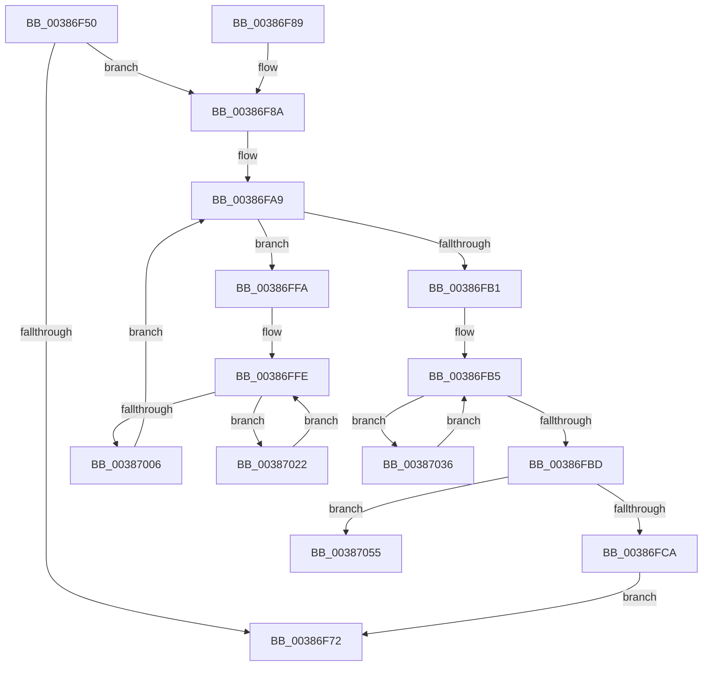

# FsRtlUninitializeFileLock

- RVA: `0x00386F50`–`0x00387060` (길이 `272` bytes)
- VA: `0x0000000140386F50`
- 실행 섹션: `.text`
- PDB 이름 있음: `예`; PDB Function 태그: `예`
- unwind 정보 RVA: `0x0007FCF0`
- 디코드: `74`개 명령, `272/272` bytes 표시
- 미해석 바이트: `0` (있으면 어셈블리에 `.byte`로 보존)

> 이 문서는 커널 이미지의 기계어와 PDB 기호를 분석해 생성했습니다. 4번과 5번은 함수 원형과 자료형을 바이너리 사용 방식에서 추정한 C 해석이며 원본 소스 복구 결과는 아닙니다.

## 1. Dependencies

- 직접 호출 지점: **10**; 고유 호출 대상: **6**
- 직접 호출자로 확인된 함수: **1**
- RIP 상대 이미지 참조: **5**

### Outgoing calls
- `0x00386F91` → [KeAcquireSpinLockRaiseToDpc](../20/KeAcquireSpinLockRaiseToDpc_function_00208470.md) (function, `0x00208470`)
- `0x00386FA0` → [KeAcquireSpinLockAtDpcLevel](../20/KeAcquireSpinLockAtDpcLevel_function_00208430.md) (function, `0x00208430`)
- `0x00386FCD` → [KxReleaseSpinLock](../20/KxReleaseSpinLock_function_00206670.md) (function, `0x00206670`)
- `0x00386FDC` → [KeReleaseSpinLock](../39/KeReleaseSpinLock_function_00392BA0.md) (function, `0x00392BA0`)
- `0x00386FEB` → [ExFreeToNPagedLookasideList](ExFreeToNPagedLookasideList_function_0038D9D0.md) (function, `0x0038D9D0`)
- `0x0038700C` → [RtlDeleteNoSplay](RtlDeleteNoSplay_function_0038C410.md) (function, `0x0038C410`)
- `0x0038701B` → [ExFreeToNPagedLookasideList](ExFreeToNPagedLookasideList_function_0038D9D0.md) (function, `0x0038D9D0`)
- `0x0038702F` → [ExFreeToNPagedLookasideList](ExFreeToNPagedLookasideList_function_0038D9D0.md) (function, `0x0038D9D0`)
- `0x0038703C` → [RtlDeleteNoSplay](RtlDeleteNoSplay_function_0038C410.md) (function, `0x0038C410`)
- `0x0038704B` → [ExFreeToNPagedLookasideList](ExFreeToNPagedLookasideList_function_0038D9D0.md) (function, `0x0038D9D0`)

### Direct callers
- [FsRtlFreeFileLock](FsRtlFreeFileLock_function_00386F20.md) at `0x00386F29`

### Static image references
- `0x00386F8A` → RVA `0x00F8F0D8` (`.data`; read)
- `0x00386FE4` → RVA `0x00E12100` (`.data`; read)
- `0x00387014` → RVA `0x00E11F80` (`.data`; read)
- `0x00387025` → RVA `0x00E12200` (`.data`; read)
- `0x00387044` → RVA `0x00E12180` (`.data`; read)

## 2. Other-region calls and transfers

- 다른 실행 섹션으로 향하는 call: **0**
- call이 아닌 외부 분기/꼬리 이동: **1**
  - `0x0038705B` → [sub_006E4D86](../6E/Unknown_function_006E4D86.md) (`tail-transfer`)

## 3. Assembly (complete function range)

```asm
00386F50  48 89 5C 24 10                  mov qword ptr [rsp + 0x10], rbx
00386F55  48 89 6C 24 18                  mov qword ptr [rsp + 0x18], rbp
00386F5A  56                              push rsi
00386F5B  57                              push rdi
00386F5C  41 54                           push r12
00386F5E  41 56                           push r14
00386F60  41 57                           push r15
00386F62  48 83 EC 30                     sub rsp, 0x30
00386F66  48 8B 59 18                     mov rbx, qword ptr [rcx + 0x18]
00386F6A  4C 8B F9                        mov r15, rcx
00386F6D  48 85 DB                        test rbx, rbx
00386F70  75 18                           jne 0x140386f8a
00386F72  48 8B 5C 24 68                  mov rbx, qword ptr [rsp + 0x68]
00386F77  48 8B 6C 24 70                  mov rbp, qword ptr [rsp + 0x70]
00386F7C  48 83 C4 30                     add rsp, 0x30
00386F80  41 5F                           pop r15
00386F82  41 5E                           pop r14
00386F84  41 5C                           pop r12
00386F86  5F                              pop rdi
00386F87  5E                              pop rsi
00386F88  C3                              ret
00386F89  CC                              int3
00386F8A  48 8D 0D 47 81 C0 00            lea rcx, [rip + 0xc08147]
00386F91  E8 DA 14 E8 FF                  call 0x140208470
00386F96  48 8D 6B 18                     lea rbp, [rbx + 0x18]
00386F9A  44 8A E0                        mov r12b, al
00386F9D  48 8B CD                        mov rcx, rbp
00386FA0  E8 8B 14 E8 FF                  call 0x140208430
00386FA5  4C 8D 73 20                     lea r14, [rbx + 0x20]
00386FA9  49 8B 3E                        mov rdi, qword ptr [r14]
00386FAC  48 85 FF                        test rdi, rdi
00386FAF  75 49                           jne 0x140386ffa
00386FB1  48 8D 73 28                     lea rsi, [rbx + 0x28]
00386FB5  48 8B 3E                        mov rdi, qword ptr [rsi]
00386FB8  48 85 FF                        test rdi, rdi
00386FBB  75 79                           jne 0x140387036
00386FBD  48 8B 7B 30                     mov rdi, qword ptr [rbx + 0x30]
00386FC1  48 85 FF                        test rdi, rdi
00386FC4  0F 85 8B 00 00 00               jne 0x140387055
00386FCA  48 8B CD                        mov rcx, rbp
00386FCD  E8 9E F6 E7 FF                  call 0x140206670
00386FD2  41 8A D4                        mov dl, r12b
00386FD5  48 8D 0D FC 80 C0 00            lea rcx, [rip + 0xc080fc]
00386FDC  E8 BF BB 00 00                  call 0x140392ba0
00386FE1  48 8B D3                        mov rdx, rbx
00386FE4  48 8D 0D 15 B1 A8 00            lea rcx, [rip + 0xa8b115]
00386FEB  E8 E0 69 00 00                  call 0x14038d9d0
00386FF0  49 83 67 18 00                  and qword ptr [r15 + 0x18], 0
00386FF5  E9 78 FF FF FF                  jmp 0x140386f72
00386FFA  48 8D 77 E8                     lea rsi, [rdi - 0x18]
00386FFE  48 8B 16                        mov rdx, qword ptr [rsi]
00387001  48 85 D2                        test rdx, rdx
00387004  75 1C                           jne 0x140387022
00387006  49 8B D6                        mov rdx, r14
00387009  48 8B CF                        mov rcx, rdi
0038700C  E8 FF 53 00 00                  call 0x14038c410
00387011  48 8B D6                        mov rdx, rsi
00387014  48 8D 0D 65 AF A8 00            lea rcx, [rip + 0xa8af65]
0038701B  E8 B0 69 00 00                  call 0x14038d9d0
00387020  EB 87                           jmp 0x140386fa9
00387022  48 8B 02                        mov rax, qword ptr [rdx]
00387025  48 8D 0D D4 B1 A8 00            lea rcx, [rip + 0xa8b1d4]
0038702C  48 89 06                        mov qword ptr [rsi], rax
0038702F  E8 9C 69 00 00                  call 0x14038d9d0
00387034  EB C8                           jmp 0x140386ffe
00387036  48 8B D6                        mov rdx, rsi
00387039  48 8B CF                        mov rcx, rdi
0038703C  E8 CF 53 00 00                  call 0x14038c410
00387041  48 8B D7                        mov rdx, rdi
00387044  48 8D 0D 35 B1 A8 00            lea rcx, [rip + 0xa8b135]
0038704B  E8 80 69 00 00                  call 0x14038d9d0
00387050  E9 60 FF FF FF                  jmp 0x140386fb5
00387055  41 BE 07 00 00 00               mov r14d, 7
0038705B  E9 26 DD 35 00                  jmp 0x1406e4d86
```

## 4. C-style interpretation (structured pseudocode)

```c
__int64 __fastcall FsRtlUninitializeFileLock(__int64 a1)
{
    __int64 result;
    __int64 v_rsp;
    unsigned __int64 v_stack_p10;
    unsigned __int64 v_stack_p18;

    v_stack_p10 = v_rbx;
    v_stack_p18 = v_rbp;
    v_rsp = (v_rsp) - (48);
    if (*(unsigned __int64 *)(a1 + 24) != 0) goto loc_00386F8A;
loc_00386F72:
    v_rsp = (v_rsp) + (48);
    return result;
loc_00386F8A:
    result = KeAcquireSpinLockRaiseToDpc(v_rip + 12616007, a2, a3, a4);
    result = KeAcquireSpinLockAtDpcLevel(v_stack_p10 + 24, a2, a3, a4);
loc_00386FA9:
    if (*(unsigned __int64 *)(v_stack_p10 + 32) != 0) goto loc_00386FFA;
loc_00386FB5:
    if (*(unsigned __int64 *)(v_stack_p10 + 40) != 0) goto loc_00387036;
    if (*(unsigned __int64 *)(v_stack_p10 + 48) != 0) goto loc_00387055;
    result = KxReleaseSpinLock(v_stack_p10 + 24, a2, a3, a4);
    result = KeReleaseSpinLock(v_rip + 12615932, (unsigned __int8)((unsigned __int8)(result)), a3, a4);
    result = ExFreeToNPagedLookasideList(v_rip + 11055381, v_stack_p10, a3, a4);
    goto loc_00386F72;
loc_00386FFA:
loc_00386FFE:
    if (*(unsigned __int64 *)(*(unsigned __int64 *)(v_stack_p10 + 48) - 24) != 0) goto loc_00387022;
    result = RtlDeleteNoSplay(*(unsigned __int64 *)(v_stack_p10 + 48), v_stack_p10 + 32, a3, a4);
    result = ExFreeToNPagedLookasideList(v_rip + 11054949, *(unsigned __int64 *)(v_stack_p10 + 48) - 24, a3, a4);
    goto loc_00386FA9;
loc_00387022:
    *(unsigned __int64 *)(*(unsigned __int64 *)(v_stack_p10 + 48) - 24) = *(unsigned __int64 *)(*(unsigned __int64 *)(v_stack_p10 + 48) - 24);
    result = ExFreeToNPagedLookasideList(v_rip + 11055572, *(unsigned __int64 *)(v_stack_p10 + 48) - 24, a3, a4);
    goto loc_00386FFE;
loc_00387036:
    result = RtlDeleteNoSplay(*(unsigned __int64 *)(v_stack_p10 + 48), *(unsigned __int64 *)(v_stack_p10 + 48) - 24, a3, a4);
    result = ExFreeToNPagedLookasideList(v_rip + 11055413, *(unsigned __int64 *)(v_stack_p10 + 48), a3, a4);
    goto loc_00386FB5;
loc_00387055:
}
```

## 5. (Beta) C Style

```c
int64_t FsRtlUninitializeFileLock(void *Arg1)
{
    uint8_t *arg1 = (uint8_t *)Arg1;

    int64_t result;
    int64_t local_rsp;
    uint64_t v_stack_p10;
    uint64_t v_stack_p18;

    v_stack_p10 = local_rbx;
    v_stack_p18 = local_rbp;
    local_rsp = (local_rsp) - (48);
    if (*(uint64_t *)(arg1 + 0x18) != 0) goto loc_00386F8A;
loc_00386F72:
    local_rsp = (local_rsp) + (48);
    return result;
loc_00386F8A:
    result = KeAcquireSpinLockRaiseToDpc(v_rip + 12616007, a2, a3, a4);
    result = KeAcquireSpinLockAtDpcLevel(v_stack_p10 + 24, a2, a3, a4);
loc_00386FA9:
    if (*(uint64_t *)(v_stack_p10 + 0x20) != 0) goto loc_00386FFA;
loc_00386FB5:
    if (*(uint64_t *)(v_stack_p10 + 0x28) != 0) goto loc_00387036;
    if (*(uint64_t *)(v_stack_p10 + 0x30) != 0) goto loc_00387055;
    result = KxReleaseSpinLock(v_stack_p10 + 24, a2, a3, a4);
    result = KeReleaseSpinLock(v_rip + 12615932, (uint8_t)((uint8_t)(result)), a3, a4);
    result = ExFreeToNPagedLookasideList(v_rip + 11055381, v_stack_p10, a3, a4);
    goto loc_00386F72;
loc_00386FFA:
loc_00386FFE:
    if (*(uint64_t *)(*(uint64_t *)(v_stack_p10 + 0x30) - 0x18) != 0) goto loc_00387022;
    result = RtlDeleteNoSplay(*(uint64_t *)(v_stack_p10 + 0x30), v_stack_p10 + 32, a3, a4);
    result = ExFreeToNPagedLookasideList(v_rip + 11054949, *(uint64_t *)(v_stack_p10 + 0x30) - 24, a3, a4);
    goto loc_00386FA9;
loc_00387022:
    *(uint64_t *)(*(uint64_t *)(v_stack_p10 + 0x30) - 0x18) = *(uint64_t *)(*(uint64_t *)(v_stack_p10 + 0x30) - 0x18);
    result = ExFreeToNPagedLookasideList(v_rip + 11055572, *(uint64_t *)(v_stack_p10 + 0x30) - 24, a3, a4);
    goto loc_00386FFE;
loc_00387036:
    result = RtlDeleteNoSplay(*(uint64_t *)(v_stack_p10 + 0x30), *(uint64_t *)(v_stack_p10 + 0x30) - 24, a3, a4);
    result = ExFreeToNPagedLookasideList(v_rip + 11055413, *(uint64_t *)(v_stack_p10 + 0x30), a3, a4);
    goto loc_00386FB5;
loc_00387055:
}
```

### 관측된 메모리 오프셋

구조체 형식이 확인되지 않은 접근은 인자 기준의 오프셋으로만 기록했습니다.

| 기준 인자 | 오프셋 표현 | 폭 (bit) | 접근 |
|---|---:|---:|---|
| `Arg1` | `+ 0x18` | `64` | `R` |
| `Arg1` | `+ 0x18` | `64` | `R/W` |

## 6. Execution-region graph

[열기: 2D/3D 그래프와 함수 탐색 컨트롤 패널](../../../control-panel.html?section=text&rva=0x00386F50&view=graph)

- 2D 그래프는 위에서 아래로 흐르고, 3D 그래프는 빈 공간을 드래그해 회전합니다. Shift+드래그는 이동, 휠은 확대·축소, 함수 노드 선택은 대상 보고서 이동입니다.

### Static fallback


