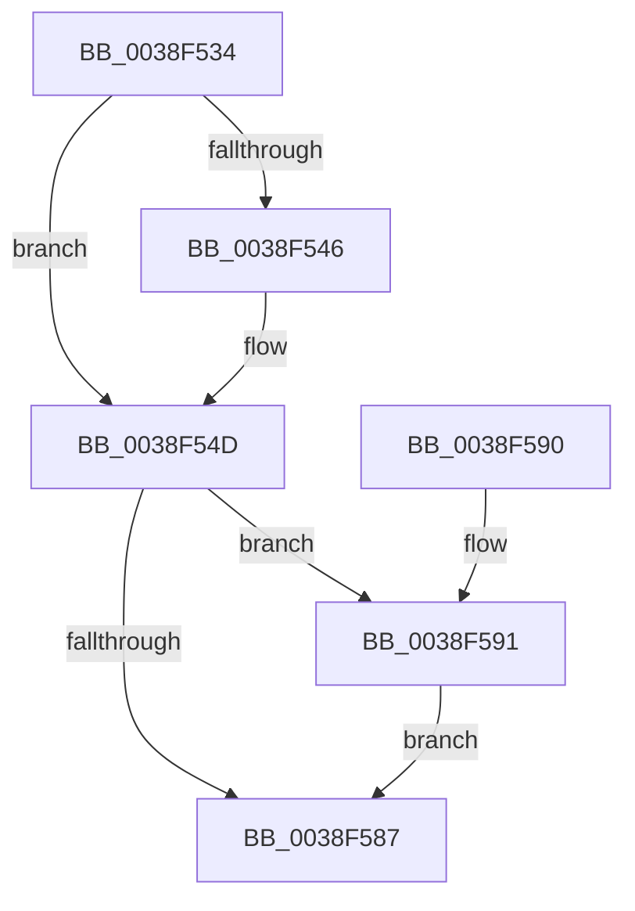

# FsRtlpOplockEnqueueRH

- RVA: `0x0038F534`–`0x0038F59B` (길이 `103` bytes)
- VA: `0x000000014038F534`
- 실행 섹션: `.text`
- PDB 이름 있음: `예`; PDB Function 태그: `아니요`
- unwind 정보 RVA: `0x000807AC`
- 디코드: `31`개 명령, `103/103` bytes 표시
- 미해석 바이트: `0` (있으면 어셈블리에 `.byte`로 보존)

> 이 문서는 커널 이미지의 기계어와 PDB 기호를 분석해 생성했습니다. 4번과 5번은 함수 원형과 자료형을 바이너리 사용 방식에서 추정한 C 해석이며 원본 소스 복구 결과는 아닙니다.

## 1. Dependencies

- 직접 호출 지점: **2**; 고유 호출 대상: **2**
- 직접 호출자로 확인된 함수: **2**
- RIP 상대 이미지 참조: **0**

### Outgoing calls
- `0x0038F57B` → [IoSetOplockPrivateFoExt](IoSetOplockPrivateFoExt_function_0038F5A4.md) (function, `0x0038F5A4`)
- `0x0038F594` → [FsRtlpOplockDequeueRH](../42/FsRtlpOplockDequeueRH_function_004258FC.md) (function, `0x004258FC`)

### Direct callers
- [FsRtlpRemoveAndCompleteRHIrp](../42/FsRtlpRemoveAndCompleteRHIrp_function_00425964.md) at `0x00425C58`
- [FsRtlpRequestShareableOplock](../4E/FsRtlpRequestShareableOplock_function_004E6EC8.md) at `0x004E745A`

### Static image references
- 디코드된 RIP-relative 메모리 참조가 없습니다.

## 2. Other-region calls and transfers

- 다른 실행 섹션으로 향하는 call: **0**
- 별도 외부 분기/꼬리 이동을 확인하지 못했습니다.

## 3. Assembly (complete function range)

```asm
0038F534  40 53                           push rbx
0038F536  48 83 EC 50                     sub rsp, 0x50
0038F53A  48 8B 01                        mov rax, qword ptr [rcx]
0038F53D  48 8B DA                        mov rbx, rdx
0038F540  48 39 48 08                     cmp qword ptr [rax + 8], rcx
0038F544  74 07                           je 0x14038f54d
0038F546  B9 03 00 00 00                  mov ecx, 3
0038F54B  CD 29                           int 0x29
0038F54D  48 89 02                        mov qword ptr [rdx], rax
0038F550  0F 57 C0                        xorps xmm0, xmm0
0038F553  48 89 4A 08                     mov qword ptr [rdx + 8], rcx
0038F557  48 89 58 08                     mov qword ptr [rax + 8], rbx
0038F55B  48 89 19                        mov qword ptr [rcx], rbx
0038F55E  48 8B 4A 18                     mov rcx, qword ptr [rdx + 0x18]
0038F562  48 8D 54 24 20                  lea rdx, [rsp + 0x20]
0038F567  0F 11 44 24 40                  movups xmmword ptr [rsp + 0x40], xmm0
0038F56C  48 89 5C 24 48                  mov qword ptr [rsp + 0x48], rbx
0038F571  0F 11 44 24 20                  movups xmmword ptr [rsp + 0x20], xmm0
0038F576  0F 11 44 24 30                  movups xmmword ptr [rsp + 0x30], xmm0
0038F57B  E8 24 00 00 00                  call 0x14038f5a4
0038F580  44 8B C8                        mov r9d, eax
0038F583  85 C0                           test eax, eax
0038F585  78 0A                           js 0x14038f591
0038F587  41 8B C1                        mov eax, r9d
0038F58A  48 83 C4 50                     add rsp, 0x50
0038F58E  5B                              pop rbx
0038F58F  C3                              ret
0038F590  CC                              int3
0038F591  48 8B CB                        mov rcx, rbx
0038F594  E8 63 63 09 00                  call 0x1404258fc
0038F599  EB EC                           jmp 0x14038f587
```

## 4. C-style interpretation (structured pseudocode)

```c
__int64 __fastcall FsRtlpOplockEnqueueRH(__int64 a1, __int64 a2)
{
    __int64 result;
    __int64 v_rsp;
    unsigned __int64 v_stack_m10;
    unsigned __int64 v_stack_m18;
    unsigned __int64 v_stack_m28;
    unsigned __int64 v_stack_m38;

    v_rsp = (v_rsp) - (80);
    if ((*(unsigned __int64 *)(*(unsigned __int64 *)(a1) + 8)) != a1) {
        a1 = 3;
    }
    *(unsigned __int64 *)(a2) = *(unsigned __int64 *)(a1);
    *(unsigned __int64 *)(a2 + 8) = a1;
    *(unsigned __int64 *)(*(unsigned __int64 *)(a1) + 8) = a2;
    *(unsigned __int64 *)(a1) = a2;
    v_stack_m18 = v_xmm0;
    v_stack_m10 = a2;
    v_stack_m38 = v_xmm0;
    v_stack_m28 = v_xmm0;
    result = IoSetOplockPrivateFoExt(*(unsigned __int64 *)(a2 + 24), v_stack_m38, a3, a4);
    if (sign_flag) goto loc_0038F591;
loc_0038F587:
    v_rsp = (v_rsp) + (80);
    return (unsigned int)((unsigned int)((unsigned int)((unsigned int)(result))));
loc_0038F591:
    result = FsRtlpOplockDequeueRH(a2, v_stack_m38, a3, (unsigned int)((unsigned int)(result)));
    goto loc_0038F587;
}
```

## 5. (Beta) C Style

```c
int64_t FsRtlpOplockEnqueueRH(void *Arg1, void *Arg2)
{
    uint8_t *arg1 = (uint8_t *)Arg1;
    uint8_t *arg2 = (uint8_t *)Arg2;

    int64_t result;
    int64_t local_rsp;
    uint64_t v_stack_m10;
    uint64_t v_stack_m18;
    uint64_t v_stack_m28;
    uint64_t v_stack_m38;

    local_rsp = (local_rsp) - (80);
    if ((*(uint64_t *)(*(uint64_t *)(arg1) + 0x8)) != Arg1) {
        Arg1 = 3;
    }
    *(uint64_t *)(arg2) = *(uint64_t *)(arg1);
    *(void **)(arg2 + 0x8) = Arg1;
    *(void **)(*(uint64_t *)(arg1) + 0x8) = Arg2;
    *(void **)(arg1) = Arg2;
    v_stack_m18 = v_xmm0;
    v_stack_m10 = Arg2;
    v_stack_m38 = v_xmm0;
    v_stack_m28 = v_xmm0;
    result = IoSetOplockPrivateFoExt(*(uint64_t *)(arg2 + 0x18), v_stack_m38, a3, a4);
    if (sign_flag) goto loc_0038F591;
loc_0038F587:
    local_rsp = (local_rsp) + (80);
    return (uint32_t)((uint32_t)((uint32_t)((uint32_t)(result))));
loc_0038F591:
    result = FsRtlpOplockDequeueRH(Arg2, v_stack_m38, a3, (uint32_t)((uint32_t)(result)));
    goto loc_0038F587;
}
```

### 관측된 메모리 오프셋

구조체 형식이 확인되지 않은 접근은 인자 기준의 오프셋으로만 기록했습니다.

| 기준 인자 | 오프셋 표현 | 폭 (bit) | 접근 |
|---|---:|---:|---|
| `Arg1` | `+ 0x0` | `64` | `R` |
| `Arg2` | `+ 0x0` | `64` | `W` |
| `Arg2` | `+ 0x8` | `64` | `W` |
| `Arg2` | `+ 0x18` | `64` | `R` |

## 6. Execution-region graph

[열기: 2D/3D 그래프와 함수 탐색 컨트롤 패널](../../../control-panel.html?section=text&rva=0x0038F534&view=graph)

- 2D 그래프는 위에서 아래로 흐르고, 3D 그래프는 빈 공간을 드래그해 회전합니다. Shift+드래그는 이동, 휠은 확대·축소, 함수 노드 선택은 대상 보고서 이동입니다.

### Static fallback


