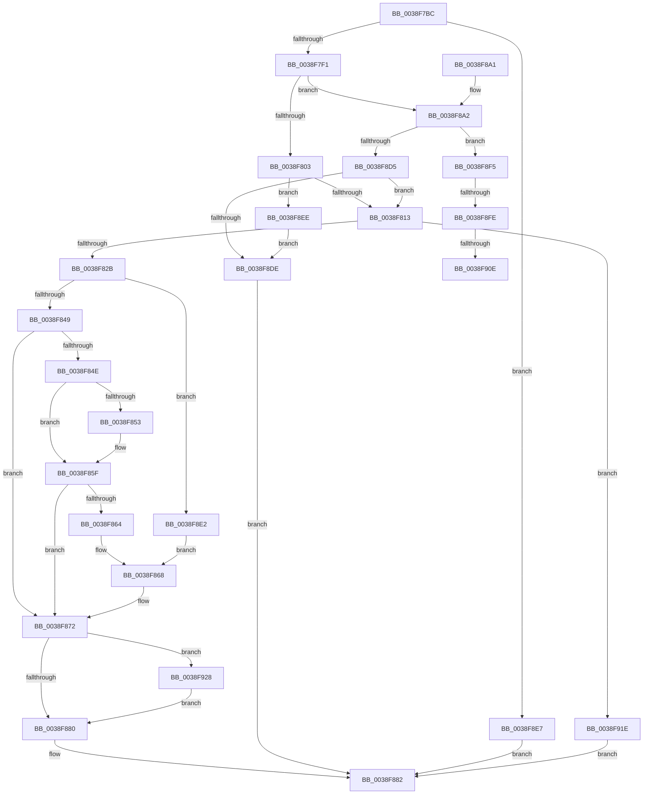

# IoSetOplockKeyContext

- RVA: `0x0038F7BC`–`0x0038F93E` (길이 `386` bytes)
- VA: `0x000000014038F7BC`
- 실행 섹션: `.text`
- PDB 이름 있음: `예`; PDB Function 태그: `예`
- unwind 정보 RVA: `0x000807F4`
- 디코드: `100`개 명령, `386/386` bytes 표시
- 미해석 바이트: `0` (있으면 어셈블리에 `.byte`로 보존)

> 이 문서는 커널 이미지의 기계어와 PDB 기호를 분석해 생성했습니다. 4번과 5번은 함수 원형과 자료형을 바이너리 사용 방식에서 추정한 C 해석이며 원본 소스 복구 결과는 아닙니다.

## 1. Dependencies

- 직접 호출 지점: **4**; 고유 호출 대상: **4**
- 직접 호출자로 확인된 함수: **1**
- RIP 상대 이미지 참조: **2**

### Outgoing calls
- `0x0038F81A` → [ExAllocateFromNPagedLookasideList](ExAllocateFromNPagedLookasideList_function_0038E6C0.md) (function, `0x0038E6C0`)
- `0x0038F8B0` → [ExAllocatePool2](../../poolcode/B8/ExAllocatePool2_function_00B820F0.md) (function, `0x00B820F0`)
- `0x0038F913` → [ExFreePoolWithTag](../../poolcode/B8/ExFreePoolWithTag_function_00B82870.md) (function, `0x00B82870`)
- `0x0038F934` → [ExFreeToNPagedLookasideList](ExFreeToNPagedLookasideList_function_0038D9D0.md) (function, `0x0038D9D0`)

### Direct callers
- [sub_0041DE4F](../41/Unknown_function_0041DE4F.md) at `0x0041DE5E`
- [sub_0041DE4F](../41/Unknown_function_0041DE4F.md) at `0x0041DE8B`

### Static image references
- `0x0038F803` → RVA `0x00014730` (`.rdata`; read)
- `0x0038F813` → RVA `0x00E12400` (`.data`; read)

## 2. Other-region calls and transfers

- 다른 실행 섹션으로 향하는 call: **2**
  - `0x0038F8B0` → [ExAllocatePool2](../../poolcode/B8/ExAllocatePool2_function_00B820F0.md) (`.text` → `POOLCODE`)
  - `0x0038F913` → [ExFreePoolWithTag](../../poolcode/B8/ExFreePoolWithTag_function_00B82870.md) (`.text` → `POOLCODE`)
- call이 아닌 외부 분기/꼬리 이동: **3**
  - `0x0038F8F8` → [sub_006E575E](../6E/Unknown_function_006E575E.md) (`tail-transfer`)
  - `0x0038F908` → [sub_006E575E](../6E/Unknown_function_006E575E.md) (`tail-transfer`)
  - `0x0038F919` → [sub_006E575E](../6E/Unknown_function_006E575E.md) (`tail-transfer`)

## 3. Assembly (complete function range)

```asm
0038F7BC  48 8B C4                        mov rax, rsp
0038F7BF  48 89 58 08                     mov qword ptr [rax + 8], rbx
0038F7C3  48 89 68 10                     mov qword ptr [rax + 0x10], rbp
0038F7C7  48 89 70 18                     mov qword ptr [rax + 0x18], rsi
0038F7CB  48 89 78 20                     mov qword ptr [rax + 0x20], rdi
0038F7CF  41 54                           push r12
0038F7D1  41 56                           push r14
0038F7D3  41 57                           push r15
0038F7D5  48 83 EC 20                     sub rsp, 0x20
0038F7D9  45 0F B7 F8                     movzx r15d, r8w
0038F7DD  48 8B F2                        mov rsi, rdx
0038F7E0  4C 8B F1                        mov r14, rcx
0038F7E3  41 8D 47 FF                     lea eax, [r15 - 1]
0038F7E7  66 83 F8 01                     cmp ax, 1
0038F7EB  0F 87 F6 00 00 00               ja 0x14038f8e7
0038F7F1  48 8B B9 D0 00 00 00            mov rdi, qword ptr [rcx + 0xd0]
0038F7F8  33 DB                           xor ebx, ebx
0038F7FA  48 85 FF                        test rdi, rdi
0038F7FD  0F 84 9F 00 00 00               je 0x14038f8a2
0038F803  48 8D 05 26 4F C8 FF            lea rax, [rip - 0x37b0da]
0038F80A  48 3B F8                        cmp rdi, rax
0038F80D  0F 84 DB 00 00 00               je 0x14038f8ee
0038F813  48 8D 0D E6 2B A8 00            lea rcx, [rip + 0xa82be6]
0038F81A  E8 A1 EE FF FF                  call 0x14038e6c0
0038F81F  48 8B D0                        mov rdx, rax
0038F822  48 85 C0                        test rax, rax
0038F825  0F 84 F3 00 00 00               je 0x14038f91e
0038F82B  0F 57 C0                        xorps xmm0, xmm0
0038F82E  41 8B CF                        mov ecx, r15d
0038F831  0F 11 00                        movups xmmword ptr [rax], xmm0
0038F834  0F 11 40 10                     movups xmmword ptr [rax + 0x10], xmm0
0038F838  0F 11 40 20                     movups xmmword ptr [rax + 0x20], xmm0
0038F83C  66 44 89 38                     mov word ptr [rax], r15w
0038F840  83 E9 01                        sub ecx, 1
0038F843  0F 84 99 00 00 00               je 0x14038f8e2
0038F849  83 F9 01                        cmp ecx, 1
0038F84C  75 24                           jne 0x14038f872
0038F84E  38 5E 20                        cmp byte ptr [rsi + 0x20], bl
0038F851  74 0C                           je 0x14038f85f
0038F853  0F 10 06                        movups xmm0, xmmword ptr [rsi]
0038F856  66 09 48 02                     or word ptr [rax + 2], cx
0038F85A  F3 0F 7F 40 04                  movdqu xmmword ptr [rax + 4], xmm0
0038F85F  38 5E 21                        cmp byte ptr [rsi + 0x21], bl
0038F862  74 0E                           je 0x14038f872
0038F864  0F 10 46 10                     movups xmm0, xmmword ptr [rsi + 0x10]
0038F868  66 83 48 02 02                  or word ptr [rax + 2], 2
0038F86D  F3 0F 7F 40 14                  movdqu xmmword ptr [rax + 0x14], xmm0
0038F872  33 C0                           xor eax, eax
0038F874  F0 48 0F B1 57 38               lock cmpxchg qword ptr [rdi + 0x38], rdx
0038F87A  0F 85 A8 00 00 00               jne 0x14038f928
0038F880  8B C3                           mov eax, ebx
0038F882  48 8B 5C 24 40                  mov rbx, qword ptr [rsp + 0x40]
0038F887  48 8B 6C 24 48                  mov rbp, qword ptr [rsp + 0x48]
0038F88C  48 8B 74 24 50                  mov rsi, qword ptr [rsp + 0x50]
0038F891  48 8B 7C 24 58                  mov rdi, qword ptr [rsp + 0x58]
0038F896  48 83 C4 20                     add rsp, 0x20
0038F89A  41 5F                           pop r15
0038F89C  41 5E                           pop r14
0038F89E  41 5C                           pop r12
0038F8A0  C3                              ret
0038F8A1  CC                              int3
0038F8A2  BA 60 00 00 00                  mov edx, 0x60
0038F8A7  41 B8 49 6F 46 45               mov r8d, 0x45466f49
0038F8AD  8D 4A E0                        lea ecx, [rdx - 0x20]
0038F8B0  E8 3B 28 7F 00                  call 0x140b820f0
0038F8B5  4C 8B E0                        mov r12, rax
0038F8B8  48 8B F8                        mov rdi, rax
0038F8BB  48 F7 D8                        neg rax
0038F8BE  1B ED                           sbb ebp, ebp
0038F8C0  F7 D5                           not ebp
0038F8C2  81 E5 9A 00 00 C0               and ebp, 0xc000009a
0038F8C8  33 C0                           xor eax, eax
0038F8CA  F0 49 0F B1 BE D0 00 00 00      lock cmpxchg qword ptr [r14 + 0xd0], rdi
0038F8D3  75 20                           jne 0x14038f8f5
0038F8D5  4D 85 E4                        test r12, r12
0038F8D8  0F 85 35 FF FF FF               jne 0x14038f813
0038F8DE  8B C5                           mov eax, ebp
0038F8E0  EB A0                           jmp 0x14038f882
0038F8E2  0F 10 06                        movups xmm0, xmmword ptr [rsi]
0038F8E5  EB 81                           jmp 0x14038f868
0038F8E7  B8 0D 00 00 C0                  mov eax, 0xc000000d
0038F8EC  EB 94                           jmp 0x14038f882
0038F8EE  BD 9A 00 00 C0                  mov ebp, 0xc000009a
0038F8F3  EB E9                           jmp 0x14038f8de
0038F8F5  48 85 FF                        test rdi, rdi
0038F8F8  0F 84 60 5E 35 00               je 0x1406e575e
0038F8FE  48 8D 05 2B 4E C8 FF            lea rax, [rip - 0x37b1d5]
0038F905  48 3B F8                        cmp rdi, rax
0038F908  0F 84 50 5E 35 00               je 0x1406e575e
0038F90E  33 D2                           xor edx, edx
0038F910  48 8B CF                        mov rcx, rdi
0038F913  E8 58 2F 7F 00                  call 0x140b82870
0038F918  90                              nop
0038F919  E9 40 5E 35 00                  jmp 0x1406e575e
0038F91E  B8 9A 00 00 C0                  mov eax, 0xc000009a
0038F923  E9 5A FF FF FF                  jmp 0x14038f882
0038F928  48 8D 0D D1 2A A8 00            lea rcx, [rip + 0xa82ad1]
0038F92F  BB 01 00 00 C0                  mov ebx, 0xc0000001
0038F934  E8 97 E0 FF FF                  call 0x14038d9d0
0038F939  E9 42 FF FF FF                  jmp 0x14038f880
```

## 4. C-style interpretation (structured pseudocode)

```c
__int64 __fastcall IoSetOplockKeyContext(__int64 a1, __int64 a2, unsigned __int16 a3)
{
    __int64 result;
    __int64 v_rbp;
    __int64 v_rbx;
    __int64 v_rsp;
    unsigned __int64 v_stack_p10;
    unsigned __int64 v_stack_p18;
    unsigned __int64 v_stack_p20;
    unsigned __int64 v_stack_p8;

    *(unsigned __int64 *)(v_rsp + 8) = v_rbx;
    *(unsigned __int64 *)(v_rsp + 16) = v_rbp;
    *(unsigned __int64 *)(v_rsp + 24) = v_rsi;
    *(unsigned __int64 *)(v_rsp + 32) = v_rdi;
    v_rsp = (v_rsp) - (32);
    if (((unsigned __int16)(a3 - 1)) > 1) goto loc_0038F8E7;
    v_rbx = 0;
    if (*(unsigned __int64 *)(a1 + 208) == 0) goto loc_0038F8A2;
    if ((*(unsigned __int64 *)(a1 + 208)) == (v_rip - 3649754)) goto loc_0038F8EE;
loc_0038F813:
    result = ExAllocateFromNPagedLookasideList(v_rip + 11021286, a2, a3, a4);
    if (result == 0) goto loc_0038F91E;
    *(unsigned __int64 *)(result) = v_xmm0;
    *(unsigned __int64 *)(result + 16) = v_xmm0;
    *(unsigned __int64 *)(result + 32) = v_xmm0;
    *(unsigned __int16 *)(result) = a3;
    a1 = (unsigned int)(((unsigned int)(a3)) - (1));
    if (condition_is_equal) goto loc_0038F8E2;
    if (((unsigned int)(a1)) != 1) goto loc_0038F872;
    if ((*(unsigned __int8 *)(a2 + 32)) != 0) {
        *(unsigned __int64 *)(result + 4) = v_xmm0;
    }
    if ((*(unsigned __int8 *)(a2 + 33)) == 0) goto loc_0038F872;
loc_0038F868:
    *(unsigned __int64 *)(result + 20) = v_xmm0;
loc_0038F872:
    result = 0;
    if (condition_is_not_equal) goto loc_0038F928;
loc_0038F880:
loc_0038F882:
    v_rsp = (v_rsp) + (32);
    return 0;
loc_0038F8A2:
    result = ExAllocatePool2(96 - 32, 96, (unsigned int)(0x45466F49ULL), a4);
    result = -(result);
    v_rbp = (unsigned int)(~(v_stack_p10));
    v_rbp = (unsigned int)((v_rbp) & (0xC000009AULL));
    result = 0;
    if (condition_is_not_equal) goto loc_0038F8F5;
    if (0 != 0) goto loc_0038F813;
loc_0038F8DE:
    goto loc_0038F882;
loc_0038F8E2:
    goto loc_0038F868;
loc_0038F8E7:
    goto loc_0038F882;
loc_0038F8EE:
    goto loc_0038F8DE;
loc_0038F8F5:
    a2 = 0;
    result = ExFreePoolWithTag(0, a2, (unsigned int)(0x45466F49ULL), a4);
loc_0038F91E:
    goto loc_0038F882;
loc_0038F928:
    result = ExFreeToNPagedLookasideList(v_rip + 11021009, a2, (unsigned int)(0x45466F49ULL), a4);
    goto loc_0038F880;
}
```

## 5. (Beta) C Style

```c
int64_t IoSetOplockKeyContext(void *Arg1, void *Arg2, void *Arg3)
{
    uint8_t *arg1 = (uint8_t *)Arg1;
    uint8_t *arg2 = (uint8_t *)Arg2;
    uint8_t *arg3 = (uint8_t *)Arg3;

    int64_t result;
    int64_t local_rbp;
    int64_t local_rbx;
    int64_t local_rsp;
    uint64_t v_stack_p10;
    uint64_t v_stack_p18;
    uint64_t v_stack_p20;
    uint64_t v_stack_p8;

    *(uint64_t *)(local_rsp + 0x8) = local_rbx;
    *(uint64_t *)(local_rsp + 0x10) = local_rbp;
    *(uint64_t *)(local_rsp + 0x18) = local_rsi;
    *(uint64_t *)(local_rsp + 0x20) = local_rdi;
    local_rsp = (local_rsp) - (32);
    if (((uint16_t)(Arg3 - 1)) > 1) goto loc_0038F8E7;
    local_rbx = 0;
    if (*(uint64_t *)(arg1 + 0xD0) == 0) goto loc_0038F8A2;
    if ((*(uint64_t *)(arg1 + 0xD0)) == (v_rip - 3649754)) goto loc_0038F8EE;
loc_0038F813:
    result = ExAllocateFromNPagedLookasideList(v_rip + 11021286, Arg2, Arg3, a4);
    if (result == 0) goto loc_0038F91E;
    *(uint64_t *)(result) = v_xmm0;
    *(uint64_t *)(result + 0x10) = v_xmm0;
    *(uint64_t *)(result + 0x20) = v_xmm0;
    *(uint16_t *)(result) = Arg3;
    Arg1 = (uint32_t)(((uint32_t)(Arg3)) - (1));
    if (condition_is_equal) goto loc_0038F8E2;
    if (((uint32_t)(Arg1)) != 1) goto loc_0038F872;
    if ((*(uint8_t *)(arg2 + 0x20)) != 0) {
        *(uint64_t *)(result + 0x4) = v_xmm0;
    }
    if ((*(uint8_t *)(arg2 + 0x21)) == 0) goto loc_0038F872;
loc_0038F868:
    *(uint64_t *)(result + 0x14) = v_xmm0;
loc_0038F872:
    result = 0;
    if (condition_is_not_equal) goto loc_0038F928;
loc_0038F880:
loc_0038F882:
    local_rsp = (local_rsp) + (32);
    return 0;
loc_0038F8A2:
    result = ExAllocatePool2(96 - 32, 96, (uint32_t)(0x45466F49ULL), a4);
    result = -(result);
    local_rbp = (uint32_t)(~(v_stack_p10));
    local_rbp = (uint32_t)((local_rbp) & (0xC000009AULL));
    result = 0;
    if (condition_is_not_equal) goto loc_0038F8F5;
    if (0 != 0) goto loc_0038F813;
loc_0038F8DE:
    goto loc_0038F882;
loc_0038F8E2:
    goto loc_0038F868;
loc_0038F8E7:
    goto loc_0038F882;
loc_0038F8EE:
    goto loc_0038F8DE;
loc_0038F8F5:
    Arg2 = 0;
    result = ExFreePoolWithTag(0, Arg2, (uint32_t)(0x45466F49ULL), a4);
loc_0038F91E:
    goto loc_0038F882;
loc_0038F928:
    result = ExFreeToNPagedLookasideList(v_rip + 11021009, Arg2, (uint32_t)(0x45466F49ULL), a4);
    goto loc_0038F880;
}
```

### 관측된 메모리 오프셋

구조체 형식이 확인되지 않은 접근은 인자 기준의 오프셋으로만 기록했습니다.

| 기준 인자 | 오프셋 표현 | 폭 (bit) | 접근 |
|---|---:|---:|---|
| `Arg1` | `+ 0xD0` | `64` | `R` |
| `Arg2` | `+ 0x0` | `128` | `R` |
| `Arg2` | `+ 0x10` | `128` | `R` |
| `Arg2` | `+ 0x20` | `8` | `R` |
| `Arg2` | `+ 0x21` | `8` | `R` |
| `Arg3` | `- 0x1` | `32` | `R` |

## 6. Execution-region graph

[열기: 2D/3D 그래프와 함수 탐색 컨트롤 패널](../../../control-panel.html?section=text&rva=0x0038F7BC&view=graph)

- 2D 그래프는 위에서 아래로 흐르고, 3D 그래프는 빈 공간을 드래그해 회전합니다. Shift+드래그는 이동, 휠은 확대·축소, 함수 노드 선택은 대상 보고서 이동입니다.

### Static fallback


