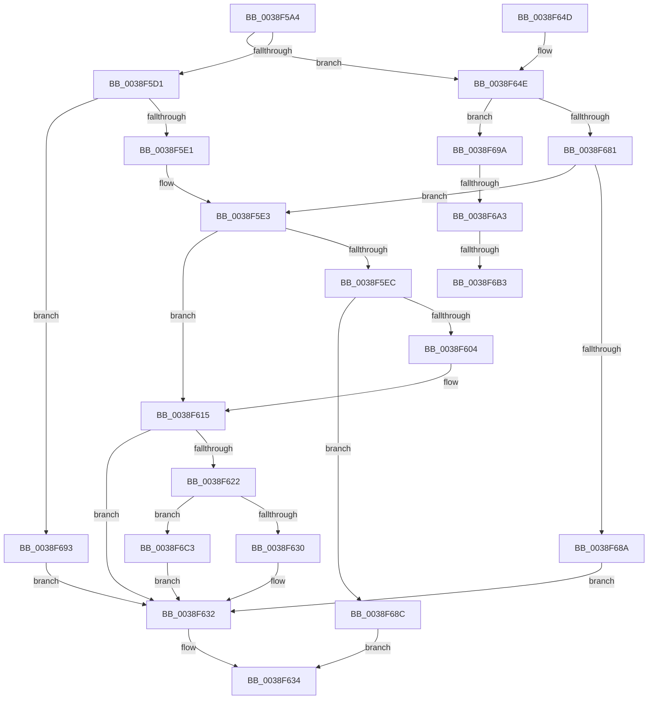

# IoSetOplockPrivateFoExt

- RVA: `0x0038F5A4`–`0x0038F6D9` (길이 `309` bytes)
- VA: `0x000000014038F5A4`
- 실행 섹션: `.text`
- PDB 이름 있음: `예`; PDB Function 태그: `예`
- unwind 정보 RVA: `0x000807B8`
- 디코드: `82`개 명령, `309/309` bytes 표시
- 미해석 바이트: `0` (있으면 어셈블리에 `.byte`로 보존)

> 이 문서는 커널 이미지의 기계어와 PDB 기호를 분석해 생성했습니다. 4번과 5번은 함수 원형과 자료형을 바이너리 사용 방식에서 추정한 C 해석이며 원본 소스 복구 결과는 아닙니다.

## 1. Dependencies

- 직접 호출 지점: **4**; 고유 호출 대상: **4**
- 직접 호출자로 확인된 함수: **1**
- RIP 상대 이미지 참조: **2**

### Outgoing calls
- `0x0038F5F3` → [ExAllocateFromNPagedLookasideList](ExAllocateFromNPagedLookasideList_function_0038E6C0.md) (function, `0x0038E6C0`)
- `0x0038F65C` → [ExAllocatePool2](../../poolcode/B8/ExAllocatePool2_function_00B820F0.md) (function, `0x00B820F0`)
- `0x0038F6B8` → [ExFreePoolWithTag](../../poolcode/B8/ExFreePoolWithTag_function_00B82870.md) (function, `0x00B82870`)
- `0x0038F6CF` → [ExFreeToNPagedLookasideList](ExFreeToNPagedLookasideList_function_0038D9D0.md) (function, `0x0038D9D0`)

### Direct callers
- [FsRtlpOplockEnqueueRH](FsRtlpOplockEnqueueRH_function_0038F534.md) at `0x0038F57B`

### Static image references
- `0x0038F5D1` → RVA `0x00014730` (`.rdata`; read)
- `0x0038F5EC` → RVA `0x00E12400` (`.data`; read)

## 2. Other-region calls and transfers

- 다른 실행 섹션으로 향하는 call: **2**
  - `0x0038F65C` → [ExAllocatePool2](../../poolcode/B8/ExAllocatePool2_function_00B820F0.md) (`.text` → `POOLCODE`)
  - `0x0038F6B8` → [ExFreePoolWithTag](../../poolcode/B8/ExFreePoolWithTag_function_00B82870.md) (`.text` → `POOLCODE`)
- call이 아닌 외부 분기/꼬리 이동: **3**
  - `0x0038F69D` → [sub_006E5752](../6E/Unknown_function_006E5752.md) (`tail-transfer`)
  - `0x0038F6AD` → [sub_006E5752](../6E/Unknown_function_006E5752.md) (`tail-transfer`)
  - `0x0038F6BE` → [sub_006E5752](../6E/Unknown_function_006E5752.md) (`tail-transfer`)

## 3. Assembly (complete function range)

```asm
0038F5A4  48 89 5C 24 08                  mov qword ptr [rsp + 8], rbx
0038F5A9  48 89 6C 24 10                  mov qword ptr [rsp + 0x10], rbp
0038F5AE  48 89 74 24 18                  mov qword ptr [rsp + 0x18], rsi
0038F5B3  57                              push rdi
0038F5B4  41 56                           push r14
0038F5B6  41 57                           push r15
0038F5B8  48 83 EC 20                     sub rsp, 0x20
0038F5BC  48 8B 99 D0 00 00 00            mov rbx, qword ptr [rcx + 0xd0]
0038F5C3  40 32 ED                        xor bpl, bpl
0038F5C6  4C 8B FA                        mov r15, rdx
0038F5C9  48 8B F1                        mov rsi, rcx
0038F5CC  48 85 DB                        test rbx, rbx
0038F5CF  74 7D                           je 0x14038f64e
0038F5D1  48 8D 05 58 51 C8 FF            lea rax, [rip - 0x37aea8]
0038F5D8  48 3B D8                        cmp rbx, rax
0038F5DB  0F 84 B2 00 00 00               je 0x14038f693
0038F5E1  33 FF                           xor edi, edi
0038F5E3  48 8B 53 38                     mov rdx, qword ptr [rbx + 0x38]
0038F5E7  48 85 D2                        test rdx, rdx
0038F5EA  75 29                           jne 0x14038f615
0038F5EC  48 8D 0D 0D 2E A8 00            lea rcx, [rip + 0xa82e0d]
0038F5F3  E8 C8 F0 FF FF                  call 0x14038e6c0
0038F5F8  48 8B D0                        mov rdx, rax
0038F5FB  48 85 C0                        test rax, rax
0038F5FE  0F 84 88 00 00 00               je 0x14038f68c
0038F604  0F 57 C0                        xorps xmm0, xmm0
0038F607  40 B5 01                        mov bpl, 1
0038F60A  0F 11 00                        movups xmmword ptr [rax], xmm0
0038F60D  0F 11 40 10                     movups xmmword ptr [rax + 0x10], xmm0
0038F611  0F 11 40 20                     movups xmmword ptr [rax + 0x20], xmm0
0038F615  49 8B 47 28                     mov rax, qword ptr [r15 + 0x28]
0038F619  48 89 42 28                     mov qword ptr [rdx + 0x28], rax
0038F61D  40 84 ED                        test bpl, bpl
0038F620  74 10                           je 0x14038f632
0038F622  33 C0                           xor eax, eax
0038F624  F0 48 0F B1 53 38               lock cmpxchg qword ptr [rbx + 0x38], rdx
0038F62A  0F 85 93 00 00 00               jne 0x14038f6c3
0038F630  33 FF                           xor edi, edi
0038F632  8B C7                           mov eax, edi
0038F634  48 8B 5C 24 40                  mov rbx, qword ptr [rsp + 0x40]
0038F639  48 8B 6C 24 48                  mov rbp, qword ptr [rsp + 0x48]
0038F63E  48 8B 74 24 50                  mov rsi, qword ptr [rsp + 0x50]
0038F643  48 83 C4 20                     add rsp, 0x20
0038F647  41 5F                           pop r15
0038F649  41 5E                           pop r14
0038F64B  5F                              pop rdi
0038F64C  C3                              ret
0038F64D  CC                              int3
0038F64E  BA 60 00 00 00                  mov edx, 0x60
0038F653  41 B8 49 6F 46 45               mov r8d, 0x45466f49
0038F659  8D 4A E0                        lea ecx, [rdx - 0x20]
0038F65C  E8 8F 2A 7F 00                  call 0x140b820f0
0038F661  4C 8B F0                        mov r14, rax
0038F664  48 8B D8                        mov rbx, rax
0038F667  48 F7 D8                        neg rax
0038F66A  1B FF                           sbb edi, edi
0038F66C  F7 D7                           not edi
0038F66E  81 E7 9A 00 00 C0               and edi, 0xc000009a
0038F674  33 C0                           xor eax, eax
0038F676  F0 48 0F B1 9E D0 00 00 00      lock cmpxchg qword ptr [rsi + 0xd0], rbx
0038F67F  75 19                           jne 0x14038f69a
0038F681  4D 85 F6                        test r14, r14
0038F684  0F 85 59 FF FF FF               jne 0x14038f5e3
0038F68A  EB A6                           jmp 0x14038f632
0038F68C  B8 9A 00 00 C0                  mov eax, 0xc000009a
0038F691  EB A1                           jmp 0x14038f634
0038F693  BF 9A 00 00 C0                  mov edi, 0xc000009a
0038F698  EB 98                           jmp 0x14038f632
0038F69A  48 85 DB                        test rbx, rbx
0038F69D  0F 84 AF 60 35 00               je 0x1406e5752
0038F6A3  48 8D 05 86 50 C8 FF            lea rax, [rip - 0x37af7a]
0038F6AA  48 3B D8                        cmp rbx, rax
0038F6AD  0F 84 9F 60 35 00               je 0x1406e5752
0038F6B3  33 D2                           xor edx, edx
0038F6B5  48 8B CB                        mov rcx, rbx
0038F6B8  E8 B3 31 7F 00                  call 0x140b82870
0038F6BD  90                              nop
0038F6BE  E9 8F 60 35 00                  jmp 0x1406e5752
0038F6C3  48 8D 0D 36 2D A8 00            lea rcx, [rip + 0xa82d36]
0038F6CA  BF 01 00 00 C0                  mov edi, 0xc0000001
0038F6CF  E8 FC E2 FF FF                  call 0x14038d9d0
0038F6D4  E9 59 FF FF FF                  jmp 0x14038f632
```

## 4. C-style interpretation (structured pseudocode)

```c
__int64 __fastcall IoSetOplockPrivateFoExt(__int64 a1, __int64 a2)
{
    __int64 result;
    __int64 v_rbp;
    __int64 v_rdi;
    __int64 v_rsp;
    unsigned __int64 v_stack_p10;
    unsigned __int64 v_stack_p18;
    unsigned __int64 v_stack_p8;

    v_stack_p8 = v_rbx;
    v_stack_p10 = v_rbp;
    v_stack_p18 = v_rsi;
    v_rsp = (v_rsp) - (32);
    v_rbp = 0;
    if (*(unsigned __int64 *)(a1 + 208) == 0) goto loc_0038F64E;
    if ((*(unsigned __int64 *)(a1 + 208)) == (v_rip - 3649192)) goto loc_0038F693;
    v_rdi = 0;
loc_0038F5E3:
    if (*(unsigned __int64 *)(*(unsigned __int64 *)(a1 + 208) + 56) != 0) goto loc_0038F615;
    result = ExAllocateFromNPagedLookasideList(v_rip + 11021837, *(unsigned __int64 *)(*(unsigned __int64 *)(a1 + 208) + 56), a3, a4);
    if (result == 0) goto loc_0038F68C;
    *(unsigned __int64 *)(result) = v_xmm0;
    *(unsigned __int64 *)(result + 16) = v_xmm0;
    *(unsigned __int64 *)(result + 32) = v_xmm0;
loc_0038F615:
    *(unsigned __int64 *)(result + 40) = *(unsigned __int64 *)(a2 + 40);
    if (1 == 0) goto loc_0038F632;
    result = 0;
    if (condition_is_not_equal) goto loc_0038F6C3;
    v_rdi = 0;
loc_0038F632:
loc_0038F634:
    v_rsp = (v_rsp) + (32);
    return 0;
loc_0038F64E:
    result = ExAllocatePool2(96 - 32, 96, (unsigned int)(0x45466F49ULL), a4);
    result = -(result);
    v_rdi = (unsigned int)(~(v_rdi));
    v_rdi = (unsigned int)((v_rdi) & (0xC000009AULL));
    result = 0;
    if (condition_is_not_equal) goto loc_0038F69A;
    if (0 != 0) goto loc_0038F5E3;
    goto loc_0038F632;
loc_0038F68C:
    goto loc_0038F634;
loc_0038F693:
    goto loc_0038F632;
loc_0038F69A:
    a2 = 0;
    result = ExFreePoolWithTag(0, a2, (unsigned int)(0x45466F49ULL), a4);
loc_0038F6C3:
    result = ExFreeToNPagedLookasideList(v_rip + 11021622, a2, (unsigned int)(0x45466F49ULL), a4);
    goto loc_0038F632;
}
```

## 5. (Beta) C Style

```c
int64_t IoSetOplockPrivateFoExt(void *Arg1, void *Arg2)
{
    uint8_t *arg1 = (uint8_t *)Arg1;
    uint8_t *arg2 = (uint8_t *)Arg2;

    int64_t result;
    int64_t local_rbp;
    int64_t local_rdi;
    int64_t local_rsp;
    uint64_t v_stack_p10;
    uint64_t v_stack_p18;
    uint64_t v_stack_p8;

    v_stack_p8 = local_rbx;
    v_stack_p10 = local_rbp;
    v_stack_p18 = local_rsi;
    local_rsp = (local_rsp) - (32);
    local_rbp = 0;
    if (*(uint64_t *)(arg1 + 0xD0) == 0) goto loc_0038F64E;
    if ((*(uint64_t *)(arg1 + 0xD0)) == (v_rip - 3649192)) goto loc_0038F693;
    local_rdi = 0;
loc_0038F5E3:
    if (*(uint64_t *)(*(uint64_t *)(arg1 + 0xD0) + 0x38) != 0) goto loc_0038F615;
    result = ExAllocateFromNPagedLookasideList(v_rip + 11021837, *(uint64_t *)(*(uint64_t *)(arg1 + 0xD0) + 0x38), a3, a4);
    if (result == 0) goto loc_0038F68C;
    *(uint64_t *)(result) = v_xmm0;
    *(uint64_t *)(result + 0x10) = v_xmm0;
    *(uint64_t *)(result + 0x20) = v_xmm0;
loc_0038F615:
    *(uint64_t *)(result + 0x28) = *(uint64_t *)(arg2 + 0x28);
    if (1 == 0) goto loc_0038F632;
    result = 0;
    if (condition_is_not_equal) goto loc_0038F6C3;
    local_rdi = 0;
loc_0038F632:
loc_0038F634:
    local_rsp = (local_rsp) + (32);
    return 0;
loc_0038F64E:
    result = ExAllocatePool2(96 - 32, 96, (uint32_t)(0x45466F49ULL), a4);
    result = -(result);
    local_rdi = (uint32_t)(~(local_rdi));
    local_rdi = (uint32_t)((local_rdi) & (0xC000009AULL));
    result = 0;
    if (condition_is_not_equal) goto loc_0038F69A;
    if (0 != 0) goto loc_0038F5E3;
    goto loc_0038F632;
loc_0038F68C:
    goto loc_0038F634;
loc_0038F693:
    goto loc_0038F632;
loc_0038F69A:
    Arg2 = 0;
    result = ExFreePoolWithTag(0, Arg2, (uint32_t)(0x45466F49ULL), a4);
loc_0038F6C3:
    result = ExFreeToNPagedLookasideList(v_rip + 11021622, Arg2, (uint32_t)(0x45466F49ULL), a4);
    goto loc_0038F632;
}
```

### 관측된 메모리 오프셋

구조체 형식이 확인되지 않은 접근은 인자 기준의 오프셋으로만 기록했습니다.

| 기준 인자 | 오프셋 표현 | 폭 (bit) | 접근 |
|---|---:|---:|---|
| `Arg1` | `+ 0xD0` | `64` | `R` |
| `Arg2` | `+ 0x28` | `64` | `R` |

## 6. Execution-region graph

[열기: 2D/3D 그래프와 함수 탐색 컨트롤 패널](../../../control-panel.html?section=text&rva=0x0038F5A4&view=graph)

- 2D 그래프는 위에서 아래로 흐르고, 3D 그래프는 빈 공간을 드래그해 회전합니다. Shift+드래그는 이동, 휠은 확대·축소, 함수 노드 선택은 대상 보고서 이동입니다.

### Static fallback


