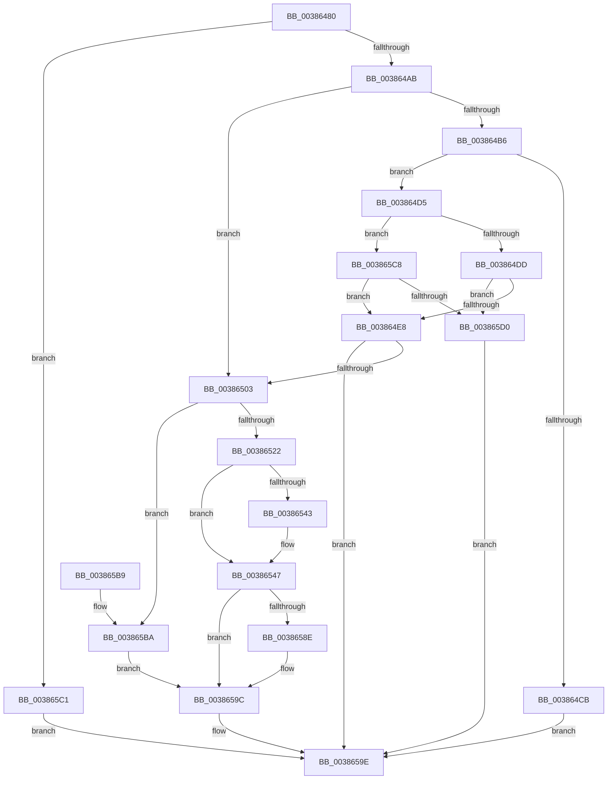

# IoWMIWriteEvent

- RVA: `0x00386480`–`0x003865D7` (길이 `343` bytes)
- VA: `0x0000000140386480`
- 실행 섹션: `.text`
- PDB 이름 있음: `예`; PDB Function 태그: `아니요`
- unwind 정보 RVA: `0x0007FBC0`
- 디코드: `85`개 명령, `343/343` bytes 표시
- 미해석 바이트: `0` (있으면 어셈블리에 `.byte`로 보존)

> 이 문서는 커널 이미지의 기계어와 PDB 기호를 분석해 생성했습니다. 4번과 5번은 함수 원형과 자료형을 바이너리 사용 방식에서 추정한 C 해석이며 원본 소스 복구 결과는 아닙니다.

## 1. Dependencies

- 직접 호출 지점: **7**; 고유 호출 대상: **7**
- 직접 호출자로 확인된 함수: **2**
- RIP 상대 이미지 참조: **6**

### Outgoing calls
- `0x003864F6` → [EtwTraceEvent](../2F/EtwTraceEvent_function_002FD290.md) (function, `0x002FD290`)
- `0x00386511` → [ExAllocatePool2](../../poolcode/B8/ExAllocatePool2_function_00B820F0.md) (function, `0x00B820F0`)
- `0x0038652C` → [KeAcquireSpinLockRaiseToDpc](../20/KeAcquireSpinLockRaiseToDpc_function_00208470.md) (function, `0x00208470`)
- `0x00386536` → [WmipDoFindRegEntryByProviderId](WmipDoFindRegEntryByProviderId_function_003869B0.md) (function, `0x003869B0`)
- `0x00386551` → [KeReleaseSpinLock](../39/KeReleaseSpinLock_function_00392BA0.md) (function, `0x00392BA0`)
- `0x00386575` → [ExInterlockedInsertTailList](ExInterlockedInsertTailList_function_00386700.md) (function, `0x00386700`)
- `0x00386597` → [ExQueueWorkItem](../2F/ExQueueWorkItem_function_002F9520.md) (function, `0x002F9520`)

### Direct callers
- [PpmFireWmiEvent](../5D/PpmFireWmiEvent_function_005D9678.md) at `0x005D96CA`
- [PpmWmiFireIdleAccountingEvent](../5D/PpmWmiFireIdleAccountingEvent_function_005D9700.md) at `0x005D976A`

### Static image references
- `0x0038649E` → RVA `0x00EFFA98` (`.data`; read)
- `0x00386525` → RVA `0x00EFFC28` (`.data`; read)
- `0x00386559` → RVA `0x00EFFAA8` (`.data`; read)
- `0x00386563` → RVA `0x00E09158` (`.data`; read)
- `0x0038657F` → RVA `0x00EFFAA0` (`.data`; read/write)
- `0x00386590` → RVA `0x00EFFAC0` (`.data`; read)

## 2. Other-region calls and transfers

- 다른 실행 섹션으로 향하는 call: **1**
  - `0x00386511` → [ExAllocatePool2](../../poolcode/B8/ExAllocatePool2_function_00B820F0.md) (`.text` → `POOLCODE`)
- 별도 외부 분기/꼬리 이동을 확인하지 못했습니다.

## 3. Assembly (complete function range)

```asm
00386480  48 8B C4                        mov rax, rsp
00386483  48 89 58 08                     mov qword ptr [rax + 8], rbx
00386487  48 89 68 10                     mov qword ptr [rax + 0x10], rbp
0038648B  48 89 70 18                     mov qword ptr [rax + 0x18], rsi
0038648F  48 89 78 20                     mov qword ptr [rax + 0x20], rdi
00386493  41 56                           push r14
00386495  48 83 EC 30                     sub rsp, 0x30
00386499  33 FF                           xor edi, edi
0038649B  48 8B F1                        mov rsi, rcx
0038649E  48 39 3D F3 95 B7 00            cmp qword ptr [rip + 0xb795f3], rdi
003864A5  0F 84 16 01 00 00               je 0x1403865c1
003864AB  8B 59 2C                        mov ebx, dword ptr [rcx + 0x2c]
003864AE  F7 C3 00 00 06 00               test ebx, 0x60000
003864B4  74 4D                           je 0x140386503
003864B6  8B 06                           mov eax, dword ptr [rsi]
003864B8  44 8D 47 30                     lea r8d, [rdi + 0x30]
003864BC  0F B7 49 08                     movzx ecx, word ptr [rcx + 8]
003864C0  81 E3 00 00 02 00               and ebx, 0x20000
003864C6  41 3B C0                        cmp eax, r8d
003864C9  73 0A                           jae 0x1403864d5
003864CB  B8 23 00 00 C0                  mov eax, 0xc0000023
003864D0  E9 C9 00 00 00                  jmp 0x14038659e
003864D5  85 DB                           test ebx, ebx
003864D7  0F 84 EB 00 00 00               je 0x1403865c8
003864DD  3D FF FF 00 00                  cmp eax, 0xffff
003864E2  0F 87 E8 00 00 00               ja 0x1403865d0
003864E8  41 B9 00 00 14 C0               mov r9d, 0xc0140000
003864EE  40 88 7C 24 20                  mov byte ptr [rsp + 0x20], dil
003864F3  48 8B D6                        mov rdx, rsi
003864F6  E8 95 6D F7 FF                  call 0x1402fd290
003864FB  85 DB                           test ebx, ebx
003864FD  0F 85 9B 00 00 00               jne 0x14038659e
00386503  BA 20 00 00 00                  mov edx, 0x20
00386508  41 B8 57 6D 69 77               mov r8d, 0x77696d57
0038650E  8D 4A 20                        lea ecx, [rdx + 0x20]
00386511  E8 DA BB 7F 00                  call 0x140b820f0
00386516  48 8B E8                        mov rbp, rax
00386519  48 85 C0                        test rax, rax
0038651C  0F 84 98 00 00 00               je 0x1403865ba
00386522  8B 5E 04                        mov ebx, dword ptr [rsi + 4]
00386525  48 8D 0D FC 96 B7 00            lea rcx, [rip + 0xb796fc]
0038652C  E8 3F 1F E8 FF                  call 0x140208470
00386531  8B CB                           mov ecx, ebx
00386533  44 8A C0                        mov r8b, al
00386536  E8 75 04 00 00                  call 0x1403869b0
0038653B  48 8B D8                        mov rbx, rax
0038653E  48 85 C0                        test rax, rax
00386541  74 04                           je 0x140386547
00386543  F0 FF 40 30                     lock inc dword ptr [rax + 0x30]
00386547  41 8A D0                        mov dl, r8b
0038654A  48 8D 0D D7 96 B7 00            lea rcx, [rip + 0xb796d7]
00386551  E8 4A C6 00 00                  call 0x140392ba0
00386556  8B 46 08                        mov eax, dword ptr [rsi + 8]
00386559  4C 8D 05 48 95 B7 00            lea r8, [rip + 0xb79548]
00386560  89 46 28                        mov dword ptr [rsi + 0x28], eax
00386563  48 8D 0D EE 2B A8 00            lea rcx, [rip + 0xa82bee]
0038656A  48 8B D5                        mov rdx, rbp
0038656D  48 89 5D 10                     mov qword ptr [rbp + 0x10], rbx
00386571  48 89 75 18                     mov qword ptr [rbp + 0x18], rsi
00386575  E8 86 01 00 00                  call 0x140386700
0038657A  B8 01 00 00 00                  mov eax, 1
0038657F  F0 0F C1 05 19 95 B7 00         lock xadd dword ptr [rip + 0xb79519], eax
00386587  FF C0                           inc eax
00386589  83 F8 01                        cmp eax, 1
0038658C  75 0E                           jne 0x14038659c
0038658E  8B D0                           mov edx, eax
00386590  48 8D 0D 29 95 B7 00            lea rcx, [rip + 0xb79529]
00386597  E8 84 2F F7 FF                  call 0x1402f9520
0038659C  8B C7                           mov eax, edi
0038659E  48 8B 5C 24 40                  mov rbx, qword ptr [rsp + 0x40]
003865A3  48 8B 6C 24 48                  mov rbp, qword ptr [rsp + 0x48]
003865A8  48 8B 74 24 50                  mov rsi, qword ptr [rsp + 0x50]
003865AD  48 8B 7C 24 58                  mov rdi, qword ptr [rsp + 0x58]
003865B2  48 83 C4 30                     add rsp, 0x30
003865B6  41 5E                           pop r14
003865B8  C3                              ret
003865B9  CC                              int3
003865BA  BF 9A 00 00 C0                  mov edi, 0xc000009a
003865BF  EB DB                           jmp 0x14038659c
003865C1  B8 01 00 00 C0                  mov eax, 0xc0000001
003865C6  EB D6                           jmp 0x14038659e
003865C8  85 C0                           test eax, eax
003865CA  0F 89 18 FF FF FF               jns 0x1403864e8
003865D0  B8 05 00 00 80                  mov eax, 0x80000005
003865D5  EB C7                           jmp 0x14038659e
```

## 4. C-style interpretation (structured pseudocode)

```c
__int64 __fastcall IoWMIWriteEvent(__int64 a1)
{
    __int64 result;
    __int64 v_rbx;
    __int64 v_rdi;
    __int64 v_rsp;
    unsigned __int8 v_stack_m18;
    unsigned __int64 v_stack_p10;
    unsigned __int64 v_stack_p18;
    unsigned __int64 v_stack_p20;
    unsigned __int64 v_stack_p8;

    *(unsigned __int64 *)(v_rsp + 8) = v_rbx;
    *(unsigned __int64 *)(v_rsp + 16) = v_rbp;
    *(unsigned __int64 *)(v_rsp + 24) = v_rsi;
    *(unsigned __int64 *)(v_rsp + 32) = v_rdi;
    v_rsp = (v_rsp) - (48);
    v_rdi = 0;
    if ((*(unsigned __int64 *)(v_rip + 12031475)) == 0) goto loc_003865C1;
    if ((((unsigned int)((unsigned int)(*(unsigned int *)(a1 + 44)))) & (0x60000ULL)) == 0) goto loc_00386503;
    v_rbx = (unsigned int)(((unsigned int)(*(unsigned int *)(a1 + 44))) & (0x20000ULL));
    if (((unsigned int)((unsigned int)(*(unsigned int *)(a1)))) >= ((unsigned int)(v_rdi + 48))) goto loc_003864D5;
    goto loc_0038659E;
loc_003864D5:
    if ((unsigned int)(v_rbx) == 0) goto loc_003865C8;
    if (((unsigned int)((unsigned int)(0xC0000023ULL))) > 0xFFFFULL) goto loc_003865D0;
loc_003864E8:
    v_stack_m18 = 0;
    result = EtwTraceEvent(*(unsigned __int16 *)(a1 + 8), a1, v_rdi + 48, (unsigned int)(0xC0140000ULL));
    if ((unsigned int)(v_rbx) != 0) goto loc_0038659E;
loc_00386503:
    result = ExAllocatePool2(32 + 32, 32, (unsigned int)(0x77696D57ULL), (unsigned int)(0xC0140000ULL));
    if (result == 0) goto loc_003865BA;
    result = KeAcquireSpinLockRaiseToDpc(v_rip + 12031740, 32, (unsigned int)(0x77696D57ULL), (unsigned int)(0xC0140000ULL));
    result = WmipDoFindRegEntryByProviderId((unsigned int)((unsigned int)((unsigned int)(*(unsigned int *)(a1 + 4)))), 32, (unsigned __int8)(result), (unsigned int)(0xC0140000ULL));
    if (result != 0) {
    }
    result = KeReleaseSpinLock(v_rip + 12031703, (unsigned __int8)((unsigned __int8)(result)), (unsigned __int8)(result), (unsigned int)(0xC0140000ULL));
    *(unsigned int *)(a1 + 40) = (unsigned int)((unsigned int)(*(unsigned int *)(a1 + 8)));
    *(unsigned __int64 *)(result + 16) = result;
    *(unsigned __int64 *)(result + 24) = a1;
    result = ExInterlockedInsertTailList(v_rip + 11021294, result, v_rip + 12031304, (unsigned int)(0xC0140000ULL));
    result = (unsigned int)((1) + 1);
    if (((unsigned int)(result)) == 1) {
        a2 = (unsigned int)(result);
        a1 = v_rip + 12031273;
        result = ExQueueWorkItem(a1, a2, v_rip + 12031304, (unsigned int)(0xC0140000ULL));
    }
loc_0038659E:
    v_rsp = (v_rsp) + (48);
    return 0;
loc_003865BA:
    goto loc_0038659C;
loc_003865C1:
    goto loc_0038659E;
loc_003865C8:
    if (!sign_flag) goto loc_003864E8;
loc_003865D0:
    goto loc_0038659E;
}
```

## 5. (Beta) C Style

```c
int64_t IoWMIWriteEvent(void *Arg1)
{
    uint8_t *arg1 = (uint8_t *)Arg1;

    int64_t result;
    int64_t local_rbx;
    int64_t local_rdi;
    int64_t local_rsp;
    uint8_t v_stack_m18;
    uint64_t v_stack_p10;
    uint64_t v_stack_p18;
    uint64_t v_stack_p20;
    uint64_t v_stack_p8;

    *(uint64_t *)(local_rsp + 0x8) = local_rbx;
    *(uint64_t *)(local_rsp + 0x10) = local_rbp;
    *(uint64_t *)(local_rsp + 0x18) = local_rsi;
    *(uint64_t *)(local_rsp + 0x20) = local_rdi;
    local_rsp = (local_rsp) - (48);
    local_rdi = 0;
    if ((*(uint64_t *)(v_rip + 0xB795F3)) == 0) goto loc_003865C1;
    if ((((uint32_t)((uint32_t)(*(uint32_t *)(arg1 + 0x2C)))) & (0x60000ULL)) == 0) goto loc_00386503;
    local_rbx = (uint32_t)(((uint32_t)(*(uint32_t *)(arg1 + 0x2C))) & (0x20000ULL));
    if (((uint32_t)((uint32_t)(*(uint32_t *)(arg1)))) >= ((uint32_t)(local_rdi + 48))) goto loc_003864D5;
    goto loc_0038659E;
loc_003864D5:
    if ((uint32_t)(local_rbx) == 0) goto loc_003865C8;
    if (((uint32_t)((uint32_t)(0xC0000023ULL))) > 0xFFFFULL) goto loc_003865D0;
loc_003864E8:
    v_stack_m18 = 0;
    result = EtwTraceEvent(*(uint16_t *)(arg1 + 0x8), Arg1, local_rdi + 48, (uint32_t)(0xC0140000ULL));
    if ((uint32_t)(local_rbx) != 0) goto loc_0038659E;
loc_00386503:
    result = ExAllocatePool2(32 + 32, 32, (uint32_t)(0x77696D57ULL), (uint32_t)(0xC0140000ULL));
    if (result == 0) goto loc_003865BA;
    result = KeAcquireSpinLockRaiseToDpc(v_rip + 12031740, 32, (uint32_t)(0x77696D57ULL), (uint32_t)(0xC0140000ULL));
    result = WmipDoFindRegEntryByProviderId((uint32_t)((uint32_t)((uint32_t)(*(uint32_t *)(arg1 + 0x4)))), 32, (uint8_t)(result), (uint32_t)(0xC0140000ULL));
    if (result != 0) {
    }
    result = KeReleaseSpinLock(v_rip + 12031703, (uint8_t)((uint8_t)(result)), (uint8_t)(result), (uint32_t)(0xC0140000ULL));
    *(uint32_t *)(arg1 + 0x28) = (uint32_t)((uint32_t)(*(uint32_t *)(arg1 + 0x8)));
    *(uint64_t *)(result + 0x10) = result;
    *(void **)(result + 0x18) = Arg1;
    result = ExInterlockedInsertTailList(v_rip + 11021294, result, v_rip + 12031304, (uint32_t)(0xC0140000ULL));
    result = (uint32_t)((1) + 1);
    if (((uint32_t)(result)) == 1) {
        a2 = (uint32_t)(result);
        Arg1 = v_rip + 12031273;
        result = ExQueueWorkItem(Arg1, a2, v_rip + 12031304, (uint32_t)(0xC0140000ULL));
    }
loc_0038659E:
    local_rsp = (local_rsp) + (48);
    return 0;
loc_003865BA:
    goto loc_0038659C;
loc_003865C1:
    goto loc_0038659E;
loc_003865C8:
    if (!sign_flag) goto loc_003864E8;
loc_003865D0:
    goto loc_0038659E;
}
```

### 관측된 메모리 오프셋

구조체 형식이 확인되지 않은 접근은 인자 기준의 오프셋으로만 기록했습니다.

| 기준 인자 | 오프셋 표현 | 폭 (bit) | 접근 |
|---|---:|---:|---|
| `Arg1` | `+ 0x0` | `32` | `R` |
| `Arg1` | `+ 0x4` | `32` | `R` |
| `Arg1` | `+ 0x8` | `16` | `R` |
| `Arg1` | `+ 0x8` | `32` | `R` |
| `Arg1` | `+ 0x28` | `32` | `W` |
| `Arg1` | `+ 0x2C` | `32` | `R` |

## 6. Execution-region graph

[열기: 2D/3D 그래프와 함수 탐색 컨트롤 패널](../../../control-panel.html?section=text&rva=0x00386480&view=graph)

- 2D 그래프는 위에서 아래로 흐르고, 3D 그래프는 빈 공간을 드래그해 회전합니다. Shift+드래그는 이동, 휠은 확대·축소, 함수 노드 선택은 대상 보고서 이동입니다.

### Static fallback


