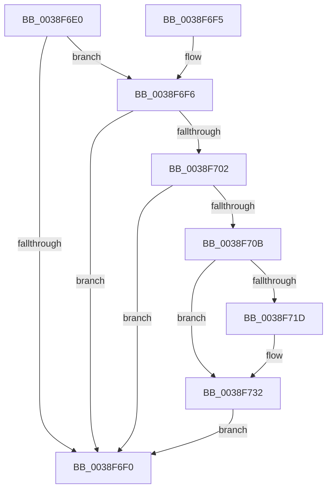

# IopCloseFileObjectExtension

- RVA: `0x0038F6E0`–`0x0038F739` (길이 `89` bytes)
- VA: `0x000000014038F6E0`
- 실행 섹션: `.text`
- PDB 이름 있음: `예`; PDB Function 태그: `아니요`
- unwind 정보 RVA: `0x000807E4`
- 디코드: `25`개 명령, `89/89` bytes 표시
- 미해석 바이트: `0` (있으면 어셈블리에 `.byte`로 보존)

> 이 문서는 커널 이미지의 기계어와 PDB 기호를 분석해 생성했습니다. 4번과 5번은 함수 원형과 자료형을 바이너리 사용 방식에서 추정한 C 해석이며 원본 소스 복구 결과는 아닙니다.

## 1. Dependencies

- 직접 호출 지점: **2**; 고유 호출 대상: **2**
- 직접 호출자로 확인된 함수: **2**
- RIP 상대 이미지 참조: **1**

### Outgoing calls
- `0x0038F720` → [PspHardDereferenceSiloWorker](PspHardDereferenceSiloWorker_function_0038F740.md) (function, `0x0038F740`)
- `0x0038F72D` → [ObfDereferenceObjectWithTag](../2F/ObfDereferenceObjectWithTag_function_002F78E0.md) (function, `0x002F78E0`)

### Direct callers
- [IoCancelFileOpen](../../page/70/IoCancelFileOpen_function_007034A0.md) at `0x007035A8`
- [IopCloseFile](../../page/86/IopCloseFile_function_008640C0.md) at `0x00864253`

### Static image references
- `0x0038F6F6` → RVA `0x00014730` (`.rdata`; read)

## 2. Other-region calls and transfers

- 다른 실행 섹션으로 향하는 call: **0**
- 별도 외부 분기/꼬리 이동을 확인하지 못했습니다.

## 3. Assembly (complete function range)

```asm
0038F6E0  48 83 EC 28                     sub rsp, 0x28
0038F6E4  48 8B 81 D0 00 00 00            mov rax, qword ptr [rcx + 0xd0]
0038F6EB  48 85 C0                        test rax, rax
0038F6EE  75 06                           jne 0x14038f6f6
0038F6F0  48 83 C4 28                     add rsp, 0x28
0038F6F4  C3                              ret
0038F6F5  CC                              int3
0038F6F6  48 8D 0D 33 50 C8 FF            lea rcx, [rip - 0x37afcd]
0038F6FD  48 3B C1                        cmp rax, rcx
0038F700  74 EE                           je 0x14038f6f0
0038F702  48 8B 48 40                     mov rcx, qword ptr [rax + 0x40]
0038F706  48 85 C9                        test rcx, rcx
0038F709  74 E5                           je 0x14038f6f0
0038F70B  83 61 04 FE                     and dword ptr [rcx + 4], 0xfffffffe
0038F70F  48 89 5C 24 20                  mov qword ptr [rsp + 0x20], rbx
0038F714  48 8B 59 08                     mov rbx, qword ptr [rcx + 8]
0038F718  48 85 DB                        test rbx, rbx
0038F71B  74 15                           je 0x14038f732
0038F71D  48 8B CB                        mov rcx, rbx
0038F720  E8 1B 00 00 00                  call 0x14038f740
0038F725  BA 53 69 6C 48                  mov edx, 0x486c6953
0038F72A  48 8B CB                        mov rcx, rbx
0038F72D  E8 AE 81 F6 FF                  call 0x1402f78e0
0038F732  48 8B 5C 24 20                  mov rbx, qword ptr [rsp + 0x20]
0038F737  EB B7                           jmp 0x14038f6f0
```

## 4. C-style interpretation (structured pseudocode)

```c
__int64 __fastcall IopCloseFileObjectExtension(__int64 a1)
{
    __int64 result;
    __int64 v_rsp;
    unsigned __int64 v_stack_p20;

    v_rsp = (v_rsp) - (40);
    if (*(unsigned __int64 *)(a1 + 208) != 0) goto loc_0038F6F6;
loc_0038F6F0:
    v_rsp = (v_rsp) + (40);
    return *(unsigned __int64 *)(a1 + 208);
loc_0038F6F6:
    if ((*(unsigned __int64 *)(a1 + 208)) == (v_rip - 3649485)) goto loc_0038F6F0;
    if (*(unsigned __int64 *)(*(unsigned __int64 *)(a1 + 208) + 64) == 0) goto loc_0038F6F0;
    v_stack_p20 = v_rbx;
    result = *(unsigned __int64 *)(a1 + 208);
    if (*(unsigned __int64 *)(*(unsigned __int64 *)(*(unsigned __int64 *)(a1 + 208) + 64) + 8) != 0) {
        a1 = *(unsigned __int64 *)(*(unsigned __int64 *)(*(unsigned __int64 *)(a1 + 208) + 64) + 8);
        result = PspHardDereferenceSiloWorker(a1, a2, a3, a4);
        a2 = 0x486C6953ULL;
        a1 = *(unsigned __int64 *)(*(unsigned __int64 *)(*(unsigned __int64 *)(a1 + 208) + 64) + 8);
        result = ObfDereferenceObjectWithTag(a1, a2, a3, a4);
    }
    goto loc_0038F6F0;
}
```

## 5. (Beta) C Style

```c
int64_t IopCloseFileObjectExtension(void *Arg1)
{
    uint8_t *arg1 = (uint8_t *)Arg1;

    int64_t result;
    int64_t local_rsp;
    uint64_t v_stack_p20;

    local_rsp = (local_rsp) - (40);
    if (*(uint64_t *)(arg1 + 0xD0) != 0) goto loc_0038F6F6;
loc_0038F6F0:
    local_rsp = (local_rsp) + (40);
    return *(uint64_t *)(arg1 + 0xD0);
loc_0038F6F6:
    if ((*(uint64_t *)(arg1 + 0xD0)) == (v_rip - 3649485)) goto loc_0038F6F0;
    if (*(uint64_t *)(*(uint64_t *)(arg1 + 0xD0) + 0x40) == 0) goto loc_0038F6F0;
    v_stack_p20 = local_rbx;
    result = *(uint64_t *)(arg1 + 0xD0);
    if (*(uint64_t *)(*(uint64_t *)(*(uint64_t *)(arg1 + 0xD0) + 0x40) + 0x8) != 0) {
        Arg1 = *(uint64_t *)(*(uint64_t *)(*(uint64_t *)(arg1 + 0xD0) + 0x40) + 0x8);
        result = PspHardDereferenceSiloWorker(Arg1, a2, a3, a4);
        a2 = 0x486C6953ULL;
        Arg1 = *(uint64_t *)(*(uint64_t *)(*(uint64_t *)(arg1 + 0xD0) + 0x40) + 0x8);
        result = ObfDereferenceObjectWithTag(Arg1, a2, a3, a4);
    }
    goto loc_0038F6F0;
}
```

### 관측된 메모리 오프셋

구조체 형식이 확인되지 않은 접근은 인자 기준의 오프셋으로만 기록했습니다.

| 기준 인자 | 오프셋 표현 | 폭 (bit) | 접근 |
|---|---:|---:|---|
| `Arg1` | `+ 0xD0` | `64` | `R` |

## 6. Execution-region graph

[열기: 2D/3D 그래프와 함수 탐색 컨트롤 패널](../../../control-panel.html?section=text&rva=0x0038F6E0&view=graph)

- 2D 그래프는 위에서 아래로 흐르고, 3D 그래프는 빈 공간을 드래그해 회전합니다. Shift+드래그는 이동, 휠은 확대·축소, 함수 노드 선택은 대상 보고서 이동입니다.

### Static fallback


