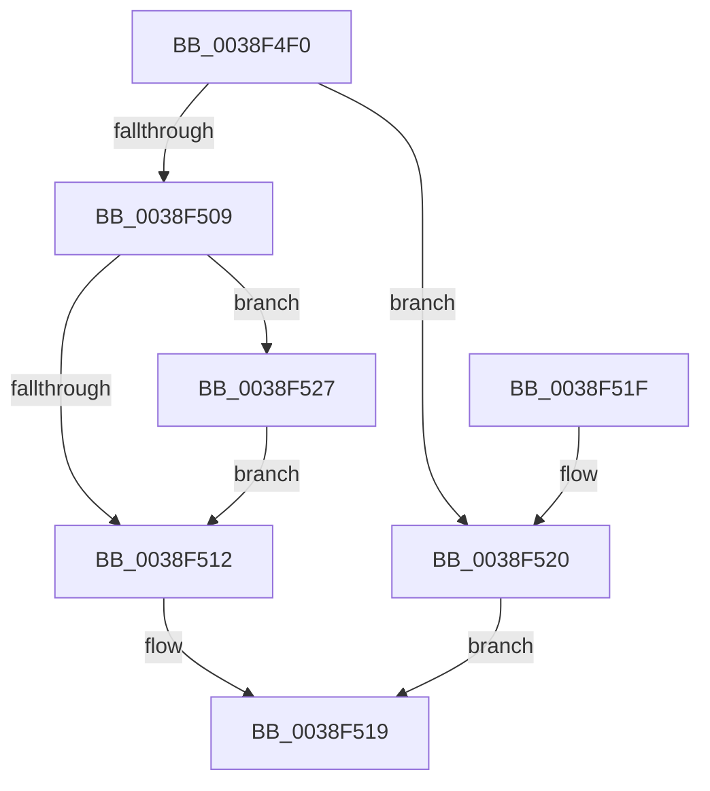

# KeQueryPriorityThread

- RVA: `0x0038F4F0`–`0x0038F52E` (길이 `62` bytes)
- VA: `0x000000014038F4F0`
- 실행 섹션: `.text`
- PDB 이름 있음: `예`; PDB Function 태그: `아니요`
- unwind 정보 RVA: `0x000704F4`
- 디코드: `17`개 명령, `62/62` bytes 표시
- 미해석 바이트: `0` (있으면 어셈블리에 `.byte`로 보존)

> 이 문서는 커널 이미지의 기계어와 PDB 기호를 분석해 생성했습니다. 4번과 5번은 함수 원형과 자료형을 바이너리 사용 방식에서 추정한 C 해석이며 원본 소스 복구 결과는 아닙니다.

## 1. Dependencies

- 직접 호출 지점: **1**; 고유 호출 대상: **1**
- 직접 호출자로 확인된 함수: **18**
- RIP 상대 이미지 참조: **1**

### Outgoing calls
- `0x0038F527` → [KiUpdateVpBackingThreadPriorityOnPriorityQuery](../4B/KiUpdateVpBackingThreadPriorityOnPriorityQuery_function_004BF550.md) (function, `0x004BF550`)

### Direct callers
- [sub_00206865](../20/Unknown_function_00206865.md) at `0x00206BDF`
- [sub_00206865](../20/Unknown_function_00206865.md) at `0x00206C24`
- [MiSetIdealProcessorThread](../2C/MiSetIdealProcessorThread_function_002C760C.md) at `0x002C7650`
- [MiLaunchZeroWorkers](../2C/MiLaunchZeroWorkers_function_002CAF28.md) at `0x002CAF77`
- [sub_003176F1](../31/Unknown_function_003176F1.md) at `0x0031786C`
- [SMKM_STORE&lt;SM_TRAITS&gt;::SmStWorkItemQueue](../31/SMKM_STORE_SM_TRAITS_SmStWorkItemQueue_function_00317A34.md) at `0x00317B3B`
- [SMKM_STORE&lt;SM_TRAITS&gt;::SmStWorkItemQueue](../31/SMKM_STORE_SM_TRAITS_SmStWorkItemQueue_function_00317A34.md) at `0x00317CF9`
- [MiReplenishSlabAllocator](../37/MiReplenishSlabAllocator_function_003788E4.md) at `0x00378950`
- [LZNT1DecompressChunkNewThread](LZNT1DecompressChunkNewThread_function_0038F3F8.md) at `0x0038F49A`
- [SMKM_STORE&lt;SM_TRAITS&gt;::SmStUpdateMemoryCondition](../3C/SMKM_STORE_SM_TRAITS_SmStUpdateMemoryCondition_function_003C34D0.md) at `0x003C350A`
- [FsRtlpWaitForIoAtEof](../41/FsRtlpWaitForIoAtEof_function_00415298.md) at `0x00415329`
- [FsRtlpWaitForIoAtEof](../41/FsRtlpWaitForIoAtEof_function_00415298.md) at `0x004153A3`
- [MiModifiedPageWriter](../47/MiModifiedPageWriter_function_0047E5F0.md) at `0x0047E973`
- [PoNotifyMediaBuffering](../48/PoNotifyMediaBuffering_function_00481FC0.md) at `0x0048200B`
- [EtwpTraceThreadRundownWithStack](../4A/EtwpTraceThreadRundownWithStack_function_004AB5A0.md) at `0x004AB687`
- [EtwpTraceThreadRundownWithStack](../4A/EtwpTraceThreadRundownWithStack_function_004AB5A0.md) at `0x004AB691`
- [PspQueryWobTicketPriority](../../page/78/PspQueryWobTicketPriority_function_007898C8.md) at `0x00789943`
- [PfSnPrefetchSections](../../page/93/PfSnPrefetchSections_function_0093BCF4.md) at `0x0093BDC5`
- [PfSnPrefetchSectionsCleanup](../../page/93/PfSnPrefetchSectionsCleanup_function_0093C0B0.md) at `0x0093C114`
- [PfSnPrefetchScenario](../../page/96/PfSnPrefetchScenario_function_00961080.md) at `0x00961113`
- [MiInSwapStore](../../page/A6/MiInSwapStore_function_00A61B74.md) at `0x00A61BE7`
- [ViPendingQueuePassiveLevelCompletion](../../pagevrfy/BA/ViPendingQueuePassiveLevelCompletion_function_00BA1FE0.md) at `0x00BA2003`

### Static image references
- `0x0038F4F6` → RVA `0x00FCFF00` (`CACHEALI`; read)

## 2. Other-region calls and transfers

- 다른 실행 섹션으로 향하는 call: **0**
- 별도 외부 분기/꼬리 이동을 확인하지 못했습니다.

## 3. Assembly (complete function range)

```asm
0038F4F0  40 53                           push rbx
0038F4F2  48 83 EC 20                     sub rsp, 0x20
0038F4F6  48 8D 05 03 0A C4 00            lea rax, [rip + 0xc40a03]
0038F4FD  48 8B D9                        mov rbx, rcx
0038F500  48 39 81 20 02 00 00            cmp qword ptr [rcx + 0x220], rax
0038F507  74 17                           je 0x14038f520
0038F509  F7 41 78 00 00 40 00            test dword ptr [rcx + 0x78], 0x400000
0038F510  75 15                           jne 0x14038f527
0038F512  0F BE 83 C3 00 00 00            movsx eax, byte ptr [rbx + 0xc3]
0038F519  48 83 C4 20                     add rsp, 0x20
0038F51D  5B                              pop rbx
0038F51E  C3                              ret
0038F51F  CC                              int3
0038F520  B8 01 00 00 00                  mov eax, 1
0038F525  EB F2                           jmp 0x14038f519
0038F527  E8 24 00 13 00                  call 0x1404bf550
0038F52C  EB E4                           jmp 0x14038f512
```

## 4. C-style interpretation (structured pseudocode)

```c
__int64 __fastcall KeQueryPriorityThread(__int64 a1)
{
    __int64 result;
    __int64 v_rsp;

    v_rsp = (v_rsp) - (32);
    if ((*(unsigned __int64 *)(a1 + 544)) == (v_rip + 12847619)) goto loc_0038F520;
    if (((*(unsigned int *)(a1 + 120)) & (0x400000ULL)) != 0) goto loc_0038F527;
loc_0038F512:
loc_0038F519:
    v_rsp = (v_rsp) + (32);
    return (__int8)(*(unsigned __int8 *)(a1 + 195));
loc_0038F520:
    goto loc_0038F519;
loc_0038F527:
    result = KiUpdateVpBackingThreadPriorityOnPriorityQuery(a1, a2, a3, a4);
    goto loc_0038F512;
}
```

## 5. (Beta) C Style

```c
int64_t KeQueryPriorityThread(void *Arg1)
{
    uint8_t *arg1 = (uint8_t *)Arg1;

    int64_t result;
    int64_t local_rsp;

    local_rsp = (local_rsp) - (32);
    if ((*(uint64_t *)(arg1 + 0x220)) == (v_rip + 12847619)) goto loc_0038F520;
    if (((*(uint32_t *)(arg1 + 0x78)) & (0x400000ULL)) != 0) goto loc_0038F527;
loc_0038F512:
loc_0038F519:
    local_rsp = (local_rsp) + (32);
    return (int8_t)(*(uint8_t *)(arg1 + 0xC3));
loc_0038F520:
    goto loc_0038F519;
loc_0038F527:
    result = KiUpdateVpBackingThreadPriorityOnPriorityQuery(Arg1, a2, a3, a4);
    goto loc_0038F512;
}
```

### 관측된 메모리 오프셋

구조체 형식이 확인되지 않은 접근은 인자 기준의 오프셋으로만 기록했습니다.

| 기준 인자 | 오프셋 표현 | 폭 (bit) | 접근 |
|---|---:|---:|---|
| `Arg1` | `+ 0x78` | `32` | `R` |
| `Arg1` | `+ 0xC3` | `8` | `R` |
| `Arg1` | `+ 0x220` | `64` | `R` |

## 6. Execution-region graph

[열기: 2D/3D 그래프와 함수 탐색 컨트롤 패널](../../../control-panel.html?section=text&rva=0x0038F4F0&view=graph)

- 2D 그래프는 위에서 아래로 흐르고, 3D 그래프는 빈 공간을 드래그해 회전합니다. Shift+드래그는 이동, 휠은 확대·축소, 함수 노드 선택은 대상 보고서 이동입니다.

### Static fallback


