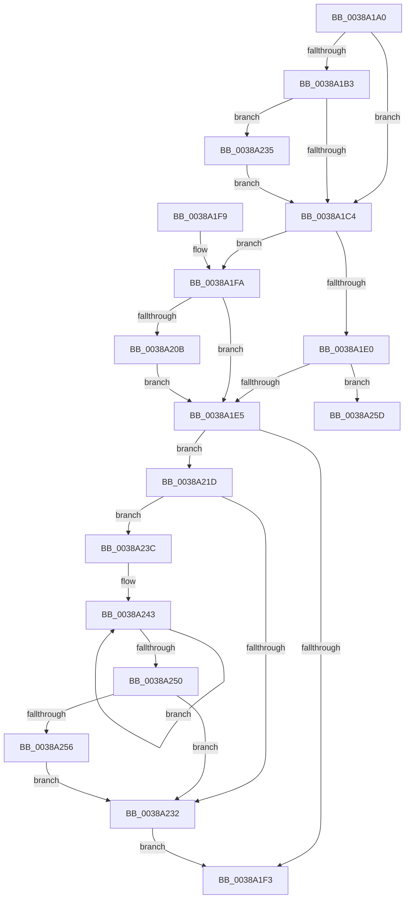

# KeRcuReadLock

- RVA: `0x0038A1A0`–`0x0038A264` (길이 `196` bytes)
- VA: `0x000000014038A1A0`
- 실행 섹션: `.text`
- PDB 이름 있음: `예`; PDB Function 태그: `아니요`
- unwind 정보 RVA: `0x0007FFC8`
- 디코드: `52`개 명령, `196/196` bytes 표시
- 미해석 바이트: `0` (있으면 어셈블리에 `.byte`로 보존)

> 이 문서는 커널 이미지의 기계어와 PDB 기호를 분석해 생성했습니다. 4번과 5번은 함수 원형과 자료형을 바이너리 사용 방식에서 추정한 C 해석이며 원본 소스 복구 결과는 아닙니다.

## 1. Dependencies

- 직접 호출 지점: **3**; 고유 호출 대상: **3**
- 직접 호출자로 확인된 함수: **12**
- RIP 상대 이미지 참조: **1**

### Outgoing calls
- `0x0038A1CD` → [KeDisableInterrupts](../21/KeDisableInterrupts_function_00217BE0.md) (function, `0x00217BE0`)
- `0x0038A235` → [KiRaiseIrqlProcessIrqlFlags](../4F/KiRaiseIrqlProcessIrqlFlags_function_004F56FC.md) (function, `0x004F56FC`)
- `0x0038A256` → [KiRemoveSystemWorkPriorityKick](../26/KiRemoveSystemWorkPriorityKick_function_002631D0.md) (function, `0x002631D0`)

### Direct callers
- [CcFlushCachePreProcess](../35/CcFlushCachePreProcess_function_0035A9B0.md) at `0x0035AAB6`
- [CcZeroData](CcZeroData_function_00387F00.md) at `0x00387F49`
- [CcCanIWrite](CcCanIWrite_function_00388250.md) at `0x003882E0`
- [CcIsFileObjectDirectMapped](CcIsFileObjectDirectMapped_function_00388D10.md) at `0x00388D1F`
- [CcInitializeVolumeCacheMap](CcInitializeVolumeCacheMap_function_00389D60.md) at `0x00389DA3`
- [CcForceWriteThrough](CcForceWriteThrough_function_00389E50.md) at `0x00389E9F`
- [CcScanLogHandleList](CcScanLogHandleList_function_0038A26C.md) at `0x0038A2B8`
- [CcScanLogHandleList](CcScanLogHandleList_function_0038A26C.md) at `0x0038A330`
- [CcGetFlushedValidData](../40/CcGetFlushedValidData_function_00402920.md) at `0x004029EF`
- [CcPostVolumeTelemetry](../42/CcPostVolumeTelemetry_function_00420FF8.md) at `0x004210E2`
- [CcPerfLogLoggedStreamsStats](../4B/CcPerfLogLoggedStreamsStats_function_004B2400.md) at `0x004B2418`
- [CcUpdateTimeOnLogHandles](../4C/CcUpdateTimeOnLogHandles_function_004C6D0C.md) at `0x004C6D3E`
- [CcDeferWrite](../57/CcDeferWrite_function_0057C860.md) at `0x0057C8C5`

### Static image references
- `0x0038A1BB` → RVA `0x00FC6D20` (`ALMOSTRO`; read)

## 2. Other-region calls and transfers

- 다른 실행 섹션으로 향하는 call: **0**
- 별도 외부 분기/꼬리 이동을 확인하지 못했습니다.

## 3. Assembly (complete function range)

```asm
0038A1A0  40 53                           push rbx
0038A1A2  48 83 EC 20                     sub rsp, 0x20
0038A1A6  44 0F 20 C3                     mov rbx, cr8
0038A1AA  BA 02 00 00 00                  mov edx, 2
0038A1AF  3A DA                           cmp bl, dl
0038A1B1  73 11                           jae 0x14038a1c4
0038A1B3  44 0F 20 C1                     mov rcx, cr8
0038A1B7  44 0F 22 C2                     mov cr8, rdx
0038A1BB  83 3D 5E CB C3 00 00            cmp dword ptr [rip + 0xc3cb5e], 0
0038A1C2  75 71                           jne 0x14038a235
0038A1C4  65 4C 8B 04 25 20 00 00 00      mov r8, qword ptr gs:[0x20]
0038A1CD  E8 0E DA E8 FF                  call 0x140217be0
0038A1D2  44 8A C8                        mov r9b, al
0038A1D5  41 8B 80 E0 38 00 00            mov eax, dword ptr [r8 + 0x38e0]
0038A1DC  85 C0                           test eax, eax
0038A1DE  74 1A                           je 0x14038a1fa
0038A1E0  83 F8 FF                        cmp eax, -1
0038A1E3  74 78                           je 0x14038a25d
0038A1E5  FF C0                           inc eax
0038A1E7  41 89 80 E0 38 00 00            mov dword ptr [r8 + 0x38e0], eax
0038A1EE  45 84 C9                        test r9b, r9b
0038A1F1  75 2A                           jne 0x14038a21d
0038A1F3  48 83 C4 20                     add rsp, 0x20
0038A1F7  5B                              pop rbx
0038A1F8  C3                              ret
0038A1F9  CC                              int3
0038A1FA  41 80 B8 E7 38 00 00 00         cmp byte ptr [r8 + 0x38e7], 0
0038A202  41 88 98 E4 38 00 00            mov byte ptr [r8 + 0x38e4], bl
0038A209  74 DA                           je 0x14038a1e5
0038A20B  F0 41 80 88 E7 38 00 00 80      lock or byte ptr [r8 + 0x38e7], 0x80
0038A214  41 8B 80 E0 38 00 00            mov eax, dword ptr [r8 + 0x38e0]
0038A21B  EB C8                           jmp 0x14038a1e5
0038A21D  65 48 8B 0C 25 20 00 00 00      mov rcx, qword ptr gs:[0x20]
0038A226  4C 8B 81 B8 8E 00 00            mov r8, qword ptr [rcx + 0x8eb8]
0038A22D  4D 85 C0                        test r8, r8
0038A230  75 0A                           jne 0x14038a23c
0038A232  FB                              sti
0038A233  EB BE                           jmp 0x14038a1f3
0038A235  E8 C2 B4 16 00                  call 0x1404f56fc
0038A23A  EB 88                           jmp 0x14038a1c4
0038A23C  41 0F 0D 08                     prefetchw byte ptr [r8]
0038A240  41 8B 00                        mov eax, dword ptr [r8]
0038A243  8B D0                           mov edx, eax
0038A245  0F BA F2 15                     btr edx, 0x15
0038A249  F0 41 0F B1 10                  lock cmpxchg dword ptr [r8], edx
0038A24E  75 F3                           jne 0x14038a243
0038A250  0F BA E0 15                     bt eax, 0x15
0038A254  73 DC                           jae 0x14038a232
0038A256  E8 75 8F ED FF                  call 0x1402631d0
0038A25B  EB D5                           jmp 0x14038a232
0038A25D  B9 0E 00 00 00                  mov ecx, 0xe
0038A262  CD 29                           int 0x29
```

## 4. C-style interpretation (structured pseudocode)

```c
__int64 __fastcall KeRcuReadLock(void)
{
    __int64 result;
    __int64 v_rsp;

    v_rsp = (v_rsp) - (32);
    if (((unsigned __int8)(v_cr8)) >= 2) goto loc_0038A1C4;
    if ((*(unsigned int *)(v_rip + 12831582)) != 0) goto loc_0038A235;
loc_0038A1C4:
    result = KeDisableInterrupts(v_cr8, 2, *(unsigned __int64 *)(gs_base + (0 + 32)), a4);
    if ((unsigned int)((unsigned int)(*(unsigned int *)(*(unsigned __int64 *)(gs_base + (0 + 32)) + 14560))) == 0) goto loc_0038A1FA;
    if (((unsigned int)((unsigned int)(*(unsigned int *)(*(unsigned __int64 *)(gs_base + (0 + 32)) + 14560)))) == -1) goto loc_0038A25D;
loc_0038A1E5:
    result = (unsigned int)(((unsigned int)(*(unsigned int *)(*(unsigned __int64 *)(gs_base + (0 + 32)) + 14560))) + 1);
    *(unsigned int *)(*(unsigned __int64 *)(gs_base + (0 + 32)) + 14560) = (unsigned int)(result);
    if ((unsigned __int8)((unsigned __int8)(result)) != 0) goto loc_0038A21D;
loc_0038A1F3:
    v_rsp = (v_rsp) + (32);
    return result;
loc_0038A1FA:
    *(unsigned __int8 *)(*(unsigned __int64 *)(gs_base + (0 + 32)) + 14564) = (unsigned __int8)(v_cr8);
    if ((*(unsigned __int8 *)(*(unsigned __int64 *)(gs_base + (0 + 32)) + 14567)) == 0) goto loc_0038A1E5;
    goto loc_0038A1E5;
loc_0038A21D:
    if (*(unsigned __int64 *)(*(unsigned __int64 *)(gs_base + (0 + 32)) + 36536) != 0) goto loc_0038A23C;
loc_0038A232:
    goto loc_0038A1F3;
loc_0038A235:
    result = KiRaiseIrqlProcessIrqlFlags(*(unsigned __int64 *)(gs_base + (0 + 32)), 2, *(unsigned __int64 *)(*(unsigned __int64 *)(gs_base + (0 + 32)) + 36536), (unsigned __int8)(result));
    goto loc_0038A1C4;
loc_0038A23C:
loc_0038A243:
    if (*(unsigned __int64 *)(*(unsigned __int64 *)(gs_base + (0 + 32)) + 36536) != 0) goto loc_0038A243;
    if (condition_is_above_or_equal) goto loc_0038A232;
    result = KiRemoveSystemWorkPriorityKick(*(unsigned __int64 *)(gs_base + (0 + 32)), (unsigned int)((unsigned int)((unsigned int)(*(unsigned int *)(*(unsigned __int64 *)(*(unsigned __int64 *)(gs_base + (0 + 32)) + 36536))))), *(unsigned __int64 *)(*(unsigned __int64 *)(gs_base + (0 + 32)) + 36536), (unsigned __int8)(result));
    goto loc_0038A232;
loc_0038A25D:
    return result;
}
```

## 5. (Beta) C Style

```c
void KeRcuReadLock(void)
{
    int64_t result;
    int64_t local_rsp;

    local_rsp = (local_rsp) - (32);
    if (((uint8_t)(v_cr8)) >= 2) goto loc_0038A1C4;
    if ((*(uint32_t *)(v_rip + 0xC3CB5E)) != 0) goto loc_0038A235;
loc_0038A1C4:
    result = KeDisableInterrupts(v_cr8, 2, *(uint64_t *)(gs_base + (0 + 0x20)), a4);
    if ((uint32_t)((uint32_t)(*(uint32_t *)(*(uint64_t *)(gs_base + (0 + 0x20)) + 0x38E0))) == 0) goto loc_0038A1FA;
    if (((uint32_t)((uint32_t)(*(uint32_t *)(*(uint64_t *)(gs_base + (0 + 0x20)) + 0x38E0)))) == -1) goto loc_0038A25D;
loc_0038A1E5:
    result = (uint32_t)(((uint32_t)(*(uint32_t *)(*(uint64_t *)(gs_base + (0 + 0x20)) + 0x38E0))) + 1);
    *(uint32_t *)(*(uint64_t *)(gs_base + (0 + 0x20)) + 0x38E0) = (uint32_t)(result);
    if ((uint8_t)((uint8_t)(result)) != 0) goto loc_0038A21D;
loc_0038A1F3:
    local_rsp = (local_rsp) + (32);
    return result;
loc_0038A1FA:
    *(uint8_t *)(*(uint64_t *)(gs_base + (0 + 0x20)) + 0x38E4) = (uint8_t)(v_cr8);
    if ((*(uint8_t *)(*(uint64_t *)(gs_base + (0 + 0x20)) + 0x38E7)) == 0) goto loc_0038A1E5;
    goto loc_0038A1E5;
loc_0038A21D:
    if (*(uint64_t *)(*(uint64_t *)(gs_base + (0 + 0x20)) + 0x8EB8) != 0) goto loc_0038A23C;
loc_0038A232:
    goto loc_0038A1F3;
loc_0038A235:
    result = KiRaiseIrqlProcessIrqlFlags(*(uint64_t *)(gs_base + (0 + 0x20)), 2, *(uint64_t *)(*(uint64_t *)(gs_base + (0 + 0x20)) + 0x8EB8), (uint8_t)(result));
    goto loc_0038A1C4;
loc_0038A23C:
loc_0038A243:
    if (*(uint64_t *)(*(uint64_t *)(gs_base + (0 + 0x20)) + 0x8EB8) != 0) goto loc_0038A243;
    if (condition_is_above_or_equal) goto loc_0038A232;
    result = KiRemoveSystemWorkPriorityKick(*(uint64_t *)(gs_base + (0 + 0x20)), (uint32_t)((uint32_t)((uint32_t)(*(uint32_t *)(*(uint64_t *)(*(uint64_t *)(gs_base + (0 + 0x20)) + 0x8EB8))))), *(uint64_t *)(*(uint64_t *)(gs_base + (0 + 0x20)) + 0x8EB8), (uint8_t)(result));
    goto loc_0038A232;
loc_0038A25D:
    return result;
}
```

## 6. Execution-region graph

[열기: 2D/3D 그래프와 함수 탐색 컨트롤 패널](../../../control-panel.html?section=text&rva=0x0038A1A0&view=graph)

- 2D 그래프는 위에서 아래로 흐르고, 3D 그래프는 빈 공간을 드래그해 회전합니다. Shift+드래그는 이동, 휠은 확대·축소, 함수 노드 선택은 대상 보고서 이동입니다.

### Static fallback


