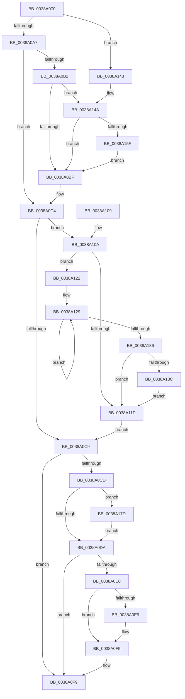

# KeRcuReadUnlock

- RVA: `0x0038A070`–`0x0038A190` (길이 `288` bytes)
- VA: `0x000000014038A070`
- 실행 섹션: `.text`
- PDB 이름 있음: `예`; PDB Function 태그: `아니요`
- unwind 정보 RVA: `0x0007FFB4`
- 디코드: `67`개 명령, `288/288` bytes 표시
- 미해석 바이트: `0` (있으면 어셈블리에 `.byte`로 보존)

> 이 문서는 커널 이미지의 기계어와 PDB 기호를 분석해 생성했습니다. 4번과 5번은 함수 원형과 자료형을 바이너리 사용 방식에서 추정한 C 해석이며 원본 소스 복구 결과는 아닙니다.

## 1. Dependencies

- 직접 호출 지점: **4**; 고유 호출 대상: **4**
- 직접 호출자로 확인된 함수: **14**
- RIP 상대 이미지 참조: **2**

### Outgoing calls
- `0x0038A091` → [KeDisableInterrupts](../21/KeDisableInterrupts_function_00217BE0.md) (function, `0x00217BE0`)
- `0x0038A0F0` → [KiLowerIrqlProcessIrqlFlags](../4F/KiLowerIrqlProcessIrqlFlags_function_004F5698.md) (function, `0x004F5698`)
- `0x0038A13C` → [KiRemoveSystemWorkPriorityKick](../26/KiRemoveSystemWorkPriorityKick_function_002631D0.md) (function, `0x002631D0`)
- `0x0038A186` → [KiRcuCheckQuiescent](../21/KiRcuCheckQuiescent_function_0021B110.md) (function, `0x0021B110`)

### Direct callers
- [CcFlushCachePreProcess](../35/CcFlushCachePreProcess_function_0035A9B0.md) at `0x0035AB40`
- [CcFlushCachePreProcess](../35/CcFlushCachePreProcess_function_0035A9B0.md) at `0x0035ABE2`
- [CcZeroData](CcZeroData_function_00387F00.md) at `0x00387F63`
- [CcCanIWrite](CcCanIWrite_function_00388250.md) at `0x00388399`
- [CcIsFileObjectDirectMapped](CcIsFileObjectDirectMapped_function_00388D10.md) at `0x00388D4C`
- [CcInitializeVolumeCacheMap](CcInitializeVolumeCacheMap_function_00389D60.md) at `0x00389DDA`
- [CcInitializeVolumeCacheMap](CcInitializeVolumeCacheMap_function_00389D60.md) at `0x00389E17`
- [CcForceWriteThrough](CcForceWriteThrough_function_00389E50.md) at `0x00389ECE`
- [CcScanLogHandleList](CcScanLogHandleList_function_0038A26C.md) at `0x0038A2F0`
- [CcScanLogHandleList](CcScanLogHandleList_function_0038A26C.md) at `0x0038A3E9`
- [CcGetFlushedValidData](../40/CcGetFlushedValidData_function_00402920.md) at `0x00402A18`
- [CcGetFlushedValidData](../40/CcGetFlushedValidData_function_00402920.md) at `0x00402A76`
- [CcPostVolumeTelemetry](../42/CcPostVolumeTelemetry_function_00420FF8.md) at `0x004211D1`
- [CcPerfLogLoggedStreamsStats](../4B/CcPerfLogLoggedStreamsStats_function_004B2400.md) at `0x004B2473`
- [CcUpdateTimeOnLogHandles](../4C/CcUpdateTimeOnLogHandles_function_004C6D0C.md) at `0x004C6D98`
- [CcDeferWrite](../57/CcDeferWrite_function_0057C860.md) at `0x0057C8E3`
- [CcPostVolumeTelemetry$fin$0](../6D/CcPostVolumeTelemetry_fin_0_function_006D30F5.md) at `0x006D3101`
- [sub_006E2C34](../6E/Unknown_function_006E2C34.md) at `0x006E2C5A`

### Static image references
- `0x0038A0E0` → RVA `0x00FC6D20` (`ALMOSTRO`; read)
- `0x0038A16A` → RVA `0x00F210E8` (`.data`; read)

## 2. Other-region calls and transfers

- 다른 실행 섹션으로 향하는 call: **0**
- 별도 외부 분기/꼬리 이동을 확인하지 못했습니다.

## 3. Assembly (complete function range)

```asm
0038A070  48 89 5C 24 08                  mov qword ptr [rsp + 8], rbx
0038A075  48 89 74 24 10                  mov qword ptr [rsp + 0x10], rsi
0038A07A  57                              push rdi
0038A07B  48 83 EC 20                     sub rsp, 0x20
0038A07F  65 48 8B 1C 25 20 00 00 00      mov rbx, qword ptr gs:[0x20]
0038A088  33 F6                           xor esi, esi
0038A08A  0F B6 BB E4 38 00 00            movzx edi, byte ptr [rbx + 0x38e4]
0038A091  E8 4A DB E8 FF                  call 0x140217be0
0038A096  44 8A C0                        mov r8b, al
0038A099  8B 83 E0 38 00 00               mov eax, dword ptr [rbx + 0x38e0]
0038A09F  85 C0                           test eax, eax
0038A0A1  0F 84 9C 00 00 00               je 0x14038a143
0038A0A7  83 E8 01                        sub eax, 1
0038A0AA  89 83 E0 38 00 00               mov dword ptr [rbx + 0x38e0], eax
0038A0B0  75 12                           jne 0x14038a0c4
0038A0B2  40 38 B3 E7 38 00 00            cmp byte ptr [rbx + 0x38e7], sil
0038A0B9  0F 8C 8B 00 00 00               jl 0x14038a14a
0038A0BF  BE 01 00 00 00                  mov esi, 1
0038A0C4  45 84 C0                        test r8b, r8b
0038A0C7  75 41                           jne 0x14038a10a
0038A0C9  85 F6                           test esi, esi
0038A0CB  74 2C                           je 0x14038a0f9
0038A0CD  80 BB E6 38 00 00 00            cmp byte ptr [rbx + 0x38e6], 0
0038A0D4  0F 85 A3 00 00 00               jne 0x14038a17d
0038A0DA  40 80 FF 02                     cmp dil, 2
0038A0DE  73 19                           jae 0x14038a0f9
0038A0E0  83 3D 39 CC C3 00 00            cmp dword ptr [rip + 0xc3cc39], 0
0038A0E7  74 0C                           je 0x14038a0f5
0038A0E9  44 0F 20 C1                     mov rcx, cr8
0038A0ED  40 8A D7                        mov dl, dil
0038A0F0  E8 A3 B5 16 00                  call 0x1404f5698
0038A0F5  44 0F 22 C7                     mov cr8, rdi
0038A0F9  48 8B 5C 24 30                  mov rbx, qword ptr [rsp + 0x30]
0038A0FE  48 8B 74 24 38                  mov rsi, qword ptr [rsp + 0x38]
0038A103  48 83 C4 20                     add rsp, 0x20
0038A107  5F                              pop rdi
0038A108  C3                              ret
0038A109  CC                              int3
0038A10A  65 48 8B 0C 25 20 00 00 00      mov rcx, qword ptr gs:[0x20]
0038A113  4C 8B 81 B8 8E 00 00            mov r8, qword ptr [rcx + 0x8eb8]
0038A11A  4D 85 C0                        test r8, r8
0038A11D  75 03                           jne 0x14038a122
0038A11F  FB                              sti
0038A120  EB A7                           jmp 0x14038a0c9
0038A122  41 0F 0D 08                     prefetchw byte ptr [r8]
0038A126  41 8B 00                        mov eax, dword ptr [r8]
0038A129  8B D0                           mov edx, eax
0038A12B  0F BA F2 15                     btr edx, 0x15
0038A12F  F0 41 0F B1 10                  lock cmpxchg dword ptr [r8], edx
0038A134  75 F3                           jne 0x14038a129
0038A136  0F BA E0 15                     bt eax, 0x15
0038A13A  73 E3                           jae 0x14038a11f
0038A13C  E8 8F 90 ED FF                  call 0x1402631d0
0038A141  EB DC                           jmp 0x14038a11f
0038A143  B9 0E 00 00 00                  mov ecx, 0xe
0038A148  CD 29                           int 0x29
0038A14A  F0 80 A3 E7 38 00 00 7F         lock and byte ptr [rbx + 0x38e7], 0x7f
0038A152  40 38 B3 E5 38 00 00            cmp byte ptr [rbx + 0x38e5], sil
0038A159  0F 84 60 FF FF FF               je 0x14038a0bf
0038A15F  40 88 B3 E5 38 00 00            mov byte ptr [rbx + 0x38e5], sil
0038A166  F0 09 34 24                     lock or dword ptr [rsp], esi
0038A16A  48 8B 05 77 6F B9 00            mov rax, qword ptr [rip + 0xb96f77]
0038A171  48 89 83 E8 38 00 00            mov qword ptr [rbx + 0x38e8], rax
0038A178  E9 42 FF FF FF                  jmp 0x14038a0bf
0038A17D  65 48 8B 0C 25 20 00 00 00      mov rcx, qword ptr gs:[0x20]
0038A186  E8 85 0F E9 FF                  call 0x14021b110
0038A18B  E9 4A FF FF FF                  jmp 0x14038a0da
```

## 4. C-style interpretation (structured pseudocode)

```c
__int64 __fastcall KeRcuReadUnlock(void)
{
    __int64 result;
    __int64 v_rsi;
    __int64 v_rsp;
    unsigned int v_stack_p0;
    unsigned __int64 v_stack_p10;
    unsigned __int64 v_stack_p8;

    v_stack_p8 = v_rbx;
    v_stack_p10 = v_rsi;
    v_rsp = (v_rsp) - (32);
    v_rsi = 0;
    result = KeDisableInterrupts(a1, a2, a3, a4);
    if ((unsigned int)((unsigned int)(*(unsigned int *)(*(unsigned __int64 *)(gs_base + (0 + 32)) + 14560))) == 0) goto loc_0038A143;
    result = (unsigned int)(((unsigned int)(*(unsigned int *)(*(unsigned __int64 *)(gs_base + (0 + 32)) + 14560))) - (1));
    *(unsigned int *)(*(unsigned __int64 *)(gs_base + (0 + 32)) + 14560) = (unsigned int)(result);
    if (condition_is_not_equal) goto loc_0038A0C4;
    if ((*(unsigned __int8 *)(*(unsigned __int64 *)(gs_base + (0 + 32)) + 14567)) < 0) goto loc_0038A14A;
loc_0038A0BF:
loc_0038A0C4:
    if ((unsigned __int8)((unsigned __int8)(result)) != 0) goto loc_0038A10A;
loc_0038A0C9:
    if (1 == 0) goto loc_0038A0F9;
    if ((*(unsigned __int8 *)(*(unsigned __int64 *)(gs_base + (0 + 32)) + 14566)) != 0) goto loc_0038A17D;
loc_0038A0DA:
    if (((unsigned __int8)(*(unsigned __int8 *)(*(unsigned __int64 *)(gs_base + (0 + 32)) + 14564))) >= 2) goto loc_0038A0F9;
    if ((*(unsigned int *)(v_rip + 12831801)) != 0) {
        a1 = v_cr8;
        a2 = (unsigned __int8)(*(unsigned __int8 *)(*(unsigned __int64 *)(gs_base + (0 + 32)) + 14564));
        result = KiLowerIrqlProcessIrqlFlags(a1, a2, (unsigned __int8)(result), a4);
    }
loc_0038A0F9:
    v_rsp = (v_rsp) + (32);
    return result;
loc_0038A10A:
    if (*(unsigned __int64 *)(*(unsigned __int64 *)(gs_base + (0 + 32)) + 36536) != 0) goto loc_0038A122;
loc_0038A11F:
    goto loc_0038A0C9;
loc_0038A122:
loc_0038A129:
    if (*(unsigned __int64 *)(*(unsigned __int64 *)(gs_base + (0 + 32)) + 36536) != 0) goto loc_0038A129;
    if (condition_is_above_or_equal) goto loc_0038A11F;
    result = KiRemoveSystemWorkPriorityKick(*(unsigned __int64 *)(gs_base + (0 + 32)), (unsigned int)((unsigned int)((unsigned int)(*(unsigned int *)(*(unsigned __int64 *)(*(unsigned __int64 *)(gs_base + (0 + 32)) + 36536))))), *(unsigned __int64 *)(*(unsigned __int64 *)(gs_base + (0 + 32)) + 36536), a4);
    goto loc_0038A11F;
loc_0038A143:
loc_0038A14A:
    if ((*(unsigned __int8 *)(v_stack_p8 + 14565)) == ((unsigned __int8)(v_stack_p10))) goto loc_0038A0BF;
    *(unsigned __int8 *)(v_stack_p8 + 14565) = (unsigned __int8)(v_stack_p10);
    *(unsigned __int64 *)(v_stack_p8 + 14568) = *(unsigned __int64 *)(v_rip + 12152695);
    goto loc_0038A0BF;
loc_0038A17D:
    result = KiRcuCheckQuiescent(*(unsigned __int64 *)(gs_base + (0 + 32)), (unsigned int)((unsigned int)((unsigned int)(*(unsigned int *)(*(unsigned __int64 *)(*(unsigned __int64 *)(gs_base + (0 + 32)) + 36536))))), *(unsigned __int64 *)(*(unsigned __int64 *)(gs_base + (0 + 32)) + 36536), a4);
    goto loc_0038A0DA;
}
```

## 5. (Beta) C Style

```c
void KeRcuReadUnlock(void)
{
    int64_t result;
    int64_t local_rsi;
    int64_t local_rsp;
    uint32_t v_stack_p0;
    uint64_t v_stack_p10;
    uint64_t v_stack_p8;

    v_stack_p8 = local_rbx;
    v_stack_p10 = local_rsi;
    local_rsp = (local_rsp) - (32);
    local_rsi = 0;
    result = KeDisableInterrupts(a1, a2, a3, a4);
    if ((uint32_t)((uint32_t)(*(uint32_t *)(*(uint64_t *)(gs_base + (0 + 0x20)) + 0x38E0))) == 0) goto loc_0038A143;
    result = (uint32_t)(((uint32_t)(*(uint32_t *)(*(uint64_t *)(gs_base + (0 + 0x20)) + 0x38E0))) - (1));
    *(uint32_t *)(*(uint64_t *)(gs_base + (0 + 0x20)) + 0x38E0) = (uint32_t)(result);
    if (condition_is_not_equal) goto loc_0038A0C4;
    if ((*(uint8_t *)(*(uint64_t *)(gs_base + (0 + 0x20)) + 0x38E7)) < 0) goto loc_0038A14A;
loc_0038A0BF:
loc_0038A0C4:
    if ((uint8_t)((uint8_t)(result)) != 0) goto loc_0038A10A;
loc_0038A0C9:
    if (1 == 0) goto loc_0038A0F9;
    if ((*(uint8_t *)(*(uint64_t *)(gs_base + (0 + 0x20)) + 0x38E6)) != 0) goto loc_0038A17D;
loc_0038A0DA:
    if (((uint8_t)(*(uint8_t *)(*(uint64_t *)(gs_base + (0 + 0x20)) + 0x38E4))) >= 2) goto loc_0038A0F9;
    if ((*(uint32_t *)(v_rip + 0xC3CC39)) != 0) {
        a1 = v_cr8;
        a2 = (uint8_t)(*(uint8_t *)(*(uint64_t *)(gs_base + (0 + 0x20)) + 0x38E4));
        result = KiLowerIrqlProcessIrqlFlags(a1, a2, (uint8_t)(result), a4);
    }
loc_0038A0F9:
    local_rsp = (local_rsp) + (32);
    return result;
loc_0038A10A:
    if (*(uint64_t *)(*(uint64_t *)(gs_base + (0 + 0x20)) + 0x8EB8) != 0) goto loc_0038A122;
loc_0038A11F:
    goto loc_0038A0C9;
loc_0038A122:
loc_0038A129:
    if (*(uint64_t *)(*(uint64_t *)(gs_base + (0 + 0x20)) + 0x8EB8) != 0) goto loc_0038A129;
    if (condition_is_above_or_equal) goto loc_0038A11F;
    result = KiRemoveSystemWorkPriorityKick(*(uint64_t *)(gs_base + (0 + 0x20)), (uint32_t)((uint32_t)((uint32_t)(*(uint32_t *)(*(uint64_t *)(*(uint64_t *)(gs_base + (0 + 0x20)) + 0x8EB8))))), *(uint64_t *)(*(uint64_t *)(gs_base + (0 + 0x20)) + 0x8EB8), a4);
    goto loc_0038A11F;
loc_0038A143:
loc_0038A14A:
    if ((*(uint8_t *)(v_stack_p8 + 0x38E5)) == ((uint8_t)(v_stack_p10))) goto loc_0038A0BF;
    *(uint8_t *)(v_stack_p8 + 0x38E5) = (uint8_t)(v_stack_p10);
    *(uint64_t *)(v_stack_p8 + 0x38E8) = *(uint64_t *)(v_rip + 0xB96F77);
    goto loc_0038A0BF;
loc_0038A17D:
    result = KiRcuCheckQuiescent(*(uint64_t *)(gs_base + (0 + 0x20)), (uint32_t)((uint32_t)((uint32_t)(*(uint32_t *)(*(uint64_t *)(*(uint64_t *)(gs_base + (0 + 0x20)) + 0x8EB8))))), *(uint64_t *)(*(uint64_t *)(gs_base + (0 + 0x20)) + 0x8EB8), a4);
    goto loc_0038A0DA;
}
```

## 6. Execution-region graph

[열기: 2D/3D 그래프와 함수 탐색 컨트롤 패널](../../../control-panel.html?section=text&rva=0x0038A070&view=graph)

- 2D 그래프는 위에서 아래로 흐르고, 3D 그래프는 빈 공간을 드래그해 회전합니다. Shift+드래그는 이동, 휠은 확대·축소, 함수 노드 선택은 대상 보고서 이동입니다.

### Static fallback


