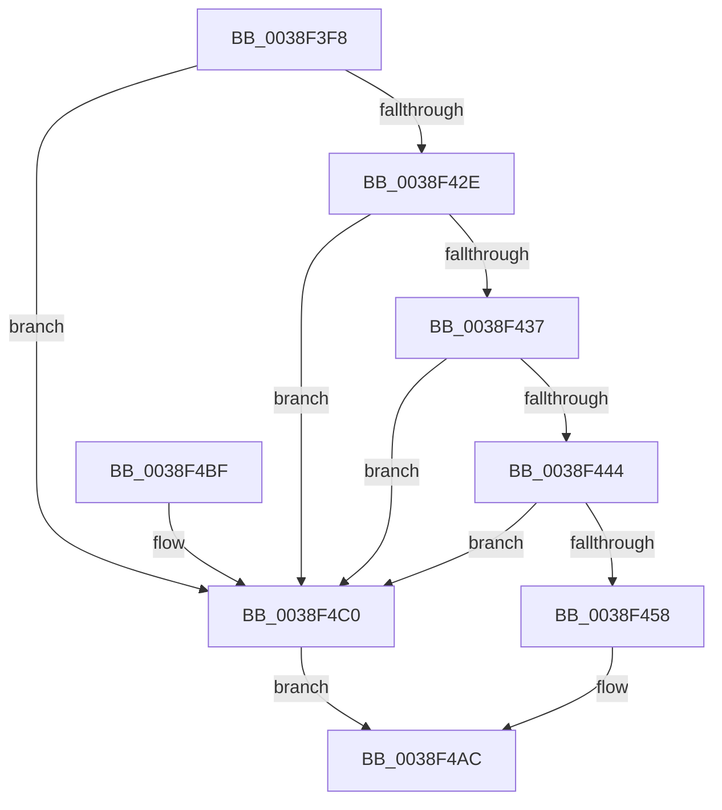

# LZNT1DecompressChunkNewThread

- RVA: `0x0038F3F8`–`0x0038F4DF` (길이 `231` bytes)
- VA: `0x000000014038F3F8`
- 실행 섹션: `.text`
- PDB 이름 있음: `예`; PDB Function 태그: `아니요`
- unwind 정보 RVA: `0x00080794`
- 디코드: `60`개 명령, `231/231` bytes 표시
- 미해석 바이트: `0` (있으면 어셈블리에 `.byte`로 보존)

> 이 문서는 커널 이미지의 기계어와 PDB 기호를 분석해 생성했습니다. 4번과 5번은 함수 원형과 자료형을 바이너리 사용 방식에서 추정한 C 해석이며 원본 소스 복구 결과는 아닙니다.

## 1. Dependencies

- 직접 호출 지점: **4**; 고유 호출 대상: **4**
- 직접 호출자로 확인된 함수: **2**
- RIP 상대 이미지 참조: **2**

### Outgoing calls
- `0x0038F44B` → [ExAllocateFromNPagedLookasideList](ExAllocateFromNPagedLookasideList_function_0038E6C0.md) (function, `0x0038E6C0`)
- `0x0038F49A` → [KeQueryPriorityThread](KeQueryPriorityThread_function_0038F4F0.md) (function, `0x0038F4F0`)
- `0x0038F4A5` → [ExQueueWorkItem](../2F/ExQueueWorkItem_function_002F9520.md) (function, `0x002F9520`)
- `0x0038F4D8` → [LZNT1DecompressChunk](../6B/LZNT1DecompressChunk_function_006BB050.md) (function, `0x006BB050`)

### Direct callers
- [sub_00AEC8DA](../../page/AE/Unknown_function_00AEC8DA.md) at `0x00AEC92A`
- [RtlDecompressFragmentLZNT1](../../page/AE/RtlDecompressFragmentLZNT1_function_00AECAF0.md) at `0x00AECC19`

### Static image references
- `0x0038F444` → RVA `0x00E28280` (`.data`; read)
- `0x0038F45C` → RVA `0x00448A20` (`LZNT1DecompressChunkWorkItem`; read)

## 2. Other-region calls and transfers

- 다른 실행 섹션으로 향하는 call: **0**
- 별도 외부 분기/꼬리 이동을 확인하지 못했습니다.

## 3. Assembly (complete function range)

```asm
0038F3F8  48 89 5C 24 08                  mov qword ptr [rsp + 8], rbx
0038F3FD  48 89 6C 24 18                  mov qword ptr [rsp + 0x18], rbp
0038F402  56                              push rsi
0038F403  57                              push rdi
0038F404  41 56                           push r14
0038F406  48 83 EC 30                     sub rsp, 0x30
0038F40A  83 64 24 58 00                  and dword ptr [rsp + 0x58], 0
0038F40F  48 B8 00 00 FF FF FF 7F 00 00   movabs rax, 0x7fffffff0000
0038F419  49 8B F1                        mov rsi, r9
0038F41C  49 8B E8                        mov rbp, r8
0038F41F  48 8B FA                        mov rdi, rdx
0038F422  4C 8B F1                        mov r14, rcx
0038F425  48 3B D0                        cmp rdx, rax
0038F428  0F 86 92 00 00 00               jbe 0x14038f4c0
0038F42E  4C 3B C8                        cmp r9, rax
0038F431  0F 86 89 00 00 00               jbe 0x14038f4c0
0038F437  48 63 44 24 78                  movsxd rax, dword ptr [rsp + 0x78]
0038F43C  4C 2B C2                        sub r8, rdx
0038F43F  4C 3B C0                        cmp r8, rax
0038F442  7C 7C                           jl 0x14038f4c0
0038F444  48 8D 0D 35 8E A9 00            lea rcx, [rip + 0xa98e35]
0038F44B  E8 70 F2 FF FF                  call 0x14038e6c0
0038F450  48 8B D8                        mov rbx, rax
0038F453  48 85 C0                        test rax, rax
0038F456  74 68                           je 0x14038f4c0
0038F458  48 83 23 00                     and qword ptr [rbx], 0
0038F45C  48 8D 05 BD 95 0B 00            lea rax, [rip + 0xb95bd]
0038F463  48 8B 4C 24 70                  mov rcx, qword ptr [rsp + 0x70]
0038F468  48 89 43 10                     mov qword ptr [rbx + 0x10], rax
0038F46C  48 89 5B 18                     mov qword ptr [rbx + 0x18], rbx
0038F470  48 89 4B 38                     mov qword ptr [rbx + 0x38], rcx
0038F474  48 8D 4B 48                     lea rcx, [rbx + 0x48]
0038F478  48 89 4B 40                     mov qword ptr [rbx + 0x40], rcx
0038F47C  48 89 7B 20                     mov qword ptr [rbx + 0x20], rdi
0038F480  48 89 6B 28                     mov qword ptr [rbx + 0x28], rbp
0038F484  48 89 73 30                     mov qword ptr [rbx + 0x30], rsi
0038F488  4C 89 73 50                     mov qword ptr [rbx + 0x50], r14
0038F48C  F0 41 FF 46 18                  lock inc dword ptr [r14 + 0x18]
0038F491  65 48 8B 0C 25 88 01 00 00      mov rcx, qword ptr gs:[0x188]
0038F49A  E8 51 00 00 00                  call 0x14038f4f0
0038F49F  48 8B CB                        mov rcx, rbx
0038F4A2  8D 50 20                        lea edx, [rax + 0x20]
0038F4A5  E8 76 A0 F6 FF                  call 0x1402f9520
0038F4AA  33 C0                           xor eax, eax
0038F4AC  48 8B 5C 24 50                  mov rbx, qword ptr [rsp + 0x50]
0038F4B1  48 8B 6C 24 60                  mov rbp, qword ptr [rsp + 0x60]
0038F4B6  48 83 C4 30                     add rsp, 0x30
0038F4BA  41 5E                           pop r14
0038F4BC  5F                              pop rdi
0038F4BD  5E                              pop rsi
0038F4BE  C3                              ret
0038F4BF  CC                              int3
0038F4C0  4C 8B 4C 24 70                  mov r9, qword ptr [rsp + 0x70]
0038F4C5  48 8D 44 24 58                  lea rax, [rsp + 0x58]
0038F4CA  4C 8B C6                        mov r8, rsi
0038F4CD  48 89 44 24 20                  mov qword ptr [rsp + 0x20], rax
0038F4D2  48 8B D5                        mov rdx, rbp
0038F4D5  48 8B CF                        mov rcx, rdi
0038F4D8  E8 73 BB 32 00                  call 0x1406bb050
0038F4DD  EB CD                           jmp 0x14038f4ac
```

## 4. C-style interpretation (structured pseudocode)

```c
__int64 __fastcall LZNT1DecompressChunkNewThread(__int64 a1, __int64 a2, __int64 a3, __int64 a4, __int64 a5, unsigned int a6)
{
    __int64 result;
    __int64 v_rsp;
    unsigned int v_stack_p10;
    unsigned __int64 v_stack_p18;
    unsigned __int64 v_stack_p20;
    unsigned __int64 v_stack_p58;
    unsigned __int64 v_stack_p8;

    v_stack_p8 = v_rbx;
    v_stack_p18 = v_rbp;
    v_rsp = (v_rsp) - (48);
    if (a2 <= result) goto loc_0038F4C0;
    if (a4 <= result) goto loc_0038F4C0;
    a3 = (a3) - (a2);
    if (a3 < ((int)(a6))) goto loc_0038F4C0;
    result = ExAllocateFromNPagedLookasideList(v_rip + 11111989, a2, a3, a4);
    if (result == 0) goto loc_0038F4C0;
    *(unsigned __int64 *)(result + 16) = v_rip + 759229;
    *(unsigned __int64 *)(result + 24) = result;
    *(unsigned __int64 *)(result + 56) = a5;
    *(unsigned __int64 *)(result + 64) = result + 72;
    *(unsigned __int64 *)(result + 32) = a2;
    *(unsigned __int64 *)(result + 40) = a3;
    *(unsigned __int64 *)(result + 48) = a4;
    *(unsigned __int64 *)(result + 80) = a1;
    result = KeQueryPriorityThread(*(unsigned __int64 *)(gs_base + (0 + 392)), a2, a3, a4);
    result = ExQueueWorkItem(result, result + 32, a3, a4);
    result = 0;
loc_0038F4AC:
    v_rsp = (v_rsp) + (48);
    return result;
loc_0038F4C0:
    v_stack_p20 = v_stack_p58;
    result = LZNT1DecompressChunk(a2, v_stack_p18, a4, a5);
    goto loc_0038F4AC;
}
```

## 5. (Beta) C Style

```c
int64_t LZNT1DecompressChunkNewThread(void *Arg1, int64_t Arg2, int64_t Arg3, int64_t Arg4, int64_t Arg5, uint32_t Arg6)
{
    uint8_t *arg1 = (uint8_t *)Arg1;

    int64_t result;
    int64_t local_rsp;
    uint32_t v_stack_p10;
    uint64_t v_stack_p18;
    uint64_t v_stack_p20;
    uint64_t v_stack_p58;
    uint64_t v_stack_p8;

    v_stack_p8 = local_rbx;
    v_stack_p18 = local_rbp;
    local_rsp = (local_rsp) - (48);
    if (Arg2 <= result) goto loc_0038F4C0;
    if (Arg4 <= result) goto loc_0038F4C0;
    Arg3 = (Arg3) - (Arg2);
    if (Arg3 < ((int32_t)(Arg6))) goto loc_0038F4C0;
    result = ExAllocateFromNPagedLookasideList(v_rip + 11111989, Arg2, Arg3, Arg4);
    if (result == 0) goto loc_0038F4C0;
    *(uint64_t *)(result + 0x10) = v_rip + 759229;
    *(uint64_t *)(result + 0x18) = result;
    *(uint64_t *)(result + 0x38) = Arg5;
    *(uint64_t *)(result + 0x40) = result + 72;
    *(uint64_t *)(result + 0x20) = Arg2;
    *(uint64_t *)(result + 0x28) = Arg3;
    *(uint64_t *)(result + 0x30) = Arg4;
    *(void **)(result + 0x50) = Arg1;
    result = KeQueryPriorityThread(*(uint64_t *)(gs_base + (0 + 0x188)), Arg2, Arg3, Arg4);
    result = ExQueueWorkItem(result, result + 32, Arg3, Arg4);
    result = 0;
loc_0038F4AC:
    local_rsp = (local_rsp) + (48);
    return result;
loc_0038F4C0:
    v_stack_p20 = v_stack_p58;
    result = LZNT1DecompressChunk(Arg2, v_stack_p18, Arg4, Arg5);
    goto loc_0038F4AC;
}
```

### 관측된 메모리 오프셋

구조체 형식이 확인되지 않은 접근은 인자 기준의 오프셋으로만 기록했습니다.

| 기준 인자 | 오프셋 표현 | 폭 (bit) | 접근 |
|---|---:|---:|---|
| `Arg1` | `+ 0x18` | `32` | `R/W` |

## 6. Execution-region graph

[열기: 2D/3D 그래프와 함수 탐색 컨트롤 패널](../../../control-panel.html?section=text&rva=0x0038F3F8&view=graph)

- 2D 그래프는 위에서 아래로 흐르고, 3D 그래프는 빈 공간을 드래그해 회전합니다. Shift+드래그는 이동, 휠은 확대·축소, 함수 노드 선택은 대상 보고서 이동입니다.

### Static fallback


