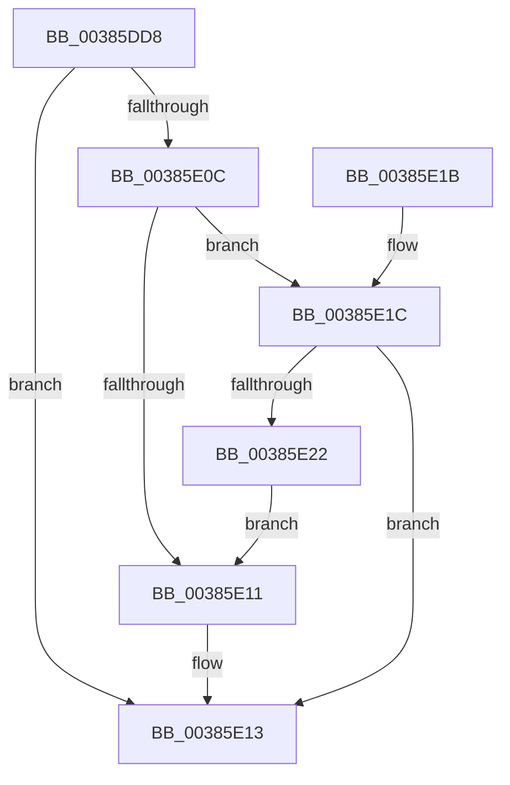

# MI_IS_PTE_IN_WS_SWAP_SET

- RVA: `0x00385DD8`–`0x00385E24` (길이 `76` bytes)
- VA: `0x0000000140385DD8`
- 실행 섹션: `.text`
- PDB 이름 있음: `예`; PDB Function 태그: `아니요`
- unwind 정보 RVA: `0x0007BD2C`
- 디코드: `25`개 명령, `76/76` bytes 표시
- 미해석 바이트: `0` (있으면 어셈블리에 `.byte`로 보존)

> 이 문서는 커널 이미지의 기계어와 PDB 기호를 분석해 생성했습니다. 4번과 5번은 함수 원형과 자료형을 바이너리 사용 방식에서 추정한 C 해석이며 원본 소스 복구 결과는 아닙니다.

## 1. Dependencies

- 직접 호출 지점: **1**; 고유 호출 대상: **1**
- 직접 호출자로 확인된 함수: **5**
- RIP 상대 이미지 참조: **0**

### Outgoing calls
- `0x00385DE4` → [MI_READ_PTE_LOCK_FREE](../28/MI_READ_PTE_LOCK_FREE_function_002828A0.md) (function, `0x002828A0`)

### Direct callers
- [MiAbandonPrivatePfn](../22/MiAbandonPrivatePfn_function_0022F548.md) at `0x0022F5E3`
- [MiDecommitHandleTransitionPte](../24/MiDecommitHandleTransitionPte_function_0024037C.md) at `0x0024062C`
- [MiReservePageFileSpace](MiReservePageFileSpace_function_00383ED8.md) at `0x003841A7`
- [MiAddToReservationCluster](../40/MiAddToReservationCluster_function_00405474.md) at `0x004055C4`
- [sub_006D7C5C](../6D/Unknown_function_006D7C5C.md) at `0x006D7CC4`

### Static image references
- 디코드된 RIP-relative 메모리 참조가 없습니다.

## 2. Other-region calls and transfers

- 다른 실행 섹션으로 향하는 call: **0**
- 별도 외부 분기/꼬리 이동을 확인하지 못했습니다.

## 3. Assembly (complete function range)

```asm
00385DD8  40 53                           push rbx
00385DDA  48 83 EC 20                     sub rsp, 0x20
00385DDE  48 8B D9                        mov rbx, rcx
00385DE1  48 8B CA                        mov rcx, rdx
00385DE4  E8 B7 CA EF FF                  call 0x1402828a0
00385DE9  48 8B C8                        mov rcx, rax
00385DEC  48 C1 E9 0C                     shr rcx, 0xc
00385DF0  83 E1 0F                        and ecx, 0xf
00385DF3  48 8B 8C CB 60 48 00 00         mov rcx, qword ptr [rbx + rcx*8 + 0x4860]
00385DFB  0F B7 91 AC 00 00 00            movzx edx, word ptr [rcx + 0xac]
00385E02  B9 01 00 00 00                  mov ecx, 1
00385E07  F6 C2 10                        test dl, 0x10
00385E0A  75 07                           jne 0x140385e13
00385E0C  F6 C2 20                        test dl, 0x20
00385E0F  75 0B                           jne 0x140385e1c
00385E11  33 C9                           xor ecx, ecx
00385E13  8B C1                           mov eax, ecx
00385E15  48 83 C4 20                     add rsp, 0x20
00385E19  5B                              pop rbx
00385E1A  C3                              ret
00385E1B  CC                              int3
00385E1C  D0 E8                           shr al, 1
00385E1E  84 C1                           test cl, al
00385E20  75 F1                           jne 0x140385e13
00385E22  EB ED                           jmp 0x140385e11
```

## 4. C-style interpretation (structured pseudocode)

```c
__int64 __fastcall MI_IS_PTE_IN_WS_SWAP_SET(__int64 a1, __int64 a2)
{
    __int64 result;
    __int64 v_rsp;

    v_rsp = (v_rsp) - (32);
    result = MI_READ_PTE_LOCK_FREE(a2, a2, a3, a4);
    a1 = (result) >> (12);
    a1 = (unsigned int)((a1) & (15));
    if ((((unsigned __int8)(*(unsigned __int16 *)(*(unsigned __int64 *)(a1 + a1 * 8 + 18528) + 172))) & (16)) != 0) goto loc_00385E13;
    if ((((unsigned __int8)(*(unsigned __int16 *)(*(unsigned __int64 *)(a1 + a1 * 8 + 18528) + 172))) & (32)) != 0) goto loc_00385E1C;
loc_00385E11:
    a1 = 0;
loc_00385E13:
    v_rsp = (v_rsp) + (32);
    return 0;
loc_00385E1C:
    result = (unsigned __int8)((0) >> (1));
    if (((0) & ((unsigned __int8)(result))) != 0) goto loc_00385E13;
    goto loc_00385E11;
}
```

## 5. (Beta) C Style

```c
int64_t MI_IS_PTE_IN_WS_SWAP_SET(void *Arg1, int64_t Arg2)
{
    uint8_t *arg1 = (uint8_t *)Arg1;

    int64_t result;
    int64_t local_rsp;

    local_rsp = (local_rsp) - (32);
    result = MI_READ_PTE_LOCK_FREE(Arg2, Arg2, a3, a4);
    Arg1 = (result) >> (12);
    Arg1 = (uint32_t)((Arg1) & (15));
    if ((((uint8_t)(*(uint16_t *)(*(uint64_t *)(arg1 + arg1 * 8 + 0x4860) + 0xAC))) & (16)) != 0) goto loc_00385E13;
    if ((((uint8_t)(*(uint16_t *)(*(uint64_t *)(arg1 + arg1 * 8 + 0x4860) + 0xAC))) & (32)) != 0) goto loc_00385E1C;
loc_00385E11:
    Arg1 = 0;
loc_00385E13:
    local_rsp = (local_rsp) + (32);
    return 0;
loc_00385E1C:
    result = (uint8_t)((0) >> (1));
    if (((0) & ((uint8_t)(result))) != 0) goto loc_00385E13;
    goto loc_00385E11;
}
```

### 관측된 메모리 오프셋

구조체 형식이 확인되지 않은 접근은 인자 기준의 오프셋으로만 기록했습니다.

| 기준 인자 | 오프셋 표현 | 폭 (bit) | 접근 |
|---|---:|---:|---|
| `Arg1` | `+ 0x4860 + rcx*8` | `64` | `R` |

## 6. Execution-region graph

[열기: 2D/3D 그래프와 함수 탐색 컨트롤 패널](../../../control-panel.html?section=text&rva=0x00385DD8&view=graph)

- 2D 그래프는 위에서 아래로 흐르고, 3D 그래프는 빈 공간을 드래그해 회전합니다. Shift+드래그는 이동, 휠은 확대·축소, 함수 노드 선택은 대상 보고서 이동입니다.

### Static fallback


