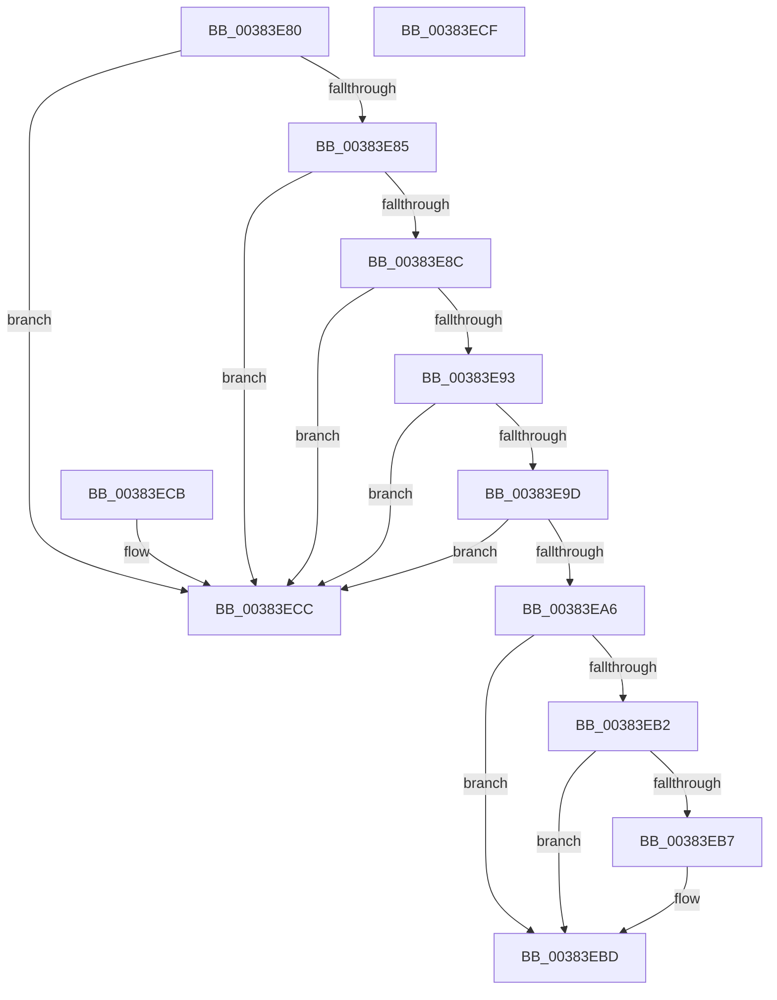

# MI_IS_RESET_PTE

- RVA: `0x00383E80`–`0x00383ED0` (길이 `80` bytes)
- VA: `0x0000000140383E80`
- 실행 섹션: `.text`
- PDB 이름 있음: `예`; PDB Function 태그: `아니요`
- unwind 정보 RVA: `0x000DB714`
- 디코드: `30`개 명령, `80/80` bytes 표시
- 미해석 바이트: `0` (있으면 어셈블리에 `.byte`로 보존)

> 이 문서는 커널 이미지의 기계어와 PDB 기호를 분석해 생성했습니다. 4번과 5번은 함수 원형과 자료형을 바이너리 사용 방식에서 추정한 C 해석이며 원본 소스 복구 결과는 아닙니다.

## 1. Dependencies

- 직접 호출 지점: **0**; 고유 호출 대상: **0**
- 직접 호출자로 확인된 함수: **4**
- RIP 상대 이미지 참조: **1**

### Outgoing calls
- 직접 디코드된 call 명령이 없습니다.

### Direct callers
- [MiActOnPte](../24/MiActOnPte_function_00244C90.md) at `0x0024508C`
- [MiActOnPte](../24/MiActOnPte_function_00244C90.md) at `0x0024522E`
- [MiActOnPte](../24/MiActOnPte_function_00244C90.md) at `0x00245757`
- [MiCombineCandidate](../31/MiCombineCandidate_function_00316290.md) at `0x003164EC`
- [MiCombineCandidate](../31/MiCombineCandidate_function_00316290.md) at `0x00316506`
- [MiRestoreTransitionPte](../33/MiRestoreTransitionPte_function_0033DD90.md) at `0x0033E082`
- [MiRestoreTransitionPte](../33/MiRestoreTransitionPte_function_0033DD90.md) at `0x0033E13B`
- [MiReservePageFileSpaceForPage](MiReservePageFileSpaceForPage_function_0038377C.md) at `0x0038388A`
- [MiReservePageFileSpaceForPage](MiReservePageFileSpaceForPage_function_0038377C.md) at `0x00383A79`

### Static image references
- `0x00383EA6` → RVA `0x00E2DC80` (`.data`; read)

## 2. Other-region calls and transfers

- 다른 실행 섹션으로 향하는 call: **0**
- 별도 외부 분기/꼬리 이동을 확인하지 못했습니다.

## 3. Assembly (complete function range)

```asm
00383E80  F6 C1 01                        test cl, 1
00383E83  75 47                           jne 0x140383ecc
00383E85  48 0F BA E1 0A                  bt rcx, 0xa
00383E8A  72 40                           jb 0x140383ecc
00383E8C  48 0F BA E1 0B                  bt rcx, 0xb
00383E91  72 39                           jb 0x140383ecc
00383E93  0F B6 C1                        movzx eax, cl
00383E96  C0 E8 02                        shr al, 2
00383E99  A8 01                           test al, 1
00383E9B  75 2F                           jne 0x140383ecc
00383E9D  0F B6 C1                        movzx eax, cl
00383EA0  D0 E8                           shr al, 1
00383EA2  A8 01                           test al, 1
00383EA4  75 26                           jne 0x140383ecc
00383EA6  48 8B 05 D3 9D AA 00            mov rax, qword ptr [rip + 0xaa9dd3]
00383EAD  48 85 C0                        test rax, rax
00383EB0  74 0B                           je 0x140383ebd
00383EB2  F6 C1 10                        test cl, 0x10
00383EB5  75 06                           jne 0x140383ebd
00383EB7  48 F7 D0                        not rax
00383EBA  48 23 C8                        and rcx, rax
00383EBD  33 C0                           xor eax, eax
00383EBF  48 C1 E9 20                     shr rcx, 0x20
00383EC3  48 83 F9 01                     cmp rcx, 1
00383EC7  0F 94 C0                        sete al
00383ECA  C3                              ret
00383ECB  CC                              int3
00383ECC  33 C0                           xor eax, eax
00383ECE  C3                              ret
00383ECF  CC                              int3
```

## 4. C-style interpretation (structured pseudocode)

```c
__int64 __fastcall MI_IS_RESET_PTE(__int64 a1)
{
    __int64 result;

    if ((((unsigned __int8)(a1)) & (1)) != 0) goto loc_00383ECC;
    if (condition_is_below) goto loc_00383ECC;
    if (condition_is_below) goto loc_00383ECC;
    result = (unsigned __int8)(((unsigned __int8)(a1)) >> (2));
    if ((((unsigned __int8)(result)) & (1)) != 0) goto loc_00383ECC;
    result = (unsigned __int8)(((unsigned __int8)(a1)) >> (1));
    if ((((unsigned __int8)(result)) & (1)) != 0) goto loc_00383ECC;
    if (*(unsigned __int64 *)(v_rip + 11181523) == 0) goto loc_00383EBD;
    result = *(unsigned __int64 *)(v_rip + 11181523);
    if ((((unsigned __int8)(a1)) & (16)) == 0) {
        result = ~(*(unsigned __int64 *)(v_rip + 11181523));
        a1 = (a1) & (result);
    }
    result = 0;
    a1 = (a1) >> (32);
    result = (a1 == 1) ? 1 : 0;
    return result;
loc_00383ECC:
    result = 0;
    return result;
}
```

## 5. (Beta) C Style

```c
int64_t MI_IS_RESET_PTE(int64_t Arg1)
{
    int64_t result;

    if ((((uint8_t)(Arg1)) & (1)) != 0) goto loc_00383ECC;
    if (condition_is_below) goto loc_00383ECC;
    if (condition_is_below) goto loc_00383ECC;
    result = (uint8_t)(((uint8_t)(Arg1)) >> (2));
    if ((((uint8_t)(result)) & (1)) != 0) goto loc_00383ECC;
    result = (uint8_t)(((uint8_t)(Arg1)) >> (1));
    if ((((uint8_t)(result)) & (1)) != 0) goto loc_00383ECC;
    if (*(uint64_t *)(v_rip + 0xAA9DD3) == 0) goto loc_00383EBD;
    result = *(uint64_t *)(v_rip + 0xAA9DD3);
    if ((((uint8_t)(Arg1)) & (16)) == 0) {
        result = ~(*(uint64_t *)(v_rip + 0xAA9DD3));
        Arg1 = (Arg1) & (result);
    }
    result = 0;
    Arg1 = (Arg1) >> (32);
    result = (Arg1 == 1) ? 1 : 0;
    return result;
loc_00383ECC:
    result = 0;
    return result;
}
```

## 6. Execution-region graph

[열기: 2D/3D 그래프와 함수 탐색 컨트롤 패널](../../../control-panel.html?section=text&rva=0x00383E80&view=graph)

- 2D 그래프는 위에서 아래로 흐르고, 3D 그래프는 빈 공간을 드래그해 회전합니다. Shift+드래그는 이동, 휠은 확대·축소, 함수 노드 선택은 대상 보고서 이동입니다.

### Static fallback


