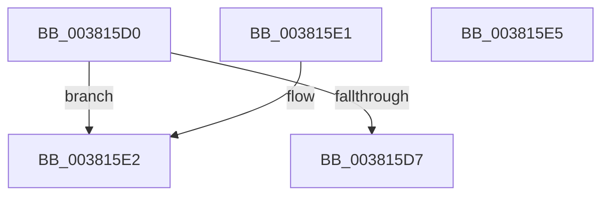

# MI_IS_SOFTWARE_PTE_SHADOW_STACK

- RVA: `0x003815D0`–`0x003815E6` (길이 `22` bytes)
- VA: `0x00000001403815D0`
- 실행 섹션: `.text`
- PDB 이름 있음: `예`; PDB Function 태그: `아니요`
- unwind 정보 RVA: `0x000DB714`
- 디코드: `10`개 명령, `22/22` bytes 표시
- 미해석 바이트: `0` (있으면 어셈블리에 `.byte`로 보존)

> 이 문서는 커널 이미지의 기계어와 PDB 기호를 분석해 생성했습니다. 4번과 5번은 함수 원형과 자료형을 바이너리 사용 방식에서 추정한 C 해석이며 원본 소스 복구 결과는 아닙니다.

## 1. Dependencies

- 직접 호출 지점: **0**; 고유 호출 대상: **0**
- 직접 호출자로 확인된 함수: **5**
- RIP 상대 이미지 참조: **0**

### Outgoing calls
- 직접 디코드된 call 명령이 없습니다.

### Direct callers
- [MiHandleForkTransitionPte](../22/MiHandleForkTransitionPte_function_0022D34C.md) at `0x0022D582`
- [MiBuildForkPte](../22/MiBuildForkPte_function_0022E32C.md) at `0x0022E446`
- [MiBuildForkPte](../22/MiBuildForkPte_function_0022E32C.md) at `0x0022E831`
- [MiBuildForkPte](../22/MiBuildForkPte_function_0022E32C.md) at `0x0022ED3B`
- [MiCombineCandidate](../31/MiCombineCandidate_function_00316290.md) at `0x003164F8`
- [MiCombineCandidate](../31/MiCombineCandidate_function_00316290.md) at `0x00316512`
- [MiIssueHardFault](MiIssueHardFault_function_00380074.md) at `0x003803DF`
- [MiDuplicateCloneLeaf](MiDuplicateCloneLeaf_function_003825F0.md) at `0x00382665`

### Static image references
- 디코드된 RIP-relative 메모리 참조가 없습니다.

## 2. Other-region calls and transfers

- 다른 실행 섹션으로 향하는 call: **0**
- 별도 외부 분기/꼬리 이동을 확인하지 못했습니다.

## 3. Assembly (complete function range)

```asm
003815D0  48 0F BA E1 0A                  bt rcx, 0xa
003815D5  72 0B                           jb 0x1403815e2
003815D7  48 C1 E9 1A                     shr rcx, 0x1a
003815DB  83 E1 01                        and ecx, 1
003815DE  8B C1                           mov eax, ecx
003815E0  C3                              ret
003815E1  CC                              int3
003815E2  33 C0                           xor eax, eax
003815E4  C3                              ret
003815E5  CC                              int3
```

## 4. C-style interpretation (structured pseudocode)

```c
__int64 __fastcall MI_IS_SOFTWARE_PTE_SHADOW_STACK(__int64 a1)
{
    __int64 result;

    if (condition_is_below) goto loc_003815E2;
    a1 = (a1) >> (26);
    a1 = (unsigned int)((a1) & (1));
    return (unsigned int)((unsigned int)(a1));
loc_003815E2:
    result = 0;
    return result;
}
```

## 5. (Beta) C Style

```c
int64_t MI_IS_SOFTWARE_PTE_SHADOW_STACK(int64_t Arg1)
{
    int64_t result;

    if (condition_is_below) goto loc_003815E2;
    Arg1 = (Arg1) >> (26);
    Arg1 = (uint32_t)((Arg1) & (1));
    return (uint32_t)((uint32_t)(Arg1));
loc_003815E2:
    result = 0;
    return result;
}
```

## 6. Execution-region graph

[열기: 2D/3D 그래프와 함수 탐색 컨트롤 패널](../../../control-panel.html?section=text&rva=0x003815D0&view=graph)

- 2D 그래프는 위에서 아래로 흐르고, 3D 그래프는 빈 공간을 드래그해 회전합니다. Shift+드래그는 이동, 휠은 확대·축소, 함수 노드 선택은 대상 보고서 이동입니다.

### Static fallback


