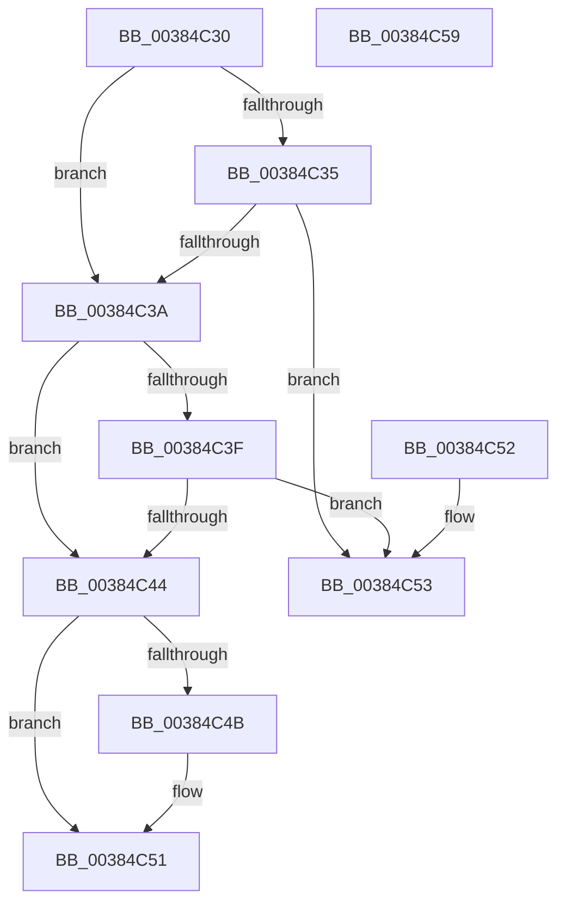

# MI_TIGHTER_PERMISSIONS

- RVA: `0x00384C30`–`0x00384C5A` (길이 `42` bytes)
- VA: `0x0000000140384C30`
- 실행 섹션: `.text`
- PDB 이름 있음: `예`; PDB Function 태그: `아니요`
- unwind 정보 RVA: `0x000DB714`
- 디코드: `18`개 명령, `42/42` bytes 표시
- 미해석 바이트: `0` (있으면 어셈블리에 `.byte`로 보존)

> 이 문서는 커널 이미지의 기계어와 PDB 기호를 분석해 생성했습니다. 4번과 5번은 함수 원형과 자료형을 바이너리 사용 방식에서 추정한 C 해석이며 원본 소스 복구 결과는 아닙니다.

## 1. Dependencies

- 직접 호출 지점: **0**; 고유 호출 대상: **0**
- 직접 호출자로 확인된 함수: **4**
- RIP 상대 이미지 참조: **0**

### Outgoing calls
- 직접 디코드된 call 명령이 없습니다.

### Direct callers
- [MmSetAddressRangeModifiedEx](../23/MmSetAddressRangeModifiedEx_function_00236F20.md) at `0x002374B5`
- [MmProtectPool](../26/MmProtectPool_function_002697AC.md) at `0x00269D0A`
- [MmProtectPool](../26/MmProtectPool_function_002697AC.md) at `0x00269D22`
- [MiSetSystemCodeProtection](MiSetSystemCodeProtection_function_00384420.md) at `0x003845BB`
- [MiProtectEnclavePages](../4D/MiProtectEnclavePages_function_004D5528.md) at `0x004D598E`

### Static image references
- 디코드된 RIP-relative 메모리 참조가 없습니다.

## 2. Other-region calls and transfers

- 다른 실행 섹션으로 향하는 call: **0**
- 별도 외부 분기/꼬리 이동을 확인하지 못했습니다.

## 3. Assembly (complete function range)

```asm
00384C30  F6 C2 40                        test dl, 0x40
00384C33  75 05                           jne 0x140384c3a
00384C35  F6 C1 40                        test cl, 0x40
00384C38  75 19                           jne 0x140384c53
00384C3A  F6 C2 02                        test dl, 2
00384C3D  75 05                           jne 0x140384c44
00384C3F  F6 C1 02                        test cl, 2
00384C42  75 0F                           jne 0x140384c53
00384C44  33 C0                           xor eax, eax
00384C46  48 85 D2                        test rdx, rdx
00384C49  79 06                           jns 0x140384c51
00384C4B  48 85 C9                        test rcx, rcx
00384C4E  0F 99 C0                        setns al
00384C51  C3                              ret
00384C52  CC                              int3
00384C53  B8 01 00 00 00                  mov eax, 1
00384C58  C3                              ret
00384C59  CC                              int3
```

## 4. C-style interpretation (structured pseudocode)

```c
__int64 __fastcall MI_TIGHTER_PERMISSIONS(__int64 a1, __int64 a2)
{
    __int64 result;

    if ((((unsigned __int8)(a2)) & (64)) != 0) goto loc_00384C3A;
    if ((((unsigned __int8)(a1)) & (64)) != 0) goto loc_00384C53;
loc_00384C3A:
    if ((((unsigned __int8)(a2)) & (2)) != 0) goto loc_00384C44;
    if ((((unsigned __int8)(a1)) & (2)) != 0) goto loc_00384C53;
loc_00384C44:
    result = 0;
    if (sign_flag) {
        result = (!sign_flag) ? 1 : 0;
    }
    return result;
loc_00384C53:
    return 1;
}
```

## 5. (Beta) C Style

```c
int64_t MI_TIGHTER_PERMISSIONS(int64_t Arg1, int64_t Arg2)
{
    int64_t result;

    if ((((uint8_t)(Arg2)) & (64)) != 0) goto loc_00384C3A;
    if ((((uint8_t)(Arg1)) & (64)) != 0) goto loc_00384C53;
loc_00384C3A:
    if ((((uint8_t)(Arg2)) & (2)) != 0) goto loc_00384C44;
    if ((((uint8_t)(Arg1)) & (2)) != 0) goto loc_00384C53;
loc_00384C44:
    result = 0;
    if (sign_flag) {
        result = (!sign_flag) ? 1 : 0;
    }
    return result;
loc_00384C53:
    return 1;
}
```

## 6. Execution-region graph

[열기: 2D/3D 그래프와 함수 탐색 컨트롤 패널](../../../control-panel.html?section=text&rva=0x00384C30&view=graph)

- 2D 그래프는 위에서 아래로 흐르고, 3D 그래프는 빈 공간을 드래그해 회전합니다. Shift+드래그는 이동, 휠은 확대·축소, 함수 노드 선택은 대상 보고서 이동입니다.

### Static fallback


