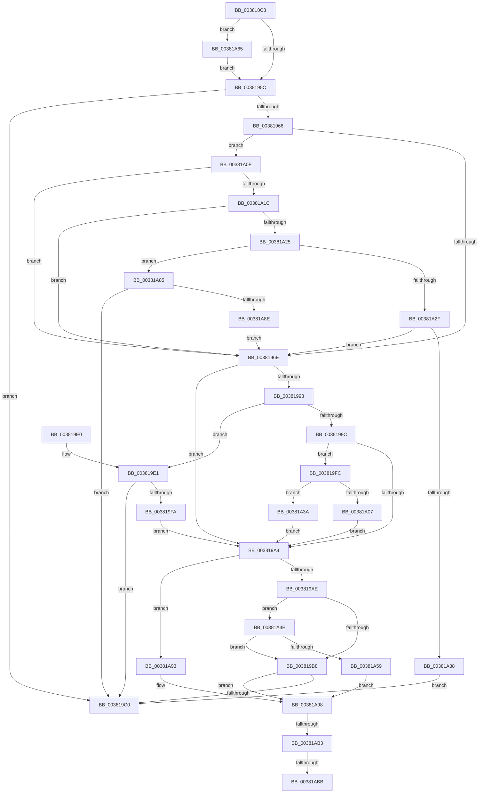

# MiArePagefileContentsCorrupted

- RVA: `0x003818C8`–`0x00381AC2` (길이 `506` bytes)
- VA: `0x00000001403818C8`
- 실행 섹션: `.text`
- PDB 이름 있음: `예`; PDB Function 태그: `예`
- unwind 정보 RVA: `0x0007BA20`
- 디코드: `140`개 명령, `506/506` bytes 표시
- 미해석 바이트: `0` (있으면 어셈블리에 `.byte`로 보존)

> 이 문서는 커널 이미지의 기계어와 PDB 기호를 분석해 생성했습니다. 4번과 5번은 함수 원형과 자료형을 바이너리 사용 방식에서 추정한 C 해석이며 원본 소스 복구 결과는 아닙니다.

## 1. Dependencies

- 직접 호출 지점: **5**; 고유 호출 대상: **4**
- 직접 호출자로 확인된 함수: **2**
- RIP 상대 이미지 참조: **6**

### Outgoing calls
- `0x00381942` → [MiGetPagingFileOffset](../36/MiGetPagingFileOffset_function_0036F530.md) (function, `0x0036F530`)
- `0x00381978` → [MiGetPagingFileOffset](../36/MiGetPagingFileOffset_function_0036F530.md) (function, `0x0036F530`)
- `0x00381988` → [MiComputePageHash](MiComputePageHash_function_00381C20.md) (function, `0x00381C20`)
- `0x003819EF` → [MiLateWritePageHash](../4D/MiLateWritePageHash_function_004D4148.md) (function, `0x004D4148`)
- `0x00381A76` → [MiObtainPagefileHashes](MiObtainPagefileHashes_function_00381AC8.md) (function, `0x00381AC8`)

### Direct callers
- [sub_0038167C](Unknown_function_0038167C.md) at `0x00381785`
- [MiIsStandbyPageCorrupted](../4D/MiIsStandbyPageCorrupted_function_004DEE50.md) at `0x004DEEE3`

### Static image references
- `0x00381918` → RVA `0x00E30088` (`.data`; read)
- `0x0038199C` → RVA `0x00E37390` (`.data`; read)
- `0x00381A0E` → RVA `0x00FC5200` (`ALMOSTRO`; read)
- `0x00381A98` → RVA `0x00E30258` (`.data`; read/write)
- `0x00381A9E` → RVA `0x00E30254` (`.data`; read)
- `0x00381AA4` → RVA `0x00E30268` (`.data`; write)

## 2. Other-region calls and transfers

- 다른 실행 섹션으로 향하는 call: **0**
- call이 아닌 외부 분기/꼬리 이동: **3**
  - `0x00381AAD` → [sub_006E4766 + 0x7](../6E/Unknown_function_006E4766.md) (`tail-transfer`)
  - `0x00381AB5` → [sub_006E4766](../6E/Unknown_function_006E4766.md) (`tail-transfer`)
  - `0x00381ABD` → [sub_006E4766](../6E/Unknown_function_006E4766.md) (`tail-transfer`)

## 3. Assembly (complete function range)

```asm
003818C8  48 8B C4                        mov rax, rsp
003818CB  48 89 58 08                     mov qword ptr [rax + 8], rbx
003818CF  48 89 68 10                     mov qword ptr [rax + 0x10], rbp
003818D3  48 89 70 18                     mov qword ptr [rax + 0x18], rsi
003818D7  57                              push rdi
003818D8  41 54                           push r12
003818DA  41 55                           push r13
003818DC  41 56                           push r14
003818DE  41 57                           push r15
003818E0  48 83 EC 50                     sub rsp, 0x50
003818E4  0F 57 C0                        xorps xmm0, xmm0
003818E7  48 8D 2C 49                     lea rbp, [rcx + rcx*2]
003818EB  0F 57 C9                        xorps xmm1, xmm1
003818EE  48 C1 E5 04                     shl rbp, 4
003818F2  0F 11 40 B8                     movups xmmword ptr [rax - 0x48], xmm0
003818F6  45 8B E8                        mov r13d, r8d
003818F9  48 8B F2                        mov rsi, rdx
003818FC  0F 11 48 C8                     movups xmmword ptr [rax - 0x38], xmm1
00381900  4C 8B E1                        mov r12, rcx
00381903  48 B8 00 00 00 00 00 DE FF FF   movabs rax, 0xffffde0000000000
0038190D  48 03 E8                        add rbp, rax
00381910  48 8B 45 28                     mov rax, qword ptr [rbp + 0x28]
00381914  48 8B 5D 10                     mov rbx, qword ptr [rbp + 0x10]
00381918  48 8B 0D 69 E7 AA 00            mov rcx, qword ptr [rip + 0xaae769]
0038191F  4C 8B C3                        mov r8, rbx
00381922  48 C1 E8 2B                     shr rax, 0x2b
00381926  25 FF 03 00 00                  and eax, 0x3ff
0038192B  49 C1 E8 0C                     shr r8, 0xc
0038192F  41 83 E0 0F                     and r8d, 0xf
00381933  48 8B 14 C1                     mov rdx, qword ptr [rcx + rax*8]
00381937  48 8B CB                        mov rcx, rbx
0038193A  4E 8B BC C2 60 48 00 00         mov r15, qword ptr [rdx + r8*8 + 0x4860]
00381942  E8 E9 DB FE FF                  call 0x14036f530
00381947  48 C1 EB 05                     shr rbx, 5
0038194B  33 FF                           xor edi, edi
0038194D  83 E3 1F                        and ebx, 0x1f
00381950  44 8B F0                        mov r14d, eax
00381953  48 85 F6                        test rsi, rsi
00381956  0F 84 09 01 00 00               je 0x140381a65
0038195C  8B 0E                           mov ecx, dword ptr [rsi]
0038195E  8D 41 FE                        lea eax, [rcx - 2]
00381961  83 F8 01                        cmp eax, 1
00381964  76 5A                           jbe 0x1403819c0
00381966  85 C9                           test ecx, ecx
00381968  0F 84 A0 00 00 00               je 0x140381a0e
0038196E  4C 8B 45 08                     mov r8, qword ptr [rbp + 8]
00381972  8B DF                           mov ebx, edi
00381974  48 8B 4D 10                     mov rcx, qword ptr [rbp + 0x10]
00381978  E8 B3 DB FE FF                  call 0x14036f530
0038197D  44 8B C8                        mov r9d, eax
00381980  48 8D 4C 24 30                  lea rcx, [rsp + 0x30]
00381985  49 8B D4                        mov rdx, r12
00381988  E8 93 02 00 00                  call 0x140381c20
0038198D  8B 06                           mov eax, dword ptr [rsi]
0038198F  BD 01 00 00 00                  mov ebp, 1
00381994  3B C5                           cmp eax, ebp
00381996  74 0C                           je 0x1403819a4
00381998  85 C0                           test eax, eax
0038199A  74 45                           je 0x1403819e1
0038199C  39 3D EE 59 AB 00               cmp dword ptr [rip + 0xab59ee], edi
003819A2  75 58                           jne 0x1403819fc
003819A4  8B 06                           mov eax, dword ptr [rsi]
003819A6  3B C5                           cmp eax, ebp
003819A8  0F 84 E5 00 00 00               je 0x140381a93
003819AE  3B 44 24 30                     cmp eax, dword ptr [rsp + 0x30]
003819B2  0F 85 96 00 00 00               jne 0x140381a4e
003819B8  85 DB                           test ebx, ebx
003819BA  0F 85 D8 00 00 00               jne 0x140381a98
003819C0  33 C0                           xor eax, eax
003819C2  4C 8D 5C 24 50                  lea r11, [rsp + 0x50]
003819C7  49 8B 5B 30                     mov rbx, qword ptr [r11 + 0x30]
003819CB  49 8B 6B 38                     mov rbp, qword ptr [r11 + 0x38]
003819CF  49 8B 73 40                     mov rsi, qword ptr [r11 + 0x40]
003819D3  49 8B E3                        mov rsp, r11
003819D6  41 5F                           pop r15
003819D8  41 5E                           pop r14
003819DA  41 5D                           pop r13
003819DC  41 5C                           pop r12
003819DE  5F                              pop rdi
003819DF  C3                              ret
003819E0  CC                              int3
003819E1  4C 8D 4C 24 30                  lea r9, [rsp + 0x30]
003819E6  4C 8B C6                        mov r8, rsi
003819E9  41 8B D6                        mov edx, r14d
003819EC  49 8B CF                        mov rcx, r15
003819EF  E8 54 27 15 00                  call 0x1404d4148
003819F4  8B D8                           mov ebx, eax
003819F6  85 C0                           test eax, eax
003819F8  74 C6                           je 0x1403819c0
003819FA  EB A8                           jmp 0x1403819a4
003819FC  48 8B 44 24 38                  mov rax, qword ptr [rsp + 0x38]
00381A01  48 39 46 08                     cmp qword ptr [rsi + 8], rax
00381A05  74 33                           je 0x140381a3a
00381A07  BB 3B 00 00 00                  mov ebx, 0x3b
00381A0C  EB 96                           jmp 0x1403819a4
00381A0E  8B 05 EC 37 C4 00               mov eax, dword ptr [rip + 0xc437ec]
00381A14  A8 01                           test al, 1
00381A16  0F 85 52 FF FF FF               jne 0x14038196e
00381A1C  83 FB 1F                        cmp ebx, 0x1f
00381A1F  0F 84 49 FF FF FF               je 0x14038196e
00381A25  8B C3                           mov eax, ebx
00381A27  C1 E8 03                        shr eax, 3
00381A2A  83 F8 03                        cmp eax, 3
00381A2D  74 56                           je 0x140381a85
00381A2F  83 F8 01                        cmp eax, 1
00381A32  0F 85 36 FF FF FF               jne 0x14038196e
00381A38  EB 86                           jmp 0x1403819c0
00381A3A  8B 44 24 34                     mov eax, dword ptr [rsp + 0x34]
00381A3E  B9 38 00 00 00                  mov ecx, 0x38
00381A43  39 46 04                        cmp dword ptr [rsi + 4], eax
00381A46  0F 45 D9                        cmovne ebx, ecx
00381A49  E9 56 FF FF FF                  jmp 0x1403819a4
00381A4E  83 C0 FE                        add eax, -2
00381A51  3B C5                           cmp eax, ebp
00381A53  0F 86 5F FF FF FF               jbe 0x1403819b8
00381A59  F7 DB                           neg ebx
00381A5B  1B DB                           sbb ebx, ebx
00381A5D  83 E3 FA                        and ebx, 0xfffffffa
00381A60  83 C3 3F                        add ebx, 0x3f
00381A63  EB 33                           jmp 0x140381a98
00381A65  4C 8D 4C 24 40                  lea r9, [rsp + 0x40]
00381A6A  41 B8 01 00 00 00               mov r8d, 1
00381A70  41 8B D6                        mov edx, r14d
00381A73  49 8B CF                        mov rcx, r15
00381A76  E8 4D 00 00 00                  call 0x140381ac8
00381A7B  48 8D 74 24 40                  lea rsi, [rsp + 0x40]
00381A80  E9 D7 FE FF FF                  jmp 0x14038195c
00381A85  F6 C3 07                        test bl, 7
00381A88  0F 85 32 FF FF FF               jne 0x1403819c0
00381A8E  E9 DB FE FF FF                  jmp 0x14038196e
00381A93  BB 3C 00 00 00                  mov ebx, 0x3c
00381A98  01 2D BA E7 AA 00               add dword ptr [rip + 0xaae7ba], ebp
00381A9E  8B 0D B0 E7 AA 00               mov ecx, dword ptr [rip + 0xaae7b0]
00381AA4  4C 89 25 BD E7 AA 00            mov qword ptr [rip + 0xaae7bd], r12
00381AAB  85 C9                           test ecx, ecx
00381AAD  0F 84 BA 2C 36 00               je 0x1406e476d
00381AB3  3B CD                           cmp ecx, ebp
00381AB5  0F 85 AB 2C 36 00               jne 0x1406e4766
00381ABB  8B FD                           mov edi, ebp
00381ABD  E9 A4 2C 36 00                  jmp 0x1406e4766
```

## 4. C-style interpretation (structured pseudocode)

```c
__int64 __fastcall MiArePagefileContentsCorrupted(__int64 a1, __int64 a2, int a3)
{
    __int64 result;
    __int64 v_rbp;
    __int64 v_rbx;
    __int64 v_rdi;
    __int64 v_rsp;
    unsigned __int64 v_stack_m10;
    unsigned __int64 v_stack_m18;
    unsigned int v_stack_m1C;
    unsigned __int64 v_stack_m20;
    unsigned __int64 v_stack_m28;
    unsigned __int64 v_stack_m48;

    *(unsigned __int64 *)(v_rsp + 8) = v_rbx;
    *(unsigned __int64 *)(v_rsp + 16) = v_rbp;
    *(unsigned __int64 *)(v_rsp + 24) = v_rsi;
    v_rsp = (v_rsp) - (80);
    v_rbp = (a1 + a1 * 2) << (4);
    *(unsigned __int64 *)(v_rsp - 72) = v_xmm0;
    *(unsigned __int64 *)(v_rsp - 56) = v_xmm1;
    v_rbp = (v_rbp) + (v_rsp);
    result = (*(unsigned __int64 *)(v_rbp + 40)) >> (43);
    result = (unsigned int)((result) & (0x3FFULL));
    a3 = (*(unsigned __int64 *)(v_rbp + 16)) >> (12);
    a3 = (unsigned int)((a3) & (15));
    result = MiGetPagingFileOffset(*(unsigned __int64 *)(v_rbp + 16), *(unsigned __int64 *)(*(unsigned __int64 *)(v_rip + 11200361) + result * 8), a3, a4);
    v_rbx = (*(unsigned __int64 *)(v_rbp + 16)) >> (5);
    v_rdi = 0;
    v_rbx = (unsigned int)((v_rbx) & (31));
    if (a2 == 0) goto loc_00381A65;
loc_0038195C:
    if (((unsigned int)((unsigned int)(*(unsigned int *)(a2)) - 2)) <= 1) goto loc_003819C0;
    if ((unsigned int)((unsigned int)(*(unsigned int *)(a2))) == 0) goto loc_00381A0E;
loc_0038196E:
    result = MiGetPagingFileOffset(*(unsigned __int64 *)(v_rbp + 16), *(unsigned __int64 *)(*(unsigned __int64 *)(v_rip + 11200361) + result * 8), *(unsigned __int64 *)(v_rbp + 8), a4);
    result = MiComputePageHash(v_stack_m48, a1, *(unsigned __int64 *)(v_rbp + 8), (unsigned int)((unsigned int)(result)));
    if (((unsigned int)((unsigned int)(*(unsigned int *)(a2)))) == 1) goto loc_003819A4;
    if ((unsigned int)((unsigned int)(*(unsigned int *)(a2))) == 0) goto loc_003819E1;
    if ((*(unsigned int *)(v_rip + 11229678)) != 0) goto loc_003819FC;
loc_003819A4:
    if (((unsigned int)((unsigned int)(*(unsigned int *)(a2)))) == 1) goto loc_00381A93;
    if (((unsigned int)((unsigned int)(*(unsigned int *)(a2)))) != v_stack_m48) goto loc_00381A4E;
loc_003819B8:
    if (0 != 0) goto loc_00381A98;
loc_003819C0:
    result = 0;
    return result;
loc_003819E1:
    result = MiLateWritePageHash(*(unsigned __int64 *)(*(unsigned __int64 *)(*(unsigned __int64 *)(v_rip + 11200361) + result * 8) + a3 * 8 + 18528), (unsigned int)((unsigned int)((unsigned int)((unsigned int)(result)))), *(unsigned __int64 *)(v_stack_m28 + 64), v_stack_m20);
    if ((unsigned int)(result) == 0) goto loc_003819C0;
    goto loc_003819A4;
loc_003819FC:
    if ((*(unsigned __int64 *)(*(unsigned __int64 *)(v_stack_m28 + 64) + 8)) == v_stack_m18) goto loc_00381A3A;
    goto loc_003819A4;
loc_00381A0E:
    if ((((unsigned __int8)((unsigned int)(*(unsigned int *)(v_rip + 12859372)))) & (1)) != 0) goto loc_0038196E;
    if (59 == 31) goto loc_0038196E;
    result = (unsigned int)((59) >> (3));
    if (((unsigned int)(result)) == 3) goto loc_00381A85;
    if (((unsigned int)(result)) != 1) goto loc_0038196E;
    goto loc_003819C0;
loc_00381A3A:
    v_rbx = 59;
    if ((*(unsigned int *)(*(unsigned __int64 *)(v_stack_m28 + 64) + 4)) != ((unsigned int)((unsigned int)(v_stack_m1C)))) { v_rbx = 56; }
    goto loc_003819A4;
loc_00381A4E:
    result = (unsigned int)(((unsigned int)(v_stack_m1C)) + (-2));
    if (((unsigned int)(result)) <= ((unsigned int)(*(unsigned __int64 *)(v_stack_m28 + 56)))) goto loc_003819B8;
    v_rbx = (unsigned int)(-(v_rbx));
    v_rbx = (unsigned int)((v_rbx) & (0xFFFFFFFAULL));
    v_rbx = (unsigned int)((v_rbx) + (63));
    goto loc_00381A98;
loc_00381A65:
    result = MiObtainPagefileHashes(*(unsigned __int64 *)(*(unsigned __int64 *)(*(unsigned __int64 *)(v_rip + 11200361) + result * 8) + a3 * 8 + 18528), (unsigned int)((unsigned int)((unsigned int)((unsigned int)(result)))), 1, v_stack_m10);
    goto loc_0038195C;
loc_00381A85:
    if ((((unsigned __int8)(v_rbx)) & (7)) != 0) goto loc_003819C0;
    goto loc_0038196E;
loc_00381A93:
loc_00381A98:
    *(unsigned __int64 *)(v_rip + 11200445) = a1;
}
```

## 5. (Beta) C Style

```c
int64_t MiArePagefileContentsCorrupted(void *Arg1, int64_t Arg2, int32_t Arg3)
{
    uint8_t *arg1 = (uint8_t *)Arg1;

    int64_t result;
    int64_t local_rbp;
    int64_t local_rbx;
    int64_t local_rdi;
    int64_t local_rsp;
    uint64_t v_stack_m10;
    uint64_t v_stack_m18;
    uint32_t v_stack_m1C;
    uint64_t v_stack_m20;
    uint64_t v_stack_m28;
    uint64_t v_stack_m48;

    *(uint64_t *)(local_rsp + 0x8) = local_rbx;
    *(uint64_t *)(local_rsp + 0x10) = local_rbp;
    *(uint64_t *)(local_rsp + 0x18) = local_rsi;
    local_rsp = (local_rsp) - (80);
    local_rbp = (Arg1 + Arg1 * 2) << (4);
    *(uint64_t *)(local_rsp - 0x48) = v_xmm0;
    *(uint64_t *)(local_rsp - 0x38) = v_xmm1;
    local_rbp = (local_rbp) + (local_rsp);
    result = (*(uint64_t *)(local_rbp + 0x28)) >> (43);
    result = (uint32_t)((result) & (0x3FFULL));
    Arg3 = (*(uint64_t *)(local_rbp + 0x10)) >> (12);
    Arg3 = (uint32_t)((Arg3) & (15));
    result = MiGetPagingFileOffset(*(uint64_t *)(local_rbp + 0x10), *(uint64_t *)(*(uint64_t *)(v_rip + 0xAAE769) + result * 8), Arg3, a4);
    local_rbx = (*(uint64_t *)(local_rbp + 0x10)) >> (5);
    local_rdi = 0;
    local_rbx = (uint32_t)((local_rbx) & (31));
    if (Arg2 == 0) goto loc_00381A65;
loc_0038195C:
    if (((uint32_t)((uint32_t)(*(uint32_t *)(Arg2)) - 2)) <= 1) goto loc_003819C0;
    if ((uint32_t)((uint32_t)(*(uint32_t *)(Arg2))) == 0) goto loc_00381A0E;
loc_0038196E:
    result = MiGetPagingFileOffset(*(uint64_t *)(local_rbp + 0x10), *(uint64_t *)(*(uint64_t *)(v_rip + 0xAAE769) + result * 8), *(uint64_t *)(local_rbp + 0x8), a4);
    result = MiComputePageHash(v_stack_m48, Arg1, *(uint64_t *)(local_rbp + 0x8), (uint32_t)((uint32_t)(result)));
    if (((uint32_t)((uint32_t)(*(uint32_t *)(Arg2)))) == 1) goto loc_003819A4;
    if ((uint32_t)((uint32_t)(*(uint32_t *)(Arg2))) == 0) goto loc_003819E1;
    if ((*(uint32_t *)(v_rip + 0xAB59EE)) != 0) goto loc_003819FC;
loc_003819A4:
    if (((uint32_t)((uint32_t)(*(uint32_t *)(Arg2)))) == 1) goto loc_00381A93;
    if (((uint32_t)((uint32_t)(*(uint32_t *)(Arg2)))) != v_stack_m48) goto loc_00381A4E;
loc_003819B8:
    if (0 != 0) goto loc_00381A98;
loc_003819C0:
    result = 0;
    return result;
loc_003819E1:
    result = MiLateWritePageHash(*(uint64_t *)(*(uint64_t *)(*(uint64_t *)(v_rip + 0xAAE769) + result * 8) + Arg3 * 8 + 0x4860), (uint32_t)((uint32_t)((uint32_t)((uint32_t)(result)))), *(uint64_t *)(v_stack_m28 + 0x40), v_stack_m20);
    if ((uint32_t)(result) == 0) goto loc_003819C0;
    goto loc_003819A4;
loc_003819FC:
    if ((*(uint64_t *)(*(uint64_t *)(v_stack_m28 + 0x40) + 0x8)) == v_stack_m18) goto loc_00381A3A;
    goto loc_003819A4;
loc_00381A0E:
    if ((((uint8_t)((uint32_t)(*(uint32_t *)(v_rip + 0xC437EC)))) & (1)) != 0) goto loc_0038196E;
    if (59 == 31) goto loc_0038196E;
    result = (uint32_t)((59) >> (3));
    if (((uint32_t)(result)) == 3) goto loc_00381A85;
    if (((uint32_t)(result)) != 1) goto loc_0038196E;
    goto loc_003819C0;
loc_00381A3A:
    local_rbx = 59;
    if ((*(uint32_t *)(*(uint64_t *)(v_stack_m28 + 0x40) + 0x4)) != ((uint32_t)((uint32_t)(v_stack_m1C)))) { local_rbx = 56; }
    goto loc_003819A4;
loc_00381A4E:
    result = (uint32_t)(((uint32_t)(v_stack_m1C)) + (-2));
    if (((uint32_t)(result)) <= ((uint32_t)(*(uint64_t *)(v_stack_m28 + 0x38)))) goto loc_003819B8;
    local_rbx = (uint32_t)(-(local_rbx));
    local_rbx = (uint32_t)((local_rbx) & (0xFFFFFFFAULL));
    local_rbx = (uint32_t)((local_rbx) + (63));
    goto loc_00381A98;
loc_00381A65:
    result = MiObtainPagefileHashes(*(uint64_t *)(*(uint64_t *)(*(uint64_t *)(v_rip + 0xAAE769) + result * 8) + Arg3 * 8 + 0x4860), (uint32_t)((uint32_t)((uint32_t)((uint32_t)(result)))), 1, v_stack_m10);
    goto loc_0038195C;
loc_00381A85:
    if ((((uint8_t)(local_rbx)) & (7)) != 0) goto loc_003819C0;
    goto loc_0038196E;
loc_00381A93:
loc_00381A98:
    *(void **)(v_rip + 0xAAE7BD) = Arg1;
}
```

### 관측된 메모리 오프셋

구조체 형식이 확인되지 않은 접근은 인자 기준의 오프셋으로만 기록했습니다.

| 기준 인자 | 오프셋 표현 | 폭 (bit) | 접근 |
|---|---:|---:|---|
| `Arg1` | `+ 0x0 + rcx*2` | `64` | `R` |

## 6. Execution-region graph

[열기: 2D/3D 그래프와 함수 탐색 컨트롤 패널](../../../control-panel.html?section=text&rva=0x003818C8&view=graph)

- 2D 그래프는 위에서 아래로 흐르고, 3D 그래프는 빈 공간을 드래그해 회전합니다. Shift+드래그는 이동, 휠은 확대·축소, 함수 노드 선택은 대상 보고서 이동입니다.

### Static fallback


