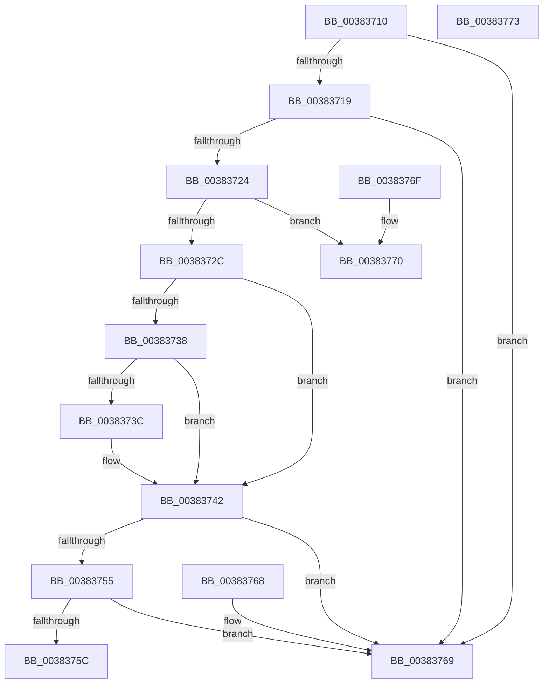

# MiCanPageMove

- RVA: `0x00383710`–`0x00383774` (길이 `100` bytes)
- VA: `0x0000000140383710`
- 실행 섹션: `.text`
- PDB 이름 있음: `예`; PDB Function 태그: `아니요`
- unwind 정보 RVA: `0x000DB714`
- 디코드: `35`개 명령, `100/100` bytes 표시
- 미해석 바이트: `0` (있으면 어셈블리에 `.byte`로 보존)

> 이 문서는 커널 이미지의 기계어와 PDB 기호를 분석해 생성했습니다. 4번과 5번은 함수 원형과 자료형을 바이너리 사용 방식에서 추정한 C 해석이며 원본 소스 복구 결과는 아닙니다.

## 1. Dependencies

- 직접 호출 지점: **0**; 고유 호출 대상: **0**
- 직접 호출자로 확인된 함수: **6**
- RIP 상대 이미지 참조: **1**

### Outgoing calls
- 직접 디코드된 call 명령이 없습니다.

### Direct callers
- [sub_0023D97B](../23/Unknown_function_0023D97B.md) at `0x0023D99C`
- [MiTradeTransitionPage](../28/MiTradeTransitionPage_function_0028B9AC.md) at `0x0028B9E4`
- [MiTradeTransitionPage](../28/MiTradeTransitionPage_function_0028B9AC.md) at `0x0028BBDC`
- [MiMigratePfn](../28/MiMigratePfn_function_0028DBB0.md) at `0x0028DC42`
- [MiValidateInPage](MiValidateInPage_function_00382E0C.md) at `0x00383142`
- [MiReplaceLockedPage](MiReplaceLockedPage_function_0038351C.md) at `0x00383575`
- [MiSwapNumaStandbyPage](MiSwapNumaStandbyPage_function_00385144.md) at `0x00385263`

### Static image references
- `0x0038372C` → RVA `0x00E2DC80` (`.data`; read)

## 2. Other-region calls and transfers

- 다른 실행 섹션으로 향하는 call: **0**
- 별도 외부 분기/꼬리 이동을 확인하지 못했습니다.

## 3. Assembly (complete function range)

```asm
00383710  48 8B 41 28                     mov rax, qword ptr [rcx + 0x28]
00383714  48 85 C0                        test rax, rax
00383717  79 50                           jns 0x140383769
00383719  48 8B 41 10                     mov rax, qword ptr [rcx + 0x10]
0038371D  48 0F BA E0 0A                  bt rax, 0xa
00383722  73 45                           jae 0x140383769
00383724  48 0F BA 61 28 35               bt qword ptr [rcx + 0x28], 0x35
0038372A  72 44                           jb 0x140383770
0038372C  48 8B 0D 4D A5 AA 00            mov rcx, qword ptr [rip + 0xaaa54d]
00383733  48 85 C9                        test rcx, rcx
00383736  74 0A                           je 0x140383742
00383738  A8 10                           test al, 0x10
0038373A  75 06                           jne 0x140383742
0038373C  48 F7 D1                        not rcx
0038373F  48 23 C1                        and rax, rcx
00383742  48 C1 F8 10                     sar rax, 0x10
00383746  48 8B 10                        mov rdx, qword ptr [rax]
00383749  48 8D 8A 80 00 00 00            lea rcx, [rdx + 0x80]
00383750  48 3B C1                        cmp rax, rcx
00383753  74 14                           je 0x140383769
00383755  8B 42 38                        mov eax, dword ptr [rdx + 0x38]
00383758  A8 20                           test al, 0x20
0038375A  74 0D                           je 0x140383769
0038375C  8B 42 5C                        mov eax, dword ptr [rdx + 0x5c]
0038375F  C1 E8 11                        shr eax, 0x11
00383762  F7 D0                           not eax
00383764  83 E0 01                        and eax, 1
00383767  C3                              ret
00383768  CC                              int3
00383769  B8 01 00 00 00                  mov eax, 1
0038376E  C3                              ret
0038376F  CC                              int3
00383770  33 C0                           xor eax, eax
00383772  C3                              ret
00383773  CC                              int3
```

## 4. C-style interpretation (structured pseudocode)

```c
__int64 __fastcall MiCanPageMove(__int64 a1)
{
    __int64 result;

    if (!sign_flag) goto loc_00383769;
    if (condition_is_above_or_equal) goto loc_00383769;
    if (condition_is_below) goto loc_00383770;
    if (*(unsigned __int64 *)(v_rip + 11183437) == 0) goto loc_00383742;
    result = *(unsigned __int64 *)(a1 + 16);
    if ((((unsigned __int8)(*(unsigned __int64 *)(a1 + 16))) & (16)) == 0) {
        a1 = ~(*(unsigned __int64 *)(v_rip + 11183437));
        result = (*(unsigned __int64 *)(a1 + 16)) & (a1);
    }
    result = (result) >> (16);
    if (result == (*(unsigned __int64 *)(result) + 128)) goto loc_00383769;
    if ((((unsigned __int8)((unsigned int)(*(unsigned int *)(*(unsigned __int64 *)(result) + 56)))) & (32)) == 0) goto loc_00383769;
    result = (unsigned int)(((unsigned int)(*(unsigned int *)(*(unsigned __int64 *)(result) + 92))) >> (17));
    result = (unsigned int)(~(result));
    result = (unsigned int)((result) & (1));
    return result;
loc_00383769:
    return 1;
loc_00383770:
    result = 0;
    return result;
}
```

## 5. (Beta) C Style

```c
int64_t MiCanPageMove(void *Arg1)
{
    uint8_t *arg1 = (uint8_t *)Arg1;

    int64_t result;

    if (!sign_flag) goto loc_00383769;
    if (condition_is_above_or_equal) goto loc_00383769;
    if (condition_is_below) goto loc_00383770;
    if (*(uint64_t *)(v_rip + 0xAAA54D) == 0) goto loc_00383742;
    result = *(uint64_t *)(arg1 + 0x10);
    if ((((uint8_t)(*(uint64_t *)(arg1 + 0x10))) & (16)) == 0) {
        Arg1 = ~(*(uint64_t *)(v_rip + 0xAAA54D));
        result = (*(uint64_t *)(arg1 + 0x10)) & (Arg1);
    }
    result = (result) >> (16);
    if (result == (*(uint64_t *)(result) + 128)) goto loc_00383769;
    if ((((uint8_t)((uint32_t)(*(uint32_t *)(*(uint64_t *)(result) + 0x38)))) & (32)) == 0) goto loc_00383769;
    result = (uint32_t)(((uint32_t)(*(uint32_t *)(*(uint64_t *)(result) + 0x5C))) >> (17));
    result = (uint32_t)(~(result));
    result = (uint32_t)((result) & (1));
    return result;
loc_00383769:
    return 1;
loc_00383770:
    result = 0;
    return result;
}
```

### 관측된 메모리 오프셋

구조체 형식이 확인되지 않은 접근은 인자 기준의 오프셋으로만 기록했습니다.

| 기준 인자 | 오프셋 표현 | 폭 (bit) | 접근 |
|---|---:|---:|---|
| `Arg1` | `+ 0x10` | `64` | `R` |
| `Arg1` | `+ 0x28` | `64` | `R` |

## 6. Execution-region graph

[열기: 2D/3D 그래프와 함수 탐색 컨트롤 패널](../../../control-panel.html?section=text&rva=0x00383710&view=graph)

- 2D 그래프는 위에서 아래로 흐르고, 3D 그래프는 빈 공간을 드래그해 회전합니다. Shift+드래그는 이동, 휠은 확대·축소, 함수 노드 선택은 대상 보고서 이동입니다.

### Static fallback


