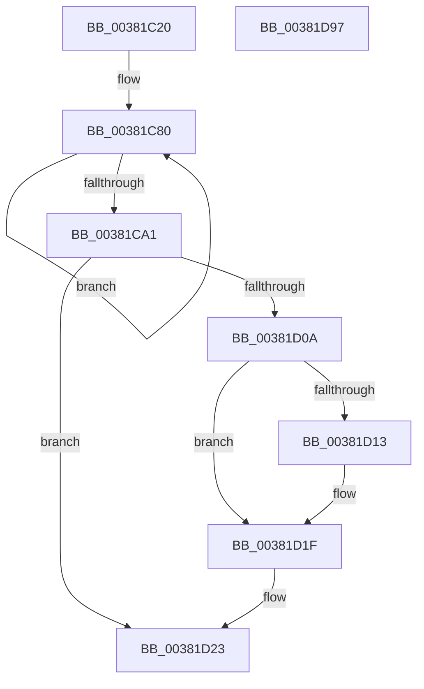

# MiComputePageHash

- RVA: `0x00381C20`–`0x00381D98` (길이 `376` bytes)
- VA: `0x0000000140381C20`
- 실행 섹션: `.text`
- PDB 이름 있음: `예`; PDB Function 태그: `아니요`
- unwind 정보 RVA: `0x0007BA84`
- 디코드: `93`개 명령, `376/376` bytes 표시
- 미해석 바이트: `0` (있으면 어셈블리에 `.byte`로 보존)

> 이 문서는 커널 이미지의 기계어와 PDB 기호를 분석해 생성했습니다. 4번과 5번은 함수 원형과 자료형을 바이너리 사용 방식에서 추정한 C 해석이며 원본 소스 복구 결과는 아닙니다.

## 1. Dependencies

- 직접 호출 지점: **2**; 고유 호출 대상: **2**
- 직접 호출자로 확인된 함수: **2**
- RIP 상대 이미지 참조: **2**

### Outgoing calls
- `0x00381C51` → [MiMapPageInHyperSpaceWorker](../33/MiMapPageInHyperSpaceWorker_function_00332B10.md) (function, `0x00332B10`)
- `0x00381D1A` → [KiLowerIrqlProcessIrqlFlags](../4F/KiLowerIrqlProcessIrqlFlags_function_004F5698.md) (function, `0x004F5698`)

### Direct callers
- [MiArePagefileContentsCorrupted](MiArePagefileContentsCorrupted_function_003818C8.md) at `0x00381988`
- [MiWritePageFileHash](MiWritePageFileHash_function_00381DC8.md) at `0x00381FC1`

### Static image references
- `0x00381CF4` → RVA `0x00010880` (`.rdata`; read)
- `0x00381D0A` → RVA `0x00FC6D20` (`ALMOSTRO`; read)

## 2. Other-region calls and transfers

- 다른 실행 섹션으로 향하는 call: **0**
- 별도 외부 분기/꼬리 이동을 확인하지 못했습니다.

## 3. Assembly (complete function range)

```asm
00381C20  48 8B C4                        mov rax, rsp
00381C23  48 89 58 10                     mov qword ptr [rax + 0x10], rbx
00381C27  48 89 68 18                     mov qword ptr [rax + 0x18], rbp
00381C2B  56                              push rsi
00381C2C  57                              push rdi
00381C2D  41 54                           push r12
00381C2F  41 56                           push r14
00381C31  41 57                           push r15
00381C33  48 83 EC 40                     sub rsp, 0x40
00381C37  4C 8B F2                        mov r14, rdx
00381C3A  C6 40 20 00                     mov byte ptr [rax + 0x20], 0
00381C3E  4D 8B E0                        mov r12, r8
00381C41  48 8D 50 20                     lea rdx, [rax + 0x20]
00381C45  4C 8B F9                        mov r15, rcx
00381C48  45 33 C0                        xor r8d, r8d
00381C4B  49 8B CE                        mov rcx, r14
00381C4E  41 8B E9                        mov ebp, r9d
00381C51  E8 BA 0E FB FF                  call 0x140332b10
00381C56  48 8B F0                        mov rsi, rax
00381C59  4C 8B D0                        mov r10, rax
00381C5C  4C 8B 08                        mov r9, qword ptr [rax]
00381C5F  48 8D B8 E0 0F 00 00            lea rdi, [rax + 0xfe0]
00381C66  48 8B 50 08                     mov rdx, qword ptr [rax + 8]
00381C6A  4C 8B 40 10                     mov r8, qword ptr [rax + 0x10]
00381C6E  4C 8B 58 18                     mov r11, qword ptr [rax + 0x18]
00381C72  4C 89 4C 24 20                  mov qword ptr [rsp + 0x20], r9
00381C77  66 0F 1F 84 00 00 00 00 00      nop word ptr [rax + rax]
00381C80  49 8B 4A 28                     mov rcx, qword ptr [r10 + 0x28]
00381C84  49 83 C2 20                     add r10, 0x20
00381C88  48 03 D1                        add rdx, rcx
00381C8B  49 8B 42 10                     mov rax, qword ptr [r10 + 0x10]
00381C8F  49 8B 5A 18                     mov rbx, qword ptr [r10 + 0x18]
00381C93  4C 03 C0                        add r8, rax
00381C96  4D 03 0A                        add r9, qword ptr [r10]
00381C99  4C 03 DB                        add r11, rbx
00381C9C  4C 3B D7                        cmp r10, rdi
00381C9F  75 DF                           jne 0x140381c80
00381CA1  48 03 C3                        add rax, rbx
00381CA4  48 C1 EE 09                     shr rsi, 9
00381CA8  0F B6 9C 24 88 00 00 00         movzx ebx, byte ptr [rsp + 0x88]
00381CB0  48 03 C1                        add rax, rcx
00381CB3  49 03 C1                        add rax, r9
00381CB6  48 89 54 24 28                  mov qword ptr [rsp + 0x28], rdx
00381CBB  48 89 44 24 20                  mov qword ptr [rsp + 0x20], rax
00381CC0  48 B8 F8 FF FF FF 7F 00 00 00   movabs rax, 0x7ffffffff8
00381CCA  48 23 F0                        and rsi, rax
00381CCD  4C 89 44 24 30                  mov qword ptr [rsp + 0x30], r8
00381CD2  4C 89 5C 24 38                  mov qword ptr [rsp + 0x38], r11
00381CD7  48 B8 00 00 00 00 80 F6 FF FF   movabs rax, 0xfffff68000000000
00381CE1  48 03 F0                        add rsi, rax
00381CE4  65 48 8B 04 25 20 00 00 00      mov rax, qword ptr gs:[0x20]
00381CED  48 8B 88 38 88 00 00            mov rcx, qword ptr [rax + 0x8838]
00381CF4  48 8B 05 85 EB C8 FF            mov rax, qword ptr [rip - 0x37147b]
00381CFB  48 C7 01 00 00 00 00            mov qword ptr [rcx], 0
00381D02  48 89 06                        mov qword ptr [rsi], rax
00381D05  80 FB 11                        cmp bl, 0x11
00381D08  74 19                           je 0x140381d23
00381D0A  83 3D 0F 50 C4 00 00            cmp dword ptr [rip + 0xc4500f], 0
00381D11  74 0C                           je 0x140381d1f
00381D13  44 0F 20 C1                     mov rcx, cr8
00381D17  0F B6 D3                        movzx edx, bl
00381D1A  E8 79 39 17 00                  call 0x1404f5698
00381D1F  44 0F 22 C3                     mov cr8, rbx
00381D23  48 8B 44 24 20                  mov rax, qword ptr [rsp + 0x20]
00381D28  48 8B C8                        mov rcx, rax
00381D2B  41 89 6F 04                     mov dword ptr [r15 + 4], ebp
00381D2F  48 C1 E9 20                     shr rcx, 0x20
00381D33  03 C8                           add ecx, eax
00381D35  B8 03 00 00 00                  mov eax, 3
00381D3A  3B C8                           cmp ecx, eax
00381D3C  0F 42 C8                        cmovb ecx, eax
00381D3F  4B 8D 04 76                     lea rax, [r14 + r14*2]
00381D43  48 03 C0                        add rax, rax
00381D46  41 89 0F                        mov dword ptr [r15], ecx
00381D49  48 B9 28 00 00 00 00 DE FF FF   movabs rcx, 0xffffde0000000028
00381D53  48 8B 04 C1                     mov rax, qword ptr [rcx + rax*8]
00381D57  48 B9 FF FF FF FF FF 00 00 00   movabs rcx, 0xffffffffff
00381D61  48 23 C1                        and rax, rcx
00381D64  48 B9 68 DF BE 7D FB F6 FF FF   movabs rcx, 0xfffff6fb7dbedf68
00381D6E  48 8B 5C 24 78                  mov rbx, qword ptr [rsp + 0x78]
00381D73  49 3B C6                        cmp rax, r14
00381D76  48 8B AC 24 80 00 00 00         mov rbp, qword ptr [rsp + 0x80]
00381D7E  49 0F 45 CC                     cmovne rcx, r12
00381D82  48 83 C9 01                     or rcx, 1
00381D86  49 89 4F 08                     mov qword ptr [r15 + 8], rcx
00381D8A  48 83 C4 40                     add rsp, 0x40
00381D8E  41 5F                           pop r15
00381D90  41 5E                           pop r14
00381D92  41 5C                           pop r12
00381D94  5F                              pop rdi
00381D95  5E                              pop rsi
00381D96  C3                              ret
00381D97  CC                              int3
```

## 4. C-style interpretation (structured pseudocode)

```c
__int64 __fastcall MiComputePageHash(__int64 a1, __int64 a2, __int64 a3, int a4)
{
    __int64 result;
    __int64 v_r10;
    __int64 v_r11;
    __int64 v_rsi;
    __int64 v_rsp;
    unsigned __int64 v_stack_m30;
    unsigned __int64 v_stack_m38;
    unsigned __int64 v_stack_m40;
    unsigned __int64 v_stack_m48;
    unsigned __int64 v_stack_p10;
    unsigned __int64 v_stack_p18;
    unsigned __int8 v_stack_p20;

    *(unsigned __int64 *)(v_rsp + 16) = v_rbx;
    *(unsigned __int64 *)(v_rsp + 24) = v_rbp;
    v_rsp = (v_rsp) - (64);
    *(unsigned __int8 *)(v_rsp + 32) = 0;
    a3 = 0;
    result = MiMapPageInHyperSpaceWorker(a2, v_rsp + 32, a3, a4);
    v_stack_m48 = *(unsigned __int64 *)(result);
loc_00381C80:
    v_r10 = (result) + (32);
    a2 = (*(unsigned __int64 *)(result + 8)) + (*(unsigned __int64 *)(result + 40));
    a3 = (*(unsigned __int64 *)(result + 16)) + (*(unsigned __int64 *)(v_r10 + 16));
    a4 = (*(unsigned __int64 *)(result)) + (*(unsigned __int64 *)(v_r10));
    v_r11 = (*(unsigned __int64 *)(result + 24)) + (*(unsigned __int64 *)(v_r10 + 24));
    if (v_r10 != (result + 4064)) goto loc_00381C80;
    result = (*(unsigned __int64 *)(v_r10 + 16)) + (*(unsigned __int64 *)(v_r10 + 24));
    v_rsi = (result) >> (9);
    result = (result) + (*(unsigned __int64 *)(result + 40));
    result = (result) + (a4);
    v_stack_m40 = a2;
    v_stack_m48 = result;
    v_rsi = (v_rsi) & (result);
    v_stack_m38 = a3;
    v_stack_m30 = v_r11;
    v_rsi = (v_rsi) + (result);
    *(unsigned __int64 *)(*(unsigned __int64 *)(*(unsigned __int64 *)(gs_base + (0 + 32)) + 34872)) = 0;
    *(unsigned __int64 *)(v_rsi) = *(unsigned __int64 *)(v_rip - 3609723);
    if (((unsigned __int8)(v_stack_p20)) == 17) goto loc_00381D23;
    result = *(unsigned __int64 *)(v_rip - 3609723);
    if ((*(unsigned int *)(v_rip + 12865551)) != 0) {
        a1 = v_cr8;
        a2 = (unsigned __int8)(v_stack_p20);
        result = KiLowerIrqlProcessIrqlFlags(a1, a2, a3, a4);
    }
loc_00381D23:
    *(unsigned int *)(a1 + 4) = (unsigned int)((unsigned int)(a4));
    a1 = (v_stack_m48) >> (32);
    a1 = (unsigned int)((a1) + ((unsigned int)(v_stack_m48)));
    if (((unsigned int)(a1)) < 3) { a1 = 3; }
    result = (a2 + a2 * 2) + (a2 + a2 * 2);
    *(unsigned int *)(a1) = (unsigned int)(a1);
    result = (*(unsigned __int64 *)(a1 + result * 8)) & (a1);
    if (result != a2) { a1 = a3; }
    a1 = (a1) | (1);
    *(unsigned __int64 *)(a1 + 8) = a1;
    v_rsp = (v_rsp) + (64);
    return result;
}
```

## 5. (Beta) C Style

```c
int64_t MiComputePageHash(void *Arg1, void *Arg2, int64_t Arg3, int32_t Arg4)
{
    uint8_t *arg1 = (uint8_t *)Arg1;
    uint8_t *arg2 = (uint8_t *)Arg2;

    int64_t result;
    int64_t local_r10;
    int64_t local_r11;
    int64_t local_rsi;
    int64_t local_rsp;
    uint64_t v_stack_m30;
    uint64_t v_stack_m38;
    uint64_t v_stack_m40;
    uint64_t v_stack_m48;
    uint64_t v_stack_p10;
    uint64_t v_stack_p18;
    uint8_t v_stack_p20;

    *(uint64_t *)(local_rsp + 0x10) = local_rbx;
    *(uint64_t *)(local_rsp + 0x18) = local_rbp;
    local_rsp = (local_rsp) - (64);
    *(uint8_t *)(local_rsp + 0x20) = 0;
    Arg3 = 0;
    result = MiMapPageInHyperSpaceWorker(Arg2, local_rsp + 32, Arg3, Arg4);
    v_stack_m48 = *(uint64_t *)(result);
loc_00381C80:
    local_r10 = (result) + (32);
    Arg2 = (*(uint64_t *)(result + 0x8)) + (*(uint64_t *)(result + 0x28));
    Arg3 = (*(uint64_t *)(result + 0x10)) + (*(uint64_t *)(local_r10 + 0x10));
    Arg4 = (*(uint64_t *)(result)) + (*(uint64_t *)(local_r10));
    local_r11 = (*(uint64_t *)(result + 0x18)) + (*(uint64_t *)(local_r10 + 0x18));
    if (local_r10 != (result + 4064)) goto loc_00381C80;
    result = (*(uint64_t *)(local_r10 + 0x10)) + (*(uint64_t *)(local_r10 + 0x18));
    local_rsi = (result) >> (9);
    result = (result) + (*(uint64_t *)(result + 0x28));
    result = (result) + (Arg4);
    v_stack_m40 = Arg2;
    v_stack_m48 = result;
    local_rsi = (local_rsi) & (result);
    v_stack_m38 = Arg3;
    v_stack_m30 = local_r11;
    local_rsi = (local_rsi) + (result);
    *(uint64_t *)(*(uint64_t *)(*(uint64_t *)(gs_base + (0 + 0x20)) + 0x8838)) = 0;
    *(uint64_t *)(local_rsi) = *(uint64_t *)(v_rip - 0x37147B);
    if (((uint8_t)(v_stack_p20)) == 17) goto loc_00381D23;
    result = *(uint64_t *)(v_rip - 0x37147B);
    if ((*(uint32_t *)(v_rip + 0xC4500F)) != 0) {
        Arg1 = v_cr8;
        Arg2 = (uint8_t)(v_stack_p20);
        result = KiLowerIrqlProcessIrqlFlags(Arg1, Arg2, Arg3, Arg4);
    }
loc_00381D23:
    *(uint32_t *)(arg1 + 0x4) = (uint32_t)((uint32_t)(Arg4));
    Arg1 = (v_stack_m48) >> (32);
    Arg1 = (uint32_t)((Arg1) + ((uint32_t)(v_stack_m48)));
    if (((uint32_t)(Arg1)) < 3) { Arg1 = 3; }
    result = (Arg2 + Arg2 * 2) + (Arg2 + Arg2 * 2);
    *(uint32_t *)(arg1) = (uint32_t)(Arg1);
    result = (*(uint64_t *)(arg1 + result * 8)) & (Arg1);
    if (result != Arg2) { Arg1 = Arg3; }
    Arg1 = (Arg1) | (1);
    *(void **)(arg1 + 0x8) = Arg1;
    local_rsp = (local_rsp) + (64);
    return result;
}
```

### 관측된 메모리 오프셋

구조체 형식이 확인되지 않은 접근은 인자 기준의 오프셋으로만 기록했습니다.

| 기준 인자 | 오프셋 표현 | 폭 (bit) | 접근 |
|---|---:|---:|---|
| `Arg1` | `+ 0x0` | `32` | `W` |
| `Arg1` | `+ 0x4` | `32` | `W` |
| `Arg1` | `+ 0x8` | `64` | `W` |
| `Arg2` | `+ 0x0 + r14*2` | `64` | `R` |

## 6. Execution-region graph

[열기: 2D/3D 그래프와 함수 탐색 컨트롤 패널](../../../control-panel.html?section=text&rva=0x00381C20&view=graph)

- 2D 그래프는 위에서 아래로 흐르고, 3D 그래프는 빈 공간을 드래그해 회전합니다. Shift+드래그는 이동, 휠은 확대·축소, 함수 노드 선택은 대상 보고서 이동입니다.

### Static fallback


