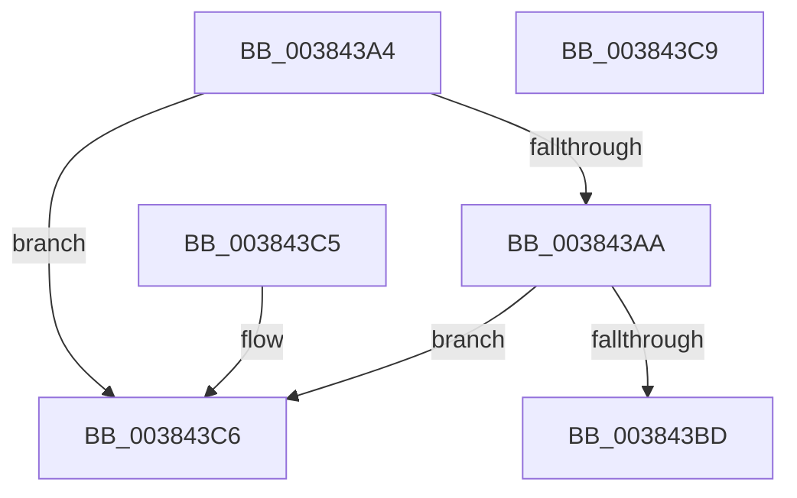

# MiControlAreaHasHostRelocationsApplied

- RVA: `0x003843A4`–`0x003843CA` (길이 `38` bytes)
- VA: `0x00000001403843A4`
- 실행 섹션: `.text`
- PDB 이름 있음: `예`; PDB Function 태그: `아니요`
- unwind 정보 RVA: `0x000DB714`
- 디코드: `15`개 명령, `38/38` bytes 표시
- 미해석 바이트: `0` (있으면 어셈블리에 `.byte`로 보존)

> 이 문서는 커널 이미지의 기계어와 PDB 기호를 분석해 생성했습니다. 4번과 5번은 함수 원형과 자료형을 바이너리 사용 방식에서 추정한 C 해석이며 원본 소스 복구 결과는 아닙니다.

## 1. Dependencies

- 직접 호출 지점: **0**; 고유 호출 대상: **0**
- 직접 호출자로 확인된 함수: **3**
- RIP 상대 이미지 참조: **0**

### Outgoing calls
- 직접 디코드된 call 명령이 없습니다.

### Direct callers
- [MiValidateInPage](MiValidateInPage_function_00382E0C.md) at `0x0038324B`
- [MiValidateImagePfn](../../page/93/MiValidateImagePfn_function_0093EA08.md) at `0x0093EAF1`
- [sub_00B25312](../../page/B2/Unknown_function_00B25312.md) at `0x00B25315`

### Static image references
- 디코드된 RIP-relative 메모리 참조가 없습니다.

## 2. Other-region calls and transfers

- 다른 실행 섹션으로 향하는 call: **0**
- 별도 외부 분기/꼬리 이동을 확인하지 못했습니다.

## 3. Assembly (complete function range)

```asm
003843A4  F6 41 3E 0C                     test byte ptr [rcx + 0x3e], 0xc
003843A8  74 1C                           je 0x1403843c6
003843AA  48 8B 41 60                     mov rax, qword ptr [rcx + 0x60]
003843AE  48 83 E0 F8                     and rax, 0xfffffffffffffff8
003843B2  48 8B 48 20                     mov rcx, qword ptr [rax + 0x20]
003843B6  33 C0                           xor eax, eax
003843B8  48 85 C9                        test rcx, rcx
003843BB  74 09                           je 0x1403843c6
003843BD  48 39 41 30                     cmp qword ptr [rcx + 0x30], rax
003843C1  0F 95 C0                        setne al
003843C4  C3                              ret
003843C5  CC                              int3
003843C6  33 C0                           xor eax, eax
003843C8  C3                              ret
003843C9  CC                              int3
```

## 4. C-style interpretation (structured pseudocode)

```c
__int64 __fastcall MiControlAreaHasHostRelocationsApplied(__int64 a1)
{
    __int64 result;

    if (((*(unsigned __int8 *)(a1 + 62)) & (12)) == 0) goto loc_003843C6;
    result = (*(unsigned __int64 *)(a1 + 96)) & (-8);
    result = 0;
    if (*(unsigned __int64 *)(result + 32) == 0) goto loc_003843C6;
    result = ((*(unsigned __int64 *)(*(unsigned __int64 *)(result + 32) + 48)) != 0) ? 1 : 0;
    return result;
loc_003843C6:
    result = 0;
    return result;
}
```

## 5. (Beta) C Style

```c
int64_t MiControlAreaHasHostRelocationsApplied(void *Arg1)
{
    uint8_t *arg1 = (uint8_t *)Arg1;

    int64_t result;

    if (((*(uint8_t *)(arg1 + 0x3E)) & (12)) == 0) goto loc_003843C6;
    result = (*(uint64_t *)(arg1 + 0x60)) & (-8);
    result = 0;
    if (*(uint64_t *)(result + 0x20) == 0) goto loc_003843C6;
    result = ((*(uint64_t *)(*(uint64_t *)(result + 0x20) + 0x30)) != 0) ? 1 : 0;
    return result;
loc_003843C6:
    result = 0;
    return result;
}
```

### 관측된 메모리 오프셋

구조체 형식이 확인되지 않은 접근은 인자 기준의 오프셋으로만 기록했습니다.

| 기준 인자 | 오프셋 표현 | 폭 (bit) | 접근 |
|---|---:|---:|---|
| `Arg1` | `+ 0x3E` | `8` | `R` |
| `Arg1` | `+ 0x60` | `64` | `R` |

## 6. Execution-region graph

[열기: 2D/3D 그래프와 함수 탐색 컨트롤 패널](../../../control-panel.html?section=text&rva=0x003843A4&view=graph)

- 2D 그래프는 위에서 아래로 흐르고, 3D 그래프는 빈 공간을 드래그해 회전합니다. Shift+드래그는 이동, 휠은 확대·축소, 함수 노드 선택은 대상 보고서 이동입니다.

### Static fallback


