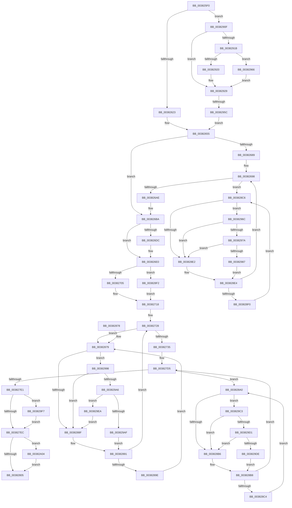

# MiDuplicateCloneLeaf

- RVA: `0x003825F0`–`0x00382A17` (길이 `1,063` bytes)
- VA: `0x00000001403825F0`
- 실행 섹션: `.text`
- PDB 이름 있음: `예`; PDB Function 태그: `예`
- unwind 정보 RVA: `0x0007BAEC`
- 디코드: `252`개 명령, `1,063/1,063` bytes 표시
- 미해석 바이트: `0` (있으면 어셈블리에 `.byte`로 보존)

> 이 문서는 커널 이미지의 기계어와 PDB 기호를 분석해 생성했습니다. 4번과 5번은 함수 원형과 자료형을 바이너리 사용 방식에서 추정한 C 해석이며 원본 소스 복구 결과는 아닙니다.

## 1. Dependencies

- 직접 호출 지점: **16**; 고유 호출 대상: **12**
- 직접 호출자로 확인된 함수: **2**
- RIP 상대 이미지 참조: **3**

### Outgoing calls
- `0x00382665` → [MI_IS_SOFTWARE_PTE_SHADOW_STACK](MI_IS_SOFTWARE_PTE_SHADOW_STACK_function_003815D0.md) (function, `0x003815D0`)
- `0x003826C3` → [MiCopyPage](../2B/MiCopyPage_function_002B1B30.md) (function, `0x002B1B30`)
- `0x003826E3` → [MiGetPfnPriority](../32/MiGetPfnPriority_function_003226F0.md) (function, `0x003226F0`)
- `0x00382713` → [MiMakeTransitionPte](../36/MiMakeTransitionPte_function_00363F70.md) (function, `0x00363F70`)
- `0x0038276F` → [MiIncreaseUsedPtesInPfn](MiIncreaseUsedPtesInPfn_function_00382D90.md) (function, `0x00382D90`)
- `0x003827B1` → [MiInitializePfnForOtherProcess](MiInitializePfnForOtherProcess_function_00382A20.md) (function, `0x00382A20`)
- `0x0038285A` → [MiDecrementShareCountEx](../33/MiDecrementShareCountEx_function_00333F70.md) (function, `0x00333F70`)
- `0x00382905` → [MiUpdateTransitionPteFrame](MiUpdateTransitionPteFrame_function_00385EDC.md) (function, `0x00385EDC`)
- `0x0038297A` → [KiCheckVpBackingLongSpinWaitHypercall](../30/KiCheckVpBackingLongSpinWaitHypercall_function_0030F490.md) (function, `0x0030F490`)
- `0x0038298E` → [HvlNotifyLongSpinWait](../30/HvlNotifyLongSpinWait_function_0030F460.md) (function, `0x0030F460`)
- `0x003829A6` → [KiCheckVpBackingLongSpinWaitHypercall](../30/KiCheckVpBackingLongSpinWaitHypercall_function_0030F490.md) (function, `0x0030F490`)
- `0x003829B1` → [HvlNotifyLongSpinWait](../30/HvlNotifyLongSpinWait_function_0030F460.md) (function, `0x0030F460`)
- `0x003829D1` → [KiCheckVpBackingLongSpinWaitHypercall](../30/KiCheckVpBackingLongSpinWaitHypercall_function_0030F490.md) (function, `0x0030F490`)
- `0x003829E0` → [HvlNotifyLongSpinWait](../30/HvlNotifyLongSpinWait_function_0030F460.md) (function, `0x0030F460`)
- `0x003829FA` → [MI_SET_SOFTWARE_PTE_SHADOW_STACK](../49/MI_SET_SOFTWARE_PTE_SHADOW_STACK_function_00491EC0.md) (function, `0x00491EC0`)
- `0x00382A0D` → [MiChangePageAttribute](../33/MiChangePageAttribute_function_00332ECC.md) (function, `0x00332ECC`)

### Direct callers
- [MiHandleForkTransitionPte](../22/MiHandleForkTransitionPte_function_0022D34C.md) at `0x0022D903`
- [MiBuildForkPte](../22/MiBuildForkPte_function_0022E32C.md) at `0x0022EB65`

### Static image references
- `0x00382883` → RVA `0x00FC52AC` (`ALMOSTRO`; reference)
- `0x0038290F` → RVA `0x00E2DC80` (`.data`; read)
- `0x0038296C` → RVA `0x00FC6AB8` (`ALMOSTRO`; read)

## 2. Other-region calls and transfers

- 다른 실행 섹션으로 향하는 call: **0**
- call이 아닌 외부 분기/꼬리 이동: **1**
  - `0x00382956` → [sub_006E4786](../6E/Unknown_function_006E4786.md) (`tail-transfer`)

## 3. Assembly (complete function range)

```asm
003825F0  4C 89 4C 24 20                  mov qword ptr [rsp + 0x20], r9
003825F5  4C 89 44 24 18                  mov qword ptr [rsp + 0x18], r8
003825FA  48 89 54 24 10                  mov qword ptr [rsp + 0x10], rdx
003825FF  53                              push rbx
00382600  56                              push rsi
00382601  57                              push rdi
00382602  41 54                           push r12
00382604  41 55                           push r13
00382606  41 56                           push r14
00382608  41 57                           push r15
0038260A  48 83 EC 40                     sub rsp, 0x40
0038260E  4D 8B C8                        mov r9, r8
00382611  4C 8B E1                        mov r12, rcx
00382614  48 8B 19                        mov rbx, qword ptr [rcx]
00382617  48 8B FB                        mov rdi, rbx
0038261A  F6 C3 01                        test bl, 1
0038261D  0F 84 EC 02 00 00               je 0x14038290f
00382623  48 C1 EF 0C                     shr rdi, 0xc
00382627  48 B8 FF FF FF FF FF 00 00 00   movabs rax, 0xffffffffff
00382631  48 23 F8                        and rdi, rax
00382634  48 8D 34 7F                     lea rsi, [rdi + rdi*2]
00382638  48 C1 E6 04                     shl rsi, 4
0038263C  49 B8 00 00 00 00 00 DE FF FF   movabs r8, 0xffffde0000000000
00382646  49 8B C0                        mov rax, r8
00382649  48 03 F0                        add rsi, rax
0038264C  BA 01 00 00 00                  mov edx, 1
00382651  4C 8B 6E 10                     mov r13, qword ptr [rsi + 0x10]
00382655  49 C1 ED 05                     shr r13, 5
00382659  89 54 24 20                     mov dword ptr [rsp + 0x20], edx
0038265D  41 83 E5 1F                     and r13d, 0x1f
00382661  48 8B 4E 10                     mov rcx, qword ptr [rsi + 0x10]
00382665  E8 66 EF FF FF                  call 0x1403815d0
0038266A  89 44 24 30                     mov dword ptr [rsp + 0x30], eax
0038266E  4F 8D 3C 49                     lea r15, [r9 + r9*2]
00382672  49 C1 E7 04                     shl r15, 4
00382676  49 8B C0                        mov rax, r8
00382679  4C 03 F8                        add r15, rax
0038267C  B9 80 01 00 00                  mov ecx, 0x180
00382681  4D 8D 77 18                     lea r14, [r15 + 0x18]
00382685  85 D2                           test edx, edx
00382687  75 31                           jne 0x1403826ba
00382689  C7 44 24 2C 84 01 00 00         mov dword ptr [rsp + 0x2c], 0x184
00382691  21 94 24 80 00 00 00            and dword ptr [rsp + 0x80], edx
00382698  F0 49 0F BA 2E 3F               lock bts qword ptr [r14], 0x3f
0038269E  B8 00 00 00 00                  mov eax, 0
003826A3  0F 93 C0                        setae al
003826A6  85 C0                           test eax, eax
003826A8  0F 84 18 02 00 00               je 0x1403828c6
003826AE  4C 8B 8C 24 90 00 00 00         mov r9, qword ptr [rsp + 0x90]
003826B6  8B 4C 24 2C                     mov ecx, dword ptr [rsp + 0x2c]
003826BA  44 8B C1                        mov r8d, ecx
003826BD  48 8B D7                        mov rdx, rdi
003826C0  49 8B C9                        mov rcx, r9
003826C3  E8 68 F4 F2 FF                  call 0x1402b1b30
003826C8  44 8B 54 24 20                  mov r10d, dword ptr [rsp + 0x20]
003826CD  48 BF FF FF FF FF FF FF FF 7F   movabs rdi, 0x7fffffffffffffff
003826D7  45 85 D2                        test r10d, r10d
003826DA  75 04                           jne 0x1403826e0
003826DC  F0 49 21 3E                     lock and qword ptr [r14], rdi
003826E0  48 8B CE                        mov rcx, rsi
003826E3  E8 08 00 FA FF                  call 0x1403226f0
003826E8  89 44 24 20                     mov dword ptr [rsp + 0x20], eax
003826EC  8B 46 20                        mov eax, dword ptr [rsi + 0x20]
003826EF  C1 E8 10                        shr eax, 0x10
003826F2  0F B6 C0                        movzx eax, al
003826F5  C1 E8 06                        shr eax, 6
003826F8  89 44 24 2C                     mov dword ptr [rsp + 0x2c], eax
003826FC  45 85 D2                        test r10d, r10d
003826FF  0F 84 ED 01 00 00               je 0x1403828f2
00382705  41 8B D5                        mov edx, r13d
00382708  48 8B B4 24 90 00 00 00         mov rsi, qword ptr [rsp + 0x90]
00382710  48 8B CE                        mov rcx, rsi
00382713  E8 58 18 FE FF                  call 0x140363f70
00382718  48 8B D8                        mov rbx, rax
0038271B  83 64 24 24 00                  and dword ptr [rsp + 0x24], 0
00382720  4C 8B 9C 24 98 00 00 00         mov r11, qword ptr [rsp + 0x98]
00382728  F0 49 0F BA 6B 18 3F            lock bts qword ptr [r11 + 0x18], 0x3f
0038272F  0F 82 44 01 00 00               jb 0x140382879
00382735  48 89 5C 24 38                  mov qword ptr [rsp + 0x38], rbx
0038273A  48 8B 84 24 88 00 00 00         mov rax, qword ptr [rsp + 0x88]
00382742  48 89 18                        mov qword ptr [rax], rbx
00382745  49 8B 43 18                     mov rax, qword ptr [r11 + 0x18]
00382749  48 8D 48 01                     lea rcx, [rax + 1]
0038274D  48 8B D1                        mov rdx, rcx
00382750  48 33 D0                        xor rdx, rax
00382753  48 B8 00 00 00 00 00 00 00 C0   movabs rax, 0xc000000000000000
0038275D  48 23 D0                        and rdx, rax
00382760  48 33 D1                        xor rdx, rcx
00382763  49 89 53 18                     mov qword ptr [r11 + 0x18], rdx
00382767  BA 01 00 00 00                  mov edx, 1
0038276C  49 8B CB                        mov rcx, r11
0038276F  E8 1C 06 00 00                  call 0x140382d90
00382774  48 BF FF FF FF FF FF FF FF 7F   movabs rdi, 0x7fffffffffffffff
0038277E  F0 49 21 7B 18                  lock and qword ptr [r11 + 0x18], rdi
00382783  48 B8 00 00 00 00 00 DE FF FF   movabs rax, 0xffffde0000000000
0038278D  48 8B C0                        mov rax, rax
00382790  4C 2B D8                        sub r11, rax
00382793  49 C1 FB 04                     sar r11, 4
00382797  49 B8 AB AA AA AA AA AA AA AA   movabs r8, 0xaaaaaaaaaaaaaaab
003827A1  4D 0F AF C3                     imul r8, r11
003827A5  41 B9 10 08 00 00               mov r9d, 0x810
003827AB  49 8B D4                        mov rdx, r12
003827AE  48 8B CE                        mov rcx, rsi
003827B1  E8 6A 02 00 00                  call 0x140382a20
003827B6  49 8D 77 10                     lea rsi, [r15 + 0x10]
003827BA  41 8B CD                        mov ecx, r13d
003827BD  48 C1 E1 05                     shl rcx, 5
003827C1  48 8B 06                        mov rax, qword ptr [rsi]
003827C4  48 25 1F FC FF FF               and rax, 0xfffffffffffffc1f
003827CA  48 0B C8                        or rcx, rax
003827CD  48 89 0E                        mov qword ptr [rsi], rcx
003827D0  83 64 24 28 00                  and dword ptr [rsp + 0x28], 0
003827D5  F0 49 0F BA 2E 3F               lock bts qword ptr [r14], 0x3f
003827DB  0F 82 BF 00 00 00               jb 0x1403828a0
003827E1  83 7C 24 30 00                  cmp dword ptr [rsp + 0x30], 0
003827E6  0F 85 0B 02 00 00               jne 0x1403829f7
003827EC  41 8B 47 20                     mov eax, dword ptr [r15 + 0x20]
003827F0  C1 E8 10                        shr eax, 0x10
003827F3  0F B6 C8                        movzx ecx, al
003827F6  C1 E9 06                        shr ecx, 6
003827F9  8B 54 24 2C                     mov edx, dword ptr [rsp + 0x2c]
003827FD  3B CA                           cmp ecx, edx
003827FF  0F 85 FF 01 00 00               jne 0x140382a04
00382805  41 8B 4F 20                     mov ecx, dword ptr [r15 + 0x20]
00382809  89 8C 24 80 00 00 00            mov dword ptr [rsp + 0x80], ecx
00382810  C1 E9 18                        shr ecx, 0x18
00382813  8A C1                           mov al, cl
00382815  32 44 24 20                     xor al, byte ptr [rsp + 0x20]
00382819  24 07                           and al, 7
0038281B  32 C1                           xor al, cl
0038281D  88 84 24 83 00 00 00            mov byte ptr [rsp + 0x83], al
00382824  8B 84 24 80 00 00 00            mov eax, dword ptr [rsp + 0x80]
0038282B  41 89 47 20                     mov dword ptr [r15 + 0x20], eax
0038282F  41 8B 57 20                     mov edx, dword ptr [r15 + 0x20]
00382833  89 94 24 80 00 00 00            mov dword ptr [rsp + 0x80], edx
0038283A  C1 EA 10                        shr edx, 0x10
0038283D  80 E2 FE                        and dl, 0xfe
00382840  80 CA 06                        or dl, 6
00382843  88 94 24 82 00 00 00            mov byte ptr [rsp + 0x82], dl
0038284A  8B 94 24 80 00 00 00            mov edx, dword ptr [rsp + 0x80]
00382851  41 89 57 20                     mov dword ptr [r15 + 0x20], edx
00382855  33 D2                           xor edx, edx
00382857  49 8B CF                        mov rcx, r15
0038285A  E8 11 17 FB FF                  call 0x140333f70
0038285F  F0 49 21 3E                     lock and qword ptr [r14], rdi
00382863  B8 01 00 00 00                  mov eax, 1
00382868  48 83 C4 40                     add rsp, 0x40
0038286C  41 5F                           pop r15
0038286E  41 5E                           pop r14
00382870  41 5D                           pop r13
00382872  41 5C                           pop r12
00382874  5F                              pop rdi
00382875  5E                              pop rsi
00382876  5B                              pop rbx
00382877  C3                              ret
00382878  CC                              int3
00382879  8B 7C 24 24                     mov edi, dword ptr [rsp + 0x24]
0038287D  FF C7                           inc edi
0038287F  89 7C 24 24                     mov dword ptr [rsp + 0x24], edi
00382883  85 3D 23 2A C4 00               test dword ptr [rip + 0xc42a23], edi
00382889  0F 84 09 01 00 00               je 0x140382998
0038288F  F3 90                           pause
00382891  49 8B 43 18                     mov rax, qword ptr [r11 + 0x18]
00382895  48 85 C0                        test rax, rax
00382898  0F 89 8A FE FF FF               jns 0x140382728
0038289E  EB D9                           jmp 0x140382879
003828A0  8B 5C 24 28                     mov ebx, dword ptr [rsp + 0x28]
003828A4  FF C3                           inc ebx
003828A6  89 5C 24 28                     mov dword ptr [rsp + 0x28], ebx
003828AA  85 1D FC 29 C4 00               test dword ptr [rip + 0xc429fc], ebx
003828B0  0F 84 0D 01 00 00               je 0x1403829c3
003828B6  F3 90                           pause
003828B8  49 8B 06                        mov rax, qword ptr [r14]
003828BB  48 85 C0                        test rax, rax
003828BE  0F 89 11 FF FF FF               jns 0x1403827d5
003828C4  EB DA                           jmp 0x1403828a0
003828C6  8B 8C 24 80 00 00 00            mov ecx, dword ptr [rsp + 0x80]
003828CD  FF C1                           inc ecx
003828CF  89 8C 24 80 00 00 00            mov dword ptr [rsp + 0x80], ecx
003828D6  85 0D D0 29 C4 00               test dword ptr [rip + 0xc429d0], ecx
003828DC  0F 84 8A 00 00 00               je 0x14038296c
003828E2  F3 90                           pause
003828E4  49 8B 06                        mov rax, qword ptr [r14]
003828E7  48 85 C0                        test rax, rax
003828EA  0F 89 A8 FD FF FF               jns 0x140382698
003828F0  EB D4                           jmp 0x1403828c6
003828F2  F0 48 21 7E 18                  lock and qword ptr [rsi + 0x18], rdi
003828F7  48 8B B4 24 90 00 00 00         mov rsi, qword ptr [rsp + 0x90]
003828FF  48 8B D6                        mov rdx, rsi
00382902  48 8B CB                        mov rcx, rbx
00382905  E8 D2 35 00 00                  call 0x140385edc
0038290A  E9 09 FE FF FF                  jmp 0x140382718
0038290F  48 8B 05 6A B3 AA 00            mov rax, qword ptr [rip + 0xaab36a]
00382916  48 85 C0                        test rax, rax
00382919  74 0E                           je 0x140382929
0038291B  F6 C3 10                        test bl, 0x10
0038291E  75 46                           jne 0x140382966
00382920  48 8B F8                        mov rdi, rax
00382923  48 F7 D7                        not rdi
00382926  48 23 FB                        and rdi, rbx
00382929  48 C1 EF 0C                     shr rdi, 0xc
0038292D  48 B8 FF FF FF FF FF 00 00 00   movabs rax, 0xffffffffff
00382937  48 23 F8                        and rdi, rax
0038293A  48 8D 34 7F                     lea rsi, [rdi + rdi*2]
0038293E  48 C1 E6 04                     shl rsi, 4
00382942  49 B8 00 00 00 00 00 DE FF FF   movabs r8, 0xffffde0000000000
0038294C  49 8B C0                        mov rax, r8
0038294F  48 03 F0                        add rsi, rax
00382952  F6 46 22 20                     test byte ptr [rsi + 0x22], 0x20
00382956  0F 85 2A 1E 36 00               jne 0x1406e4786
0038295C  33 D2                           xor edx, edx
0038295E  4C 8B EB                        mov r13, rbx
00382961  E9 EF FC FF FF                  jmp 0x140382655
00382966  48 83 E7 EF                     and rdi, 0xffffffffffffffef
0038296A  EB BD                           jmp 0x140382929
0038296C  8B 05 46 41 C4 00               mov eax, dword ptr [rip + 0xc44146]
00382972  A8 40                           test al, 0x40
00382974  0F 84 68 FF FF FF               je 0x1403828e2
0038297A  E8 11 CB F8 FF                  call 0x14030f490
0038297F  84 C0                           test al, al
00382981  0F 84 5B FF FF FF               je 0x1403828e2
00382987  8B 8C 24 80 00 00 00            mov ecx, dword ptr [rsp + 0x80]
0038298E  E8 CD CA F8 FF                  call 0x14030f460
00382993  E9 4C FF FF FF                  jmp 0x1403828e4
00382998  8B 05 1A 41 C4 00               mov eax, dword ptr [rip + 0xc4411a]
0038299E  A8 40                           test al, 0x40
003829A0  0F 84 E9 FE FF FF               je 0x14038288f
003829A6  E8 E5 CA F8 FF                  call 0x14030f490
003829AB  84 C0                           test al, al
003829AD  74 3B                           je 0x1403829ea
003829AF  8B CF                           mov ecx, edi
003829B1  E8 AA CA F8 FF                  call 0x14030f460
003829B6  4C 8B 9C 24 98 00 00 00         mov r11, qword ptr [rsp + 0x98]
003829BE  E9 CE FE FF FF                  jmp 0x140382891
003829C3  8B 05 EF 40 C4 00               mov eax, dword ptr [rip + 0xc440ef]
003829C9  A8 40                           test al, 0x40
003829CB  0F 84 E5 FE FF FF               je 0x1403828b6
003829D1  E8 BA CA F8 FF                  call 0x14030f490
003829D6  84 C0                           test al, al
003829D8  0F 84 D8 FE FF FF               je 0x1403828b6
003829DE  8B CB                           mov ecx, ebx
003829E0  E8 7B CA F8 FF                  call 0x14030f460
003829E5  E9 CE FE FF FF                  jmp 0x1403828b8
003829EA  4C 8B 9C 24 98 00 00 00         mov r11, qword ptr [rsp + 0x98]
003829F2  E9 98 FE FF FF                  jmp 0x14038288f
003829F7  48 8B CE                        mov rcx, rsi
003829FA  E8 C1 F4 10 00                  call 0x140491ec0
003829FF  E9 E8 FD FF FF                  jmp 0x1403827ec
00382A04  41 B8 03 00 00 00               mov r8d, 3
00382A0A  49 8B CF                        mov rcx, r15
00382A0D  E8 BA 04 FB FF                  call 0x140332ecc
00382A12  E9 EE FD FF FF                  jmp 0x140382805
```

## 4. C-style interpretation (structured pseudocode)

```c
__int64 __fastcall MiDuplicateCloneLeaf(__int64 a1, __int64 a2, __int64 a3, __int64 a4)
{
    __int64 result;
    __int64 v_r11;
    __int64 v_r13;
    __int64 v_r15;
    __int64 v_rbx;
    __int64 v_rdi;
    __int64 v_rsi;
    __int64 v_rsp;
    unsigned __int64 v_stack_m40;
    unsigned int v_stack_m48;
    unsigned int v_stack_m4C;
    unsigned int v_stack_m50;
    unsigned int v_stack_m54;
    unsigned int v_stack_m58;
    unsigned __int64 v_stack_p10;
    unsigned __int64 v_stack_p18;
    unsigned __int64 v_stack_p20;
    unsigned int v_stack_p24;
    unsigned int v_stack_p28;
    unsigned int v_stack_p8;
    unsigned int v_stack_p80;
    unsigned __int64 v_stack_p90;
    unsigned __int64 v_stack_p98;
    unsigned __int8 v_stack_pA;
    unsigned __int8 v_stack_pB;

    v_stack_p20 = a4;
    v_stack_p18 = a3;
    v_stack_p10 = a2;
    v_rsp = (v_rsp) - (64);
    if ((((unsigned __int8)(*(unsigned __int64 *)(a1))) & (1)) == 0) goto loc_0038290F;
    v_rdi = (*(unsigned __int64 *)(a1)) >> (12);
    v_rdi = (v_rdi) & (result);
    v_rsi = (v_rdi + v_rdi * 2) << (4);
    v_rsi = (v_rsi) + (a3);
loc_00382655:
    v_r13 = (*(unsigned __int64 *)(v_rsi + 16)) >> (5);
    v_stack_m58 = 1;
    v_r13 = (unsigned int)((v_r13) & (31));
    result = MI_IS_SOFTWARE_PTE_SHADOW_STACK(*(unsigned __int64 *)(v_rsi + 16), 1, a3, a3);
    v_stack_m48 = (unsigned int)(result);
    v_r15 = (a3 + a3 * 2) << (4);
    v_r15 = (v_r15) + (a3);
    if (1 != 0) goto loc_003826BA;
    v_stack_m4C = 388;
loc_00382698:
    result = (condition_is_above_or_equal) ? 1 : 0;
    if ((unsigned int)(result) == 0) goto loc_003828C6;
loc_003826BA:
    result = MiCopyPage(v_stack_p18, v_rdi, (unsigned int)((unsigned int)((unsigned int)(v_stack_m4C))), v_stack_p18);
    if ((unsigned int)((unsigned int)(v_stack_m58)) == 0) {
    }
    result = MiGetPfnPriority(v_rsi, v_rdi, (unsigned int)((unsigned int)((unsigned int)(v_stack_m4C))), v_stack_p18);
    v_stack_m58 = (unsigned int)(result);
    result = (unsigned int)(((unsigned int)(*(unsigned int *)(v_rsi + 32))) >> (16));
    result = (unsigned int)(((unsigned __int8)(result)) >> (6));
    v_stack_m4C = (unsigned int)(result);
    if ((unsigned int)((unsigned int)(v_stack_m58)) == 0) goto loc_003828F2;
    result = MiMakeTransitionPte(v_stack_p18, (unsigned int)((unsigned int)(v_r13)), (unsigned int)((unsigned int)((unsigned int)(v_stack_m4C))), v_stack_p18);
loc_00382718:
loc_00382728:
    if (condition_is_below) goto loc_00382879;
    v_stack_m40 = result;
    *(unsigned __int64 *)(v_stack_p10) = result;
    a2 = (*(unsigned __int64 *)(v_stack_p20 + 24) + 1) ^ (*(unsigned __int64 *)(v_stack_p20 + 24));
    a2 = (a2) & (*(unsigned __int64 *)(v_stack_p20 + 24));
    a2 = (a2) ^ (*(unsigned __int64 *)(v_stack_p20 + 24) + 1);
    *(unsigned __int64 *)(v_stack_p20 + 24) = a2;
    result = MiIncreaseUsedPtesInPfn(v_stack_p20, 1, (unsigned int)((unsigned int)((unsigned int)(v_stack_m4C))), v_stack_p18);
    v_r11 = (v_stack_p20) - (result);
    v_r11 = (v_r11) >> (4);
    a3 = ((unsigned int)((unsigned int)((unsigned int)(v_stack_m4C)))) * (v_r11);
    result = MiInitializePfnForOtherProcess(v_stack_p18, a1, a3, (unsigned int)(0x810ULL));
    a1 = ((unsigned int)((unsigned int)(v_r13))) << (5);
    result = (*(unsigned __int64 *)(v_r15 + 16)) & (-993);
    a1 = (a1) | (result);
    *(unsigned __int64 *)(v_r15 + 16) = a1;
loc_003827D5:
    if (condition_is_below) goto loc_003828A0;
    if (v_stack_m48 != 0) goto loc_003829F7;
loc_003827EC:
    result = (unsigned int)(((unsigned int)(*(unsigned int *)(v_r15 + 32))) >> (16));
    a1 = (unsigned int)(((unsigned __int8)(result)) >> (6));
    if (((unsigned int)(a1)) != ((unsigned int)((unsigned int)(v_stack_m4C)))) goto loc_00382A04;
loc_00382805:
    v_stack_p8 = (unsigned int)((unsigned int)(*(unsigned int *)(v_r15 + 32)));
    a1 = (unsigned int)(((unsigned int)(*(unsigned int *)(v_r15 + 32))) >> (24));
    result = (unsigned __int8)(((unsigned __int8)(a1)) ^ (v_stack_m58));
    result = (unsigned __int8)((result) & (7));
    result = (unsigned __int8)((result) ^ ((unsigned __int8)(a1)));
    v_stack_pB = (unsigned __int8)(result);
    *(unsigned int *)(v_r15 + 32) = (unsigned int)((unsigned int)(v_stack_p8));
    v_stack_p8 = (unsigned int)((unsigned int)(*(unsigned int *)(v_r15 + 32)));
    a2 = (unsigned int)(((unsigned int)(*(unsigned int *)(v_r15 + 32))) >> (16));
    a2 = (unsigned __int8)((a2) & (254));
    a2 = (unsigned __int8)((a2) | (6));
    v_stack_pA = (unsigned __int8)(a2);
    *(unsigned int *)(v_r15 + 32) = (unsigned int)((unsigned int)(v_stack_p8));
    a2 = 0;
    result = MiDecrementShareCountEx(v_r15, a2, a3, (unsigned int)(0x810ULL));
    v_rsp = (v_rsp) + (64);
    return 1;
loc_00382879:
    v_rdi = (unsigned int)(((unsigned int)(v_stack_p24)) + 1);
    v_stack_p24 = (unsigned int)(v_rdi);
    if (((*(unsigned int *)(v_rip + 12855843)) & ((unsigned int)(v_rdi))) == 0) goto loc_00382998;
loc_0038288F:
loc_00382891:
    if (!sign_flag) goto loc_00382728;
    goto loc_00382879;
loc_003828A0:
    v_rbx = (unsigned int)(((unsigned int)(v_stack_p28)) + 1);
    v_stack_p28 = (unsigned int)(v_rbx);
    if (((*(unsigned int *)(v_rip + 12855804)) & ((unsigned int)(v_rbx))) == 0) goto loc_003829C3;
loc_003828B6:
loc_003828B8:
    if (!sign_flag) goto loc_003827D5;
    goto loc_003828A0;
loc_003828C6:
    a1 = (unsigned int)(((unsigned int)(v_stack_p80)) + 1);
    v_stack_p80 = (unsigned int)(a1);
    if (((*(unsigned int *)(v_rip + 12855760)) & ((unsigned int)(a1))) == 0) goto loc_0038296C;
loc_003828E2:
loc_003828E4:
    if (!sign_flag) goto loc_00382698;
    goto loc_003828C6;
loc_003828F2:
    result = MiUpdateTransitionPteFrame(v_rbx, v_stack_p90, a3, (unsigned int)(0x810ULL));
    goto loc_00382718;
loc_0038290F:
    if (*(unsigned __int64 *)(v_rip + 11187050) == 0) goto loc_00382929;
    if ((((unsigned __int8)(v_rbx)) & (16)) != 0) goto loc_00382966;
    v_rdi = ~(*(unsigned __int64 *)(v_rip + 11187050));
    v_rdi = (v_rdi) & (v_rbx);
loc_00382929:
    v_rdi = (v_rdi) >> (12);
    v_rdi = (v_rdi) & (*(unsigned __int64 *)(v_rip + 11187050));
    v_rsi = (v_rdi + v_rdi * 2) << (4);
    v_rsi = (v_rsi) + (a3);
    a2 = 0;
    goto loc_00382655;
loc_00382966:
    v_rdi = (v_rdi) & (-17);
    goto loc_00382929;
loc_0038296C:
    if ((((unsigned __int8)((unsigned int)(*(unsigned int *)(v_rip + 12861766)))) & (64)) == 0) goto loc_003828E2;
    result = KiCheckVpBackingLongSpinWaitHypercall(v_rbx, a2, a3, (unsigned int)(0x810ULL));
    if ((unsigned __int8)(result) == 0) goto loc_003828E2;
    result = HvlNotifyLongSpinWait((unsigned int)(v_stack_p80), a2, a3, (unsigned int)(0x810ULL));
    goto loc_003828E4;
loc_00382998:
    if ((((unsigned __int8)((unsigned int)(*(unsigned int *)(v_rip + 12861722)))) & (64)) == 0) goto loc_0038288F;
    result = KiCheckVpBackingLongSpinWaitHypercall((unsigned int)(v_stack_p80), a2, a3, (unsigned int)(0x810ULL));
    if ((unsigned __int8)(result) == 0) goto loc_003829EA;
    result = HvlNotifyLongSpinWait((unsigned int)((unsigned int)(v_rdi)), a2, a3, (unsigned int)(0x810ULL));
    goto loc_00382891;
loc_003829C3:
    if ((((unsigned __int8)((unsigned int)(*(unsigned int *)(v_rip + 12861679)))) & (64)) == 0) goto loc_003828B6;
    result = KiCheckVpBackingLongSpinWaitHypercall((unsigned int)((unsigned int)(v_rdi)), a2, a3, (unsigned int)(0x810ULL));
    if ((unsigned __int8)(result) == 0) goto loc_003828B6;
    result = HvlNotifyLongSpinWait((unsigned int)((unsigned int)(v_rbx)), a2, a3, (unsigned int)(0x810ULL));
    goto loc_003828B8;
loc_003829EA:
    goto loc_0038288F;
loc_003829F7:
    result = MI_SET_SOFTWARE_PTE_SHADOW_STACK(v_rsi, a2, a3, (unsigned int)(0x810ULL));
    goto loc_003827EC;
loc_00382A04:
    result = MiChangePageAttribute(v_r15, a2, 3, (unsigned int)(0x810ULL));
    goto loc_00382805;
}
```

## 5. (Beta) C Style

```c
int64_t MiDuplicateCloneLeaf(void *Arg1, int64_t Arg2, int64_t Arg3, int64_t Arg4)
{
    uint8_t *arg1 = (uint8_t *)Arg1;

    int64_t result;
    int64_t local_r11;
    int64_t local_r13;
    int64_t local_r15;
    int64_t local_rbx;
    int64_t local_rdi;
    int64_t local_rsi;
    int64_t local_rsp;
    uint64_t v_stack_m40;
    uint32_t v_stack_m48;
    uint32_t v_stack_m4C;
    uint32_t v_stack_m50;
    uint32_t v_stack_m54;
    uint32_t v_stack_m58;
    uint64_t v_stack_p10;
    uint64_t v_stack_p18;
    uint64_t v_stack_p20;
    uint32_t v_stack_p24;
    uint32_t v_stack_p28;
    uint32_t v_stack_p8;
    uint32_t v_stack_p80;
    uint64_t v_stack_p90;
    uint64_t v_stack_p98;
    uint8_t v_stack_pA;
    uint8_t v_stack_pB;

    v_stack_p20 = Arg4;
    v_stack_p18 = Arg3;
    v_stack_p10 = Arg2;
    local_rsp = (local_rsp) - (64);
    if ((((uint8_t)(*(uint64_t *)(arg1))) & (1)) == 0) goto loc_0038290F;
    local_rdi = (*(uint64_t *)(arg1)) >> (12);
    local_rdi = (local_rdi) & (result);
    local_rsi = (local_rdi + local_rdi * 2) << (4);
    local_rsi = (local_rsi) + (Arg3);
loc_00382655:
    local_r13 = (*(uint64_t *)(local_rsi + 0x10)) >> (5);
    v_stack_m58 = 1;
    local_r13 = (uint32_t)((local_r13) & (31));
    result = MI_IS_SOFTWARE_PTE_SHADOW_STACK(*(uint64_t *)(local_rsi + 0x10), 1, Arg3, Arg3);
    v_stack_m48 = (uint32_t)(result);
    local_r15 = (Arg3 + Arg3 * 2) << (4);
    local_r15 = (local_r15) + (Arg3);
    if (1 != 0) goto loc_003826BA;
    v_stack_m4C = 388;
loc_00382698:
    result = (condition_is_above_or_equal) ? 1 : 0;
    if ((uint32_t)(result) == 0) goto loc_003828C6;
loc_003826BA:
    result = MiCopyPage(v_stack_p18, local_rdi, (uint32_t)((uint32_t)((uint32_t)(v_stack_m4C))), v_stack_p18);
    if ((uint32_t)((uint32_t)(v_stack_m58)) == 0) {
    }
    result = MiGetPfnPriority(local_rsi, local_rdi, (uint32_t)((uint32_t)((uint32_t)(v_stack_m4C))), v_stack_p18);
    v_stack_m58 = (uint32_t)(result);
    result = (uint32_t)(((uint32_t)(*(uint32_t *)(local_rsi + 0x20))) >> (16));
    result = (uint32_t)(((uint8_t)(result)) >> (6));
    v_stack_m4C = (uint32_t)(result);
    if ((uint32_t)((uint32_t)(v_stack_m58)) == 0) goto loc_003828F2;
    result = MiMakeTransitionPte(v_stack_p18, (uint32_t)((uint32_t)(local_r13)), (uint32_t)((uint32_t)((uint32_t)(v_stack_m4C))), v_stack_p18);
loc_00382718:
loc_00382728:
    if (condition_is_below) goto loc_00382879;
    v_stack_m40 = result;
    *(uint64_t *)(v_stack_p10) = result;
    Arg2 = (*(uint64_t *)(v_stack_p20 + 0x18) + 1) ^ (*(uint64_t *)(v_stack_p20 + 0x18));
    Arg2 = (Arg2) & (*(uint64_t *)(v_stack_p20 + 0x18));
    Arg2 = (Arg2) ^ (*(uint64_t *)(v_stack_p20 + 0x18) + 1);
    *(uint64_t *)(v_stack_p20 + 0x18) = Arg2;
    result = MiIncreaseUsedPtesInPfn(v_stack_p20, 1, (uint32_t)((uint32_t)((uint32_t)(v_stack_m4C))), v_stack_p18);
    local_r11 = (v_stack_p20) - (result);
    local_r11 = (local_r11) >> (4);
    Arg3 = ((uint32_t)((uint32_t)((uint32_t)(v_stack_m4C)))) * (local_r11);
    result = MiInitializePfnForOtherProcess(v_stack_p18, Arg1, Arg3, (uint32_t)(0x810ULL));
    Arg1 = ((uint32_t)((uint32_t)(local_r13))) << (5);
    result = (*(uint64_t *)(local_r15 + 0x10)) & (-993);
    Arg1 = (Arg1) | (result);
    *(void **)(local_r15 + 0x10) = Arg1;
loc_003827D5:
    if (condition_is_below) goto loc_003828A0;
    if (v_stack_m48 != 0) goto loc_003829F7;
loc_003827EC:
    result = (uint32_t)(((uint32_t)(*(uint32_t *)(local_r15 + 0x20))) >> (16));
    Arg1 = (uint32_t)(((uint8_t)(result)) >> (6));
    if (((uint32_t)(Arg1)) != ((uint32_t)((uint32_t)(v_stack_m4C)))) goto loc_00382A04;
loc_00382805:
    v_stack_p8 = (uint32_t)((uint32_t)(*(uint32_t *)(local_r15 + 0x20)));
    Arg1 = (uint32_t)(((uint32_t)(*(uint32_t *)(local_r15 + 0x20))) >> (24));
    result = (uint8_t)(((uint8_t)(Arg1)) ^ (v_stack_m58));
    result = (uint8_t)((result) & (7));
    result = (uint8_t)((result) ^ ((uint8_t)(Arg1)));
    v_stack_pB = (uint8_t)(result);
    *(uint32_t *)(local_r15 + 0x20) = (uint32_t)((uint32_t)(v_stack_p8));
    v_stack_p8 = (uint32_t)((uint32_t)(*(uint32_t *)(local_r15 + 0x20)));
    Arg2 = (uint32_t)(((uint32_t)(*(uint32_t *)(local_r15 + 0x20))) >> (16));
    Arg2 = (uint8_t)((Arg2) & (254));
    Arg2 = (uint8_t)((Arg2) | (6));
    v_stack_pA = (uint8_t)(Arg2);
    *(uint32_t *)(local_r15 + 0x20) = (uint32_t)((uint32_t)(v_stack_p8));
    Arg2 = 0;
    result = MiDecrementShareCountEx(local_r15, Arg2, Arg3, (uint32_t)(0x810ULL));
    local_rsp = (local_rsp) + (64);
    return 1;
loc_00382879:
    local_rdi = (uint32_t)(((uint32_t)(v_stack_p24)) + 1);
    v_stack_p24 = (uint32_t)(local_rdi);
    if (((*(uint32_t *)(v_rip + 0xC42A23)) & ((uint32_t)(local_rdi))) == 0) goto loc_00382998;
loc_0038288F:
loc_00382891:
    if (!sign_flag) goto loc_00382728;
    goto loc_00382879;
loc_003828A0:
    local_rbx = (uint32_t)(((uint32_t)(v_stack_p28)) + 1);
    v_stack_p28 = (uint32_t)(local_rbx);
    if (((*(uint32_t *)(v_rip + 0xC429FC)) & ((uint32_t)(local_rbx))) == 0) goto loc_003829C3;
loc_003828B6:
loc_003828B8:
    if (!sign_flag) goto loc_003827D5;
    goto loc_003828A0;
loc_003828C6:
    Arg1 = (uint32_t)(((uint32_t)(v_stack_p80)) + 1);
    v_stack_p80 = (uint32_t)(Arg1);
    if (((*(uint32_t *)(v_rip + 0xC429D0)) & ((uint32_t)(Arg1))) == 0) goto loc_0038296C;
loc_003828E2:
loc_003828E4:
    if (!sign_flag) goto loc_00382698;
    goto loc_003828C6;
loc_003828F2:
    result = MiUpdateTransitionPteFrame(local_rbx, v_stack_p90, Arg3, (uint32_t)(0x810ULL));
    goto loc_00382718;
loc_0038290F:
    if (*(uint64_t *)(v_rip + 0xAAB36A) == 0) goto loc_00382929;
    if ((((uint8_t)(local_rbx)) & (16)) != 0) goto loc_00382966;
    local_rdi = ~(*(uint64_t *)(v_rip + 0xAAB36A));
    local_rdi = (local_rdi) & (local_rbx);
loc_00382929:
    local_rdi = (local_rdi) >> (12);
    local_rdi = (local_rdi) & (*(uint64_t *)(v_rip + 0xAAB36A));
    local_rsi = (local_rdi + local_rdi * 2) << (4);
    local_rsi = (local_rsi) + (Arg3);
    Arg2 = 0;
    goto loc_00382655;
loc_00382966:
    local_rdi = (local_rdi) & (-17);
    goto loc_00382929;
loc_0038296C:
    if ((((uint8_t)((uint32_t)(*(uint32_t *)(v_rip + 0xC44146)))) & (64)) == 0) goto loc_003828E2;
    result = KiCheckVpBackingLongSpinWaitHypercall(local_rbx, Arg2, Arg3, (uint32_t)(0x810ULL));
    if ((uint8_t)(result) == 0) goto loc_003828E2;
    result = HvlNotifyLongSpinWait((uint32_t)(v_stack_p80), Arg2, Arg3, (uint32_t)(0x810ULL));
    goto loc_003828E4;
loc_00382998:
    if ((((uint8_t)((uint32_t)(*(uint32_t *)(v_rip + 0xC4411A)))) & (64)) == 0) goto loc_0038288F;
    result = KiCheckVpBackingLongSpinWaitHypercall((uint32_t)(v_stack_p80), Arg2, Arg3, (uint32_t)(0x810ULL));
    if ((uint8_t)(result) == 0) goto loc_003829EA;
    result = HvlNotifyLongSpinWait((uint32_t)((uint32_t)(local_rdi)), Arg2, Arg3, (uint32_t)(0x810ULL));
    goto loc_00382891;
loc_003829C3:
    if ((((uint8_t)((uint32_t)(*(uint32_t *)(v_rip + 0xC440EF)))) & (64)) == 0) goto loc_003828B6;
    result = KiCheckVpBackingLongSpinWaitHypercall((uint32_t)((uint32_t)(local_rdi)), Arg2, Arg3, (uint32_t)(0x810ULL));
    if ((uint8_t)(result) == 0) goto loc_003828B6;
    result = HvlNotifyLongSpinWait((uint32_t)((uint32_t)(local_rbx)), Arg2, Arg3, (uint32_t)(0x810ULL));
    goto loc_003828B8;
loc_003829EA:
    goto loc_0038288F;
loc_003829F7:
    result = MI_SET_SOFTWARE_PTE_SHADOW_STACK(local_rsi, Arg2, Arg3, (uint32_t)(0x810ULL));
    goto loc_003827EC;
loc_00382A04:
    result = MiChangePageAttribute(local_r15, Arg2, 3, (uint32_t)(0x810ULL));
    goto loc_00382805;
}
```

### 관측된 메모리 오프셋

구조체 형식이 확인되지 않은 접근은 인자 기준의 오프셋으로만 기록했습니다.

| 기준 인자 | 오프셋 표현 | 폭 (bit) | 접근 |
|---|---:|---:|---|
| `Arg1` | `+ 0x0` | `64` | `R` |

## 6. Execution-region graph

[열기: 2D/3D 그래프와 함수 탐색 컨트롤 패널](../../../control-panel.html?section=text&rva=0x003825F0&view=graph)

- 2D 그래프는 위에서 아래로 흐르고, 3D 그래프는 빈 공간을 드래그해 회전합니다. Shift+드래그는 이동, 휠은 확대·축소, 함수 노드 선택은 대상 보고서 이동입니다.

### Static fallback


