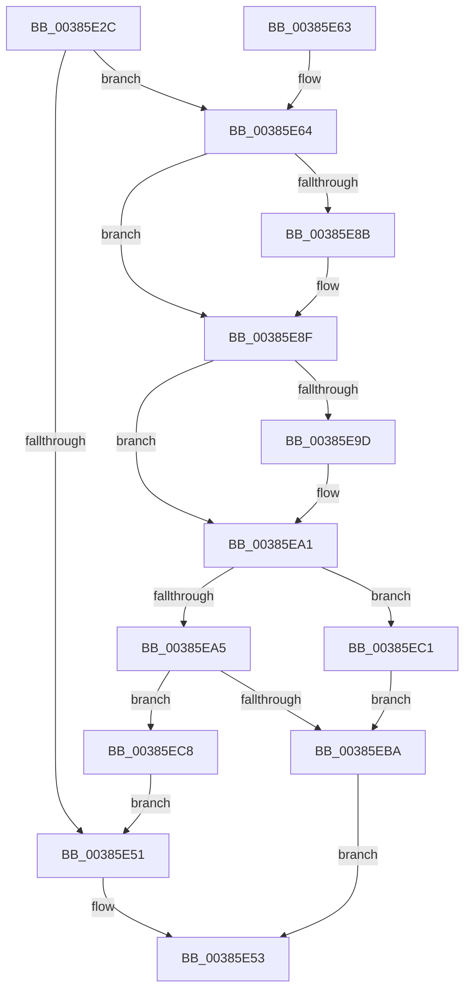

# MiGetPageFileSectionForReservation

- RVA: `0x00385E2C`–`0x00385ED5` (길이 `169` bytes)
- VA: `0x0000000140385E2C`
- 실행 섹션: `.text`
- PDB 이름 있음: `예`; PDB Function 태그: `아니요`
- unwind 정보 RVA: `0x0007BD38`
- 디코드: `50`개 명령, `169/169` bytes 표시
- 미해석 바이트: `0` (있으면 어셈블리에 `.byte`로 보존)

> 이 문서는 커널 이미지의 기계어와 PDB 기호를 분석해 생성했습니다. 4번과 5번은 함수 원형과 자료형을 바이너리 사용 방식에서 추정한 C 해석이며 원본 소스 복구 결과는 아닙니다.

## 1. Dependencies

- 직접 호출 지점: **3**; 고유 호출 대상: **3**
- 직접 호출자로 확인된 함수: **1**
- RIP 상대 이미지 참조: **0**

### Outgoing calls
- `0x00385E44` → [MiReferencePfBackedSection](../2B/MiReferencePfBackedSection_function_002B9B70.md) (function, `0x002B9B70`)
- `0x00385EAC` → [MiLockProtoPoolPage](../2B/MiLockProtoPoolPage_function_002B8B80.md) (function, `0x002B8B80`)
- `0x00385ECB` → [MiReleasePageFileSectionInfo](../4A/MiReleasePageFileSectionInfo_function_004A9A44.md) (function, `0x004A9A44`)

### Direct callers
- [MiReservePageFileSpace](MiReservePageFileSpace_function_00383ED8.md) at `0x00383F5A`

### Static image references
- 디코드된 RIP-relative 메모리 참조가 없습니다.

## 2. Other-region calls and transfers

- 다른 실행 섹션으로 향하는 call: **0**
- 별도 외부 분기/꼬리 이동을 확인하지 못했습니다.

## 3. Assembly (complete function range)

```asm
00385E2C  48 89 5C 24 08                  mov qword ptr [rsp + 8], rbx
00385E31  48 89 74 24 10                  mov qword ptr [rsp + 0x10], rsi
00385E36  57                              push rdi
00385E37  48 83 EC 20                     sub rsp, 0x20
00385E3B  41 8B F0                        mov esi, r8d
00385E3E  48 8B DA                        mov rbx, rdx
00385E41  48 8B F9                        mov rdi, rcx
00385E44  E8 27 3D F3 FF                  call 0x1402b9b70
00385E49  48 8B C8                        mov rcx, rax
00385E4C  48 85 C0                        test rax, rax
00385E4F  75 13                           jne 0x140385e64
00385E51  33 C0                           xor eax, eax
00385E53  48 8B 5C 24 30                  mov rbx, qword ptr [rsp + 0x30]
00385E58  48 8B 74 24 38                  mov rsi, qword ptr [rsp + 0x38]
00385E5D  48 83 C4 20                     add rsp, 0x20
00385E61  5F                              pop rdi
00385E62  C3                              ret
00385E63  CC                              int3
00385E64  48 8B 00                        mov rax, qword ptr [rax]
00385E67  48 89 03                        mov qword ptr [rbx], rax
00385E6A  48 8B C7                        mov rax, rdi
00385E6D  48 25 00 F0 FF FF               and rax, 0xfffffffffffff000
00385E73  48 89 43 10                     mov qword ptr [rbx + 0x10], rax
00385E77  4C 8D 88 F8 0F 00 00            lea r9, [rax + 0xff8]
00385E7E  4C 89 4B 18                     mov qword ptr [rbx + 0x18], r9
00385E82  48 8B 51 08                     mov rdx, qword ptr [rcx + 8]
00385E86  48 3B C2                        cmp rax, rdx
00385E89  73 04                           jae 0x140385e8f
00385E8B  48 89 53 10                     mov qword ptr [rbx + 0x10], rdx
00385E8F  8B 49 2C                        mov ecx, dword ptr [rcx + 0x2c]
00385E92  FF C9                           dec ecx
00385E94  4C 8D 04 CA                     lea r8, [rdx + rcx*8]
00385E98  4D 3B C8                        cmp r9, r8
00385E9B  76 04                           jbe 0x140385ea1
00385E9D  4C 89 43 18                     mov qword ptr [rbx + 0x18], r8
00385EA1  85 F6                           test esi, esi
00385EA3  74 1C                           je 0x140385ec1
00385EA5  48 8D 53 20                     lea rdx, [rbx + 0x20]
00385EA9  48 8B CF                        mov rcx, rdi
00385EAC  E8 CF 2C F3 FF                  call 0x1402b8b80
00385EB1  48 89 43 08                     mov qword ptr [rbx + 8], rax
00385EB5  48 85 C0                        test rax, rax
00385EB8  74 0E                           je 0x140385ec8
00385EBA  B8 01 00 00 00                  mov eax, 1
00385EBF  EB 92                           jmp 0x140385e53
00385EC1  48 83 63 08 00                  and qword ptr [rbx + 8], 0
00385EC6  EB F2                           jmp 0x140385eba
00385EC8  48 8B CB                        mov rcx, rbx
00385ECB  E8 74 3B 12 00                  call 0x1404a9a44
00385ED0  E9 7C FF FF FF                  jmp 0x140385e51
```

## 4. C-style interpretation (structured pseudocode)

```c
__int64 __fastcall MiGetPageFileSectionForReservation(__int64 a1, __int64 a2, int a3)
{
    __int64 result;
    __int64 v_rsp;
    unsigned __int64 v_stack_p10;
    unsigned __int64 v_stack_p8;

    v_stack_p8 = v_rbx;
    v_stack_p10 = v_rsi;
    v_rsp = (v_rsp) - (32);
    result = MiReferencePfBackedSection(a1, a2, a3, a4);
    if (result != 0) goto loc_00385E64;
loc_00385E51:
    result = 0;
loc_00385E53:
    v_rsp = (v_rsp) + (32);
    return result;
loc_00385E64:
    *(unsigned __int64 *)(v_stack_p8) = *(unsigned __int64 *)(result);
    result = (a1) & (0xFFFFFFFFFFFFF000ULL);
    *(unsigned __int64 *)(v_stack_p8 + 16) = result;
    *(unsigned __int64 *)(v_stack_p8 + 24) = result + 4088;
    if (result < (*(unsigned __int64 *)(result + 8))) {
        *(unsigned __int64 *)(v_stack_p8 + 16) = *(unsigned __int64 *)(result + 8);
    }
    a1 = (unsigned int)(((unsigned int)(*(unsigned int *)(result + 44))) - 1);
    if ((result + 4088) >= = (*(unsigned __int64 *)(result + 8) + a1 * 8)) {
        *(unsigned __int64 *)(v_stack_p8 + 24) = *(unsigned __int64 *)(result + 8) + a1 * 8;
    }
    if ((unsigned int)(v_stack_p10) == 0) goto loc_00385EC1;
    result = MiLockProtoPoolPage(a1, v_stack_p8 + 32, *(unsigned __int64 *)(result + 8) + a1 * 8, result + 4088);
    *(unsigned __int64 *)(v_stack_p8 + 8) = result;
    if (result == 0) goto loc_00385EC8;
loc_00385EBA:
    goto loc_00385E53;
loc_00385EC1:
    goto loc_00385EBA;
loc_00385EC8:
    result = MiReleasePageFileSectionInfo(v_stack_p8, v_stack_p8 + 32, *(unsigned __int64 *)(result + 8) + a1 * 8, result + 4088);
    goto loc_00385E51;
}
```

## 5. (Beta) C Style

```c
int64_t MiGetPageFileSectionForReservation(void *Arg1, void *Arg2, int32_t Arg3)
{
    uint8_t *arg1 = (uint8_t *)Arg1;
    uint8_t *arg2 = (uint8_t *)Arg2;

    int64_t result;
    int64_t local_rsp;
    uint64_t v_stack_p10;
    uint64_t v_stack_p8;

    v_stack_p8 = local_rbx;
    v_stack_p10 = local_rsi;
    local_rsp = (local_rsp) - (32);
    result = MiReferencePfBackedSection(Arg1, Arg2, Arg3, a4);
    if (result != 0) goto loc_00385E64;
loc_00385E51:
    result = 0;
loc_00385E53:
    local_rsp = (local_rsp) + (32);
    return result;
loc_00385E64:
    *(uint64_t *)(v_stack_p8) = *(uint64_t *)(result);
    result = (Arg1) & (0xFFFFFFFFFFFFF000ULL);
    *(uint64_t *)(v_stack_p8 + 0x10) = result;
    *(uint64_t *)(v_stack_p8 + 0x18) = result + 4088;
    if (result < (*(uint64_t *)(result + 0x8))) {
        *(uint64_t *)(v_stack_p8 + 0x10) = *(uint64_t *)(result + 0x8);
    }
    Arg1 = (uint32_t)(((uint32_t)(*(uint32_t *)(result + 0x2C))) - 1);
    if ((result + 4088) >= = (*(uint64_t *)(result + 0x8) + Arg1 * 8)) {
        *(uint64_t *)(v_stack_p8 + 0x18) = *(uint64_t *)(result + 0x8) + Arg1 * 8;
    }
    if ((uint32_t)(v_stack_p10) == 0) goto loc_00385EC1;
    result = MiLockProtoPoolPage(Arg1, v_stack_p8 + 32, *(uint64_t *)(result + 0x8) + Arg1 * 8, result + 4088);
    *(uint64_t *)(v_stack_p8 + 0x8) = result;
    if (result == 0) goto loc_00385EC8;
loc_00385EBA:
    goto loc_00385E53;
loc_00385EC1:
    goto loc_00385EBA;
loc_00385EC8:
    result = MiReleasePageFileSectionInfo(v_stack_p8, v_stack_p8 + 32, *(uint64_t *)(result + 0x8) + Arg1 * 8, result + 4088);
    goto loc_00385E51;
}
```

### 관측된 메모리 오프셋

구조체 형식이 확인되지 않은 접근은 인자 기준의 오프셋으로만 기록했습니다.

| 기준 인자 | 오프셋 표현 | 폭 (bit) | 접근 |
|---|---:|---:|---|
| `Arg1` | `+ 0xFF8` | `64` | `R` |
| `Arg2` | `+ 0x0` | `64` | `W` |
| `Arg2` | `+ 0x8` | `64` | `R/W` |
| `Arg2` | `+ 0x8` | `64` | `W` |
| `Arg2` | `+ 0x10` | `64` | `W` |
| `Arg2` | `+ 0x18` | `64` | `W` |
| `Arg2` | `+ 0x20` | `64` | `R` |

## 6. Execution-region graph

[열기: 2D/3D 그래프와 함수 탐색 컨트롤 패널](../../../control-panel.html?section=text&rva=0x00385E2C&view=graph)

- 2D 그래프는 위에서 아래로 흐르고, 3D 그래프는 빈 공간을 드래그해 회전합니다. Shift+드래그는 이동, 휠은 확대·축소, 함수 노드 선택은 대상 보고서 이동입니다.

### Static fallback


