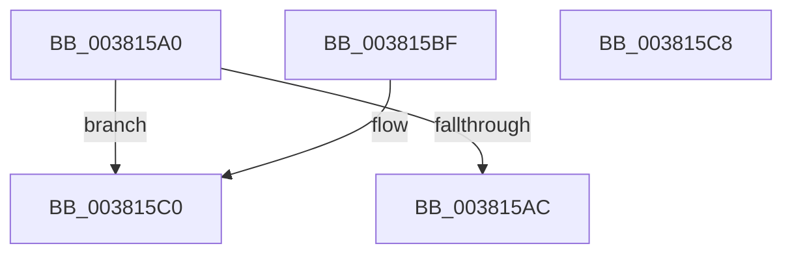

# MiGetVmAccessLoggingPartition

- RVA: `0x003815A0`–`0x003815C9` (길이 `41` bytes)
- VA: `0x00000001403815A0`
- 실행 섹션: `.text`
- PDB 이름 있음: `예`; PDB Function 태그: `아니요`
- unwind 정보 RVA: `0x000DB714`
- 디코드: `12`개 명령, `41/41` bytes 표시
- 미해석 바이트: `0` (있으면 어셈블리에 `.byte`로 보존)

> 이 문서는 커널 이미지의 기계어와 PDB 기호를 분석해 생성했습니다. 4번과 5번은 함수 원형과 자료형을 바이너리 사용 방식에서 추정한 C 해석이며 원본 소스 복구 결과는 아닙니다.

## 1. Dependencies

- 직접 호출 지점: **0**; 고유 호출 대상: **0**
- 직접 호출자로 확인된 함수: **9**
- RIP 상대 이미지 참조: **2**

### Outgoing calls
- 직접 디코드된 call 명령이 없습니다.

### Direct callers
- [MiResetAccessBitPteWorker](../22/MiResetAccessBitPteWorker_function_0022A6B8.md) at `0x0022A7D4`
- [MiDrainOldAccessBuffers](../2C/MiDrainOldAccessBuffers_function_002C0C30.md) at `0x002C0CC6`
- [MiCopyOnWrite](../36/MiCopyOnWrite_function_00362A0C.md) at `0x00363298`
- [MiAllocateAccessLog](../36/MiAllocateAccessLog_function_0036B04C.md) at `0x0036B06C`
- [MiIssueHardFault](MiIssueHardFault_function_00380074.md) at `0x0038045F`
- [MiDrainSystemAccessLog](../47/MiDrainSystemAccessLog_function_00474144.md) at `0x004741C0`
- [MiEmptyAccessLogs](../68/MiEmptyAccessLogs_function_00689FF0.md) at `0x0068A065`
- [sub_006E82CE](../6E/Unknown_function_006E82CE.md) at `0x006E836D`
- [MmDeleteProcessAddressSpace](../../page/AC/MmDeleteProcessAddressSpace_function_00AC804C.md) at `0x00AC81A9`

### Static image references
- `0x003815B3` → RVA `0x00E30088` (`.data`; read)
- `0x003815C0` → RVA `0x00E38D00` (`.data`; read)

## 2. Other-region calls and transfers

- 다른 실행 섹션으로 향하는 call: **0**
- 별도 외부 분기/꼬리 이동을 확인하지 못했습니다.

## 3. Assembly (complete function range)

```asm
003815A0  8B 81 B8 00 00 00               mov eax, dword ptr [rcx + 0xb8]
003815A6  24 0F                           and al, 0xf
003815A8  3C 01                           cmp al, 1
003815AA  74 14                           je 0x1403815c0
003815AC  0F B7 91 AE 00 00 00            movzx edx, word ptr [rcx + 0xae]
003815B3  48 8B 05 CE EA AA 00            mov rax, qword ptr [rip + 0xaaeace]
003815BA  48 8B 04 D0                     mov rax, qword ptr [rax + rdx*8]
003815BE  C3                              ret
003815BF  CC                              int3
003815C0  48 8D 05 39 77 AB 00            lea rax, [rip + 0xab7739]
003815C7  C3                              ret
003815C8  CC                              int3
```

## 4. C-style interpretation (structured pseudocode)

```c
__int64 __fastcall MiGetVmAccessLoggingPartition(__int64 a1)
{
    __int64 result;

    result = (unsigned __int8)(((unsigned int)(*(unsigned int *)(a1 + 184))) & (15));
    if (((unsigned __int8)(result)) == 1) goto loc_003815C0;
    return *(unsigned __int64 *)(*(unsigned __int64 *)(v_rip + 11201230) + *(unsigned __int16 *)(a1 + 174) * 8);
loc_003815C0:
    return v_rip + 11237177;
}
```

## 5. (Beta) C Style

```c
int64_t MiGetVmAccessLoggingPartition(void *Arg1)
{
    uint8_t *arg1 = (uint8_t *)Arg1;

    int64_t result;

    result = (uint8_t)(((uint32_t)(*(uint32_t *)(arg1 + 0xB8))) & (15));
    if (((uint8_t)(result)) == 1) goto loc_003815C0;
    return *(uint64_t *)(*(uint64_t *)(v_rip + 0xAAEACE) + *(uint16_t *)(arg1 + 0xAE) * 8);
loc_003815C0:
    return v_rip + 11237177;
}
```

### 관측된 메모리 오프셋

구조체 형식이 확인되지 않은 접근은 인자 기준의 오프셋으로만 기록했습니다.

| 기준 인자 | 오프셋 표현 | 폭 (bit) | 접근 |
|---|---:|---:|---|
| `Arg1` | `+ 0xAE` | `16` | `R` |
| `Arg1` | `+ 0xB8` | `32` | `R` |

## 6. Execution-region graph

[열기: 2D/3D 그래프와 함수 탐색 컨트롤 패널](../../../control-panel.html?section=text&rva=0x003815A0&view=graph)

- 2D 그래프는 위에서 아래로 흐르고, 3D 그래프는 빈 공간을 드래그해 회전합니다. Shift+드래그는 이동, 휠은 확대·축소, 함수 노드 선택은 대상 보고서 이동입니다.

### Static fallback


