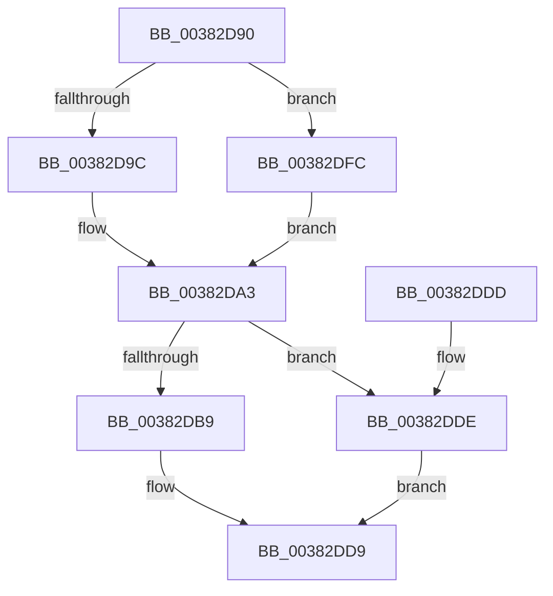

# MiIncreaseUsedPtesInPfn

- RVA: `0x00382D90`–`0x00382E06` (길이 `118` bytes)
- VA: `0x0000000140382D90`
- 실행 섹션: `.text`
- PDB 이름 있음: `예`; PDB Function 태그: `아니요`
- unwind 정보 RVA: `0x000DB714`
- 디코드: `34`개 명령, `118/118` bytes 표시
- 미해석 바이트: `0` (있으면 어셈블리에 `.byte`로 보존)

> 이 문서는 커널 이미지의 기계어와 PDB 기호를 분석해 생성했습니다. 4번과 5번은 함수 원형과 자료형을 바이너리 사용 방식에서 추정한 C 해석이며 원본 소스 복구 결과는 아닙니다.

## 1. Dependencies

- 직접 호출 지점: **0**; 고유 호출 대상: **0**
- 직접 호출자로 확인된 함수: **10**
- RIP 상대 이미지 참조: **0**

### Outgoing calls
- 직접 디코드된 call 명령이 없습니다.

### Direct callers
- [MiHandleForkTransitionPte](../22/MiHandleForkTransitionPte_function_0022D34C.md) at `0x0022D744`
- [MiBuildForkPte](../22/MiBuildForkPte_function_0022E32C.md) at `0x0022E736`
- [MiBuildForkPte](../22/MiBuildForkPte_function_0022E32C.md) at `0x0022E9A2`
- [MiBuildForkPte](../22/MiBuildForkPte_function_0022E32C.md) at `0x0022EE8D`
- [MiInitializePfn](../33/MiInitializePfn_function_00331E60.md) at `0x00332560`
- [MiDuplicateCloneLeaf](MiDuplicateCloneLeaf_function_003825F0.md) at `0x0038276F`
- [MiWriteUselessChildPte](MiWriteUselessChildPte_function_00382CFC.md) at `0x00382D31`
- [MiWriteSharedDemandZeroPte](../4A/MiWriteSharedDemandZeroPte_function_004A8DDC.md) at `0x004A8E65`
- [MiBuildForkPageTable](../4A/MiBuildForkPageTable_function_004ACF5C.md) at `0x004AD13A`
- [MiInitializeDummyPages](../../init/C6/MiInitializeDummyPages_function_00C605CC.md) at `0x00C606C1`
- [MxCreatePfnsForPtes](../../init/C6/MxCreatePfnsForPtes_function_00C635B0.md) at `0x00C637B6`
- [MiFillGapPtes](../../init/C6/MiFillGapPtes_function_00C65AC0.md) at `0x00C65BE1`

### Static image references
- 디코드된 RIP-relative 메모리 참조가 없습니다.

## 2. Other-region calls and transfers

- 다른 실행 섹션으로 향하는 call: **0**
- 별도 외부 분기/꼬리 이동을 확인하지 못했습니다.

## 3. Assembly (complete function range)

```asm
00382D90  8B 41 24                        mov eax, dword ptr [rcx + 0x24]
00382D93  4C 8B C9                        mov r9, rcx
00382D96  0F BA E0 1A                     bt eax, 0x1a
00382D9A  73 60                           jae 0x140382dfc
00382D9C  4C 8B 01                        mov r8, qword ptr [rcx]
00382D9F  49 C1 E8 20                     shr r8, 0x20
00382DA3  8B 41 24                        mov eax, dword ptr [rcx + 0x24]
00382DA6  41 81 E0 FF 03 00 00            and r8d, 0x3ff
00382DAD  44 03 C2                        add r8d, edx
00382DB0  0F BA E0 1A                     bt eax, 0x1a
00382DB4  45 8B D0                        mov r10d, r8d
00382DB7  73 25                           jae 0x140382dde
00382DB9  48 8B 01                        mov rax, qword ptr [rcx]
00382DBC  49 C1 E2 20                     shl r10, 0x20
00382DC0  49 8B CA                        mov rcx, r10
00382DC3  48 33 C8                        xor rcx, rax
00382DC6  48 B8 FF FF FF FF 00 FC FF FF   movabs rax, 0xfffffc00ffffffff
00382DD0  48 23 C8                        and rcx, rax
00382DD3  49 33 CA                        xor rcx, r10
00382DD6  49 89 09                        mov qword ptr [r9], rcx
00382DD9  41 8B C0                        mov eax, r8d
00382DDC  C3                              ret
00382DDD  CC                              int3
00382DDE  48 8B 49 10                     mov rcx, qword ptr [rcx + 0x10]
00382DE2  49 C1 E2 10                     shl r10, 0x10
00382DE6  49 8B D2                        mov rdx, r10
00382DE9  48 33 D1                        xor rdx, rcx
00382DEC  48 81 E2 FF FF 00 FC            and rdx, 0xfffffffffc00ffff
00382DF3  49 33 D2                        xor rdx, r10
00382DF6  49 89 51 10                     mov qword ptr [r9 + 0x10], rdx
00382DFA  EB DD                           jmp 0x140382dd9
00382DFC  4C 8B 41 10                     mov r8, qword ptr [rcx + 0x10]
00382E00  49 C1 E8 10                     shr r8, 0x10
00382E04  EB 9D                           jmp 0x140382da3
```

## 4. C-style interpretation (structured pseudocode)

```c
__int64 __fastcall MiIncreaseUsedPtesInPfn(__int64 a1, int a2)
{
    __int64 v_r10;

    if (condition_is_above_or_equal) goto loc_00382DFC;
    a3 = (*(unsigned __int64 *)(a1)) >> (32);
loc_00382DA3:
    a3 = (unsigned int)((a3) & (0x3FFULL));
    a3 = (unsigned int)((a3) + (a2));
    if (condition_is_above_or_equal) goto loc_00382DDE;
    v_r10 = ((unsigned int)((unsigned int)(a3))) << (32);
    a1 = (v_r10) ^ (*(unsigned __int64 *)(a1));
    a1 = (a1) & (*(unsigned __int64 *)(a1));
    a1 = (a1) ^ (v_r10);
    *(unsigned __int64 *)(a1) = a1;
loc_00382DD9:
    return (unsigned int)((unsigned int)(a3));
loc_00382DDE:
    v_r10 = (v_r10) << (16);
    a2 = (v_r10) ^ (*(unsigned __int64 *)(a1 + 16));
    a2 = (a2) & (0xFFFFFFFFFC00FFFFULL);
    a2 = (a2) ^ (v_r10);
    *(unsigned __int64 *)(a1 + 16) = a2;
    goto loc_00382DD9;
loc_00382DFC:
    a3 = (*(unsigned __int64 *)(*(unsigned __int64 *)(a1 + 16) + 16)) >> (16);
    goto loc_00382DA3;
}
```

## 5. (Beta) C Style

```c
int64_t MiIncreaseUsedPtesInPfn(void *Arg1, int32_t Arg2)
{
    uint8_t *arg1 = (uint8_t *)Arg1;

    int64_t local_r10;

    if (condition_is_above_or_equal) goto loc_00382DFC;
    a3 = (*(uint64_t *)(arg1)) >> (32);
loc_00382DA3:
    a3 = (uint32_t)((a3) & (0x3FFULL));
    a3 = (uint32_t)((a3) + (Arg2));
    if (condition_is_above_or_equal) goto loc_00382DDE;
    local_r10 = ((uint32_t)((uint32_t)(a3))) << (32);
    Arg1 = (local_r10) ^ (*(uint64_t *)(arg1));
    Arg1 = (Arg1) & (*(uint64_t *)(arg1));
    Arg1 = (Arg1) ^ (local_r10);
    *(void **)(arg1) = Arg1;
loc_00382DD9:
    return (uint32_t)((uint32_t)(a3));
loc_00382DDE:
    local_r10 = (local_r10) << (16);
    Arg2 = (local_r10) ^ (*(uint64_t *)(arg1 + 0x10));
    Arg2 = (Arg2) & (0xFFFFFFFFFC00FFFFULL);
    Arg2 = (Arg2) ^ (local_r10);
    *(uint64_t *)(arg1 + 0x10) = Arg2;
    goto loc_00382DD9;
loc_00382DFC:
    a3 = (*(uint64_t *)(*(uint64_t *)(arg1 + 0x10) + 0x10)) >> (16);
    goto loc_00382DA3;
}
```

### 관측된 메모리 오프셋

구조체 형식이 확인되지 않은 접근은 인자 기준의 오프셋으로만 기록했습니다.

| 기준 인자 | 오프셋 표현 | 폭 (bit) | 접근 |
|---|---:|---:|---|
| `Arg1` | `+ 0x0` | `64` | `R` |
| `Arg1` | `+ 0x0` | `64` | `W` |
| `Arg1` | `+ 0x10` | `64` | `R` |
| `Arg1` | `+ 0x10` | `64` | `W` |
| `Arg1` | `+ 0x24` | `32` | `R` |

## 6. Execution-region graph

[열기: 2D/3D 그래프와 함수 탐색 컨트롤 패널](../../../control-panel.html?section=text&rva=0x00382D90&view=graph)

- 2D 그래프는 위에서 아래로 흐르고, 3D 그래프는 빈 공간을 드래그해 회전합니다. Shift+드래그는 이동, 휠은 확대·축소, 함수 노드 선택은 대상 보고서 이동입니다.

### Static fallback


