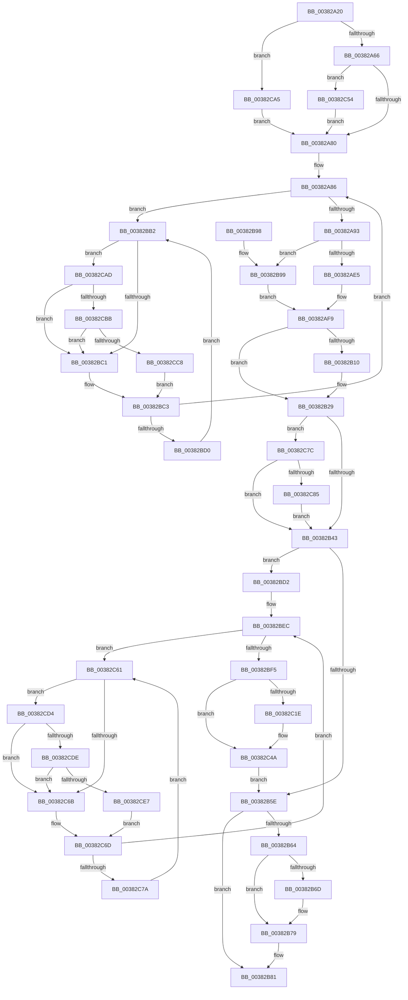

# MiInitializePfnForOtherProcess

- RVA: `0x00382A20`–`0x00382CF3` (길이 `723` bytes)
- VA: `0x0000000140382A20`
- 실행 섹션: `.text`
- PDB 이름 있음: `예`; PDB Function 태그: `아니요`
- unwind 정보 RVA: `0x0007BB2C`
- 디코드: `178`개 명령, `723/723` bytes 표시
- 미해석 바이트: `0` (있으면 어셈블리에 `.byte`로 보존)

> 이 문서는 커널 이미지의 기계어와 PDB 기호를 분석해 생성했습니다. 4번과 5번은 함수 원형과 자료형을 바이너리 사용 방식에서 추정한 C 해석이며 원본 소스 복구 결과는 아닙니다.

## 1. Dependencies

- 직접 호출 지점: **10**; 고유 호출 대상: **8**
- 직접 호출자로 확인된 함수: **7**
- RIP 상대 이미지 참조: **3**

### Outgoing calls
- `0x00382AB1` → [MiMakeDemandZeroPte](../33/MiMakeDemandZeroPte_function_00337A00.md) (function, `0x00337A00`)
- `0x00382AFF` → [MiSetPfnModified](../36/MiSetPfnModified_function_00362960.md) (function, `0x00362960`)
- `0x00382B2F` → [MiSetPfnContainingFrame](../36/MiSetPfnContainingFrame_function_00363FC0.md) (function, `0x00363FC0`)
- `0x00382B74` → [KiLowerIrqlProcessIrqlFlags](../4F/KiLowerIrqlProcessIrqlFlags_function_004F5698.md) (function, `0x004F5698`)
- `0x00382C45` → [MiIncreaseUsedPtes](../24/MiIncreaseUsedPtes_function_00243630.md) (function, `0x00243630`)
- `0x00382C57` → [KiRaiseIrqlProcessIrqlFlags](../4F/KiRaiseIrqlProcessIrqlFlags_function_004F56FC.md) (function, `0x004F56FC`)
- `0x00382CBB` → [KiCheckVpBackingLongSpinWaitHypercall](../30/KiCheckVpBackingLongSpinWaitHypercall_function_0030F490.md) (function, `0x0030F490`)
- `0x00382CCA` → [HvlNotifyLongSpinWait](../30/HvlNotifyLongSpinWait_function_0030F460.md) (function, `0x0030F460`)
- `0x00382CDE` → [KiCheckVpBackingLongSpinWaitHypercall](../30/KiCheckVpBackingLongSpinWaitHypercall_function_0030F490.md) (function, `0x0030F490`)
- `0x00382CE9` → [HvlNotifyLongSpinWait](../30/HvlNotifyLongSpinWait_function_0030F460.md) (function, `0x0030F460`)

### Direct callers
- [MiDuplicateCloneLeaf](MiDuplicateCloneLeaf_function_003825F0.md) at `0x003827B1`
- [MiMakeOutswappedPageResident](../43/MiMakeOutswappedPageResident_function_00431AD0.md) at `0x00431DD7`
- [MiInitializeSystemPageTable](../45/MiInitializeSystemPageTable_function_00451C88.md) at `0x00451E06`
- [MiMapPageFileHash](../49/MiMapPageFileHash_function_004921E0.md) at `0x00492587`
- [MiDemoteValidLargePageOneLevel](../68/MiDemoteValidLargePageOneLevel_function_0068A3F4.md) at `0x0068A725`
- [MiInitializeShadowPageTable](../../page/80/MiInitializeShadowPageTable_function_0080778C.md) at `0x00807941`
- [MiAllocateTopLevelPage](../../page/A5/MiAllocateTopLevelPage_function_00A5F2EC.md) at `0x00A5F3D9`

### Static image references
- `0x00382A73` → RVA `0x00FC6D20` (`ALMOSTRO`; read)
- `0x00382BB5` → RVA `0x00FC52AC` (`ALMOSTRO`; reference)
- `0x00382CAD` → RVA `0x00FC6AB8` (`ALMOSTRO`; read)

## 2. Other-region calls and transfers

- 다른 실행 섹션으로 향하는 call: **0**
- 별도 외부 분기/꼬리 이동을 확인하지 못했습니다.

## 3. Assembly (complete function range)

```asm
00382A20  48 89 5C 24 08                  mov qword ptr [rsp + 8], rbx
00382A25  48 89 6C 24 10                  mov qword ptr [rsp + 0x10], rbp
00382A2A  4C 89 44 24 18                  mov qword ptr [rsp + 0x18], r8
00382A2F  56                              push rsi
00382A30  57                              push rdi
00382A31  41 54                           push r12
00382A33  41 56                           push r14
00382A35  41 57                           push r15
00382A37  48 83 EC 20                     sub rsp, 0x20
00382A3B  48 8D 1C 49                     lea rbx, [rcx + rcx*2]
00382A3F  48 B8 00 00 00 00 00 DE FF FF   movabs rax, 0xffffde0000000000
00382A49  48 C1 E3 04                     shl rbx, 4
00382A4D  45 8B F1                        mov r14d, r9d
00382A50  48 8B F2                        mov rsi, rdx
00382A53  4C 8B E1                        mov r12, rcx
00382A56  48 8B C0                        mov rax, rax
00382A59  48 03 D8                        add rbx, rax
00382A5C  41 F6 C1 10                     test r9b, 0x10
00382A60  0F 85 3F 02 00 00               jne 0x140382ca5
00382A66  44 0F 20 C7                     mov rdi, cr8
00382A6A  BA 02 00 00 00                  mov edx, 2
00382A6F  44 0F 22 C2                     mov cr8, rdx
00382A73  83 3D A6 42 C4 00 00            cmp dword ptr [rip + 0xc442a6], 0
00382A7A  0F 85 D4 01 00 00               jne 0x140382c54
00382A80  33 ED                           xor ebp, ebp
00382A82  44 8D 7D 01                     lea r15d, [rbp + 1]
00382A86  F0 48 0F BA 6B 18 3F            lock bts qword ptr [rbx + 0x18], 0x3f
00382A8D  0F 82 1F 01 00 00               jb 0x140382bb2
00382A93  48 B9 FF FF FF FF FF FF FF C7   movabs rcx, 0xc7ffffffffffffff
00382A9D  48 89 73 08                     mov qword ptr [rbx + 8], rsi
00382AA1  48 8B 43 18                     mov rax, qword ptr [rbx + 0x18]
00382AA5  48 23 C1                        and rax, rcx
00382AA8  B9 04 00 00 00                  mov ecx, 4
00382AAD  48 89 43 18                     mov qword ptr [rbx + 0x18], rax
00382AB1  E8 4A 4F FB FF                  call 0x140337a00
00382AB6  48 89 43 10                     mov qword ptr [rbx + 0x10], rax
00382ABA  48 BD 00 00 00 00 00 00 00 C0   movabs rbp, 0xc000000000000000
00382AC4  8B 43 20                        mov eax, dword ptr [rbx + 0x20]
00382AC7  89 44 24 68                     mov dword ptr [rsp + 0x68], eax
00382ACB  66 44 89 7C 24 68               mov word ptr [rsp + 0x68], r15w
00382AD1  8B 44 24 68                     mov eax, dword ptr [rsp + 0x68]
00382AD5  89 43 20                        mov dword ptr [rbx + 0x20], eax
00382AD8  48 8B 43 18                     mov rax, qword ptr [rbx + 0x18]
00382ADC  45 84 F6                        test r14b, r14b
00382ADF  0F 88 B4 00 00 00               js 0x140382b99
00382AE5  48 B9 01 00 00 00 00 00 00 C0   movabs rcx, 0xc000000000000001
00382AEF  48 23 C1                        and rax, rcx
00382AF2  49 0B C7                        or rax, r15
00382AF5  48 89 43 18                     mov qword ptr [rbx + 0x18], rax
00382AF9  41 8B D7                        mov edx, r15d
00382AFC  48 8B CB                        mov rcx, rbx
00382AFF  E8 5C FE FD FF                  call 0x140362960
00382B04  4C 8B 7C 24 60                  mov r15, qword ptr [rsp + 0x60]
00382B09  41 0F BA E6 09                  bt r14d, 9
00382B0E  73 19                           jae 0x140382b29
00382B10  8B 43 20                        mov eax, dword ptr [rbx + 0x20]
00382B13  89 44 24 68                     mov dword ptr [rsp + 0x68], eax
00382B17  C1 E8 10                        shr eax, 0x10
00382B1A  24 FE                           and al, 0xfe
00382B1C  0C 06                           or al, 6
00382B1E  88 44 24 6A                     mov byte ptr [rsp + 0x6a], al
00382B22  8B 44 24 68                     mov eax, dword ptr [rsp + 0x68]
00382B26  89 43 20                        mov dword ptr [rbx + 0x20], eax
00382B29  49 8B D7                        mov rdx, r15
00382B2C  48 8B CB                        mov rcx, rbx
00382B2F  E8 8C 14 FE FF                  call 0x140363fc0
00382B34  41 B8 00 08 00 00               mov r8d, 0x800
00382B3A  4D 3B FC                        cmp r15, r12
00382B3D  0F 84 39 01 00 00               je 0x140382c7c
00382B43  C7 43 24 00 00 00 00            mov dword ptr [rbx + 0x24], 0
00382B4A  49 BC FF FF FF FF FF FF FF 7F   movabs r12, 0x7fffffffffffffff
00382B54  F0 4C 21 63 18                  lock and qword ptr [rbx + 0x18], r12
00382B59  45 85 F0                        test r8d, r14d
00382B5C  74 74                           je 0x140382bd2
00382B5E  40 80 FF 11                     cmp dil, 0x11
00382B62  74 1D                           je 0x140382b81
00382B64  83 3D B5 41 C4 00 00            cmp dword ptr [rip + 0xc441b5], 0
00382B6B  74 0C                           je 0x140382b79
00382B6D  44 0F 20 C1                     mov rcx, cr8
00382B71  40 8A D7                        mov dl, dil
00382B74  E8 1F 2B 17 00                  call 0x1404f5698
00382B79  40 0F B6 C7                     movzx eax, dil
00382B7D  44 0F 22 C0                     mov cr8, rax
00382B81  48 8B 5C 24 50                  mov rbx, qword ptr [rsp + 0x50]
00382B86  48 8B 6C 24 58                  mov rbp, qword ptr [rsp + 0x58]
00382B8B  48 83 C4 20                     add rsp, 0x20
00382B8F  41 5F                           pop r15
00382B91  41 5E                           pop r14
00382B93  41 5C                           pop r12
00382B95  5F                              pop rdi
00382B96  5E                              pop rsi
00382B97  C3                              ret
00382B98  CC                              int3
00382B99  48 8D 48 01                     lea rcx, [rax + 1]
00382B9D  48 8B D1                        mov rdx, rcx
00382BA0  48 33 D0                        xor rdx, rax
00382BA3  48 23 D5                        and rdx, rbp
00382BA6  48 33 D1                        xor rdx, rcx
00382BA9  48 89 53 18                     mov qword ptr [rbx + 0x18], rdx
00382BAD  E9 47 FF FF FF                  jmp 0x140382af9
00382BB2  41 03 EF                        add ebp, r15d
00382BB5  85 2D F1 26 C4 00               test dword ptr [rip + 0xc426f1], ebp
00382BBB  0F 84 EC 00 00 00               je 0x140382cad
00382BC1  F3 90                           pause
00382BC3  48 8B 43 18                     mov rax, qword ptr [rbx + 0x18]
00382BC7  48 85 C0                        test rax, rax
00382BCA  0F 89 B6 FE FF FF               jns 0x140382a86
00382BD0  EB E0                           jmp 0x140382bb2
00382BD2  4B 8D 1C 7F                     lea rbx, [r15 + r15*2]
00382BD6  48 B8 00 00 00 00 00 DE FF FF   movabs rax, 0xffffde0000000000
00382BE0  48 C1 E3 04                     shl rbx, 4
00382BE4  48 8B C0                        mov rax, rax
00382BE7  48 03 D8                        add rbx, rax
00382BEA  33 ED                           xor ebp, ebp
00382BEC  F0 48 0F BA 6B 18 3F            lock bts qword ptr [rbx + 0x18], 0x3f
00382BF3  72 6C                           jb 0x140382c61
00382BF5  48 8B 43 18                     mov rax, qword ptr [rbx + 0x18]
00382BF9  48 8D 48 01                     lea rcx, [rax + 1]
00382BFD  48 8B D1                        mov rdx, rcx
00382C00  48 33 D0                        xor rdx, rax
00382C03  48 B8 00 00 00 00 00 00 00 C0   movabs rax, 0xc000000000000000
00382C0D  48 23 D0                        and rdx, rax
00382C10  48 33 D1                        xor rdx, rcx
00382C13  48 89 53 18                     mov qword ptr [rbx + 0x18], rdx
00382C17  41 0F BA E6 0C                  bt r14d, 0xc
00382C1C  73 2C                           jae 0x140382c4a
00382C1E  48 C1 EE 09                     shr rsi, 9
00382C22  48 BA F8 FF FF FF 7F 00 00 00   movabs rdx, 0x7ffffffff8
00382C2C  48 23 D6                        and rdx, rsi
00382C2F  48 B8 00 00 00 00 80 F6 FF FF   movabs rax, 0xfffff68000000000
00382C39  41 B9 01 00 00 00               mov r9d, 1
00382C3F  48 03 D0                        add rdx, rax
00382C42  45 8B C1                        mov r8d, r9d
00382C45  E8 E6 09 EC FF                  call 0x140243630
00382C4A  F0 4C 21 63 18                  lock and qword ptr [rbx + 0x18], r12
00382C4F  E9 0A FF FF FF                  jmp 0x140382b5e
00382C54  40 8A CF                        mov cl, dil
00382C57  E8 A0 2A 17 00                  call 0x1404f56fc
00382C5C  E9 1F FE FF FF                  jmp 0x140382a80
00382C61  FF C5                           inc ebp
00382C63  85 2D 43 26 C4 00               test dword ptr [rip + 0xc42643], ebp
00382C69  74 69                           je 0x140382cd4
00382C6B  F3 90                           pause
00382C6D  48 8B 43 18                     mov rax, qword ptr [rbx + 0x18]
00382C71  48 85 C0                        test rax, rax
00382C74  0F 89 72 FF FF FF               jns 0x140382bec
00382C7A  EB E5                           jmp 0x140382c61
00382C7C  45 85 F0                        test r8d, r14d
00382C7F  0F 85 BE FE FF FF               jne 0x140382b43
00382C85  48 8B 43 18                     mov rax, qword ptr [rbx + 0x18]
00382C89  48 8D 48 01                     lea rcx, [rax + 1]
00382C8D  48 8B D1                        mov rdx, rcx
00382C90  48 33 D0                        xor rdx, rax
00382C93  48 23 D5                        and rdx, rbp
00382C96  48 33 D1                        xor rdx, rcx
00382C99  48 89 53 18                     mov qword ptr [rbx + 0x18], rdx
00382C9D  45 0B F0                        or r14d, r8d
00382CA0  E9 9E FE FF FF                  jmp 0x140382b43
00382CA5  40 B7 11                        mov dil, 0x11
00382CA8  E9 D3 FD FF FF                  jmp 0x140382a80
00382CAD  8B 05 05 3E C4 00               mov eax, dword ptr [rip + 0xc43e05]
00382CB3  A8 40                           test al, 0x40
00382CB5  0F 84 06 FF FF FF               je 0x140382bc1
00382CBB  E8 D0 C7 F8 FF                  call 0x14030f490
00382CC0  84 C0                           test al, al
00382CC2  0F 84 F9 FE FF FF               je 0x140382bc1
00382CC8  8B CD                           mov ecx, ebp
00382CCA  E8 91 C7 F8 FF                  call 0x14030f460
00382CCF  E9 EF FE FF FF                  jmp 0x140382bc3
00382CD4  8B 05 DE 3D C4 00               mov eax, dword ptr [rip + 0xc43dde]
00382CDA  A8 40                           test al, 0x40
00382CDC  74 8D                           je 0x140382c6b
00382CDE  E8 AD C7 F8 FF                  call 0x14030f490
00382CE3  84 C0                           test al, al
00382CE5  74 84                           je 0x140382c6b
00382CE7  8B CD                           mov ecx, ebp
00382CE9  E8 72 C7 F8 FF                  call 0x14030f460
00382CEE  E9 7A FF FF FF                  jmp 0x140382c6d
```

## 4. C-style interpretation (structured pseudocode)

```c
__int64 __fastcall MiInitializePfnForOtherProcess(__int64 a1, __int64 a2, __int64 a3, int a4)
{
    __int64 result;
    __int64 v_r14;
    __int64 v_rbp;
    __int64 v_rbx;
    __int64 v_rsi;
    __int64 v_rsp;
    unsigned __int64 v_stack_p10;
    unsigned __int64 v_stack_p18;
    unsigned int v_stack_p20;
    unsigned __int8 v_stack_p22;
    unsigned __int64 v_stack_p8;

    v_stack_p8 = v_rbx;
    v_stack_p10 = v_rbp;
    v_stack_p18 = a3;
    v_rsp = (v_rsp) - (32);
    v_rbx = (a1 + a1 * 2) << (4);
    v_rbx = (v_rbx) + (result);
    if ((((unsigned __int8)(a4)) & (16)) != 0) goto loc_00382CA5;
    if ((*(unsigned int *)(v_rip + 12862118)) != 0) goto loc_00382C54;
loc_00382A80:
    v_rbp = 0;
loc_00382A86:
    if (condition_is_below) goto loc_00382BB2;
    *(unsigned __int64 *)(v_rbx + 8) = a2;
    result = (*(unsigned __int64 *)(v_rbx + 24)) & (a1);
    *(unsigned __int64 *)(v_rbx + 24) = result;
    result = MiMakeDemandZeroPte(4, 2, a3, a4);
    *(unsigned __int64 *)(v_rbx + 16) = result;
    v_stack_p20 = (unsigned int)((unsigned int)(*(unsigned int *)(v_rbx + 32)));
    v_stack_p20 = (unsigned __int16)(v_rbp + 1);
    *(unsigned int *)(v_rbx + 32) = (unsigned int)((unsigned int)(v_stack_p20));
    if (sign_flag) goto loc_00382B99;
    result = (*(unsigned __int64 *)(v_rbx + 24)) & (4);
    result = (result) | (v_rbp + 1);
    *(unsigned __int64 *)(v_rbx + 24) = result;
loc_00382AF9:
    result = MiSetPfnModified(v_rbx, (unsigned int)((unsigned int)(v_rbp + 1)), a3, a4);
    if (!(condition_is_above_or_equal)) {
        result = *(unsigned int *)(v_rbx + 32);
        v_stack_p20 = (unsigned int)(result);
        result = (unsigned int)((result) >> (16));
        result = (unsigned __int8)((result) & (254));
        result = (unsigned __int8)((result) | (6));
        v_stack_p22 = (unsigned __int8)(result);
        result = v_stack_p20;
        *(unsigned int *)(v_rbx + 32) = (unsigned int)(result);
    }
    result = MiSetPfnContainingFrame(v_rbx, v_stack_p18, a3, a4);
    if (v_stack_p18 == a1) goto loc_00382C7C;
loc_00382B43:
    *(unsigned int *)(v_rbx + 36) = 0;
    if ((((unsigned int)((unsigned int)(0x800ULL))) & ((unsigned int)((unsigned int)(a4)))) == 0) goto loc_00382BD2;
loc_00382B5E:
    if (((unsigned __int8)(v_cr8)) == 17) goto loc_00382B81;
    if ((*(unsigned int *)(v_rip + 12861877)) != 0) {
        a1 = 2;
        a2 = (unsigned __int8)(v_cr8);
        result = KiLowerIrqlProcessIrqlFlags(a1, a2, (unsigned int)(0x800ULL), a4);
    }
loc_00382B81:
    v_rsp = (v_rsp) + (32);
    return (unsigned __int8)(v_cr8);
loc_00382B99:
    a2 = ((unsigned __int8)(v_cr8) + 1) ^ ((unsigned __int8)(v_cr8));
    a2 = (a2) & (v_stack_p10);
    a2 = (a2) ^ ((unsigned __int8)(v_cr8) + 1);
    *(unsigned __int64 *)(v_stack_p8 + 24) = a2;
    goto loc_00382AF9;
loc_00382BB2:
    v_rbp = (unsigned int)((v_stack_p10) + ((unsigned int)(v_stack_p18)));
    if (((*(unsigned int *)(v_rip + 12855025)) & ((unsigned int)(v_rbp))) == 0) goto loc_00382CAD;
loc_00382BC1:
loc_00382BC3:
    if (!sign_flag) goto loc_00382A86;
    goto loc_00382BB2;
loc_00382BD2:
    v_rbx = (v_stack_p18 + v_stack_p18 * 2) << (4);
    v_rbx = (v_rbx) + (*(unsigned __int64 *)(v_stack_p8 + 24));
    v_rbp = 0;
loc_00382BEC:
    if (condition_is_below) goto loc_00382C61;
    a2 = (*(unsigned __int64 *)(v_rbx + 24) + 1) ^ (*(unsigned __int64 *)(v_rbx + 24));
    a2 = (a2) & (*(unsigned __int64 *)(v_rbx + 24));
    a2 = (a2) ^ (*(unsigned __int64 *)(v_rbx + 24) + 1);
    *(unsigned __int64 *)(v_rbx + 24) = a2;
    result = *(unsigned __int64 *)(v_rbx + 24);
    v_rsi = a2;
    if (!(condition_is_above_or_equal)) {
        v_rsi = (a2) >> (9);
        a2 = (a2) & (v_rsi);
        a4 = 1;
        a2 = (a2) + (*(unsigned __int64 *)(v_rbx + 24));
        a3 = a4;
        result = MiIncreaseUsedPtes(*(unsigned __int64 *)(v_rbx + 24) + 1, a2, a3, a4);
    }
    goto loc_00382B5E;
loc_00382C54:
    result = KiRaiseIrqlProcessIrqlFlags((unsigned __int8)(v_cr8), a2, a3, a4);
    goto loc_00382A80;
loc_00382C61:
    v_rbp = (unsigned int)((v_rbp) + 1);
    if (((*(unsigned int *)(v_rip + 12854851)) & ((unsigned int)(v_rbp))) == 0) goto loc_00382CD4;
loc_00382C6B:
loc_00382C6D:
    if (!sign_flag) goto loc_00382BEC;
    goto loc_00382C61;
loc_00382C7C:
    if ((((unsigned int)(a3)) & ((unsigned int)((unsigned int)(a4)))) != 0) goto loc_00382B43;
    a2 = (*(unsigned __int64 *)(v_rbx + 24) + 1) ^ (*(unsigned __int64 *)(v_rbx + 24));
    a2 = (a2) & (v_rbp);
    a2 = (a2) ^ (*(unsigned __int64 *)(v_rbx + 24) + 1);
    *(unsigned __int64 *)(v_rbx + 24) = a2;
    v_r14 = (unsigned int)(((unsigned int)(a4)) | ((unsigned int)(a3)));
    goto loc_00382B43;
loc_00382CA5:
    goto loc_00382A80;
loc_00382CAD:
    if ((((unsigned __int8)((unsigned int)(*(unsigned int *)(v_rip + 12860933)))) & (64)) == 0) goto loc_00382BC1;
    result = KiCheckVpBackingLongSpinWaitHypercall(*(unsigned __int64 *)(v_rbx + 24) + 1, a2, a3, a4);
    if ((unsigned __int8)(result) == 0) goto loc_00382BC1;
    result = HvlNotifyLongSpinWait((unsigned int)((unsigned int)(v_rbp)), a2, a3, a4);
    goto loc_00382BC3;
loc_00382CD4:
    if ((((unsigned __int8)((unsigned int)(*(unsigned int *)(v_rip + 12860894)))) & (64)) == 0) goto loc_00382C6B;
    result = KiCheckVpBackingLongSpinWaitHypercall((unsigned int)((unsigned int)(v_rbp)), a2, a3, a4);
    if ((unsigned __int8)(result) == 0) goto loc_00382C6B;
    result = HvlNotifyLongSpinWait((unsigned int)((unsigned int)(v_rbp)), a2, a3, a4);
    goto loc_00382C6D;
}
```

## 5. (Beta) C Style

```c
int64_t MiInitializePfnForOtherProcess(void *Arg1, int64_t Arg2, int64_t Arg3, int32_t Arg4)
{
    uint8_t *arg1 = (uint8_t *)Arg1;

    int64_t result;
    int64_t local_r14;
    int64_t local_rbp;
    int64_t local_rbx;
    int64_t local_rsi;
    int64_t local_rsp;
    uint64_t v_stack_p10;
    uint64_t v_stack_p18;
    uint32_t v_stack_p20;
    uint8_t v_stack_p22;
    uint64_t v_stack_p8;

    v_stack_p8 = local_rbx;
    v_stack_p10 = local_rbp;
    v_stack_p18 = Arg3;
    local_rsp = (local_rsp) - (32);
    local_rbx = (Arg1 + Arg1 * 2) << (4);
    local_rbx = (local_rbx) + (result);
    if ((((uint8_t)(Arg4)) & (16)) != 0) goto loc_00382CA5;
    if ((*(uint32_t *)(v_rip + 0xC442A6)) != 0) goto loc_00382C54;
loc_00382A80:
    local_rbp = 0;
loc_00382A86:
    if (condition_is_below) goto loc_00382BB2;
    *(uint64_t *)(local_rbx + 0x8) = Arg2;
    result = (*(uint64_t *)(local_rbx + 0x18)) & (Arg1);
    *(uint64_t *)(local_rbx + 0x18) = result;
    result = MiMakeDemandZeroPte(4, 2, Arg3, Arg4);
    *(uint64_t *)(local_rbx + 0x10) = result;
    v_stack_p20 = (uint32_t)((uint32_t)(*(uint32_t *)(local_rbx + 0x20)));
    v_stack_p20 = (uint16_t)(local_rbp + 1);
    *(uint32_t *)(local_rbx + 0x20) = (uint32_t)((uint32_t)(v_stack_p20));
    if (sign_flag) goto loc_00382B99;
    result = (*(uint64_t *)(local_rbx + 0x18)) & (4);
    result = (result) | (local_rbp + 1);
    *(uint64_t *)(local_rbx + 0x18) = result;
loc_00382AF9:
    result = MiSetPfnModified(local_rbx, (uint32_t)((uint32_t)(local_rbp + 1)), Arg3, Arg4);
    if (!(condition_is_above_or_equal)) {
        result = *(uint32_t *)(local_rbx + 0x20);
        v_stack_p20 = (uint32_t)(result);
        result = (uint32_t)((result) >> (16));
        result = (uint8_t)((result) & (254));
        result = (uint8_t)((result) | (6));
        v_stack_p22 = (uint8_t)(result);
        result = v_stack_p20;
        *(uint32_t *)(local_rbx + 0x20) = (uint32_t)(result);
    }
    result = MiSetPfnContainingFrame(local_rbx, v_stack_p18, Arg3, Arg4);
    if (v_stack_p18 == Arg1) goto loc_00382C7C;
loc_00382B43:
    *(uint32_t *)(local_rbx + 0x24) = 0;
    if ((((uint32_t)((uint32_t)(0x800ULL))) & ((uint32_t)((uint32_t)(Arg4)))) == 0) goto loc_00382BD2;
loc_00382B5E:
    if (((uint8_t)(v_cr8)) == 17) goto loc_00382B81;
    if ((*(uint32_t *)(v_rip + 0xC441B5)) != 0) {
        Arg1 = 2;
        Arg2 = (uint8_t)(v_cr8);
        result = KiLowerIrqlProcessIrqlFlags(Arg1, Arg2, (uint32_t)(0x800ULL), Arg4);
    }
loc_00382B81:
    local_rsp = (local_rsp) + (32);
    return (uint8_t)(v_cr8);
loc_00382B99:
    Arg2 = ((uint8_t)(v_cr8) + 1) ^ ((uint8_t)(v_cr8));
    Arg2 = (Arg2) & (v_stack_p10);
    Arg2 = (Arg2) ^ ((uint8_t)(v_cr8) + 1);
    *(uint64_t *)(v_stack_p8 + 0x18) = Arg2;
    goto loc_00382AF9;
loc_00382BB2:
    local_rbp = (uint32_t)((v_stack_p10) + ((uint32_t)(v_stack_p18)));
    if (((*(uint32_t *)(v_rip + 0xC426F1)) & ((uint32_t)(local_rbp))) == 0) goto loc_00382CAD;
loc_00382BC1:
loc_00382BC3:
    if (!sign_flag) goto loc_00382A86;
    goto loc_00382BB2;
loc_00382BD2:
    local_rbx = (v_stack_p18 + v_stack_p18 * 2) << (4);
    local_rbx = (local_rbx) + (*(uint64_t *)(v_stack_p8 + 0x18));
    local_rbp = 0;
loc_00382BEC:
    if (condition_is_below) goto loc_00382C61;
    Arg2 = (*(uint64_t *)(local_rbx + 0x18) + 1) ^ (*(uint64_t *)(local_rbx + 0x18));
    Arg2 = (Arg2) & (*(uint64_t *)(local_rbx + 0x18));
    Arg2 = (Arg2) ^ (*(uint64_t *)(local_rbx + 0x18) + 1);
    *(uint64_t *)(local_rbx + 0x18) = Arg2;
    result = *(uint64_t *)(local_rbx + 0x18);
    local_rsi = Arg2;
    if (!(condition_is_above_or_equal)) {
        local_rsi = (Arg2) >> (9);
        Arg2 = (Arg2) & (local_rsi);
        Arg4 = 1;
        Arg2 = (Arg2) + (*(uint64_t *)(local_rbx + 0x18));
        Arg3 = Arg4;
        result = MiIncreaseUsedPtes(*(uint64_t *)(local_rbx + 0x18) + 1, Arg2, Arg3, Arg4);
    }
    goto loc_00382B5E;
loc_00382C54:
    result = KiRaiseIrqlProcessIrqlFlags((uint8_t)(v_cr8), Arg2, Arg3, Arg4);
    goto loc_00382A80;
loc_00382C61:
    local_rbp = (uint32_t)((local_rbp) + 1);
    if (((*(uint32_t *)(v_rip + 0xC42643)) & ((uint32_t)(local_rbp))) == 0) goto loc_00382CD4;
loc_00382C6B:
loc_00382C6D:
    if (!sign_flag) goto loc_00382BEC;
    goto loc_00382C61;
loc_00382C7C:
    if ((((uint32_t)(Arg3)) & ((uint32_t)((uint32_t)(Arg4)))) != 0) goto loc_00382B43;
    Arg2 = (*(uint64_t *)(local_rbx + 0x18) + 1) ^ (*(uint64_t *)(local_rbx + 0x18));
    Arg2 = (Arg2) & (local_rbp);
    Arg2 = (Arg2) ^ (*(uint64_t *)(local_rbx + 0x18) + 1);
    *(uint64_t *)(local_rbx + 0x18) = Arg2;
    local_r14 = (uint32_t)(((uint32_t)(Arg4)) | ((uint32_t)(Arg3)));
    goto loc_00382B43;
loc_00382CA5:
    goto loc_00382A80;
loc_00382CAD:
    if ((((uint8_t)((uint32_t)(*(uint32_t *)(v_rip + 0xC43E05)))) & (64)) == 0) goto loc_00382BC1;
    result = KiCheckVpBackingLongSpinWaitHypercall(*(uint64_t *)(local_rbx + 0x18) + 1, Arg2, Arg3, Arg4);
    if ((uint8_t)(result) == 0) goto loc_00382BC1;
    result = HvlNotifyLongSpinWait((uint32_t)((uint32_t)(local_rbp)), Arg2, Arg3, Arg4);
    goto loc_00382BC3;
loc_00382CD4:
    if ((((uint8_t)((uint32_t)(*(uint32_t *)(v_rip + 0xC43DDE)))) & (64)) == 0) goto loc_00382C6B;
    result = KiCheckVpBackingLongSpinWaitHypercall((uint32_t)((uint32_t)(local_rbp)), Arg2, Arg3, Arg4);
    if ((uint8_t)(result) == 0) goto loc_00382C6B;
    result = HvlNotifyLongSpinWait((uint32_t)((uint32_t)(local_rbp)), Arg2, Arg3, Arg4);
    goto loc_00382C6D;
}
```

### 관측된 메모리 오프셋

구조체 형식이 확인되지 않은 접근은 인자 기준의 오프셋으로만 기록했습니다.

| 기준 인자 | 오프셋 표현 | 폭 (bit) | 접근 |
|---|---:|---:|---|
| `Arg1` | `+ 0x0 + rcx*2` | `64` | `R` |

## 6. Execution-region graph

[열기: 2D/3D 그래프와 함수 탐색 컨트롤 패널](../../../control-panel.html?section=text&rva=0x00382A20&view=graph)

- 2D 그래프는 위에서 아래로 흐르고, 3D 그래프는 빈 공간을 드래그해 회전합니다. Shift+드래그는 이동, 휠은 확대·축소, 함수 노드 선택은 대상 보고서 이동입니다.

### Static fallback


